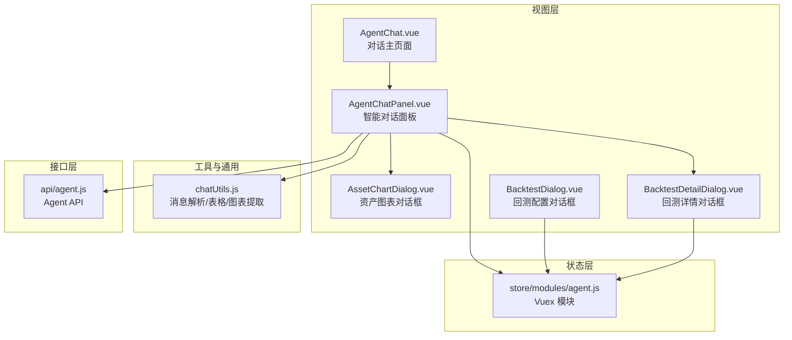
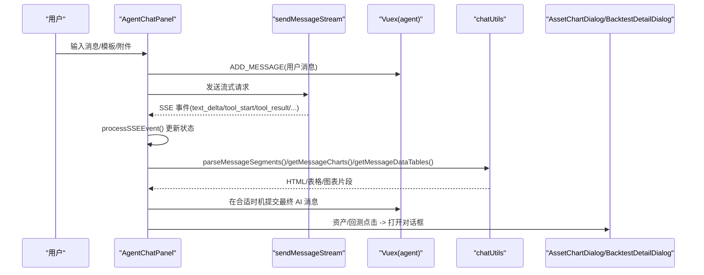
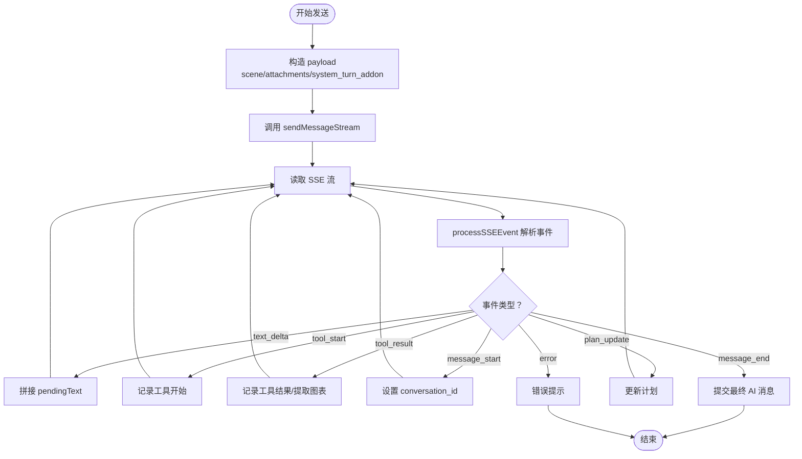
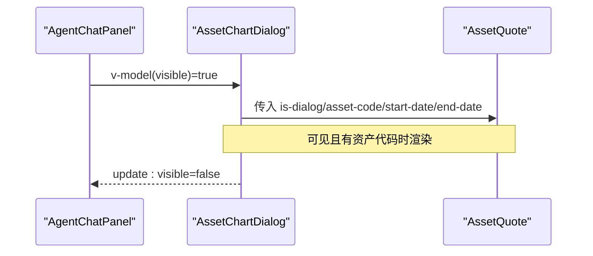
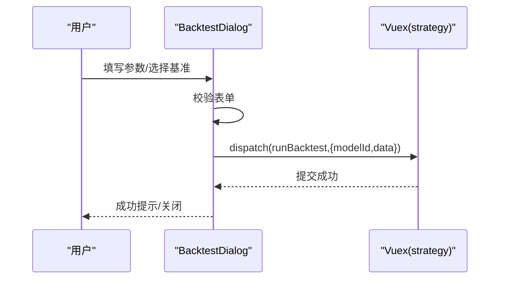
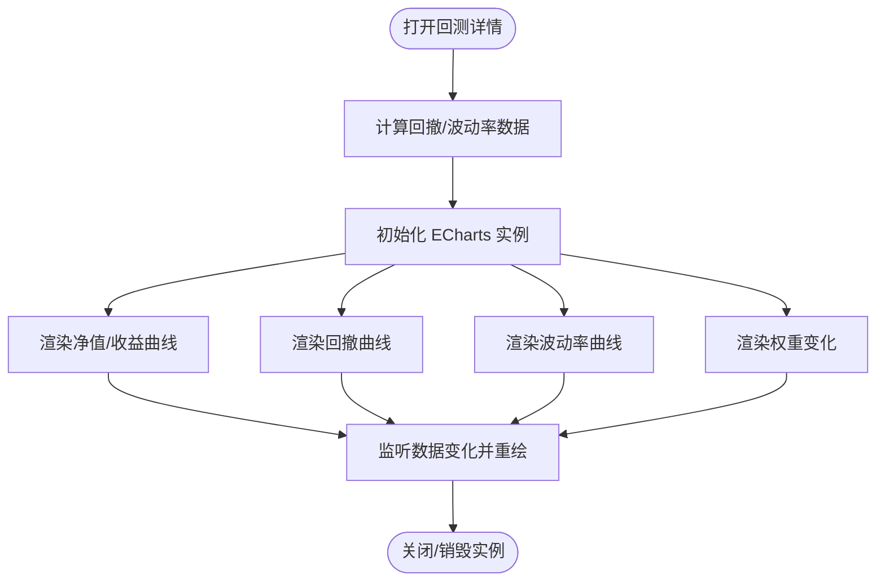
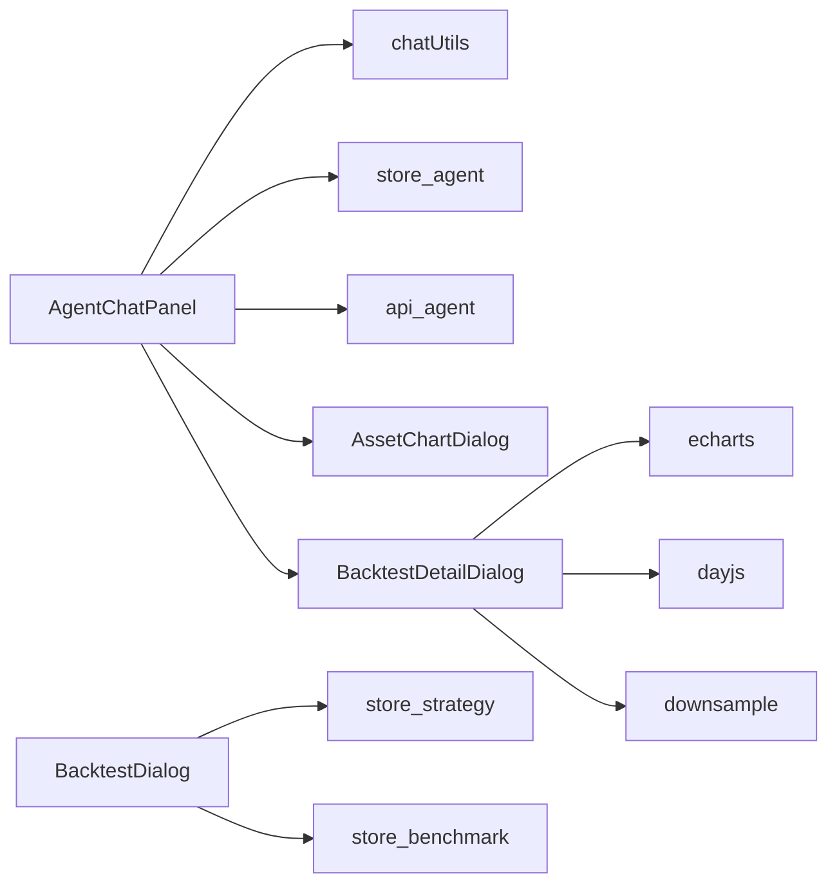

# 对话组件

<cite>
**本文引用的文件**
- [AgentChatPanel.vue](file://src/components/AgentChatPanel.vue)
- [AssetChartDialog.vue](file://src/components/AssetChartDialog.vue)
- [BacktestDialog.vue](file://src/components/BacktestDialog.vue)
- [BacktestDetailDialog.vue](file://src/components/BacktestDetailDialog.vue)
- [AgentChat.vue](file://src/views/agent/AgentChat.vue)
- [chatUtils.js](file://src/components/chatUtils.js)
- [agent.js](file://src/store/modules/agent.js)
- [agent.js](file://src/api/agent.js)
</cite>

## 目录
1. [简介](#简介)
2. [项目结构](#项目结构)
3. [核心组件](#核心组件)
4. [架构总览](#架构总览)
5. [组件详解](#组件详解)
6. [依赖关系分析](#依赖关系分析)
7. [性能考量](#性能考量)
8. [故障排查指南](#故障排查指南)
9. [结论](#结论)
10. [附录](#附录)

## 简介
本文件面向“对话组件”子系统，聚焦以下目标：
- 深入解析 AgentChatPanel 智能对话面板的设计与实现，涵盖消息渲染、流式交互、工具调用、资产/回测追踪、输入框交互、状态管理与数据流。
- 详述 AssetChartDialog 资产图表对话框的配置项、数据绑定、图表类型选择、时间范围设置。
- 详述 BacktestDialog 回测对话框的参数配置、回测结果展示与交互逻辑。
- 为每个对话组件提供完整的 API 文档（props、事件、插槽）。
- 提供实际使用示例、组件组合模式与最佳实践建议。
- 总结状态管理、数据流处理与错误处理机制。

## 项目结构
对话组件位于 src/components 与 src/views/agent 下，配合 store 与 api 模块协同工作，形成“视图层-状态层-接口层”的清晰分层。

**图表来源**
- [AgentChat.vue:1-135](file://src/views/agent/AgentChat.vue#L1-135)
- [AgentChatPanel.vue:1-225](file://src/components/AgentChatPanel.vue#L1-225)
- [AssetChartDialog.vue:1-78](file://src/components/AssetChartDialog.vue#L1-78)
- [BacktestDialog.vue:1-86](file://src/components/BacktestDialog.vue#L1-86)
- [BacktestDetailDialog.vue:1-224](file://src/components/BacktestDetailDialog.vue#L1-224)
- [chatUtils.js:1-479](file://src/components/chatUtils.js#L1-479)
- [agent.js:1-230](file://src/store/modules/agent.js#L1-230)
- [agent.js:1-168](file://src/api/agent.js#L1-168)

**章节来源**
- [AgentChat.vue:1-135](file://src/views/agent/AgentChat.vue#L1-135)
- [AgentChatPanel.vue:1-225](file://src/components/AgentChatPanel.vue#L1-225)
- [AssetChartDialog.vue:1-78](file://src/components/AssetChartDialog.vue#L1-78)
- [BacktestDialog.vue:1-86](file://src/components/BacktestDialog.vue#L1-86)
- [BacktestDetailDialog.vue:1-224](file://src/components/BacktestDetailDialog.vue#L1-224)
- [chatUtils.js:1-479](file://src/components/chatUtils.js#L1-479)
- [agent.js:1-230](file://src/store/modules/agent.js#L1-230)
- [agent.js:1-168](file://src/api/agent.js#L1-168)

## 核心组件
- AgentChatPanel：智能对话面板，负责消息列表渲染、Markdown/表格/图表混合渲染、流式 SSE 处理、工具调用阶段展示、资产/回测追踪与弹窗联动。
- AssetChartDialog：资产行情对话框，接收资产代码/名称与时间区间，内部嵌套资产行情视图。
- BacktestDialog：回测配置对话框，提供起止日期、初始资金、基准选择等参数，提交后触发回测任务。
- BacktestDetailDialog：回测详情对话框，展示净值/收益曲线、回撤、波动率、权重变化、持仓明细、相关性矩阵等。
- AgentChat：对话主页面，左右分栏布局，左侧对话列表，右侧为 AgentChatPanel。

**章节来源**
- [AgentChatPanel.vue:244-247](file://src/components/AgentChatPanel.vue#L244-247)
- [AssetChartDialog.vue:24-68](file://src/components/AssetChartDialog.vue#L24-68)
- [BacktestDialog.vue:91-146](file://src/components/BacktestDialog.vue#L91-146)
- [BacktestDetailDialog.vue:231-351](file://src/components/BacktestDetailDialog.vue#L231-351)
- [AgentChat.vue:63-134](file://src/views/agent/AgentChat.vue#L63-134)

## 架构总览
AgentChatPanel 通过 SSE 与后端交互，实时接收 text_delta/tool_start/tool_result/message_start/message_end 等事件，动态更新 UI。消息内容经 chatUtils 解析为 Markdown 片段与表格片段，表格片段交由 ChatDataTable 渲染并具备查询/排序/导出能力；图表片段交由 ChatChartRenderer 渲染；同时支持资产/回测追踪点击打开对话框。

**图表来源**
- [AgentChatPanel.vue:834-1083](file://src/components/AgentChatPanel.vue#L834-1083)
- [agent.js:78-112](file://src/api/agent.js#L78-112)
- [chatUtils.js:167-233](file://src/components/chatUtils.js#L167-233)
- [agent.js:52-82](file://src/store/modules/agent.js#L52-82)

**章节来源**
- [AgentChatPanel.vue:834-1083](file://src/components/AgentChatPanel.vue#L834-1083)
- [agent.js:78-112](file://src/api/agent.js#L78-112)
- [chatUtils.js:167-233](file://src/components/chatUtils.js#L167-233)
- [agent.js:52-82](file://src/store/modules/agent.js#L52-82)

## 组件详解

### AgentChatPanel 智能对话面板
- 设计要点
  - 虚拟滚动消息列表，支持“加载更早的消息”。
  - Markdown 渲染与表格/图表混合渲染，表格具备查询/排序/导出能力。
  - 流式交互：SSE 事件驱动，支持打字指示、工具调用阶段展示、计划进度展示。
  - 资产/回测追踪：从消息的 tool_calls 中提取 traceable_assets/backtests，点击后打开对话框。
  - 输入框交互：支持模板选择、文件上传、发送消息。
  - 状态管理：Vuex 管理对话列表、当前会话、消息、加载状态、流式状态。
- 关键数据与状态
  - props: conversationId（可选，用于外部控制会话切换）
  - data: 流式状态（isStreaming、pendingText、streamingContent、streamingToolCalls、streamingCharts）、工具步骤（completedToolSteps、currentToolLabel）、计划（currentPlan）、对话弹窗状态（assetChartDialogVisible、backtestDialogVisible）、当前资产/回测参数（currentChartAssetCode/Name/StartDate/EndDate）
  - computed: 当前场景配置、欢迎语、快捷问题、消息列表、是否有更多消息、显示流式 UI 的条件、流式表格/导入卡片/可追踪资产/回测
  - watch: 监听 conversationId 切换、消息长度变化、流式内容变化、当前会话变化，必要时中止流
- 核心方法
  - loadMoreMessages：加载历史消息并恢复滚动位置
  - cancelStreaming：中止流式请求，清理状态
  - handleSend：构造 payload，调用 sendMessageStream，解析 SSE 事件，更新 store
  - processSSEEvent：解析事件类型，更新 pendingText、tool_calls、charts、plan、conversation_id 等
  - getMessageTraceableAssets/getMessageTraceableBacktests：从 tool_calls 提取可追踪资产/回测
  - handleAssetClick/handleBacktestClick：打开资产/回测对话框
  - exportTable：事件委托导出表格为 CSV
  - handleQuickQuestion/handleTemplateSelect：快捷问题与模板选择
- 错误处理
  - 流式异常捕获与提示
  - 中止流时避免写入错误会话
  - 会话切换时主动中止，防止串话

**图表来源**
- [AgentChatPanel.vue:834-1083](file://src/components/AgentChatPanel.vue#L834-1083)
- [agent.js:78-112](file://src/api/agent.js#L78-112)

**章节来源**
- [AgentChatPanel.vue:244-1083](file://src/components/AgentChatPanel.vue#L244-1083)
- [agent.js:78-112](file://src/api/agent.js#L78-112)
- [agent.js:52-212](file://src/store/modules/agent.js#L52-212)
- [chatUtils.js:167-479](file://src/components/chatUtils.js#L167-479)

#### AgentChatPanel API 文档
- Props
  - conversationId: String（可选）用于外部控制会话切换
- Events
  - conversation-created: 当收到 conversation_id 时触发，通知上层刷新列表
- 插槽
  - 无
- 方法
  - loadMoreMessages(): 异步加载历史消息
  - cancelStreaming(): 中止流式请求
  - handleSend(textOrPayload): 发送消息（支持字符串或对象，含附件、系统附加）
  - processSSEEvent(eventStr): 解析单条 SSE 事件
  - handleAssetClick(payload): 打开资产图表对话框
  - handleBacktestClick(bt): 打开回测详情对话框
  - exportTable(tableEl): 导出表格为 CSV
  - handleQuickQuestion(q)/handleTemplateSelect(tpl): 快捷问题与模板选择

**章节来源**
- [AgentChatPanel.vue:247-1083](file://src/components/AgentChatPanel.vue#L247-1083)

### AssetChartDialog 资产图表对话框
- 设计要点
  - 响应式宽度（1200px），支持 append-to-body，顶部留白空间
  - 内部嵌套 AssetQuote，传入 is-dialog、asset-code、start-date、end-date
  - 通过 v-if 控制在可见且有资产代码时渲染
- API 文档
  - Props
    - visible: Boolean（v-model）
    - assetCode: String（默认空字符串）
    - assetName: String（默认空字符串）
    - startDate: String（默认空字符串）
    - endDate: String（默认空字符串）
  - Events
    - update:visible: 双向绑定
  - 插槽
    - 无
  - 方法
    - handleClose(): 触发 update:visible=false

**图表来源**
- [AgentChatPanel.vue:209-224](file://src/components/AgentChatPanel.vue#L209-224)
- [AssetChartDialog.vue:11-18](file://src/components/AssetChartDialog.vue#L11-18)

**章节来源**
- [AssetChartDialog.vue:24-68](file://src/components/AssetChartDialog.vue#L24-68)

### BacktestDialog 回测配置对话框
- 设计要点
  - 表单字段：起始日期、结束日期、初始资金、业绩基准（可选）
  - 校验规则：结束日期需晚于起始日期；初始资金最小值校验
  - 提交流程：校验通过后 dispatch 策略回测任务，成功提示并关闭
- API 文档
  - Props
    - value: Boolean（v-model）
    - modelId: String（必需）
  - Events
    - input: 双向绑定
    - success: 成功提交后触发
  - 插槽
    - 无
  - 方法
    - loadBenchmarkOptions(): 加载基准列表（只显示激活）
    - handleClose(): 关闭对话框
    - handleSubmit(): 校验并提交回测

**图表来源**
- [BacktestDialog.vue:150-194](file://src/components/BacktestDialog.vue#L150-194)

**章节来源**
- [BacktestDialog.vue:91-196](file://src/components/BacktestDialog.vue#L91-196)

### BacktestDetailDialog 回测详情对话框
- 设计要点
  - 展示回测区间、初始资金、创建时间、记录ID
  - 核心指标：总收益、年化收益、年化波动率、夏普比率、最大回撤、卡玛比率
  - 图表：净值/收益曲线（支持累计收益率/单位净值/双轴对比）、回撤曲线、波动率曲线、权重变化（堆叠面积图/折线图）
  - 持仓记录：分页表格，支持日期、资产、数量、权重、价格、市值、调整原因
  - 相关性矩阵：资产间相关系数表格
  - 图表渲染：ECharts 初始化与渲染，支持降采样优化大数据量
- API 文档
  - Props
    - value: Boolean（v-model）
    - record: Object（必需，包含 id、start_date、end_date、initial_capital、result、created_at）
  - Events
    - input: 双向绑定
  - 插槽
    - 无
  - 方法
    - initChart()/initWeightChart(): 初始化 ECharts 实例
    - renderEquityChart()/renderDrawdownChart()/renderVolatilityChart()/renderWeightChart(): 渲染各类图表
    - calculateDrawdown()/calculateVolatility(): 从净值曲线计算回撤/波动率
    - handlePositionPageChange()/handleClose()/handleExport(): 分页、关闭、导出
    - formatDate()/formatDateShort()/getReturnColor()/getCorrelationColor(): 辅助格式化与颜色映射

**图表来源**
- [BacktestDetailDialog.vue:332-396](file://src/components/BacktestDetailDialog.vue#L332-396)
- [BacktestDetailDialog.vue:416-998](file://src/components/BacktestDetailDialog.vue#L416-998)

**章节来源**
- [BacktestDetailDialog.vue:231-1048](file://src/components/BacktestDetailDialog.vue#L231-1048)

### AgentChat 主页面
- 设计要点
  - 左侧：对话列表，支持新建/删除/切换
  - 右侧：AgentChatPanel，绑定当前会话 ID
  - 时间格式化、确认删除对话、加载对话列表
- API 文档
  - Props
    - 无
  - Events
    - 无
  - 插槽
    - 无
  - 方法
    - handleNewChat()/handleSelectConversation()/handleDeleteConversation()
    - onConversationCreated(): 收到新 conversation_id 后刷新列表
    - formatTime(): 格式化时间显示

**章节来源**
- [AgentChat.vue:63-134](file://src/views/agent/AgentChat.vue#L63-134)

## 依赖关系分析
- 组件耦合
  - AgentChatPanel 依赖 chatUtils（消息解析/表格/图表提取）、Vuex agent 模块（消息/会话/加载状态）、Agent API（SSE 流）、AssetChartDialog/BacktestDetailDialog（资产/回测弹窗）
  - BacktestDialog 依赖 Vuex strategy 模块（runBacktest）、Vuex benchmark 模块（基准列表）
  - BacktestDetailDialog 依赖 ECharts、downsample 工具、dayjs
- 外部依赖
  - marked/DOMPurify：安全渲染 Markdown
  - Element UI：对话框、表单、分页、描述列表等
  - ECharts：回测详情图表
- 循环依赖
  - 未发现循环依赖

**图表来源**
- [AgentChatPanel.vue:228-242](file://src/components/AgentChatPanel.vue#L228-242)
- [chatUtils.js:1-8](file://src/components/chatUtils.js#L1-8)
- [agent.js:1-230](file://src/store/modules/agent.js#L1-230)
- [agent.js:1-168](file://src/api/agent.js#L1-168)
- [BacktestDialog.vue:89-149](file://src/components/BacktestDialog.vue#L89-149)
- [BacktestDetailDialog.vue:227-230](file://src/components/BacktestDetailDialog.vue#L227-230)

**章节来源**
- [AgentChatPanel.vue:228-242](file://src/components/AgentChatPanel.vue#L228-242)
- [chatUtils.js:1-8](file://src/components/chatUtils.js#L1-8)
- [agent.js:1-230](file://src/store/modules/agent.js#L1-230)
- [agent.js:1-168](file://src/api/agent.js#L1-168)
- [BacktestDialog.vue:89-149](file://src/components/BacktestDialog.vue#L89-149)
- [BacktestDetailDialog.vue:227-230](file://src/components/BacktestDetailDialog.vue#L227-230)

## 性能考量
- 虚拟滚动：消息列表使用 DynamicScroller，提升长对话性能
- 流式渲染：SSE 事件增量更新，避免一次性渲染大量内容
- 图表降采样：回测详情图表对大数据量进行降采样，避免 ECharts 卡顿
- 节流/防抖：滚动到底部、导出按钮事件委托，减少高频操作
- 去重与合并：表格/图表按关键字段去重，避免重复渲染
- 中止流：切换会话或组件销毁时主动中止，防止资源浪费

[本节为通用指导，无需特定文件引用]

## 故障排查指南
- 流式对话异常
  - 现象：长时间无响应或报错
  - 排查：检查网络与后端 SSE 端点可用性；确认 AbortController 是否被正确中止；查看控制台错误与消息提交逻辑
- 会话串话
  - 现象：切换会话后仍收到之前会话的回复
  - 排查：确认 _sseOwnerConversationId 与 currentConvId 的一致性；确保 cancelStreaming 在切换时被调用
- 表格导出闪烁
  - 现象：导出按钮闪烁或跳动
  - 排查：确认通过事件委托统一处理导出按钮点击；确保表格 HTML 预先包装导出按钮
- 回测图表空白
  - 现象：净值/回撤/波动率/权重图表不显示
  - 排查：确认 equity_curve 等数据存在；检查初始化与渲染时机；确认降采样后仍有数据点
- 回测参数校验失败
  - 现象：提交时报错“结束日期必须大于起始日期”
  - 排查：检查表单校验规则与触发时机；确认日期格式与 value-format 一致

**章节来源**
- [AgentChatPanel.vue:468-487](file://src/components/AgentChatPanel.vue#L468-487)
- [AgentChatPanel.vue:717-757](file://src/components/AgentChatPanel.vue#L717-757)
- [BacktestDetailDialog.vue:416-414](file://src/components/BacktestDetailDialog.vue#L416-414)
- [BacktestDialog.vue:113-134](file://src/components/BacktestDialog.vue#L113-134)

## 结论
对话组件体系以 AgentChatPanel 为核心，结合 SSE 流式交互、Markdown/表格/图表混合渲染、资产/回测追踪与弹窗联动，形成完整的智能对话体验。AssetChartDialog 与 BacktestDetailDialog 提供资产行情与回测结果的深度可视化。通过合理的状态管理、数据流设计与错误处理机制，系统在复杂业务场景下保持稳定与高性能。

[本节为总结，无需特定文件引用]

## 附录

### 组件组合模式与最佳实践
- 组合模式
  - AgentChat + AgentChatPanel：左侧对话列表 + 右侧对话面板
  - AgentChatPanel + AssetChartDialog：消息中资产点击 -> 打开资产图表对话框
  - AgentChatPanel + BacktestDetailDialog：消息中回测点击 -> 打开回测详情对话框
  - BacktestDialog：策略模型回测配置
- 最佳实践
  - 使用 conversationId 控制会话切换，避免流式串话
  - 表格导出采用事件委托，避免 v-html 重渲染闪烁
  - 回测图表数据量大时启用降采样
  - 工具调用阶段使用 ChatToolProgress 提示用户
  - 合理使用去重逻辑，避免重复渲染

[本节为通用指导，无需特定文件引用]