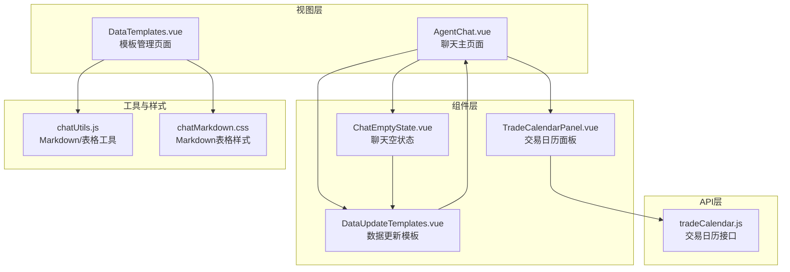
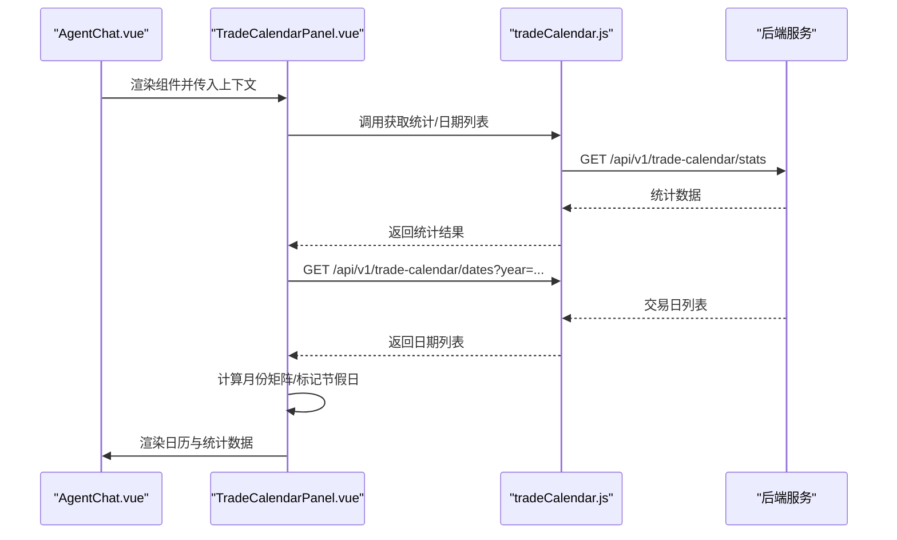
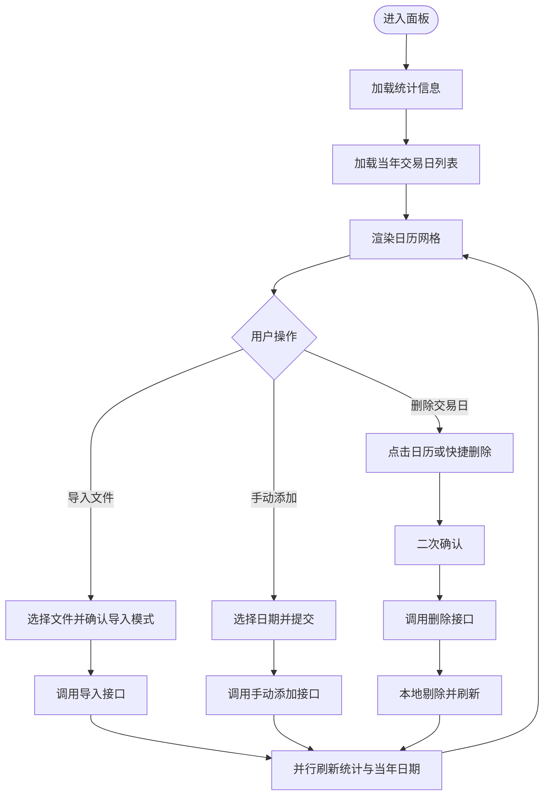
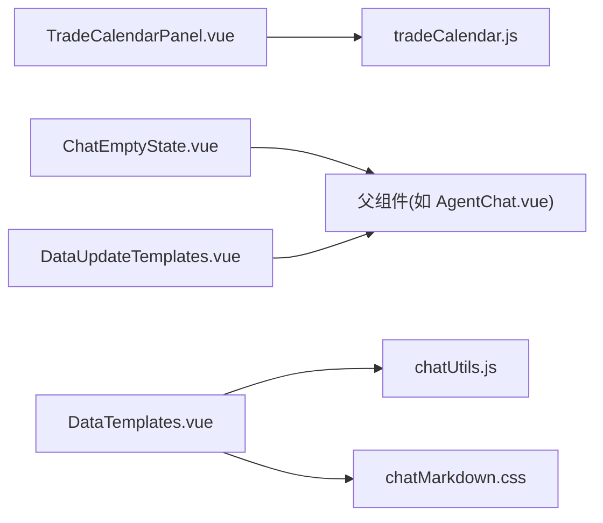

# 工具组件

<cite>
**本文引用的文件**
- [TradeCalendarPanel.vue](file://src/components/TradeCalendarPanel.vue)
- [ChatEmptyState.vue](file://src/components/ChatEmptyState.vue)
- [DataUpdateTemplates.vue](file://src/components/DataUpdateTemplates.vue)
- [tradeCalendar.js](file://src/api/tradeCalendar.js)
- [AgentChat.vue](file://src/views/agent/AgentChat.vue)
- [DataTemplates.vue](file://src/views/agent/DataTemplates.vue)
- [chatUtils.js](file://src/components/chatUtils.js)
- [chatMarkdown.css](file://src/components/chatMarkdown.css)
</cite>

## 目录
1. [简介](#简介)
2. [项目结构](#项目结构)
3. [核心组件](#核心组件)
4. [架构总览](#架构总览)
5. [详细组件分析](#详细组件分析)
6. [依赖分析](#依赖分析)
7. [性能考量](#性能考量)
8. [故障排查指南](#故障排查指南)
9. [结论](#结论)
10. [附录](#附录)

## 简介
本文件面向“工具组件”模块，聚焦以下三个组件的完整技术文档：
- TradeCalendarPanel 交易日历面板：负责交易日历的导入、统计、可视化日历渲染、节假日标记、日期选择与业务日计算辅助。
- ChatEmptyState 聊天空状态：提供欢迎信息、快速问题引导、数据更新模板快捷入口与占位视觉设计。
- DataUpdateTemplates 数据更新模板：提供数据导入/更新模板的卡片式选择入口，便于在聊天界面中触发相应流程。

同时，文档涵盖各组件的 API 定义、事件与数据格式、样式定制、使用示例、集成方法、扩展策略、通用性与可复用性、性能优化与兼容性建议。

## 项目结构
围绕工具组件的相关文件组织如下：
- 组件层：TradeCalendarPanel.vue、ChatEmptyState.vue、DataUpdateTemplates.vue
- API 层：tradeCalendar.js（交易日历相关接口）
- 视图层：AgentChat.vue（聊天主页面，承载聊天组件）、DataTemplates.vue（数据分析模板管理页面）
- 工具与样式：chatUtils.js（Markdown/表格解析与渲染工具）、chatMarkdown.css（Markdown表格渲染样式）

**图表来源**
- [AgentChat.vue:1-200](file://src/views/agent/AgentChat.vue#L1-L200)
- [DataTemplates.vue:1-200](file://src/views/agent/DataTemplates.vue#L1-L200)
- [TradeCalendarPanel.vue:1-1164](file://src/components/TradeCalendarPanel.vue#L1-L1164)
- [ChatEmptyState.vue:1-165](file://src/components/ChatEmptyState.vue#L1-L165)
- [DataUpdateTemplates.vue:1-129](file://src/components/DataUpdateTemplates.vue#L1-L129)
- [tradeCalendar.js:1-71](file://src/api/tradeCalendar.js#L1-L71)
- [chatUtils.js:1-479](file://src/components/chatUtils.js#L1-L479)
- [chatMarkdown.css:1-157](file://src/components/chatMarkdown.css#L1-L157)

**章节来源**
- [TradeCalendarPanel.vue:1-1164](file://src/components/TradeCalendarPanel.vue#L1-L1164)
- [ChatEmptyState.vue:1-165](file://src/components/ChatEmptyState.vue#L1-L165)
- [DataUpdateTemplates.vue:1-129](file://src/components/DataUpdateTemplates.vue#L1-L129)
- [tradeCalendar.js:1-71](file://src/api/tradeCalendar.js#L1-L71)
- [AgentChat.vue:1-200](file://src/views/agent/AgentChat.vue#L1-L200)
- [DataTemplates.vue:1-200](file://src/views/agent/DataTemplates.vue#L1-L200)
- [chatUtils.js:1-479](file://src/components/chatUtils.js#L1-L479)
- [chatMarkdown.css:1-157](file://src/components/chatMarkdown.css#L1-L157)

## 核心组件
本节概述三个工具组件的功能职责与交互关系：
- TradeCalendarPanel：提供交易日历导入（覆盖/增量）、手动添加、快捷删除、年度统计、可视化日历渲染与节假日标记。
- ChatEmptyState：提供欢迎语、快速问题引导、数据更新模板快捷入口，作为聊天会话初始占位。
- DataUpdateTemplates：提供数据更新模板卡片选择，向父组件发出模板选择事件，驱动后续流程。

**章节来源**
- [TradeCalendarPanel.vue:1-1164](file://src/components/TradeCalendarPanel.vue#L1-L1164)
- [ChatEmptyState.vue:1-165](file://src/components/ChatEmptyState.vue#L1-L165)
- [DataUpdateTemplates.vue:1-129](file://src/components/DataUpdateTemplates.vue#L1-L129)

## 架构总览
下图展示 TradeCalendarPanel 与 API 层、视图层的交互关系，以及聊天场景下的组件协作：

**图表来源**
- [AgentChat.vue:1-200](file://src/views/agent/AgentChat.vue#L1-L200)
- [TradeCalendarPanel.vue:408-472](file://src/components/TradeCalendarPanel.vue#L408-L472)
- [tradeCalendar.js:52-70](file://src/api/tradeCalendar.js#L52-L70)

## 详细组件分析

### TradeCalendarPanel 交易日历面板
- 功能概览
  - 导入：支持 .xlsx/.xls 文件，覆盖（replace）与增量（incremental）两种模式，自动识别日期列。
  - 手动添加：禁用周末，支持批量加入与提交。
  - 统计：交易日总数、起止日期、本年交易日数、最近更新时间。
  - 可视化日历：按年切换，渲染 12 个月网格，区分交易日（蓝色）、周末（浅灰）、非交易工作日（常规），点击交易日显示删除弹层。
  - 快捷删除：支持按日期选择器直接删除指定交易日。
- 关键实现要点
  - 月份矩阵计算：根据年月生成首日星期与当月天数，填充前导空白与当月日期，标记是否周末/交易日。
  - 日期缓存：按年缓存交易日列表，避免重复请求。
  - 导入与添加：分别调用导入与手动添加接口，成功后并行刷新统计与当年日期。
  - 删除：二次确认，删除后本地剔除对应年份缓存并刷新。
- API 接口
  - 导入：POST /api/v1/trade-calendar/import（支持 mode 参数）
  - 手动添加：POST /api/v1/trade-calendar/manual（{ dates: [...] }）
  - 删除：DELETE /api/v1/trade-calendar/{date}
  - 统计：GET /api/v1/trade-calendar/stats
  - 日期列表：GET /api/v1/trade-calendar/dates?year={...}

**图表来源**
- [TradeCalendarPanel.vue:408-702](file://src/components/TradeCalendarPanel.vue#L408-L702)
- [tradeCalendar.js:10-70](file://src/api/tradeCalendar.js#L10-L70)

- API 文档
  - 导入交易日历
    - 方法与路径：POST /api/v1/trade-calendar/import
    - 请求体：multipart/form-data，字段 file（必填），mode（可选，replace/incremental）
    - 成功响应：包含 message 字段的成功提示
    - 失败响应：包含 message 或 detail 字段的错误信息
  - 手动添加交易日
    - 方法与路径：POST /api/v1/trade-calendar/manual
    - 请求体：JSON，字段 dates（字符串数组，YYYY-MM-DD）
    - 成功响应：包含 inserted_count 与 skipped_count 的统计
  - 删除交易日
    - 方法与路径：DELETE /api/v1/trade-calendar/{date}
    - 路径参数：date（YYYY-MM-DD）
  - 获取统计
    - 方法与路径：GET /api/v1/trade-calendar/stats
    - 响应字段：total/startDate/endDate/thisYear/lastUpdated（兼容多种命名）
  - 获取日期列表
    - 方法与路径：GET /api/v1/trade-calendar/dates
    - 查询参数：year（数字）
    - 响应：dates 数组（YYYY-MM-DD 字符串）

- 事件与数据格式
  - 事件：无自定义事件发出；内部通过 Element UI 组件与本地状态管理交互。
  - 数据格式：日期统一标准化为 YYYY-MM-DD；统计字段兼容多种命名；日期列表支持 dates/data/list 等多种结构。
  - 样式定制：通过 scoped 样式控制布局、网格、颜色与交互反馈；支持响应式适配。

- 使用示例与集成
  - 在 AgentChat.vue 中作为子组件引入并渲染。
  - 通过并行刷新统计与当年日期，保证数据一致性。
  - 与聊天上下文解耦，适合在任意需要交易日历管理的页面复用。

- 扩展策略
  - 支持更多导入格式（如 CSV）与字段映射配置。
  - 增加批量预览与冲突检测（重复日期、跨年范围等）。
  - 提供业务日计算辅助（如 N 个工作日后的日期计算）。

**章节来源**
- [TradeCalendarPanel.vue:1-1164](file://src/components/TradeCalendarPanel.vue#L1-L1164)
- [tradeCalendar.js:1-71](file://src/api/tradeCalendar.js#L1-L71)
- [AgentChat.vue:1-200](file://src/views/agent/AgentChat.vue#L1-L200)

### ChatEmptyState 聊天空状态
- 功能概览
  - 欢迎标题与描述：用于引导用户开始对话。
  - 快速问题：一组可点击按钮，触发父组件的快速问题事件。
  - 数据更新快捷入口：展示数据模板卡片，点击触发父组件的模板选择事件。
- 设计与交互
  - 占位图标与文案居中布局，强调“空状态”的友好体验。
  - 数据模板卡片采用 hover 效果与图标标识，提升可发现性。
- API 文档
  - 属性
    - welcomeTitle：字符串，默认为空
    - welcomeDescription：字符串，默认为空
    - quickQuestions：数组，默认为空
  - 事件
    - quick-question：点击快速问题按钮时触发，携带所选问题
    - select-template：点击数据模板卡片时触发，携带模板对象
  - 数据模板项字段
    - id：模板标识
    - name：模板名称
    - icon：图标类名
    - prompt：简要说明
    - acceptFormats：接受的文件格式（逗号分隔）

- 使用示例与集成
  - 在聊天页面首次渲染时显示，引导用户选择模板或输入问题。
  - 父组件监听事件并执行相应流程（如打开文件上传、发起 API 同步等）。

- 扩展策略
  - 支持动态加载快速问题与模板列表。
  - 增加“最近使用”或“热门推荐”分类。

**章节来源**
- [ChatEmptyState.vue:1-165](file://src/components/ChatEmptyState.vue#L1-L165)

### DataUpdateTemplates 数据更新模板
- 功能概览
  - 以卡片形式展示数据更新模板，点击触发父组件的模板选择事件。
  - 模板类型覆盖行情、汇率、资产信息、多资产宽表、交易日历、API 同步、数据清洗修复等。
- API 文档
  - 事件
    - select-template：点击模板卡片时触发，携带模板对象
  - 数据模板项字段
    - id：模板标识
    - name：模板名称
    - icon：图标类名
    - prompt：简要说明
    - acceptFormats：接受的文件格式（逗号分隔）

- 使用示例与集成
  - 在聊天界面中作为工具条出现，便于用户一键触发数据更新流程。
  - 与 ChatEmptyState 协作，形成“空状态 + 快捷入口”的完整体验。

- 扩展策略
  - 支持模板分组与搜索。
  - 增加模板预览与参数配置入口。

**章节来源**
- [DataUpdateTemplates.vue:1-129](file://src/components/DataUpdateTemplates.vue#L1-L129)

## 依赖分析
- TradeCalendarPanel 依赖 tradeCalendar.js 提供的接口封装，实现导入、添加、删除、统计与日期列表获取。
- ChatEmptyState 与 DataUpdateTemplates 通过事件向上抛出，由父组件（如 AgentChat.vue）承接并执行具体逻辑。
- DataTemplates.vue 使用 chatUtils.js 与 chatMarkdown.css 实现 Markdown 表格渲染与样式控制。

**图表来源**
- [TradeCalendarPanel.vue:334-340](file://src/components/TradeCalendarPanel.vue#L334-L340)
- [tradeCalendar.js:1-71](file://src/api/tradeCalendar.js#L1-L71)
- [ChatEmptyState.vue:1-80](file://src/components/ChatEmptyState.vue#L1-L80)
- [DataUpdateTemplates.vue:1-84](file://src/components/DataUpdateTemplates.vue#L1-L84)
- [DataTemplates.vue:129-200](file://src/views/agent/DataTemplates.vue#L129-L200)
- [chatUtils.js:1-479](file://src/components/chatUtils.js#L1-L479)
- [chatMarkdown.css:1-157](file://src/components/chatMarkdown.css#L1-L157)

**章节来源**
- [TradeCalendarPanel.vue:334-340](file://src/components/TradeCalendarPanel.vue#L334-L340)
- [tradeCalendar.js:1-71](file://src/api/tradeCalendar.js#L1-L71)
- [ChatEmptyState.vue:1-80](file://src/components/ChatEmptyState.vue#L1-L80)
- [DataUpdateTemplates.vue:1-84](file://src/components/DataUpdateTemplates.vue#L1-L84)
- [DataTemplates.vue:129-200](file://src/views/agent/DataTemplates.vue#L129-L200)
- [chatUtils.js:1-479](file://src/components/chatUtils.js#L1-L479)
- [chatMarkdown.css:1-157](file://src/components/chatMarkdown.css#L1-L157)

## 性能考量
- 数据缓存
  - TradeCalendarPanel 使用按年缓存 dateCache，避免重复请求与重复渲染。
- 并行刷新
  - 导入/添加/删除成功后，统计与当年日期并行刷新，减少等待时间。
- 渲染优化
  - 日历网格使用固定尺寸与响应式栅格，减少重排。
  - 交易日单元格点击采用轻量 popover，避免复杂 DOM。
- Markdown/表格渲染
  - chatUtils.js 对 Markdown 表格进行预处理与 XSS 消毒，确保渲染安全与稳定。
  - chatMarkdown.css 为表格提供滚动与导出按钮的样式支持，避免大表格影响布局。

[本节为通用性能建议，不直接分析具体文件]

## 故障排查指南
- 导入失败
  - 确认文件格式与字段：导入接口要求 .xlsx/.xls，且需包含日期列（如 trade_date/date）。
  - 查看错误消息：接口返回的 message/detail 字段通常包含明确原因。
- 手动添加失败
  - 检查日期格式是否为 YYYY-MM-DD；重复日期会被跳过（返回 skipped_count）。
- 删除失败
  - 确认日期存在且为交易日；删除后需刷新缓存与统计。
- 日历不显示
  - 检查网络请求是否成功；确认当前年份缓存是否加载。
- Markdown 表格渲染异常
  - 检查 chatUtils.js 的预处理与 DOMPurify 消毒逻辑；确认 chatMarkdown.css 样式是否生效。

**章节来源**
- [TradeCalendarPanel.vue:474-527](file://src/components/TradeCalendarPanel.vue#L474-L527)
- [TradeCalendarPanel.vue:542-582](file://src/components/TradeCalendarPanel.vue#L542-L582)
- [TradeCalendarPanel.vue:653-698](file://src/components/TradeCalendarPanel.vue#L653-L698)
- [tradeCalendar.js:10-70](file://src/api/tradeCalendar.js#L10-L70)
- [chatUtils.js:119-130](file://src/components/chatUtils.js#L119-L130)
- [chatMarkdown.css:53-157](file://src/components/chatMarkdown.css#L53-L157)

## 结论
TradeCalendarPanel、ChatEmptyState、DataUpdateTemplates 三个组件分别承担“交易日历管理”、“聊天空状态与引导”、“数据更新模板入口”的职责。它们通过清晰的事件与数据契约协同工作，配合 API 层与工具层，形成可复用、可扩展的工具组件体系。建议在后续迭代中增强导入字段映射、批量预览与冲突检测、模板动态加载与参数配置，进一步提升易用性与通用性。

[本节为总结性内容，不直接分析具体文件]

## 附录
- 通用性与可复用性
  - 组件通过属性与事件解耦，可在不同页面复用。
  - API 层统一接口命名与响应格式，便于替换与扩展。
- 兼容性支持
  - 响应式布局适配多终端；Markdown 渲染兼容主流浏览器。
- 扩展策略
  - 模板与快捷入口可动态配置；导入流程支持更多格式与字段映射。

[本节为通用建议，不直接分析具体文件]