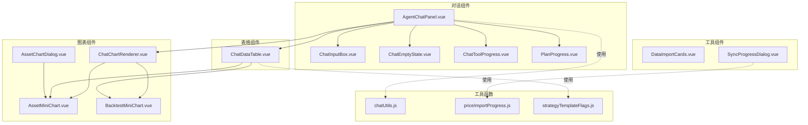
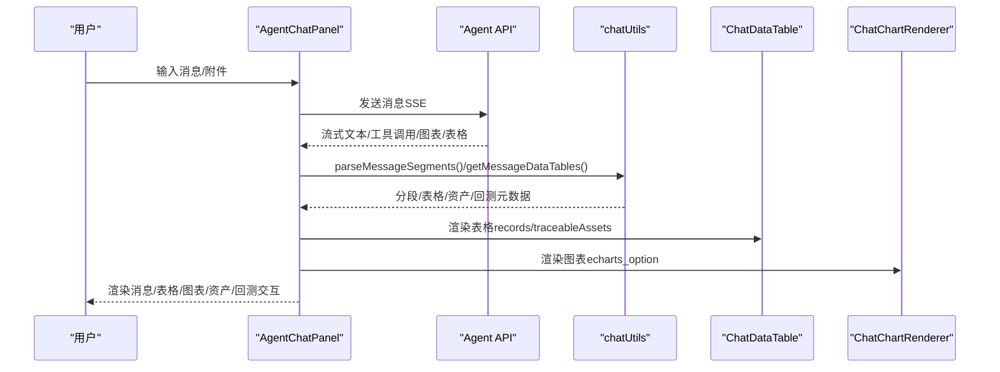
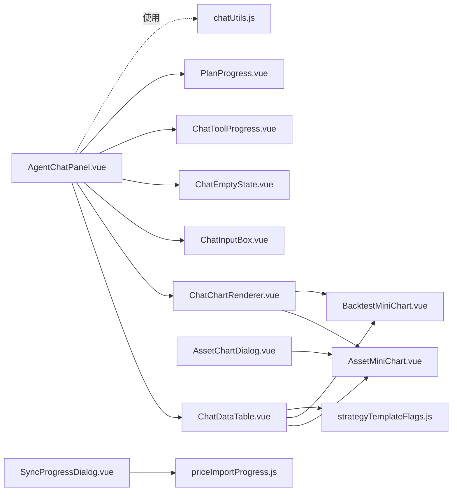

# 组件库

<cite>
**本文引用的文件**
- [AgentChatPanel.vue](file://src/components/AgentChatPanel.vue)
- [ChatInputBox.vue](file://src/components/ChatInputBox.vue)
- [AssetChartDialog.vue](file://src/components/AssetChartDialog.vue)
- [BacktestMiniChart.vue](file://src/components/BacktestMiniChart.vue)
- [ChatDataTable.vue](file://src/components/ChatDataTable.vue)
- [AssetMiniChart.vue](file://src/components/AssetMiniChart.vue)
- [ChatChartRenderer.vue](file://src/components/ChatChartRenderer.vue)
- [DataImportCards.vue](file://src/components/DataImportCards.vue)
- [ChatToolProgress.vue](file://src/components/ChatToolProgress.vue)
- [PlanProgress.vue](file://src/components/PlanProgress.vue)
- [SyncProgressDialog.vue](file://src/components/SyncProgressDialog.vue)
- [chatUtils.js](file://src/components/chatUtils.js)
- [priceImportProgress.js](file://src/utils/priceImportProgress.js)
- [strategyTemplateFlags.js](file://src/utils/strategyTemplateFlags.js)
</cite>

## 目录
1. [简介](#简介)
2. [项目结构](#项目结构)
3. [核心组件](#核心组件)
4. [架构总览](#架构总览)
5. [详细组件分析](#详细组件分析)
6. [依赖关系分析](#依赖关系分析)
7. [性能考量](#性能考量)
8. [故障排查指南](#故障排查指南)
9. [结论](#结论)
10. [附录](#附录)

## 简介
本组件库面向投资组合管理系统，聚焦对话交互、数据呈现与工具链路的可复用组件。重点覆盖以下方面：
- 对话组件：AgentChatPanel、ChatInputBox、ChatEmptyState、ChatToolProgress、PlanProgress
- 图表组件：AssetChartDialog、AssetMiniChart、BacktestMiniChart、ChatChartRenderer
- 表格组件：ChatDataTable
- 工具组件：DataImportCards、SyncProgressDialog
- 数据处理与策略模板工具：chatUtils、priceImportProgress、strategyTemplateFlags

文档提供每个组件的 API（属性、事件、插槽）、交互行为、数据绑定方式、定制化与样式扩展、响应式与无障碍支持、性能优化建议与最佳实践。

## 项目结构
组件主要位于 src/components，配套工具位于 src/utils，对话渲染与消息分段逻辑集中在 chatUtils。

**图表来源**
- [AgentChatPanel.vue:1-225](file://src/components/AgentChatPanel.vue#L1-L225)
- [ChatDataTable.vue:1-246](file://src/components/ChatDataTable.vue#L1-L246)
- [ChatChartRenderer.vue:1-599](file://src/components/ChatChartRenderer.vue#L1-L599)
- [AssetMiniChart.vue:1-493](file://src/components/AssetMiniChart.vue#L1-L493)
- [BacktestMiniChart.vue:1-350](file://src/components/BacktestMiniChart.vue#L1-L350)
- [AssetChartDialog.vue:1-78](file://src/components/AssetChartDialog.vue#L1-L78)
- [ChatInputBox.vue:1-260](file://src/components/ChatInputBox.vue#L1-L260)
- [ChatEmptyState.vue:1-165](file://src/components/ChatEmptyState.vue#L1-L165)
- [ChatToolProgress.vue:1-61](file://src/components/ChatToolProgress.vue#L1-L61)
- [PlanProgress.vue:1-187](file://src/components/PlanProgress.vue#L1-L187)
- [DataImportCards.vue:1-267](file://src/components/DataImportCards.vue#L1-L267)
- [SyncProgressDialog.vue:1-190](file://src/components/SyncProgressDialog.vue#L1-L190)
- [chatUtils.js:1-479](file://src/components/chatUtils.js#L1-L479)
- [priceImportProgress.js:1-61](file://src/utils/priceImportProgress.js#L1-L61)
- [strategyTemplateFlags.js:1-100](file://src/utils/strategyTemplateFlags.js#L1-L100)

**章节来源**
- [AgentChatPanel.vue:1-225](file://src/components/AgentChatPanel.vue#L1-L225)
- [ChatDataTable.vue:1-246](file://src/components/ChatDataTable.vue#L1-L246)
- [ChatChartRenderer.vue:1-599](file://src/components/ChatChartRenderer.vue#L1-L599)
- [AssetMiniChart.vue:1-493](file://src/components/AssetMiniChart.vue#L1-L493)
- [BacktestMiniChart.vue:1-350](file://src/components/BacktestMiniChart.vue#L1-L350)
- [AssetChartDialog.vue:1-78](file://src/components/AssetChartDialog.vue#L1-L78)
- [ChatInputBox.vue:1-260](file://src/components/ChatInputBox.vue#L1-L260)
- [ChatEmptyState.vue:1-165](file://src/components/ChatEmptyState.vue#L1-L165)
- [ChatToolProgress.vue:1-61](file://src/components/ChatToolProgress.vue#L1-L61)
- [PlanProgress.vue:1-187](file://src/components/PlanProgress.vue#L1-L187)
- [DataImportCards.vue:1-267](file://src/components/DataImportCards.vue#L1-L267)
- [SyncProgressDialog.vue:1-190](file://src/components/SyncProgressDialog.vue#L1-L190)
- [chatUtils.js:1-479](file://src/components/chatUtils.js#L1-L479)
- [priceImportProgress.js:1-61](file://src/utils/priceImportProgress.js#L1-L61)
- [strategyTemplateFlags.js:1-100](file://src/utils/strategyTemplateFlags.js#L1-L100)

## 核心组件
- 对话面板：负责消息列表渲染、流式输出、工具调用阶段展示、资产/回测交互、模板快捷入口、分页加载历史消息。
- 输入框：支持文本输入、拖拽上传、附件管理、发送控制、快捷键。
- 表格：具备搜索、排序、分页、导出、资产/回测芯片、全量数据补拉、内联 Markdown 渲染、响应式布局。
- 图表渲染：统一增强 ECharts 选项、骨架屏、错误回退、自适应尺寸、响应式布局。
- 资产/回测迷你图：Popover 弹出、K 线预取、权重变化堆叠面积图。
- 数据导入卡片：校验、预览、导入结果、模板列表。
- 工具进度：已完成步骤与当前步骤标签。
- 计划进度：计划目标与步骤状态。
- 同步进度对话框：SSE 流式进度、日志滚动、状态反馈。
- 工具函数：消息分段、表格抽取、Markdown 渲染、资产/回测推断、进度解析、模板标志。

**章节来源**
- [AgentChatPanel.vue:227-829](file://src/components/AgentChatPanel.vue#L227-L829)
- [ChatInputBox.vue:71-195](file://src/components/ChatInputBox.vue#L71-L195)
- [ChatDataTable.vue:413-1339](file://src/components/ChatDataTable.vue#L413-L1339)
- [ChatChartRenderer.vue:315-453](file://src/components/ChatChartRenderer.vue#L315-L453)
- [AssetMiniChart.vue:143-432](file://src/components/AssetMiniChart.vue#L143-L432)
- [BacktestMiniChart.vue:69-247](file://src/components/BacktestMiniChart.vue#L69-L247)
- [AssetChartDialog.vue:21-68](file://src/components/AssetChartDialog.vue#L21-L68)
- [DataImportCards.vue:104-115](file://src/components/DataImportCards.vue#L104-L115)
- [ChatToolProgress.vue:21-33](file://src/components/ChatToolProgress.vue#L21-L33)
- [PlanProgress.vue:28-43](file://src/components/PlanProgress.vue#L28-L43)
- [SyncProgressDialog.vue:40-159](file://src/components/SyncProgressDialog.vue#L40-L159)
- [chatUtils.js:167-479](file://src/components/chatUtils.js#L167-L479)
- [priceImportProgress.js:14-61](file://src/utils/priceImportProgress.js#L14-L61)
- [strategyTemplateFlags.js:4-100](file://src/utils/strategyTemplateFlags.js#L4-L100)

## 架构总览
对话组件与工具函数协同，将 LLM 输出的 Markdown/表格/图表转换为可交互 UI；表格组件进一步与资产/回测迷你图联动；图表渲染器统一对 ECharts 选项进行增强与适配。

**图表来源**
- [AgentChatPanel.vue:788-829](file://src/components/AgentChatPanel.vue#L788-L829)
- [chatUtils.js:167-479](file://src/components/chatUtils.js#L167-L479)
- [ChatDataTable.vue:413-1339](file://src/components/ChatDataTable.vue#L413-L1339)
- [ChatChartRenderer.vue:315-453](file://src/components/ChatChartRenderer.vue#L315-L453)

**章节来源**
- [AgentChatPanel.vue:788-829](file://src/components/AgentChatPanel.vue#L788-L829)
- [chatUtils.js:167-479](file://src/components/chatUtils.js#L167-L479)

## 详细组件分析

### 对话组件

#### AgentChatPanel（对话面板）
- 功能要点
  - 虚拟滚动消息列表，支持加载更早消息。
  - 流式输出 UI：HTML/表格分段渲染、工具调用阶段展示、空状态与模板快捷入口。
  - 资产/回测交互：点击表格或芯片打开资产详情弹窗或回测详情弹窗。
  - Markdown 表格导出：事件委托统一处理导出按钮点击。
  - 模板选择：根据模板类型触发文件选择或直接发送。
- 关键属性
  - conversationId: String（可选，切换会话时中止流）
- 关键事件
  - 无对外事件（内部通过 store 与 API 通信）
- 插槽
  - 无
- 重要方法
  - loadMoreMessages(): 分页加载历史消息
  - cancelStreaming(): 中止流式请求
  - handleAssetClick(payload): 打开资产详情弹窗
  - handleBacktestClick(bt): 打开回测详情弹窗
  - exportTable(tableEl): 导出 HTML 表格为 CSV
  - handleTemplateSelect(tpl): 填充模板提示，必要时触发文件选择
  - handleSend(textOrPayload): 发送消息（支持系统附加语）
- 性能与交互
  - 节流滚动至底部，防抖滚动恢复
  - 事件委托处理表格导出，避免 v-html 重渲染闪烁
  - 会话归属控制：防止串会话写入

**章节来源**
- [AgentChatPanel.vue:227-829](file://src/components/AgentChatPanel.vue#L227-L829)

#### ChatInputBox（输入框）
- 功能要点
  - 文本输入、快捷键 Enter 发送、禁用状态
  - 拖拽上传 Excel/CSV，文件列表与状态管理
  - 发送前检查上传状态，避免并发发送
- 关键属性
  - isLoading: Boolean（禁用输入与发送）
- 关键事件
  - send: { message: string, attachments: string[] }
- 插槽
  - 无
- 方法
  - setText(text): 外部设置输入框文本
  - triggerFileSelect(): 触发文件选择
  - handleFileSelect(e): 选择文件并上传
  - onDragOver/onDragLeave/onDrop: 拖拽交互
  - uploadFile(file): 上传附件
  - removeAttachment(idx): 移除附件
  - handleSend(): 校验并派发 send 事件

**章节来源**
- [ChatInputBox.vue:71-195](file://src/components/ChatInputBox.vue#L71-L195)

#### ChatEmptyState（空状态）
- 功能要点
  - 欢迎标题/描述
  - 快捷问题按钮
  - 数据更新模板快捷入口（导入行情、汇率、资产信息、API 同步、数据清洗）
- 关键属性
  - welcomeTitle: String
  - welcomeDescription: String
  - quickQuestions: Array
- 关键事件
  - quick-question: q
  - select-template: tpl
- 插槽
  - 无

**章节来源**
- [ChatEmptyState.vue:37-80](file://src/components/ChatEmptyState.vue#L37-L80)

#### ChatToolProgress（工具进度）
- 功能要点
  - 已完成步骤标签
  - 当前步骤标签（加载动画）
- 关键属性
  - completedSteps: Array<String>
  - currentLabel: String
- 关键事件
  - 无
- 插槽
  - 无

**章节来源**
- [ChatToolProgress.vue:21-33](file://src/components/ChatToolProgress.vue#L21-L33)

#### PlanProgress（计划进度）
- 功能要点
  - 计划目标与完成进度徽章
  - 步骤状态（待定/进行中/完成/失败）
- 关键属性
  - plan: Object（goal, steps[]）
- 关键事件
  - 无
- 插槽
  - 无

**章节来源**
- [PlanProgress.vue:28-43](file://src/components/PlanProgress.vue#L28-L43)

### 图表组件

#### AssetChartDialog（资产图表弹窗）
- 功能要点
  - 弹窗内嵌 AssetQuote，按传入资产与日期区间展示行情
- 关键属性
  - visible: Boolean（.sync）
  - assetCode: String
  - assetName: String
  - startDate/endDate: String（用于默认展示区间）
- 关键事件
  - update:visible
- 插槽
  - 无

**章节来源**
- [AssetChartDialog.vue:21-68](file://src/components/AssetChartDialog.vue#L21-L68)

#### AssetMiniChart（资产迷你图）
- 功能要点
  - Popover 弹出迷你 K 线（近 30 个交易日）
  - 首次悬浮即触发加载，模块级缓存与并发去重
  - 外部覆盖 barsOverride：与表格区间/数据保持一致
- 关键属性
  - assetCode: String（必填）
  - assetName: String
  - disabled: Boolean
  - barsOverride: Array（外部覆盖数据）
- 关键事件
  - 无
- 插槽
  - 无
- 方法
  - prefetchAssetKline(codes): 预取 K 线
  - handleRefHover(): 首次 hover 触发加载
  - loadChartData(): 加载并渲染
  - renderChart(): ECharts 渲染

**章节来源**
- [AssetMiniChart.vue:143-432](file://src/components/AssetMiniChart.vue#L143-L432)

#### BacktestMiniChart（回测迷你图）
- 功能要点
  - Popover 弹出权重变化堆叠面积图（最多 30 个采样点）
  - 指标摘要（总收益、夏普、最大回撤）
  - 模板代码标签、日期区间显示
- 关键属性
  - strategyName: String
  - templateCode: String
  - metrics: Object
  - weightSnapshots: Array
  - disabled: Boolean
- 关键事件
  - 无
- 插槽
  - 无
- 方法
  - renderChart(): ECharts 渲染
  - formatPercent/formatNum/getReturnColor: 格式化与颜色

**章节来源**
- [BacktestMiniChart.vue:69-247](file://src/components/BacktestMiniChart.vue#L69-L247)

#### ChatChartRenderer（消息图表渲染器）
- 功能要点
  - 统一增强 ECharts 选项：tooltip、legend、grid、x/yAxis、series、dataZoom
  - 骨架屏与错误回退
  - 自适应高度与响应式布局
- 关键属性
  - charts: Array（echarts_option/chart_type/title）
  - refPrefix: String（用于唯一 ref）
- 关键事件
  - 无
- 插槽
  - 无
- 方法
  - getChartHeight/getChartSizeClass: 计算尺寸
  - renderCharts(): 初始化并增强选项
  - resizeAll/disposeAll: 窗口变化与销毁

**章节来源**
- [ChatChartRenderer.vue:315-453](file://src/components/ChatChartRenderer.vue#L315-L453)

### 表格组件

#### ChatDataTable（消息表格）
- 功能要点
  - 搜索（全字段模糊匹配，haystack 缓存加速）
  - 排序（自定义排序）
  - 分页（展开状态下）
  - 导出 CSV（含 BOM，单元格转义）
  - 资产/回测芯片：点击打开资产详情或回测详情
  - 全量数据补拉：按推断资产与日期区间拉取完整数据
  - 内联 Markdown 渲染（缓存）
  - 响应式布局与展开/折叠
- 关键属性
  - records: Array（必填）
  - summary: String
  - recordCount: Number
  - dataShape: String
  - stepKey: String
  - previewLimit: Number
  - traceableAssets: Array
  - traceableBacktests: Array
- 关键事件
  - asset-click: { code, name, startDate, endDate, bars? }
  - backtest-click: bt
- 插槽
  - 无
- 方法
  - loadFullData(): 补拉完整数据
  - exportCsv(): 导出 CSV
  - handleSortChange/handleAssetClick/handleBacktestClick
  - renderInlineMarkdownCached: 内联 Markdown 缓存
  - _persistExpandState/_cancelReferenceProgressiveRender: 展开状态持久化

**章节来源**
- [ChatDataTable.vue:413-1339](file://src/components/ChatDataTable.vue#L413-L1339)

### 工具组件

#### DataImportCards（数据导入卡片）
- 功能要点
  - 校验结果：通过/未通过、错误/警告列表、行列数与日期范围
  - 预览：前若干行表格
  - 导入结果：新增/更新/跳过/错误统计
  - 模板列表：图标+标题+描述
- 关键属性
  - cardType: String（validate/preview/import/templates）
  - data: Object
- 关键事件
  - 无
- 插槽
  - 无

**章节来源**
- [DataImportCards.vue:104-115](file://src/components/DataImportCards.vue#L104-L115)

#### SyncProgressDialog（同步进度对话框）
- 功能要点
  - SSE 流式进度：百分比、阶段、日志滚动
  - 支持“同步当日行情”与“组合数据维护”
  - 成功/异常状态反馈
- 关键属性
  - 无
- 关键事件
  - sync-success
- 插槽
  - 无
- 方法
  - openSyncToday()/openMaintain(gid)
  - runSyncToday()/runMaintain()
  - onProgress/onDone()

**章节来源**
- [SyncProgressDialog.vue:40-159](file://src/components/SyncProgressDialog.vue#L40-L159)

### 工具函数与实用工具

#### chatUtils（消息与表格工具）
- 功能要点
  - Markdown 预处理：ASCII 表格转 GFM 表格
  - parseMessageSegments：将 Markdown 拆分为 html/table 片段
  - getMessageDataTables：从工具调用结果抽取表格数据并去重
  - getMessageCharts：从工具调用结果抽取图表并去重
  - parseToolResult：解析工具结果（字符串/JSON）
  - renderMarkdown：渲染并为表格包裹导出按钮
  - sanitizeHtml：DOMPurify 消毒
  - throttle：节流
- 关键导出
  - parseMessageSegments/renderMarkdown/getMessageDataTables/getMessageCharts/parseToolResult/sanitizeHtml/throttle

**章节来源**
- [chatUtils.js:167-479](file://src/components/chatUtils.js#L167-L479)

#### priceImportProgress（价格导入进度）
- 功能要点
  - 解析后端进度快照（支持多层嵌套）
  - 格式化进度行（按 write_done/write_total 拼接）
  - 轮询间隔常量
- 关键导出
  - unwrapPriceImportProgressPayload/formatPriceImportProgressLine/PRICE_IMPORT_PROGRESS_POLL_MS

**章节来源**
- [priceImportProgress.js:14-61](file://src/utils/priceImportProgress.js#L14-L61)

#### strategyTemplateFlags（策略模板标志）
- 功能要点
  - 风险预算目标波动率模板识别与固定参数
  - 主观策略隐藏参数与固定参数
  - 监控差异键隐藏列表
- 关键导出
  - isRiskBudgetTargetVolTemplateCode/isRiskBudgetTargetVolHiddenTemplateParameter/RISK_BUDGET_TARGET_VOL_FIXED
  - isManualAllocationTemplateCode
  - isSubjectiveMonitorHiddenSchemaParameter/SUBJECTIVE_MONITOR_FIXED_PARAMETERS
  - isSubjectiveMonitorHiddenScopedDiffKey/isSubjectiveMonitorHiddenDetailParameterKeys

**章节来源**
- [strategyTemplateFlags.js:4-100](file://src/utils/strategyTemplateFlags.js#L4-L100)

## 依赖关系分析

**图表来源**
- [AgentChatPanel.vue:227-242](file://src/components/AgentChatPanel.vue#L227-L242)
- [ChatDataTable.vue:347-348](file://src/components/ChatDataTable.vue#L347-L348)
- [ChatChartRenderer.vue:315-326](file://src/components/ChatChartRenderer.vue#L315-L326)
- [AssetMiniChart.vue:143-168](file://src/components/AssetMiniChart.vue#L143-L168)
- [BacktestMiniChart.vue:69-79](file://src/components/BacktestMiniChart.vue#L69-L79)
- [AssetChartDialog.vue:21-28](file://src/components/AssetChartDialog.vue#L21-L28)
- [SyncProgressDialog.vue:40-56](file://src/components/SyncProgressDialog.vue#L40-L56)
- [priceImportProgress.js:14-61](file://src/utils/priceImportProgress.js#L14-L61)
- [strategyTemplateFlags.js:4-100](file://src/utils/strategyTemplateFlags.js#L4-L100)
- [chatUtils.js:167-479](file://src/components/chatUtils.js#L167-L479)

**章节来源**
- [AgentChatPanel.vue:227-242](file://src/components/AgentChatPanel.vue#L227-L242)
- [ChatDataTable.vue:347-348](file://src/components/ChatDataTable.vue#L347-L348)
- [ChatChartRenderer.vue:315-326](file://src/components/ChatChartRenderer.vue#L315-L326)
- [AssetMiniChart.vue:143-168](file://src/components/AssetMiniChart.vue#L143-L168)
- [BacktestMiniChart.vue:69-79](file://src/components/BacktestMiniChart.vue#L69-L79)
- [AssetChartDialog.vue:21-28](file://src/components/AssetChartDialog.vue#L21-L28)
- [SyncProgressDialog.vue:40-56](file://src/components/SyncProgressDialog.vue#L40-L56)
- [priceImportProgress.js:14-61](file://src/utils/priceImportProgress.js#L14-L61)
- [strategyTemplateFlags.js:4-100](file://src/utils/strategyTemplateFlags.js#L4-L100)
- [chatUtils.js:167-479](file://src/components/chatUtils.js#L167-L479)

## 性能考量
- 虚拟滚动与分页
  - AgentChatPanel 使用动态滚动容器，配合“加载更早消息”分页，避免一次性渲染海量消息。
  - ChatDataTable 支持预览模式与展开/折叠，减少 DOM 数量。
- 渲染优化
  - ChatDataTable 使用 haystack 缓存加速搜索；内联 Markdown 使用 LRU 缓存；表格导出采用事件委托避免闪烁。
  - ChatChartRenderer 统一增强 ECharts 选项，减少重复计算；骨架屏与错误回退提升体验。
- 数据加载与缓存
  - AssetMiniChart 模块级缓存与并发去重，prefetch 预取；BacktestMiniChart 降采样（最多 30 个点）。
- 交互节流
  - AgentChatPanel 节流滚动至底部；chatUtils 提供 throttle 工具。
- 响应式与无障碍
  - 组件普遍使用 Element UI 组件，具备基础无障碍支持；表格与图表提供键盘可访问性与屏幕阅读器友好标签。

[本节为通用指导，无需特定文件引用]

## 故障排查指南
- 表格导出无效
  - 检查是否使用事件委托处理导出按钮点击；确认表格 HTML 已包裹导出按钮。
  - 参考：[AgentChatPanel.vue:717-757](file://src/components/AgentChatPanel.vue#L717-L757)
- 图表渲染失败
  - ChatChartRenderer 对异常进行回退展示；检查 echarts 实例是否初始化成功。
  - 参考：[ChatChartRenderer.vue:428-431](file://src/components/ChatChartRenderer.vue#L428-L431)
- 资产迷你图无数据
  - AssetMiniChart 有模块级“无数据/错误”负面缓存；确认 assetCode 有效且接口返回数据。
  - 参考：[AssetMiniChart.vue:280-338](file://src/components/AssetMiniChart.vue#L280-L338)
- 回测权重图无数据
  - BacktestMiniChart 无权重数据时显示“暂无权重数据”；确认 weightSnapshots 是否为空。
  - 参考：[BacktestMiniChart.vue:26-29](file://src/components/BacktestMiniChart.vue#L26-L29)
- SSE 串会话
  - AgentChatPanel 通过会话归属控制与中止控制器防止写入错误对话；切换会话时调用 cancelStreaming。
  - 参考：[AgentChatPanel.vue:468-487](file://src/components/AgentChatPanel.vue#L468-L487)
- 同步进度异常
  - SyncProgressDialog 在 onDone 中设置状态并反馈；检查后端 SSE 流与日志。
  - 参考：[SyncProgressDialog.vue:128-151](file://src/components/SyncProgressDialog.vue#L128-L151)

**章节来源**
- [AgentChatPanel.vue:717-757](file://src/components/AgentChatPanel.vue#L717-L757)
- [ChatChartRenderer.vue:428-431](file://src/components/ChatChartRenderer.vue#L428-L431)
- [AssetMiniChart.vue:280-338](file://src/components/AssetMiniChart.vue#L280-L338)
- [BacktestMiniChart.vue:26-29](file://src/components/BacktestMiniChart.vue#L26-L29)
- [AgentChatPanel.vue:468-487](file://src/components/AgentChatPanel.vue#L468-L487)
- [SyncProgressDialog.vue:128-151](file://src/components/SyncProgressDialog.vue#L128-L151)

## 结论
本组件库围绕对话、表格、图表与工具链路构建，具备良好的可复用性与扩展性。通过统一的消息分段与表格抽取、ECharts 选项增强、资产/回测迷你图联动、以及完善的进度与导入卡片，满足投资组合管理的复杂交互需求。建议在业务接入时遵循组件 API 与事件约定，结合性能优化与无障碍实践，确保稳定与可维护性。

[本节为总结，无需特定文件引用]

## 附录

### 组件 API 总览（概要）

- AgentChatPanel
  - 属性: conversationId
  - 事件: 无
  - 插槽: 无
  - 方法: loadMoreMessages, cancelStreaming, handleAssetClick, handleBacktestClick, exportTable, handleTemplateSelect, handleSend

- ChatInputBox
  - 属性: isLoading
  - 事件: send
  - 插槽: 无
  - 方法: setText, triggerFileSelect, handleFileSelect, onDragOver, onDragLeave, onDrop, uploadFile, removeAttachment, handleSend

- ChatEmptyState
  - 属性: welcomeTitle, welcomeDescription, quickQuestions
  - 事件: quick-question, select-template
  - 插槽: 无

- ChatToolProgress
  - 属性: completedSteps, currentLabel
  - 事件: 无
  - 插槽: 无

- PlanProgress
  - 属性: plan
  - 事件: 无
  - 插槽: 无

- ChatDataTable
  - 属性: records, summary, recordCount, dataShape, stepKey, previewLimit, traceableAssets, traceableBacktests
  - 事件: asset-click, backtest-click
  - 插槽: 无
  - 方法: loadFullData, exportCsv, handleSortChange, handleAssetClick, handleBacktestClick, renderInlineMarkdownCached

- AssetChartDialog
  - 属性: visible(.sync), assetCode, assetName, startDate, endDate
  - 事件: update:visible
  - 插槽: 无

- AssetMiniChart
  - 属性: assetCode, assetName, disabled, barsOverride
  - 事件: 无
  - 插槽: 无
  - 方法: prefetchAssetKline, handleRefHover, loadChartData, renderChart

- BacktestMiniChart
  - 属性: strategyName, templateCode, metrics, weightSnapshots, disabled
  - 事件: 无
  - 插槽: 无
  - 方法: renderChart, formatPercent, formatNum, getReturnColor

- ChatChartRenderer
  - 属性: charts, refPrefix
  - 事件: 无
  - 插槽: 无
  - 方法: getChartHeight, getChartSizeClass, renderCharts, resizeAll, disposeAll

- DataImportCards
  - 属性: cardType, data
  - 事件: 无
  - 插槽: 无

- SyncProgressDialog
  - 属性: 无
  - 事件: sync-success
  - 插槽: 无
  - 方法: openSyncToday, openMaintain, open, appendLog, runSyncToday, runMaintain, onProgress, onDone, handleClose

- 工具函数
  - chatUtils: parseMessageSegments, renderMarkdown, getMessageDataTables, getMessageCharts, parseToolResult, sanitizeHtml, throttle
  - priceImportProgress: unwrapPriceImportProgressPayload, formatPriceImportProgressLine, PRICE_IMPORT_PROGRESS_POLL_MS
  - strategyTemplateFlags: 模板识别与隐藏参数/固定参数/隐藏键

**章节来源**
- [AgentChatPanel.vue:244-829](file://src/components/AgentChatPanel.vue#L244-L829)
- [ChatInputBox.vue:74-195](file://src/components/ChatInputBox.vue#L74-L195)
- [ChatEmptyState.vue:40-80](file://src/components/ChatEmptyState.vue#L40-L80)
- [ChatToolProgress.vue:21-33](file://src/components/ChatToolProgress.vue#L21-L33)
- [PlanProgress.vue:28-43](file://src/components/PlanProgress.vue#L28-L43)
- [ChatDataTable.vue:413-1339](file://src/components/ChatDataTable.vue#L413-L1339)
- [AssetChartDialog.vue:24-68](file://src/components/AssetChartDialog.vue#L24-L68)
- [AssetMiniChart.vue:143-432](file://src/components/AssetMiniChart.vue#L143-L432)
- [BacktestMiniChart.vue:69-247](file://src/components/BacktestMiniChart.vue#L69-L247)
- [ChatChartRenderer.vue:315-453](file://src/components/ChatChartRenderer.vue#L315-L453)
- [DataImportCards.vue:104-115](file://src/components/DataImportCards.vue#L104-L115)
- [SyncProgressDialog.vue:40-159](file://src/components/SyncProgressDialog.vue#L40-L159)
- [chatUtils.js:167-479](file://src/components/chatUtils.js#L167-L479)
- [priceImportProgress.js:14-61](file://src/utils/priceImportProgress.js#L14-L61)
- [strategyTemplateFlags.js:4-100](file://src/utils/strategyTemplateFlags.js#L4-L100)