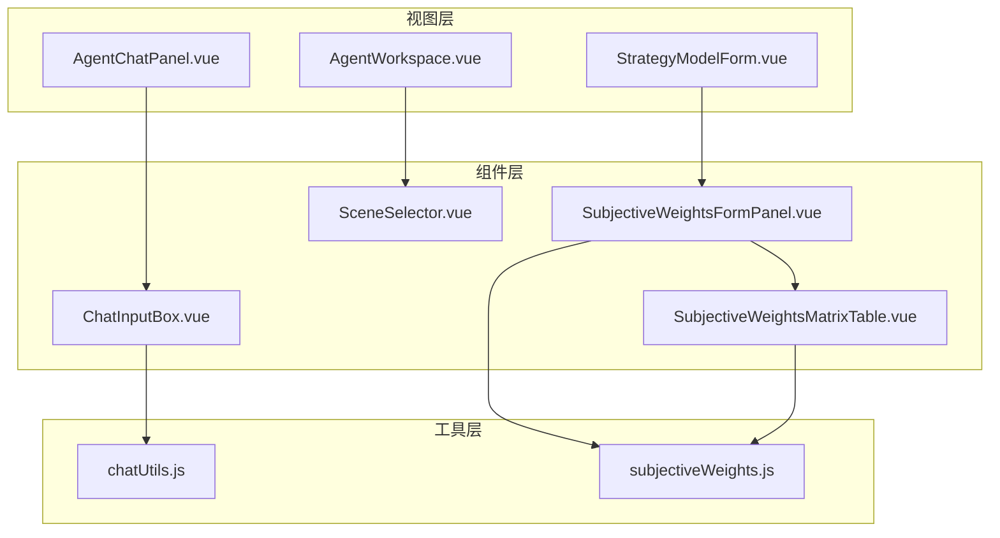
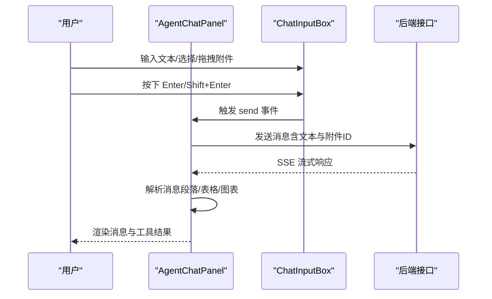
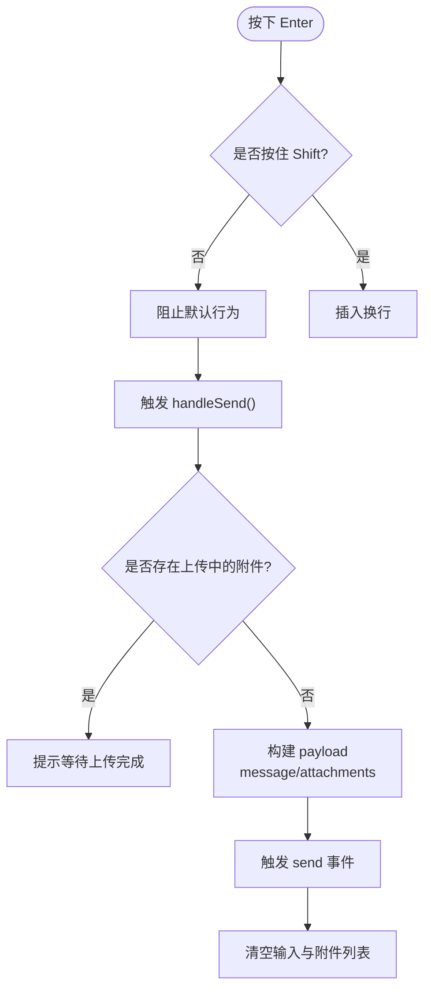
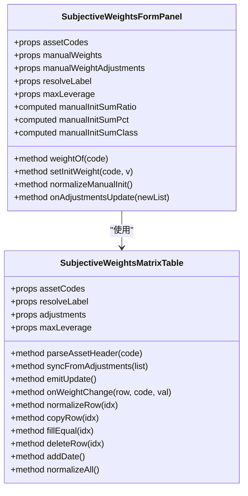
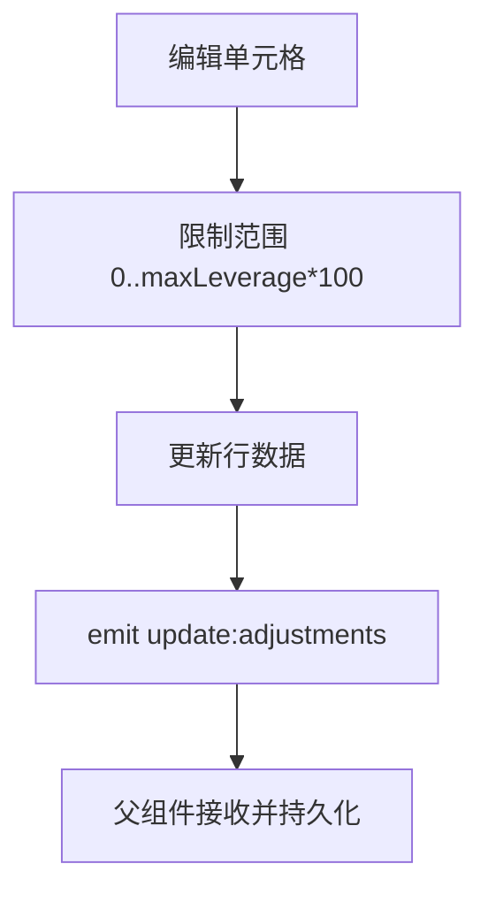
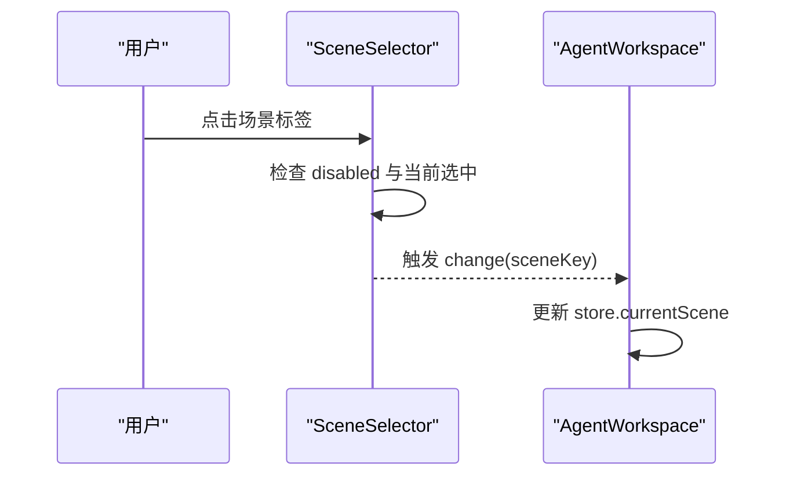
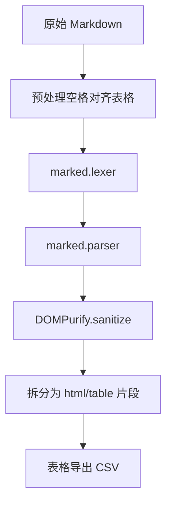
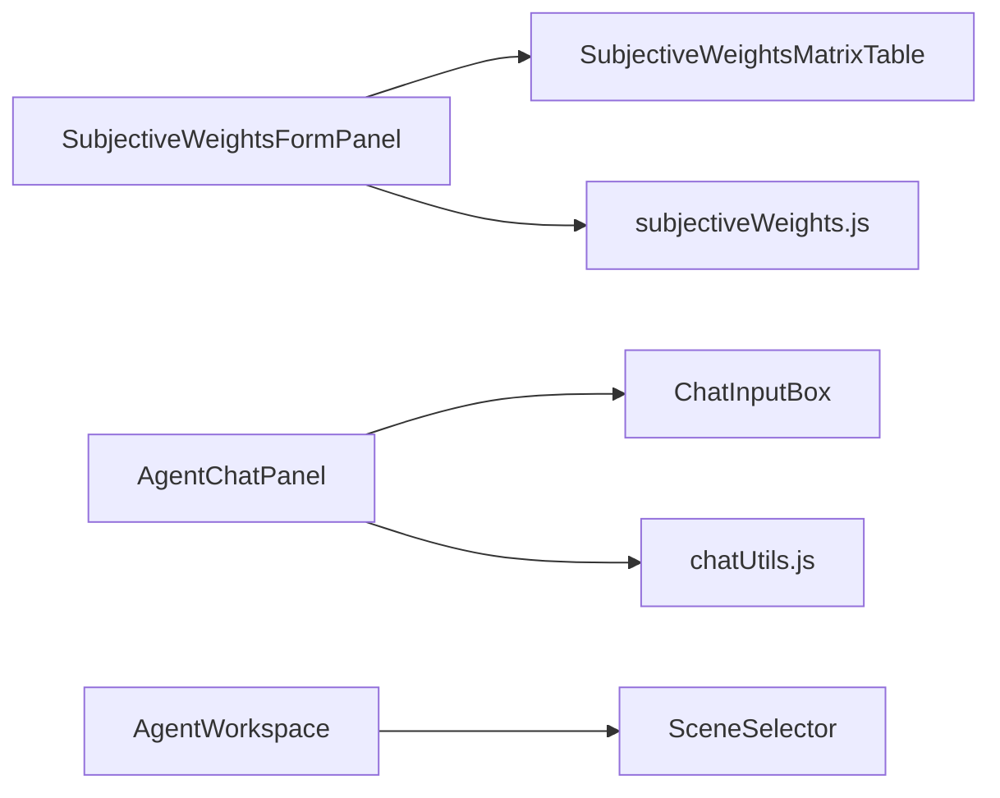

# 表单输入组件

<cite>
**本文引用的文件**
- [ChatInputBox.vue](file://src/components/ChatInputBox.vue)
- [SubjectiveWeightsFormPanel.vue](file://src/components/SubjectiveWeightsFormPanel.vue)
- [SubjectiveWeightsMatrixTable.vue](file://src/components/SubjectiveWeightsMatrixTable.vue)
- [SceneSelector.vue](file://src/components/SceneSelector.vue)
- [chatUtils.js](file://src/components/chatUtils.js)
- [subjectiveWeights.js](file://src/utils/subjectiveWeights.js)
- [AgentChatPanel.vue](file://src/components/AgentChatPanel.vue)
- [AgentWorkspace.vue](file://src/views/agent/AgentWorkspace.vue)
- [StrategyModelForm.vue](file://src/views/strategy/StrategyModelForm.vue)
</cite>

## 目录
1. [简介](#简介)
2. [项目结构](#项目结构)
3. [核心组件](#核心组件)
4. [架构总览](#架构总览)
5. [组件详解](#组件详解)
6. [依赖关系分析](#依赖关系分析)
7. [性能考量](#性能考量)
8. [故障排查指南](#故障排查指南)
9. [结论](#结论)
10. [附录](#附录)

## 简介
本文件聚焦于表单输入组件，涵盖以下能力：
- 聊天输入框：文本输入、快捷键、拖拽/选择附件上传、发送事件
- 主观权重表单面板：权重输入、滑块/数值微调联动、实时合计、批量归一化、矩阵预设调仓编辑
- 场景选择器：横向标签式选择、样式定制、禁用态、事件回调
- 通用工具：Markdown 渲染、表格解析、表格导出、节流/防抖

目标是帮助开发者快速理解并正确使用这些组件，包括 API、数据格式、事件处理、样式定制与无障碍支持。

## 项目结构
围绕表单输入与表单编辑的关键文件组织如下：
- 组件层：ChatInputBox、SubjectiveWeightsFormPanel、SubjectiveWeightsMatrixTable、SceneSelector
- 工具层：chatUtils（Markdown/表格/导出）、subjectiveWeights（权重归一化）
- 视图层：AgentChatPanel（集成输入框与消息渲染）、AgentWorkspace（场景选择器容器）、StrategyModelForm（主观权重表单面板容器）

**图表来源**
- [AgentChatPanel.vue:206-208](file://src/components/AgentChatPanel.vue#L206-L208)
- [AgentWorkspace.vue:55-60](file://src/views/agent/AgentWorkspace.vue#L55-L60)
- [StrategyModelForm.vue:123-133](file://src/views/strategy/StrategyModelForm.vue#L123-L133)
- [ChatInputBox.vue:1-69](file://src/components/ChatInputBox.vue#L1-L69)
- [SubjectiveWeightsFormPanel.vue:1-70](file://src/components/SubjectiveWeightsFormPanel.vue#L1-L70)
- [SubjectiveWeightsMatrixTable.vue:1-130](file://src/components/SubjectiveWeightsMatrixTable.vue#L1-L130)
- [chatUtils.js:1-479](file://src/components/chatUtils.js#L1-L479)
- [subjectiveWeights.js:1-50](file://src/utils/subjectiveWeights.js#L1-L50)

**章节来源**
- [AgentChatPanel.vue:206-208](file://src/components/AgentChatPanel.vue#L206-L208)
- [AgentWorkspace.vue:55-60](file://src/views/agent/AgentWorkspace.vue#L55-L60)
- [StrategyModelForm.vue:123-133](file://src/views/strategy/StrategyModelForm.vue#L123-L133)

## 核心组件
- ChatInputBox：聊天输入框，支持文本输入、快捷键 Enter/Shift+Enter、拖拽/选择附件上传、发送事件
- SubjectiveWeightsFormPanel：主观权重表单面板，包含默认权重初始化与矩阵预设调仓两部分
- SubjectiveWeightsMatrixTable：矩阵表格，支持日期列、动态资产列、合计列、批量操作（归一化、复制、等权填充、删除）
- SceneSelector：场景选择器，横向标签式，支持禁用态、样式定制、事件回调

**章节来源**
- [ChatInputBox.vue:74-195](file://src/components/ChatInputBox.vue#L74-L195)
- [SubjectiveWeightsFormPanel.vue:79-158](file://src/components/SubjectiveWeightsFormPanel.vue#L79-L158)
- [SubjectiveWeightsMatrixTable.vue:135-424](file://src/components/SubjectiveWeightsMatrixTable.vue#L135-L424)
- [SceneSelector.vue:23-51](file://src/components/SceneSelector.vue#L23-L51)

## 架构总览
组件间协作关系：
- AgentChatPanel 集成 ChatInputBox 并负责消息流式渲染与工具调用结果展示
- AgentWorkspace 集成 SceneSelector，承载场景切换与快捷问题
- StrategyModelForm 集成 SubjectiveWeightsFormPanel，承载主观权重编辑与保存校验
- SubjectiveWeightsFormPanel 内部使用 SubjectiveWeightsMatrixTable 实现矩阵编辑
- 工具模块 chatUtils 负责 Markdown 渲染、表格解析与导出；subjectiveWeights 负责权重归一化

**图表来源**
- [AgentChatPanel.vue:788-800](file://src/components/AgentChatPanel.vue#L788-L800)
- [ChatInputBox.vue:104-129](file://src/components/ChatInputBox.vue#L104-L129)
- [chatUtils.js:167-233](file://src/components/chatUtils.js#L167-L233)

**章节来源**
- [AgentChatPanel.vue:227-427](file://src/components/AgentChatPanel.vue#L227-L427)
- [ChatInputBox.vue:74-195](file://src/components/ChatInputBox.vue#L74-L195)
- [chatUtils.js:1-479](file://src/components/chatUtils.js#L1-L479)

## 组件详解

### ChatInputBox 聊天输入框
- 输入处理
  - 文本输入：v-model 绑定 inputText，支持多行文本、最大高度限制
  - 快捷键：Enter 发送，Shift+Enter 换行；Enter 时阻止默认行为
  - 发送逻辑：检查是否存在上传中的附件；若无附件或文本有效则触发 send 事件
- 附件上传
  - 支持文件选择与拖拽放置，仅接受 .xlsx/.xls/.csv
  - 上传状态：loading/成功/失败，列表展示并支持移除
  - 上传成功后返回 attachment_id，作为发送 payload 的附件列表
- 可访问性与体验
  - 禁用态：当 isLoading=true 时禁用输入与按钮
  - 占位提示：根据 isLoading 动态提示
  - 拖拽覆盖层：高亮提示拖拽区域
- API
  - 属性
    - isLoading: Boolean，是否处于流式发送状态
  - 事件
    - send: 携带 { message: string, attachments: string[] }
  - 方法
    - setText(text): 外部调用设置输入框文本
    - triggerFileSelect(): 触发隐藏文件选择器
- 数据格式
  - 发送 payload: { message: 非空字符串, attachments: 成功上传的附件ID数组 }
- 样式定制
  - 通过 scoped 样式覆盖 .input-area、.input-wrapper、.attach-btn、.send-btn 等节点
  - 拖拽态样式：.drag-over
- 使用示例
  - 在 AgentChatPanel 中监听 @send，调用 sendMessageStream 并处理 SSE
  - 在 AgentWorkspace 中通过快捷问题调用 setText 并 handleSend

**图表来源**
- [ChatInputBox.vue:98-129](file://src/components/ChatInputBox.vue#L98-L129)
- [ChatInputBox.vue:166-183](file://src/components/ChatInputBox.vue#L166-L183)

**章节来源**
- [ChatInputBox.vue:74-195](file://src/components/ChatInputBox.vue#L74-L195)
- [AgentChatPanel.vue:788-800](file://src/components/AgentChatPanel.vue#L788-L800)
- [AgentWorkspace.vue:224-234](file://src/views/agent/AgentWorkspace.vue#L224-L234)

### SubjectiveWeightsFormPanel 主观权重表单面板
- 默认资产权重（初始化）
  - 每个资产一行：标签、滑块、数值微调、占比条形图
  - 滑块步进 0.01，数值步进 0.05，精度 2 位
  - 实时合计：计算已选资产权重之和，超过 100% 时高亮警告
  - 归一化：将合计缩放至 100%，使用最大余数法保证精度
- 预设调仓日期与权重（矩阵）
  - 通过 SubjectiveWeightsMatrixTable 编辑各调仓日的目标权重
  - 支持行内归一化、复制行、等权填充、删除
  - 至少保留一条已填日期的记录
- API
  - 属性
    - assetCodes: Array，资产代码列表
    - manualWeights: Object，初始权重映射 { code: ratio }
    - manualWeightAdjustments: Array，预设调仓列表（与矩阵表格一致格式）
    - resolveLabel: Function，将 code 解析为显示标签
    - maxLeverage: Number，最大杠杆倍数（影响矩阵输入上限）
  - 事件
    - update:manualWeightAdjustments: 更新矩阵列表
- 数据格式
  - manualWeights: { [assetCode]: number 0..1 }
  - manualWeightAdjustments: [{ date: string, weights: { [code]: number }, auto_normalize: boolean }]
- 样式定制
  - 通过 scoped 样式覆盖 .swfp-editor、.weight-bar-fill、.subjective-sum-bar 等
- 使用示例
  - 在 StrategyModelForm 中绑定 form.parameters.manual_weights 与 manual_weight_adjustments
  - 监听矩阵更新事件，同步回 form.parameters.manual_weight_adjustments

**图表来源**
- [SubjectiveWeightsFormPanel.vue:79-158](file://src/components/SubjectiveWeightsFormPanel.vue#L79-L158)
- [SubjectiveWeightsMatrixTable.vue:135-424](file://src/components/SubjectiveWeightsMatrixTable.vue#L135-L424)
- [subjectiveWeights.js:10-37](file://src/utils/subjectiveWeights.js#L10-L37)

**章节来源**
- [SubjectiveWeightsFormPanel.vue:79-158](file://src/components/SubjectiveWeightsFormPanel.vue#L79-L158)
- [SubjectiveWeightsMatrixTable.vue:135-424](file://src/components/SubjectiveWeightsMatrixTable.vue#L135-L424)
- [StrategyModelForm.vue:123-133](file://src/views/strategy/StrategyModelForm.vue#L123-L133)

### SubjectiveWeightsMatrixTable 矩阵表格
- 列结构
  - 序号列、调仓日期列（日期选择器）、动态资产列（百分比输入）、合计列、操作列
- 输入与校验
  - 百分比输入：0-100，步进 5，精度 2 位；受 maxLeverage 限制
  - Tab 键导航：支持 Shift+Tab 前进/后退
  - 行求和：合计列按行计算百分比，颜色区分 under/ok/over
- 批量操作
  - 归一化单行：使用最大余数法将行权重缩放至 100%
  - 复制行：复制上一行权重
  - 等权填充：按资产数等分为 100%
  - 删除行：删除当前行
  - 批量归一化：逐行归一化
- API
  - 属性
    - assetCodes: Array
    - resolveLabel: Function
    - adjustments: Array
    - maxLeverage: Number
  - 事件
    - update:adjustments: 同步表格数据到父组件
- 数据格式
  - 表格行：{ _idx, date, auto_normalize, w_code: number }
  - emit 数据：与 manualWeightAdjustments 一致

**图表来源**
- [SubjectiveWeightsMatrixTable.vue:233-241](file://src/components/SubjectiveWeightsMatrixTable.vue#L233-L241)
- [SubjectiveWeightsMatrixTable.vue:312-325](file://src/components/SubjectiveWeightsMatrixTable.vue#L312-L325)

**章节来源**
- [SubjectiveWeightsMatrixTable.vue:135-424](file://src/components/SubjectiveWeightsMatrixTable.vue#L135-L424)
- [subjectiveWeights.js:10-37](file://src/utils/subjectiveWeights.js#L10-L37)

### SceneSelector 场景选择器
- 选项配置
  - scenes: Array，元素包含 { key, label, icon, color, disabled? }
  - currentScene: String，当前选中场景 key
- 交互模式
  - 单选：点击未禁用标签触发 change 事件
  - 禁用态：disabled=true 时透明度降低、禁用点击
- 自定义渲染
  - 标签样式：通过 --scene-color、color、backgroundColor、borderColor 动态绑定
  - 图标与徽标：支持 icon 与“即将上线”徽标
- API
  - 属性
    - scenes: Array
    - currentScene: String
  - 事件
    - change(sceneKey): 仅在 key 不等于当前值时触发
- 使用示例
  - 在 AgentWorkspace 中绑定 scenes 与 currentScene，并监听 change 更新 store

**图表来源**
- [SceneSelector.vue:35-40](file://src/components/SceneSelector.vue#L35-L40)
- [AgentWorkspace.vue:164-173](file://src/views/agent/AgentWorkspace.vue#L164-L173)

**章节来源**
- [SceneSelector.vue:23-51](file://src/components/SceneSelector.vue#L23-L51)
- [AgentWorkspace.vue:55-60](file://src/views/agent/AgentWorkspace.vue#L55-L60)

### 通用工具：Markdown/表格/导出
- Markdown 渲染与表格识别
  - 使用 marked 渲染，支持 GFM 与换行
  - 自动识别“空格对齐表格”，转换为 GFM 表格
  - DOMPurify 消毒，仅允许安全标签与属性
- 表格解析与分段
  - parseMessageSegments：将消息拆分为 html/table 片段
  - getMessageDataTables：从工具调用结果中抽取表格数据，支持去重与 traceable 元数据
- 表格导出
  - 事件委托：点击表格导出按钮，导出 CSV（含 BOM）
- 性能优化
  - 节流：scrollToBottom 使用节流减少高频滚动开销
  - 防抖：消息长度变化时滚动到底部

**图表来源**
- [chatUtils.js:59-111](file://src/components/chatUtils.js#L59-L111)
- [chatUtils.js:167-233](file://src/components/chatUtils.js#L167-L233)
- [chatUtils.js:242-261](file://src/components/chatUtils.js#L242-L261)
- [chatUtils.js:717-757](file://src/components/chatUtils.js#L717-L757)

**章节来源**
- [chatUtils.js:1-479](file://src/components/chatUtils.js#L1-L479)

## 依赖关系分析
- 组件耦合
  - SubjectiveWeightsFormPanel 依赖 SubjectiveWeightsMatrixTable 与 subjectiveWeights 工具
  - AgentChatPanel 依赖 ChatInputBox 与 chatUtils
  - SceneSelector 为纯展示组件，低耦合
- 外部依赖
  - Element UI：el-input、el-input-number、el-slider、el-button、el-tag、el-date-picker 等
  - vxe-table：SubjectiveWeightsMatrixTable 的表格能力
- 数据流
  - 表单组件通过 props 接收数据，通过事件向上游同步
  - 矩阵表格通过 update:adjustments 与父组件保持引用一致

**图表来源**
- [SubjectiveWeightsFormPanel.vue:77-78](file://src/components/SubjectiveWeightsFormPanel.vue#L77-L78)
- [SubjectiveWeightsMatrixTable.vue](file://src/components/SubjectiveWeightsMatrixTable.vue#L133)
- [AgentChatPanel.vue:238-242](file://src/components/AgentChatPanel.vue#L238-L242)
- [AgentWorkspace.vue:109-110](file://src/views/agent/AgentWorkspace.vue#L109-L110)

**章节来源**
- [SubjectiveWeightsFormPanel.vue:79-158](file://src/components/SubjectiveWeightsFormPanel.vue#L79-L158)
- [SubjectiveWeightsMatrixTable.vue:135-424](file://src/components/SubjectiveWeightsMatrixTable.vue#L135-L424)
- [AgentChatPanel.vue:244-247](file://src/components/AgentChatPanel.vue#L244-L247)
- [AgentWorkspace.vue:113-116](file://src/views/agent/AgentWorkspace.vue#L113-L116)

## 性能考量
- 表单输入
  - 文本输入使用 v-model 双向绑定，建议配合防抖/节流在上游处理高频输入
  - 附件上传采用异步，避免阻塞 UI
- 表格编辑
  - 矩阵表格使用 vxe-table，注意大数据量时的虚拟滚动与列宽设置
  - 合计与归一化操作在前端完成，建议在大列表时减少不必要的重排
- 渲染与滚动
  - 消息列表使用虚拟滚动，滚动采用节流，避免频繁 DOM 操作
  - 表格导出采用事件委托，减少绑定数量

[本节为通用指导，无需具体文件分析]

## 故障排查指南
- 附件上传失败
  - 现象：上传状态标记为 error，提示失败
  - 排查：确认后端接口返回包含 attachment_id；检查文件类型与大小限制
  - 相关实现：[ChatInputBox.vue:166-183](file://src/components/ChatInputBox.vue#L166-L183)
- 发送按钮不可用
  - 现象：canSend=false，发送按钮禁用
  - 排查：确认 isLoading=false，且 inputText 非空或存在成功上传的附件
  - 相关实现：[ChatInputBox.vue:89-96](file://src/components/ChatInputBox.vue#L89-L96)
- 权重合计超过 100%
  - 现象：合计行高亮警告
  - 排查：使用“归一化到 100%”或手动调整权重
  - 相关实现：[SubjectiveWeightsFormPanel.vue:104-114](file://src/components/SubjectiveWeightsFormPanel.vue#L104-L114)
- 矩阵表格输入越界
  - 现象：输入超出 0-100 或超过 maxLeverage
  - 排查：受控输入范围，必要时使用归一化
  - 相关实现：[SubjectiveWeightsMatrixTable.vue:233-241](file://src/components/SubjectiveWeightsMatrixTable.vue#L233-L241)
- 表格导出为空
  - 现象：点击导出按钮无反应
  - 排查：确认表格存在于 DOM 中，事件委托作用范围内
  - 相关实现：[AgentChatPanel.vue:717-757](file://src/components/AgentChatPanel.vue#L717-L757)

**章节来源**
- [ChatInputBox.vue:166-183](file://src/components/ChatInputBox.vue#L166-L183)
- [ChatInputBox.vue:89-96](file://src/components/ChatInputBox.vue#L89-L96)
- [SubjectiveWeightsFormPanel.vue:104-114](file://src/components/SubjectiveWeightsFormPanel.vue#L104-L114)
- [SubjectiveWeightsMatrixTable.vue:233-241](file://src/components/SubjectiveWeightsMatrixTable.vue#L233-L241)
- [AgentChatPanel.vue:717-757](file://src/components/AgentChatPanel.vue#L717-L757)

## 结论
本文系统梳理了聊天输入框、主观权重表单面板、矩阵表格与场景选择器的实现与使用方法，给出了 API、数据格式、事件处理、样式定制与性能优化建议。结合 chatUtils 与 subjectiveWeights 工具，可实现从输入到渲染、从编辑到提交的完整闭环。

[本节为总结，无需具体文件分析]

## 附录

### API 一览（按组件）
- ChatInputBox
  - 属性
    - isLoading: Boolean
  - 事件
    - send: { message: string, attachments: string[] }
  - 方法
    - setText(text): 设置输入框文本
    - triggerFileSelect(): 触发文件选择
  - 数据格式
    - message: 非空字符串；attachments: 成功上传的附件ID数组
  - 参考路径
    - [ChatInputBox.vue:76-81](file://src/components/ChatInputBox.vue#L76-L81)
    - [ChatInputBox.vue:104-129](file://src/components/ChatInputBox.vue#L104-L129)

- SubjectiveWeightsFormPanel
  - 属性
    - assetCodes: Array
    - manualWeights: Object
    - manualWeightAdjustments: Array
    - resolveLabel: Function
    - maxLeverage: Number
  - 事件
    - update:manualWeightAdjustments: Array
  - 方法
    - weightOf(code): number
    - setInitWeight(code, v): 设置权重
    - normalizeManualInit(): 归一化到 100%
  - 数据格式
    - manualWeights: { [code]: number 0..1 }
    - adjustments: [{ date: string, weights: { [code]: number }, auto_normalize: boolean }]
  - 参考路径
    - [SubjectiveWeightsFormPanel.vue:82-103](file://src/components/SubjectiveWeightsFormPanel.vue#L82-L103)
    - [SubjectiveWeightsFormPanel.vue:115-148](file://src/components/SubjectiveWeightsFormPanel.vue#L115-L148)

- SubjectiveWeightsMatrixTable
  - 属性
    - assetCodes: Array
    - resolveLabel: Function
    - adjustments: Array
    - maxLeverage: Number
  - 事件
    - update:adjustments: Array
  - 方法
    - onWeightChange(row, code, val): 设置权重
    - normalizeRow(idx): 行内归一化
    - copyRow(idx): 复制行
    - fillEqual(idx): 等权填充
    - deleteRow(idx): 删除行
    - addDate(): 添加行
    - normalizeAll(): 批量归一化
  - 数据格式
    - 行数据：{ _idx, date, auto_normalize, w_code: number }
  - 参考路径
    - [SubjectiveWeightsMatrixTable.vue:137-142](file://src/components/SubjectiveWeightsMatrixTable.vue#L137-L142)
    - [SubjectiveWeightsMatrixTable.vue:233-380](file://src/components/SubjectiveWeightsMatrixTable.vue#L233-L380)

- SceneSelector
  - 属性
    - scenes: Array
    - currentScene: String
  - 事件
    - change(sceneKey): 仅在 key 变化时触发
  - 参考路径
    - [SceneSelector.vue:25-34](file://src/components/SceneSelector.vue#L25-L34)
    - [SceneSelector.vue:35-40](file://src/components/SceneSelector.vue#L35-L40)

### 使用示例与数据绑定
- 聊天输入框
  - 在 AgentChatPanel 中监听 @send，调用 sendMessageStream 并处理 SSE
  - 在 AgentWorkspace 中通过快捷问题调用 setText 并 handleSend
  - 参考路径
    - [AgentChatPanel.vue:788-800](file://src/components/AgentChatPanel.vue#L788-L800)
    - [AgentWorkspace.vue:224-234](file://src/views/agent/AgentWorkspace.vue#L224-L234)

- 主观权重表单面板
  - 在 StrategyModelForm 中绑定 form.parameters.manual_weights 与 manual_weight_adjustments
  - 监听矩阵更新事件，同步回 form.parameters.manual_weight_adjustments
  - 参考路径
    - [StrategyModelForm.vue:123-133](file://src/views/strategy/StrategyModelForm.vue#L123-L133)

### 无障碍与输入法兼容
- 无障碍
  - 使用语义化标签与图标，提供颜色与形状之外的信息
  - 禁用态与高亮状态需保持对比度，确保可读性
- 输入法兼容
  - 文本输入框支持拼音输入与候选词，建议在上游进行防抖
  - 数值输入框支持上下箭头与 +/- 按钮，Tab 键导航提升键盘效率

[本节为通用指导，无需具体文件分析]