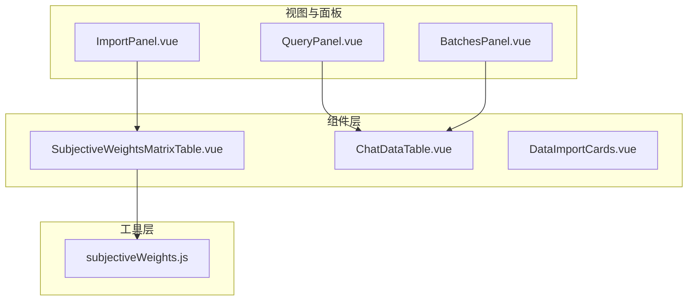
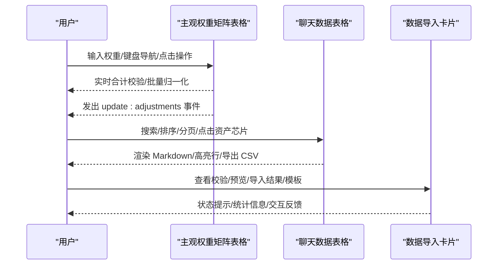
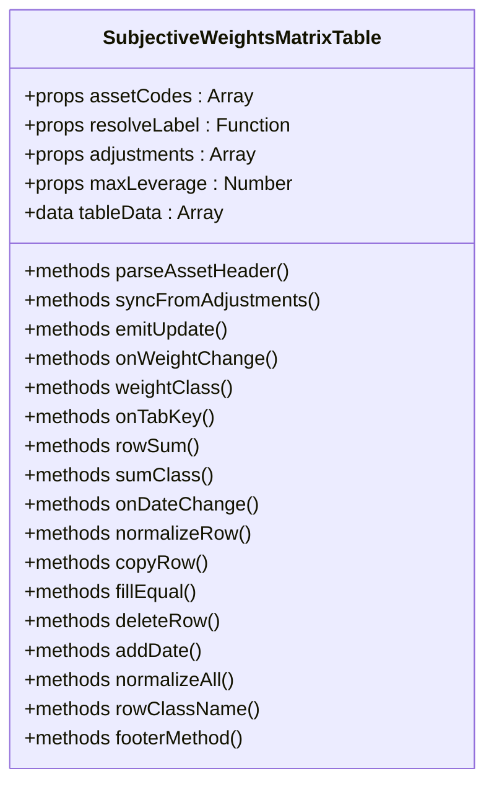
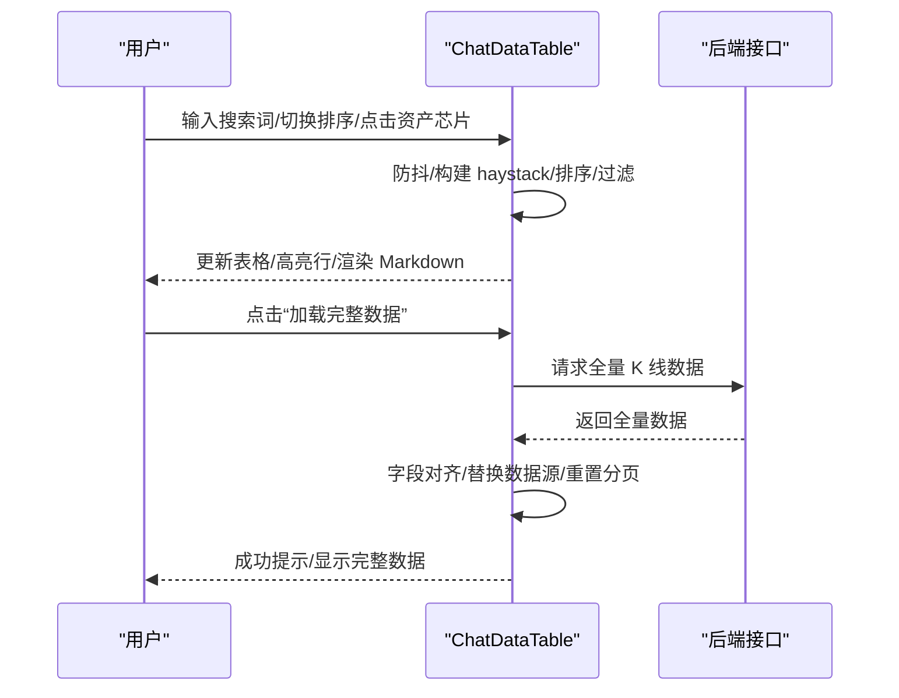
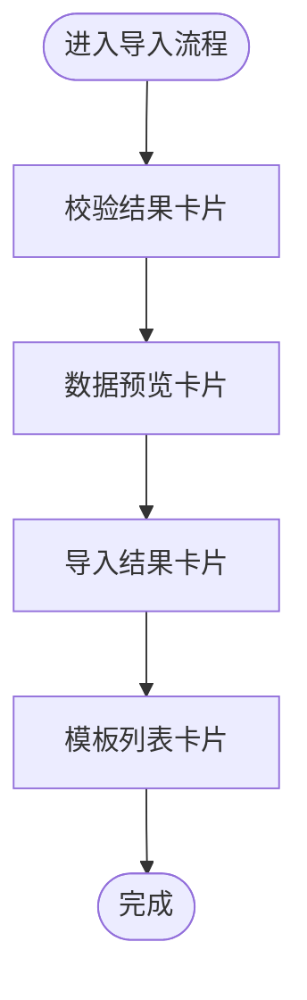
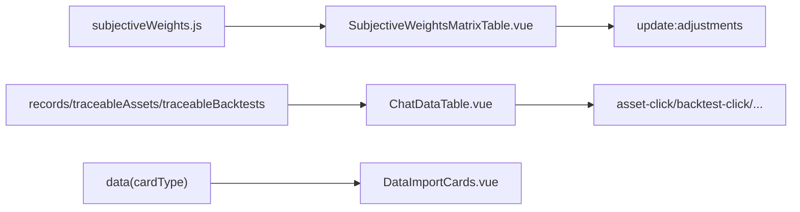

# 表格组件

<cite>
**本文档引用的文件**
- [SubjectiveWeightsMatrixTable.vue](file://src/components/SubjectiveWeightsMatrixTable.vue)
- [ChatDataTable.vue](file://src/components/ChatDataTable.vue)
- [DataImportCards.vue](file://src/components/DataImportCards.vue)
- [subjectiveWeights.js](file://src/utils/subjectiveWeights.js)
- [ImportPanel.vue](file://src/views/analysis/SubjectRisk/ImportPanel.vue)
- [QueryPanel.vue](file://src/views/analysis/SubjectRisk/QueryPanel.vue)
- [BatchesPanel.vue](file://src/views/analysis/SubjectRisk/BatchesPanel.vue)
</cite>

## 目录
1. [简介](#简介)
2. [项目结构](#项目结构)
3. [核心组件](#核心组件)
4. [架构总览](#架构总览)
5. [详细组件分析](#详细组件分析)
6. [依赖关系分析](#依赖关系分析)
7. [性能考量](#性能考量)
8. [故障排查指南](#故障排查指南)
9. [结论](#结论)
10. [附录](#附录)

## 简介
本文件聚焦于三个表格相关组件的详细说明与使用指导：
- 主观权重矩阵表格：支持多资产权重输入、实时校验与归一化、合计校验、批量操作与键盘导航。
- 聊天数据表格：支持动态列、搜索、排序、分页、Markdown 内联渲染、资产芯片交互、全量数据补拉。
- 数据导入卡片：用于展示数据校验结果、预览、导入结果与模板列表。

文档涵盖数据格式、列定义、事件处理、样式定制、使用示例、性能优化、响应式与可访问性、键盘导航、批量操作等。

## 项目结构
围绕表格组件的关键文件组织如下：
- 组件层：SubjectiveWeightsMatrixTable.vue、ChatDataTable.vue、DataImportCards.vue
- 工具函数：subjectiveWeights.js（权重归一化）
- 视图与面板：SubjectRisk 模块下的 ImportPanel、QueryPanel、BatchesPanel（演示表格使用场景）

**图表来源**
- [SubjectiveWeightsMatrixTable.vue](file://src/components/SubjectiveWeightsMatrixTable.vue)
- [ChatDataTable.vue](file://src/components/ChatDataTable.vue)
- [DataImportCards.vue](file://src/components/DataImportCards.vue)
- [subjectiveWeights.js](file://src/utils/subjectiveWeights.js)
- [ImportPanel.vue](file://src/views/analysis/SubjectRisk/ImportPanel.vue)
- [QueryPanel.vue](file://src/views/analysis/SubjectRisk/QueryPanel.vue)
- [BatchesPanel.vue](file://src/views/analysis/SubjectRisk/BatchesPanel.vue)

**章节来源**
- [SubjectiveWeightsMatrixTable.vue](file://src/components/SubjectiveWeightsMatrixTable.vue)
- [ChatDataTable.vue](file://src/components/ChatDataTable.vue)
- [DataImportCards.vue](file://src/components/DataImportCards.vue)
- [subjectiveWeights.js](file://src/utils/subjectiveWeights.js)
- [ImportPanel.vue](file://src/views/analysis/SubjectRisk/ImportPanel.vue)
- [QueryPanel.vue](file://src/views/analysis/SubjectRisk/QueryPanel.vue)
- [BatchesPanel.vue](file://src/views/analysis/SubjectRisk/BatchesPanel.vue)

## 核心组件
- 主观权重矩阵表格（SubjectiveWeightsMatrixTable）
  - 支持动态资产列、日期列、合计列与操作列
  - 权重输入范围与精度控制、合计校验、键盘 Tab 流转
  - 归一化、复制行、等权填充、删除行、批量归一化
  - 事件：update:adjustments（向外发出调整后的权重数据）
- 聊天数据表格（ChatDataTable）
  - 动态列生成、列类型推断、排序、搜索、分页
  - Markdown 内联渲染、资产芯片交互、策略芯片交互
  - 全量数据补拉、CSV 导出、行高亮、展开/折叠
- 数据导入卡片（DataImportCards）
  - 校验结果、预览、导入结果、模板列表四种卡片类型
  - 状态显示、进度指示、交互反馈

**章节来源**
- [SubjectiveWeightsMatrixTable.vue](file://src/components/SubjectiveWeightsMatrixTable.vue)
- [ChatDataTable.vue](file://src/components/ChatDataTable.vue)
- [DataImportCards.vue](file://src/components/DataImportCards.vue)

## 架构总览
三个组件分别承担不同职责：
- 主观权重矩阵表格：面向权重编辑与校验，输出标准化的权重调整数据
- 聊天数据表格：面向数据浏览与交互，提供搜索、排序、分页与导出能力
- 数据导入卡片：面向导入流程的状态展示与反馈

**图表来源**
- [SubjectiveWeightsMatrixTable.vue](file://src/components/SubjectiveWeightsMatrixTable.vue)
- [ChatDataTable.vue](file://src/components/ChatDataTable.vue)
- [DataImportCards.vue](file://src/components/DataImportCards.vue)

## 详细组件分析

### 主观权重矩阵表格（SubjectiveWeightsMatrixTable）
- 行列配置
  - 序号列（固定左侧）
  - 日期列（可编辑日期选择器）
  - 动态资产列（根据 assetCodes 动态生成，列宽与对齐可配置）
  - 合计列（右侧固定，显示每行合计百分比，颜色区分是否达标）
  - 操作列（右侧固定，包含归一化、复制行、等权填充、删除）
- 权重输入方式
  - 使用数字输入框，支持步进按钮与键盘输入
  - 输入范围受 maxLeverage 限制（百分比）
  - 精度控制为百分比两位小数
- 数值验证规则
  - 合计校验：小于 100% 显示为“不足”，大于 100% 显示为“超限”，等于 100% 显示为“达标”
  - 0 值显示为浅灰，>50% 显示为加粗
- 实时计算功能
  - 行合计实时计算并显示
  - 归一化将权重按比例缩放至 100%，使用最大余数法确保精度
  - 批量归一化与等权填充
- 键盘导航
  - Tab/Shift+Tab 在权重单元格间移动，自动聚焦到目标输入框
- 事件与数据格式
  - 外部传入：assetCodes（资产代码数组）、resolveLabel（标签解析函数）、adjustments（初始权重数据）、maxLeverage（最大杠杆）
  - 内部维护 tableData（表格行数据）
  - 事件：update:adjustments（向外发出标准化的权重调整数据）
  - 数据格式要点：
    - adjustments 每项包含 date、weights（资产代码到权重的映射，单位为小数 0~1）、auto_normalize
    - 表格内部以百分比字符串存储，对外发出时转换为小数 0~1
- 性能与体验
  - 使用 vxe-table，支持固定列、紧凑行高、斑马纹
  - 合计列使用 footerMethod 计算平均权重
  - 行类名根据奇偶行设置

**图表来源**
- [SubjectiveWeightsMatrixTable.vue](file://src/components/SubjectiveWeightsMatrixTable.vue)

**章节来源**
- [SubjectiveWeightsMatrixTable.vue](file://src/components/SubjectiveWeightsMatrixTable.vue)
- [subjectiveWeights.js](file://src/utils/subjectiveWeights.js)

### 聊天数据表格（ChatDataTable）
- 数据渲染与列配置
  - 动态列：基于 records 推断列名与类型，自动设置对齐与最小宽度
  - 列类型检测：数字、日期、字符串
  - 百分比字段识别：根据字段名关键词自动标注为百分比
  - 单元格渲染：支持 Markdown 内联渲染（加粗、斜体、代码、删除线），资产列支持点击与悬停高亮
- 排序与筛选
  - 自定义排序：支持升/降序切换，排序状态持久化
  - 全字段模糊搜索：输入防抖、haystack 缓存加速、输入框失焦后自动补回焦点
- 分页机制
  - 预览模式：默认仅显示前 previewLimit 行，不分页
  - 正常模式：按 pageSize 分页，支持切换页码与页面大小
- 交互与反馈
  - 资产芯片：代表资产与参考资产分组展示，支持展开/折叠、渐进渲染
  - 策略芯片：展示回测记录关联的策略，点击弹出详情
  - 行高亮：悬停资产芯片时高亮对应行
  - 导出 CSV：按当前排序与格式导出
- 全量数据补拉
  - 后端缩略场景：根据推断的资产与日期区间一键拉取完整数据，字段对齐后替换数据源
- 事件与数据格式
  - 外部传入：records（数组）、summary（摘要）、recordCount（记录总数）、stepKey（导出文件名前缀）、traceableAssets（可追踪资产）、traceableBacktests（可追踪策略）
  - 内部计算：columns、sortedData、filteredRecords、pagedData
  - 事件：asset-click、backtest-click、asset-hover、asset-leave
- 性能优化
  - 搜索：防抖 + IME 合成状态判断 + haystack 缓存
  - 渲染：参考资产渐进渲染（requestIdleCallback/定时器），避免主线程卡顿
  - Markdown：LRU 缓存渲染结果
  - 展开状态缓存：模块级 expandStateCache，防虚拟滚动重建后状态丢失

**图表来源**
- [ChatDataTable.vue](file://src/components/ChatDataTable.vue)

**章节来源**
- [ChatDataTable.vue](file://src/components/ChatDataTable.vue)

### 数据导入卡片（DataImportCards）
- 布局设计
  - 四种卡片类型：校验结果、数据预览、导入结果、模板列表
  - 统一样式：圆角边框、浅色背景、信息分层排版
- 状态显示
  - 校验结果：通过/未通过图标与提示，错误与警告列表，检测信息（行数、日期范围、列）
  - 预览：表格预览前若干行
  - 导入结果：新增/更新/跳过/错误统计，消息提示
  - 模板列表：图标 + 标题 + 描述
- 进度指示
  - 导入流程步骤（提交请求、请求上游、解析数据、写入 Mongo、完成）
- 交互反馈
  - 校验/预览/结果卡片均可直接查看详细信息与统计数据
  - 模板列表展示模板信息，便于选择

**图表来源**
- [DataImportCards.vue](file://src/components/DataImportCards.vue)

**章节来源**
- [DataImportCards.vue](file://src/components/DataImportCards.vue)

## 依赖关系分析
- 主观权重矩阵表格
  - 依赖工具函数：权重归一化（百分比两位小数）
  - 依赖外部数据：assetCodes、resolveLabel、adjustments、maxLeverage
  - 事件：update:adjustments
- 聊天数据表格
  - 依赖外部数据：records、traceableAssets、traceableBacktests
  - 依赖工具：Markdown 内联渲染、haystack 缓存、expandState 缓存
  - 事件：asset-click、backtest-click、asset-hover、asset-leave
- 数据导入卡片
  - 依赖外部数据：data（对象或数组，按 cardType 决定结构）

**图表来源**
- [SubjectiveWeightsMatrixTable.vue](file://src/components/SubjectiveWeightsMatrixTable.vue)
- [ChatDataTable.vue](file://src/components/ChatDataTable.vue)
- [DataImportCards.vue](file://src/components/DataImportCards.vue)
- [subjectiveWeights.js](file://src/utils/subjectiveWeights.js)

**章节来源**
- [SubjectiveWeightsMatrixTable.vue](file://src/components/SubjectiveWeightsMatrixTable.vue)
- [ChatDataTable.vue](file://src/components/ChatDataTable.vue)
- [DataImportCards.vue](file://src/components/DataImportCards.vue)
- [subjectiveWeights.js](file://src/utils/subjectiveWeights.js)

## 性能考量
- 主观权重矩阵表格
  - 使用 vxe-table，紧凑行高与斑马纹减少视觉负担
  - 合计列 footerMethod 计算平均权重，避免额外渲染
- 聊天数据表格
  - 搜索防抖与 IME 合成状态判断，避免输入过程中的无效过滤
  - haystack 缓存避免重复拼接与查找
  - Markdown 内联渲染 LRU 缓存，避免重复解析
  - 参考资产渐进渲染（requestIdleCallback/定时器），控制渲染节奏
  - 展开状态模块级缓存，避免虚拟滚动重建后状态丢失
- 数据导入卡片
  - 仅渲染当前卡片类型，结构清晰，DOM 节点较少

**章节来源**
- [ChatDataTable.vue](file://src/components/ChatDataTable.vue)
- [SubjectiveWeightsMatrixTable.vue](file://src/components/SubjectiveWeightsMatrixTable.vue)
- [DataImportCards.vue](file://src/components/DataImportCards.vue)

## 故障排查指南
- 主观权重矩阵表格
  - 权重超出上限：maxLeverage 限制百分比上限，输入会被裁剪
  - 合计不为 100%：合计列颜色提示不足/超限，建议使用“归一化”或“等权填充”
  - 键盘导航异常：确认 Tab/Shift+Tab 事件是否被外层阻止
- 聊天数据表格
  - 搜索无结果：检查搜索关键字是否为空，确认防抖是否生效
  - 高亮不生效：确认 hoveredAssetCode 与行内资产代码匹配
  - 导出失败：确认当前有数据与列，检查浏览器下载权限
  - 补拉失败：确认可推断资产与日期区间，检查后端接口可用性
- 数据导入卡片
  - 校验未通过：查看错误与警告列表，修正数据格式
  - 预览为空：确认 sample_data 与 columns 是否正确传入
  - 导入结果异常：查看统计信息与消息提示，定位失败原因

**章节来源**
- [SubjectiveWeightsMatrixTable.vue](file://src/components/SubjectiveWeightsMatrixTable.vue)
- [ChatDataTable.vue](file://src/components/ChatDataTable.vue)
- [DataImportCards.vue](file://src/components/DataImportCards.vue)

## 结论
- 主观权重矩阵表格提供了严谨的权重输入与校验机制，适合在策略权重编辑场景中使用
- 聊天数据表格具备强大的动态列、搜索、排序、分页与导出能力，适配复杂数据浏览需求
- 数据导入卡片以卡片化方式呈现导入流程关键信息，提升可读性与交互效率
- 三个组件均注重性能与用户体验，提供丰富的事件与可定制样式，满足多样化业务场景

## 附录

### API 文档与使用示例

- 主观权重矩阵表格（SubjectiveWeightsMatrixTable）
  - Props
    - assetCodes：资产代码数组（Array）
    - resolveLabel：标签解析函数（Function），返回资产名称或“名称（代码）”等格式
    - adjustments：初始权重数据（Array），每项包含 date、weights（资产到权重映射，小数 0~1）、auto_normalize
    - maxLeverage：最大杠杆（Number，百分比上限）
  - 数据格式
    - 输入：adjustments（小数 0~1）
    - 输出：update:adjustments（标准化后的权重数据）
  - 事件
    - update:adjustments：权重数据变更时触发
  - 使用示例思路
    - 父组件传入 assetCodes 与 resolveLabel，初始化 adjustments
    - 监听 update:adjustments，保存到后端或本地状态
    - 通过按钮调用 normalizeAll 或单行 normalizeRow
  - 样式定制
    - 可通过外部容器样式覆盖组件默认尺寸与间距
    - 合计列颜色与权重单元格样式可通过 CSS 类名覆盖

- 聊天数据表格（ChatDataTable）
  - Props
    - records：数据数组（Array）
    - summary：摘要文本（String）
    - recordCount：记录总数（Number）
    - dataShape：数据形态（String）
    - stepKey：导出文件名前缀（String）
    - previewLimit：预览行数（Number）
    - traceableAssets：可追踪资产列表（Array）
    - traceableBacktests：可追踪策略列表（Array）
  - 事件
    - asset-click：点击资产单元格或芯片时触发
    - backtest-click：点击策略芯片时触发
    - asset-hover/asset-leave：资产悬停/离开时触发
  - 数据格式
    - records：每行字段名即列名，值可为字符串、数字、日期
    - traceableAssets：每项包含 code、name、valid、has_kline 等
    - traceableBacktests：每项包含 strategy_name、template_code、metrics、weight_snapshots 等
  - 使用示例思路
    - 父组件传入 records 与 traceableAssets，监听 asset-click 与 backtest-click
    - 需要全量数据时调用 loadFullData
    - 需要导出时调用 exportCsv
  - 样式定制
    - headerCellStyle 可自定义表头样式
    - 行高亮类名 asset-row-highlight 可自定义高亮效果

- 数据导入卡片（DataImportCards）
  - Props
    - cardType：卡片类型（String），可选 validate/preview/import/templates
    - data：卡片数据（Object/Array），按 cardType 决定结构
  - 使用示例思路
    - 校验结果：传入 { valid, errors, warnings, row_count, date_range, detected_columns }
    - 预览：传入 { sample_data, columns, row_count }
    - 导入结果：传入 { success, stats, message }
    - 模板列表：传入 { templates } 或数组
  - 样式定制
    - 卡片头部与正文样式可按需覆盖
    - 统一的颜色类名（text-success/text-danger/text-warning 等）便于主题化

**章节来源**
- [SubjectiveWeightsMatrixTable.vue](file://src/components/SubjectiveWeightsMatrixTable.vue)
- [ChatDataTable.vue](file://src/components/ChatDataTable.vue)
- [DataImportCards.vue](file://src/components/DataImportCards.vue)

### 响应式设计与可访问性
- 响应式设计
  - 表格组件均使用 Element UI 的紧凑尺寸与自适应宽度，适合在不同屏幕尺寸下使用
  - 聊天数据表格在窄屏下可折叠与分页，避免内容拥挤
- 可访问性
  - 表格支持键盘导航（Tab/Shift+Tab），权重输入框支持上下箭头步进
  - 资产芯片与策略芯片提供悬停高亮与点击反馈，提升交互可感知性
  - 导入卡片使用图标与颜色传达状态，配合文字说明增强可理解性

**章节来源**
- [ChatDataTable.vue](file://src/components/ChatDataTable.vue)
- [DataImportCards.vue](file://src/components/DataImportCards.vue)

### 键盘导航与批量操作
- 键盘导航
  - 主观权重矩阵表格：Tab/Shift+Tab 在权重单元格间移动，自动聚焦
  - 聊天数据表格：搜索框支持连续输入，失焦后自动补回焦点
- 批量操作
  - 主观权重矩阵表格：批量归一化、等权填充、复制行、删除行
  - 聊天数据表格：导出当前页 CSV、全量数据补拉（在可补拉条件下）

**章节来源**
- [SubjectiveWeightsMatrixTable.vue](file://src/components/SubjectiveWeightsMatrixTable.vue)
- [ChatDataTable.vue](file://src/components/ChatDataTable.vue)