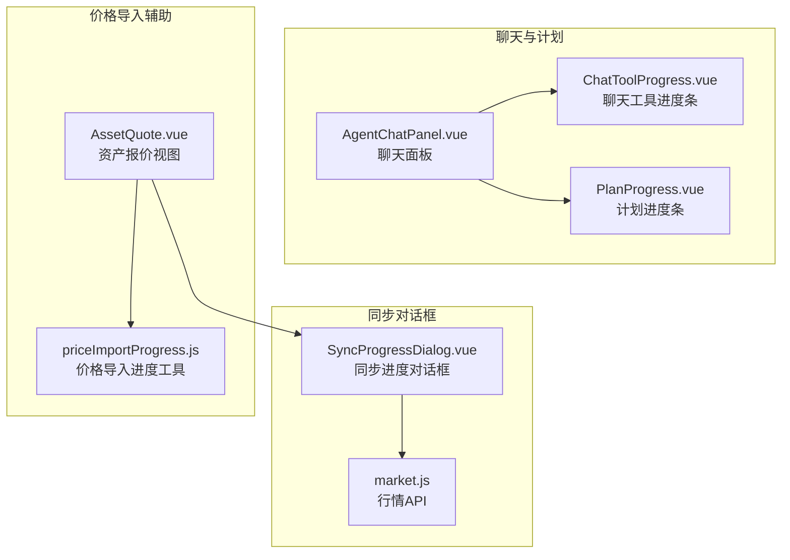
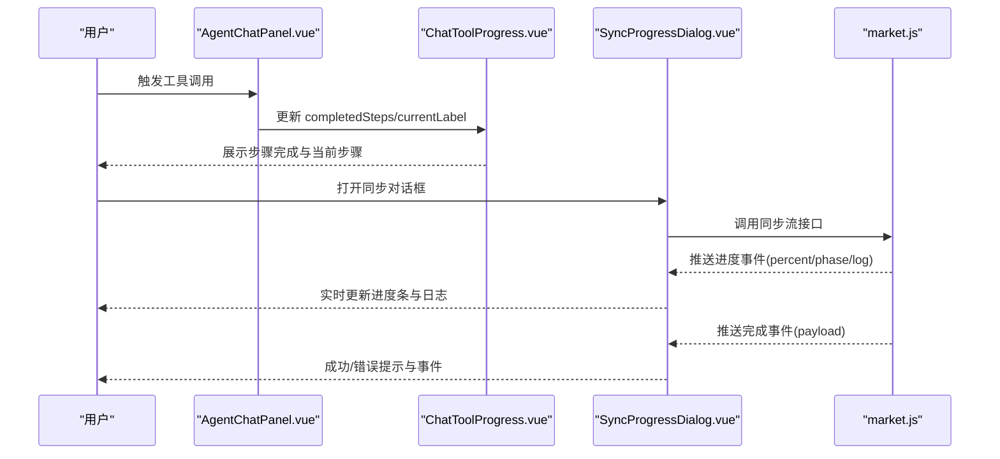
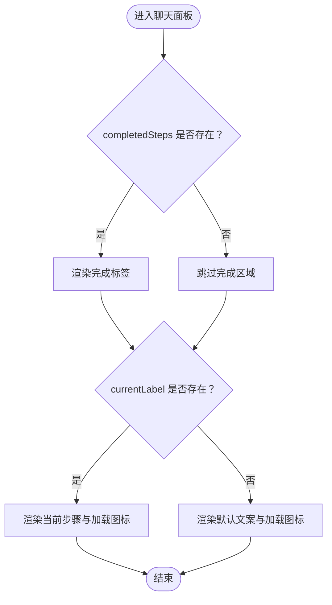
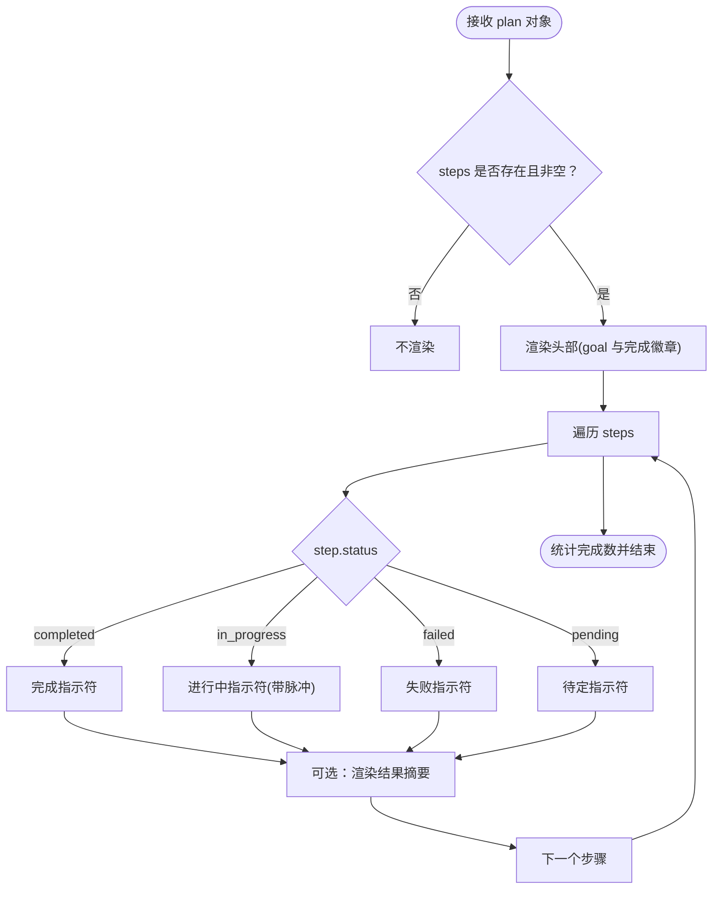
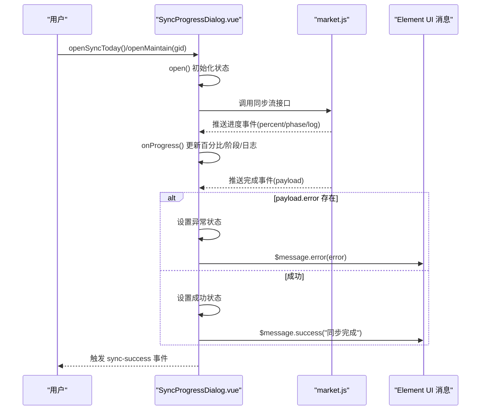
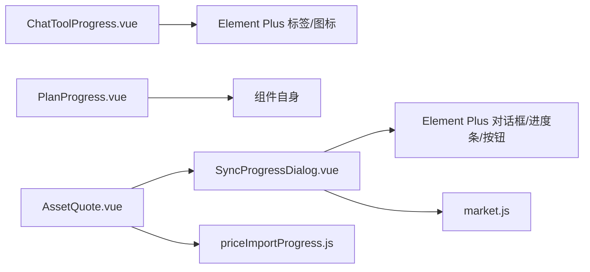

# 进度状态组件

<cite>
**本文引用的文件**
- [ChatToolProgress.vue](file://src/components/ChatToolProgress.vue)
- [PlanProgress.vue](file://src/components/PlanProgress.vue)
- [SyncProgressDialog.vue](file://src/components/SyncProgressDialog.vue)
- [AgentChatPanel.vue](file://src/components/AgentChatPanel.vue)
- [AssetQuote.vue](file://src/views/asset/AssetQuote.vue)
- [market.js](file://src/api/market.js)
- [priceImportProgress.js](file://src/utils/priceImportProgress.js)
</cite>

## 目录
1. [简介](#简介)
2. [项目结构](#项目结构)
3. [核心组件](#核心组件)
4. [架构总览](#架构总览)
5. [详细组件分析](#详细组件分析)
6. [依赖分析](#依赖分析)
7. [性能考虑](#性能考虑)
8. [故障排查指南](#故障排查指南)
9. [结论](#结论)
10. [附录](#附录)

## 简介
本文件系统化梳理并说明三类进度状态组件：聊天工具进度条、计划进度条、同步进度对话框。重点覆盖以下方面：
- 进度计算与状态显示：ChatToolProgress 的步骤完成与当前步骤提示；PlanProgress 的步骤状态与完成计数；SyncProgressDialog 的百分比与阶段文本。
- 错误处理与用户反馈：错误状态展示、消息提示、日志滚动与关闭行为。
- 重试与取消：组件内部的中止控制与外部触发策略建议。
- API 文档：属性、方法、事件与样式定制。
- 使用示例与最佳实践：异步任务驱动、进度更新策略、用户体验与动画。

## 项目结构
三个进度组件位于 src/components 下，分别承担不同场景的进度呈现与交互：
- ChatToolProgress.vue：聊天面板中工具调用的步骤级进度展示。
- PlanProgress.vue：计划任务的步骤状态与完成统计展示。
- SyncProgressDialog.vue：行情同步/维护的实时进度对话框，支持日志输出与状态反馈。

**图示来源**
- [AgentChatPanel.vue:230-246](file://src/components/AgentChatPanel.vue#L230-L246)
- [ChatToolProgress.vue:1-61](file://src/components/ChatToolProgress.vue#L1-L61)
- [PlanProgress.vue:1-187](file://src/components/PlanProgress.vue#L1-L187)
- [SyncProgressDialog.vue:1-190](file://src/components/SyncProgressDialog.vue#L1-L190)
- [market.js](file://src/api/market.js)
- [priceImportProgress.js](file://src/utils/priceImportProgress.js)

**章节来源**
- [ChatToolProgress.vue:1-61](file://src/components/ChatToolProgress.vue#L1-L61)
- [PlanProgress.vue:1-187](file://src/components/PlanProgress.vue#L1-L187)
- [SyncProgressDialog.vue:1-190](file://src/components/SyncProgressDialog.vue#L1-L190)

## 核心组件
- ChatToolProgress：以标签形式展示已完成步骤，当前步骤以加载图标与文案提示，适合工具链路的步骤可视化。
- PlanProgress：以步骤指示器与文字描述展示计划的完成情况，包含完成计数徽章，适合长流程的计划型任务。
- SyncProgressDialog：模态对话框内含进度条、阶段文本与日志区域，支持“同步当日行情”和“组合数据维护”，提供错误状态与成功提示。

**章节来源**
- [ChatToolProgress.vue:20-34](file://src/components/ChatToolProgress.vue#L20-L34)
- [PlanProgress.vue:28-43](file://src/components/PlanProgress.vue#L28-L43)
- [SyncProgressDialog.vue:40-159](file://src/components/SyncProgressDialog.vue#L40-L159)

## 架构总览
三个组件分别服务于不同业务场景：
- 聊天工具进度：由聊天面板在工具调用过程中动态更新已完成步骤与当前步骤标签。
- 计划进度：由上层业务构造 plan 对象（包含 goal 与 steps），组件负责渲染与统计完成数量。
- 同步进度：通过 API 流式接口接收进度事件，实时更新百分比、阶段与日志，并在完成后发出事件。

**图示来源**
- [AgentChatPanel.vue:230-246](file://src/components/AgentChatPanel.vue#L230-L246)
- [ChatToolProgress.vue:20-34](file://src/components/ChatToolProgress.vue#L20-L34)
- [SyncProgressDialog.vue:40-159](file://src/components/SyncProgressDialog.vue#L40-L159)
- [market.js](file://src/api/market.js)

## 详细组件分析

### ChatToolProgress 组件
- 功能定位：展示聊天工具调用过程中的已完成步骤与当前步骤标签，帮助用户理解工具链路的执行阶段。
- 关键属性
  - completedSteps: 已完成步骤数组，用于渲染完成标签。
  - currentLabel: 当前步骤标签文案，为空时显示默认文案。
- 渲染逻辑
  - 已完成步骤以小型成功标签展示，支持多步并排。
  - 当前步骤以加载图标与文案展示，为空时使用默认提示。
- 样式与交互
  - 支持通过 scoped 样式自定义标签大小、间距与颜色。
  - 适合在聊天面板工具调用期间与 PlanProgress 协同使用。

**图示来源**
- [ChatToolProgress.vue:1-18](file://src/components/ChatToolProgress.vue#L1-L18)

**章节来源**
- [ChatToolProgress.vue:20-34](file://src/components/ChatToolProgress.vue#L20-L34)
- [AgentChatPanel.vue:263-286](file://src/components/AgentChatPanel.vue#L263-L286)

### PlanProgress 组件
- 功能定位：展示计划任务的步骤状态与完成统计，适合长流程或分阶段的任务。
- 关键属性
  - plan: 计划对象，包含 goal 与 steps 数组。
- 计算属性
  - completedCount：统计 status 为 completed 的步骤数量，用于徽章显示。
- 渲染逻辑
  - 步骤指示器根据状态显示不同符号：完成、进行中、失败、待定。
  - 支持显示结果摘要（result_summary）。
- 样式与动画
  - 进行中步骤使用脉冲动画，提升视觉反馈。
  - 响应式布局在窄屏下隐藏摘要文本，保证可读性。

**图示来源**
- [PlanProgress.vue:1-26](file://src/components/PlanProgress.vue#L1-L26)
- [PlanProgress.vue:37-42](file://src/components/PlanProgress.vue#L37-L42)

**章节来源**
- [PlanProgress.vue:28-43](file://src/components/PlanProgress.vue#L28-L43)

### SyncProgressDialog 组件
- 功能定位：模态对话框内展示行情同步/维护的实时进度，包含进度条、阶段文本与日志区域。
- 打开方式
  - openSyncToday：打开“同步当日行情”，自动启动同步流。
  - openMaintain(gid)：打开“组合数据维护”，需提供分组 ID。
- 数据流
  - runSyncToday/runMaintain：调用市场 API 的流式接口，注册进度回调与完成回调。
  - onProgress：解析并更新 percent、currentPhase、logLines；支持按百分比或 current/total 两种模式。
  - onDone：根据 payload.error 设置异常状态或成功状态，追加日志并发出 sync-success 事件。
- 用户交互
  - loading 期间禁用底部按钮；支持日志自动滚动至底部。
  - 关闭对话框时，若仍在加载，追加提示信息。

**图示来源**
- [SyncProgressDialog.vue:58-159](file://src/components/SyncProgressDialog.vue#L58-L159)
- [market.js](file://src/api/market.js)

**章节来源**
- [SyncProgressDialog.vue:40-159](file://src/components/SyncProgressDialog.vue#L40-L159)

## 依赖分析
- ChatToolProgress
  - 依赖：Element Plus 标签与图标组件，用于完成标签与加载图标。
  - 与 AgentChatPanel 协作：由聊天面板在工具调用过程中更新已完成步骤与当前标签。
- PlanProgress
  - 依赖：自身模板与样式，无外部 UI 依赖。
  - 与上层业务协作：接收 plan 对象，渲染步骤状态与完成统计。
- SyncProgressDialog
  - 依赖：Element Plus 对话框、进度条、按钮与消息提示。
  - 依赖：market.js 的同步流接口，接收实时进度事件。
  - 与 AssetQuote 协作：在资产报价视图中作为同步入口，结合价格导入进度工具进行联动。

**图示来源**
- [ChatToolProgress.vue:1-18](file://src/components/ChatToolProgress.vue#L1-L18)
- [PlanProgress.vue:1-26](file://src/components/PlanProgress.vue#L1-L26)
- [SyncProgressDialog.vue:1-38](file://src/components/SyncProgressDialog.vue#L1-L38)
- [AssetQuote.vue:648-660](file://src/views/asset/AssetQuote.vue#L648-L660)
- [priceImportProgress.js](file://src/utils/priceImportProgress.js)

**章节来源**
- [AgentChatPanel.vue:230-246](file://src/components/AgentChatPanel.vue#L230-L246)
- [AssetQuote.vue:648-660](file://src/views/asset/AssetQuote.vue#L648-L660)

## 性能考虑
- ChatToolProgress
  - 仅渲染已完成步骤与当前步骤，复杂度低，适合频繁更新。
- PlanProgress
  - 计算完成数为线性扫描，steps 较大时可考虑缓存统计结果。
- SyncProgressDialog
  - 日志区域使用自动滚动，建议限制日志行数上限，避免 DOM 抖动。
  - 百分比更新采用最小/最大边界处理，避免异常值影响 UI。

[本节为通用指导，无需特定文件来源]

## 故障排查指南
- 同步对话框无法关闭
  - loading 为 true 时，Esc 键被禁用；等待任务完成或检查后端流是否正常推送完成事件。
- 分组 ID 缺失导致维护失败
  - openMaintain 需要有效分组 ID；若未提供，组件会记录日志并停止加载。
- 百分比异常
  - 支持两种进度来源：百分比与 current/total；确保后端事件包含其中之一。
- 日志不滚动
  - 确保 appendLog 后触发 $nextTick 并正确获取 logBox 引用。
- 错误提示未显示
  - onDone 中仅当 payload.error 存在时设置异常状态并提示；确认后端返回结构。

**章节来源**
- [SyncProgressDialog.vue:98-108](file://src/components/SyncProgressDialog.vue#L98-L108)
- [SyncProgressDialog.vue:128-152](file://src/components/SyncProgressDialog.vue#L128-L152)

## 结论
- ChatToolProgress 适用于工具链路的步骤可视化，简洁直观。
- PlanProgress 适用于计划型任务的状态与完成统计，具备良好的可读性与响应式设计。
- SyncProgressDialog 提供完整的同步流程体验，涵盖进度、阶段、日志与错误反馈，适合复杂后台任务的前端展示。

[本节为总结，无需特定文件来源]

## 附录

### API 文档

- ChatToolProgress
  - 属性
    - completedSteps: Array，已完成步骤名称数组。
    - currentLabel: String，当前步骤标签文案。
  - 事件：无
  - 插槽：无
  - 样式定制：通过 scoped 样式覆盖标签、当前步骤容器与图标尺寸。

- PlanProgress
  - 属性
    - plan: Object，包含 goal 与 steps 数组；steps 每项包含 status、step、result_summary。
  - 计算属性
    - completedCount: Number，已完成步骤数量。
  - 事件：无
  - 插槽：无
  - 样式定制：通过 scoped 样式覆盖头部、步骤项、指示器与摘要文本。

- SyncProgressDialog
  - 属性：无
  - 方法
    - openSyncToday(): 打开“同步当日行情”，自动启动同步流。
    - openMaintain(gid): 打开“组合数据维护”，需提供分组 ID。
    - open(): 初始化可见性、加载状态、百分比与阶段文本。
    - appendLog(text): 追加日志并滚动到底部。
  - 事件
    - sync-success: 同步完成后触发。
  - 样式定制：通过 scoped 样式覆盖进度条、阶段文本与日志区域。

**章节来源**
- [ChatToolProgress.vue:20-34](file://src/components/ChatToolProgress.vue#L20-L34)
- [PlanProgress.vue:28-43](file://src/components/PlanProgress.vue#L28-L43)
- [SyncProgressDialog.vue:58-159](file://src/components/SyncProgressDialog.vue#L58-L159)

### 使用示例与最佳实践

- 聊天工具进度
  - 在聊天面板中，根据工具调用阶段更新 completedSteps 与 currentLabel，实现步骤可视化。
  - 示例路径参考：[AgentChatPanel.vue:263-286](file://src/components/AgentChatPanel.vue#L263-L286)

- 计划进度
  - 上层业务构造 plan 对象，包含 goal 与 steps；组件自动统计完成数并渲染状态。
  - 示例路径参考：[PlanProgress.vue:1-26](file://src/components/PlanProgress.vue#L1-L26)

- 同步进度对话框
  - 在资产报价视图中，调用 openSyncToday 或 openMaintain 触发同步；监听 sync-success 完成后续逻辑。
  - 示例路径参考：
    - [AssetQuote.vue:648-660](file://src/views/asset/AssetQuote.vue#L648-L660)
    - [SyncProgressDialog.vue:58-82](file://src/components/SyncProgressDialog.vue#L58-L82)

- 异步任务与进度更新策略
  - 使用流式接口推送进度事件，onProgress 中统一更新 percent、phase 与日志。
  - 示例路径参考：[SyncProgressDialog.vue:109-127](file://src/components/SyncProgressDialog.vue#L109-L127)

- 用户体验与动画
  - 进行中步骤使用脉冲动画，增强视觉反馈。
  - 示例路径参考：[PlanProgress.vue:119-126](file://src/components/PlanProgress.vue#L119-L126)

- 错误恢复
  - onDone 中区分错误与成功，设置异常状态并提示；同时发出 sync-success 事件以便上层处理。
  - 示例路径参考：[SyncProgressDialog.vue:128-152](file://src/components/SyncProgressDialog.vue#L128-L152)