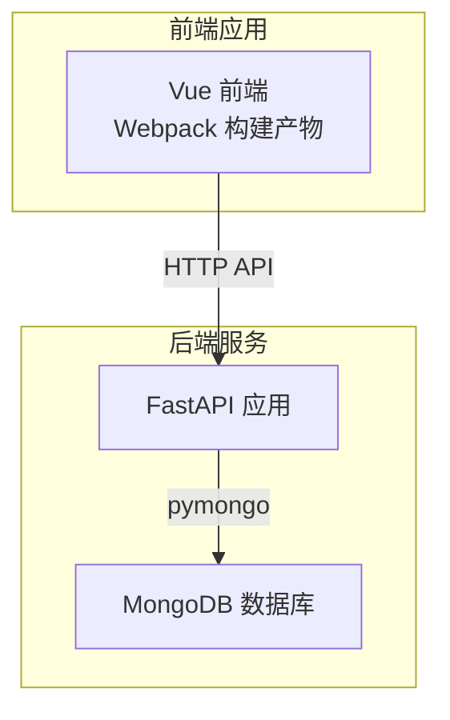
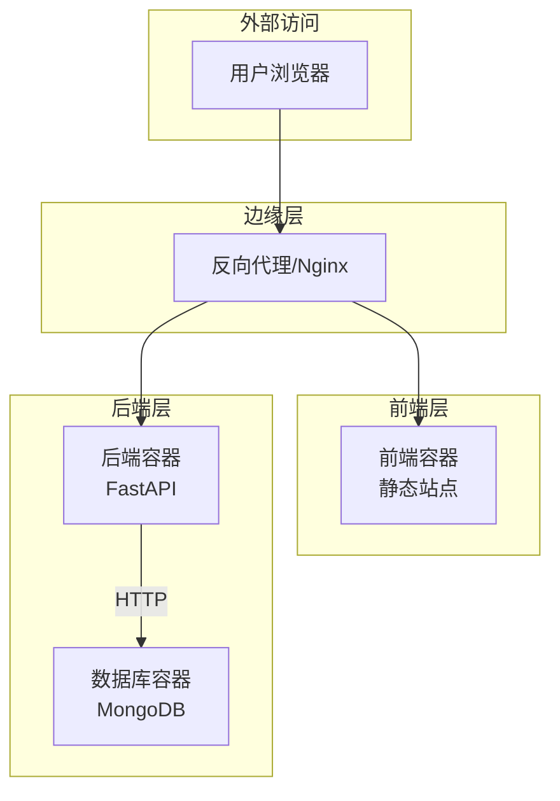
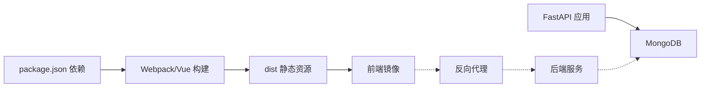

# Docker容器化

<cite>
**本文引用的文件**
- [package.json](file://package.json)
- [README_NODE_VERSION.md](file://README_NODE_VERSION.md)
- [webpack.config.js](file://webpack.config.js)
- [vue.config.js](file://vue.config.js)
- [src/main.js](file://src/main.js)
- [src/router/index.js](file://src/router/index.js)
- [src/api/market.js](file://src/api/market.js)
- [src/utils/request.js](file://src/utils/request.js)
- [网络测试脚本.js](file://网络测试脚本.js)
- [docs/ZY_DATA_API_INTEGRATION_GUIDE.md](file://docs/ZY_DATA_API_INTEGRATION_GUIDE.md)
- [scripts/import_zy_data_domain_mock.py](file://scripts/import_zy_data_domain_mock.py)
- [scripts/import_zy_seeds_from_json.py](file://scripts/import_zy_seeds_from_json.py)
- [scripts/import_to_asset_allocation.py](file://scripts/import_to_asset_allocation.py)
- [scripts/test_mongo.py](file://scripts/test_mongo.py)
</cite>

## 目录
1. [简介](#简介)
2. [项目结构](#项目结构)
3. [核心组件](#核心组件)
4. [架构总览](#架构总览)
5. [详细组件分析](#详细组件分析)
6. [依赖关系分析](#依赖关系分析)
7. [性能考虑](#性能考虑)
8. [故障排查指南](#故障排查指南)
9. [结论](#结论)
10. [附录](#附录)

## 简介
本指南面向“投资组合管理系统”的容器化部署，围绕前端应用与后端API服务（FastAPI + MongoDB）提供从镜像构建、运行配置、编排到监控与安全的完整实践。内容涵盖：
- 基于Node.js的前端构建与多阶段镜像优化
- 后端FastAPI服务的容器化与MongoDB依赖
- Docker Compose服务编排、网络与数据持久化
- 健康检查、日志与资源限制
- 非root用户、最小权限等安全最佳实践
- CI/CD集成思路与容器调试技巧

## 项目结构
前端采用Vue 2 + Webpack/Vite工程，后端采用Python FastAPI，二者通过HTTP API交互；MongoDB作为数据存储。

图示来源
- [src/main.js:1-31](file://src/main.js#L1-L31)
- [src/router/index.js:1-378](file://src/router/index.js#L1-L378)
- [docs/ZY_DATA_API_INTEGRATION_GUIDE.md:170-233](file://docs/ZY_DATA_API_INTEGRATION_GUIDE.md#L170-L233)

章节来源
- [package.json:1-45](file://package.json#L1-L45)
- [README_NODE_VERSION.md:1-73](file://README_NODE_VERSION.md#L1-L73)
- [webpack.config.js:1-63](file://webpack.config.js#L1-L63)
- [vue.config.js:1-17](file://vue.config.js#L1-L17)

## 核心组件
- 前端构建与运行
  - Node.js版本要求与依赖安装
  - Webpack/Vite构建输出与静态资源
  - 开发服务器端口与热更新
- 后端API与数据库
  - FastAPI路由与MongoDB连接
  - 健康检查端点与环境变量
  - 数据导入脚本与索引建议
- 前后端通信
  - 前端API基址与SSE流式处理
  - 跨域与网络连通性测试

章节来源
- [package.json:1-45](file://package.json#L1-L45)
- [README_NODE_VERSION.md:1-73](file://README_NODE_VERSION.md#L1-L73)
- [webpack.config.js:1-63](file://webpack.config.js#L1-L63)
- [vue.config.js:1-17](file://vue.config.js#L1-L17)
- [src/api/market.js:1-38](file://src/api/market.js#L1-L38)
- [src/utils/request.js:74-99](file://src/utils/request.js#L74-L99)
- [docs/ZY_DATA_API_INTEGRATION_GUIDE.md:170-233](file://docs/ZY_DATA_API_INTEGRATION_GUIDE.md#L170-L233)

## 架构总览
前后端分离部署，前端静态资源由Nginx或反向代理提供，后端FastAPI服务通过容器网络访问MongoDB。

图示来源
- [src/api/market.js:6-8](file://src/api/market.js#L6-L8)
- [docs/ZY_DATA_API_INTEGRATION_GUIDE.md:170-233](file://docs/ZY_DATA_API_INTEGRATION_GUIDE.md#L170-L233)

## 详细组件分析

### 前端容器化（Node.js + Nginx）
- 基础镜像选择
  - 构建阶段：使用官方Node LTS镜像，安装依赖并执行构建
  - 运行阶段：使用轻量Nginx镜像，将构建产物dist目录作为静态站点根目录
- 依赖安装与构建优化
  - 使用package.json中的脚本进行构建
  - Webpack配置启用内容哈希与清理输出目录
  - Vue CLI别名与解析配置确保打包一致性
- 多阶段构建要点
  - 第一阶段：Node安装依赖、构建产物
  - 第二阶段：Nginx复制dist，配置静态服务
  - 最小化运行镜像体积，避免携带构建工具链
- 端口与卷
  - 运行时暴露80端口
  - 不需要挂载卷（静态资源）
- 健康检查
  - 可通过HTTP GET探测首页或API健康端点
- 安全
  - 运行非root用户，限制文件权限

章节来源
- [package.json:5-10](file://package.json#L5-L10)
- [webpack.config.js:6-12](file://webpack.config.js#L6-L12)
- [vue.config.js:5-16](file://vue.config.js#L5-L16)
- [src/main.js:1-31](file://src/main.js#L1-L31)

### 后端容器化（FastAPI + MongoDB）
- 基础镜像与依赖
  - Python 3.9+镜像，pip安装依赖
  - 从环境变量读取MongoDB连接信息
- 多阶段构建
  - 构建阶段：安装依赖
  - 运行阶段：仅复制必要文件，使用非root用户
- 端口与卷
  - 暴露API端口（如8000），挂载数据目录用于持久化
- 健康检查
  - 提供健康检查端点，容器层面可轮询该端点
- 安全
  - 非root用户运行，最小权限原则
  - 环境变量注入敏感配置

章节来源
- [docs/ZY_DATA_API_INTEGRATION_GUIDE.md:170-233](file://docs/ZY_DATA_API_INTEGRATION_GUIDE.md#L170-L233)
- [docs/ZY_DATA_API_INTEGRATION_GUIDE.md:214-221](file://docs/ZY_DATA_API_INTEGRATION_GUIDE.md#L214-L221)

### Docker Compose编排
- 服务
  - web：前端静态站点
  - api：后端FastAPI服务
  - mongo：MongoDB数据库
- 网络
  - 自定义桥接网络，服务间通过服务名通信
- 数据持久化
  - mongo挂载数据卷至宿主机
- 依赖与启动顺序
  - api依赖mongo，web通过反向代理访问api
- 环境变量
  - 通过.env或compose文件注入

章节来源
- [docs/ZY_DATA_API_INTEGRATION_GUIDE.md:223-233](file://docs/ZY_DATA_API_INTEGRATION_GUIDE.md#L223-L233)

### 健康检查、日志与资源限制
- 健康检查
  - 后端提供健康端点，容器健康探针轮询
- 日志
  - 前端Nginx访问/错误日志
  - 后端标准输出日志，结合集中式日志收集
- 资源限制
  - CPU/内存配额，避免资源争用

章节来源
- [docs/ZY_DATA_API_INTEGRATION_GUIDE.md:188-201](file://docs/ZY_DATA_API_INTEGRATION_GUIDE.md#L188-L201)

### 安全最佳实践
- 非root用户
  - 运行用户为非特权用户
- 最小权限
  - 仅授予数据库访问所需权限
- 环境变量
  - 敏感配置通过环境变量注入
- 网络隔离
  - 服务间通过内部网络通信，外部只暴露必要端口

章节来源
- [docs/ZY_DATA_API_INTEGRATION_GUIDE.md:337-373](file://docs/ZY_DATA_API_INTEGRATION_GUIDE.md#L337-L373)

### CI/CD集成
- 构建
  - 触发条件：代码合并主分支
  - 步骤：拉取代码 → 构建前端镜像 → 构建后端镜像 → 推送镜像仓库
- 测试
  - 前端：构建产物校验
  - 后端：单元/集成测试
- 部署
  - 使用Compose或Kubernetes部署
  - 健康检查通过后再切换流量

（本节为通用流程说明，不直接分析具体文件）

### 容器调试技巧
- 日志查看
  - docker compose logs -f web/api/mongo
- Shell进入
  - docker compose exec api bash
- 性能分析
  - 使用top/htop观察进程资源占用
  - 检查API端点耗时与MongoDB慢查询
- 网络连通性
  - 在容器内使用curl/ping验证服务可达
  - 前端通过浏览器控制台脚本测试后端连通性

章节来源
- [网络测试脚本.js:1-156](file://网络测试脚本.js#L1-L156)

## 依赖关系分析

图示来源
- [package.json:11-29](file://package.json#L11-L29)
- [webpack.config.js:6-12](file://webpack.config.js#L6-L12)
- [docs/ZY_DATA_API_INTEGRATION_GUIDE.md:205-221](file://docs/ZY_DATA_API_INTEGRATION_GUIDE.md#L205-L221)

章节来源
- [package.json:11-29](file://package.json#L11-L29)
- [webpack.config.js:1-63](file://webpack.config.js#L1-L63)
- [vue.config.js:1-17](file://vue.config.js#L1-L17)

## 性能考虑
- 前端
  - 内容哈希与缓存策略，减少带宽消耗
  - CDN加速与Gzip压缩
- 后端
  - 为常用查询字段建立索引
  - 缓存热点数据
- 数据库
  - 合理分片与副本，避免单点瓶颈

章节来源
- [docs/ZY_DATA_API_INTEGRATION_GUIDE.md:374-407](file://docs/ZY_DATA_API_INTEGRATION_GUIDE.md#L374-L407)

## 故障排查指南
- 健康检查失败
  - 检查后端健康端点是否可达
  - 查看容器日志定位异常
- 网络连通性
  - 使用浏览器控制台脚本验证后端API连通性
  - 检查CORS配置与反向代理规则
- 数据库连接
  - 确认MongoDB连接字符串与端口
  - 使用脚本验证数据库可用性

章节来源
- [网络测试脚本.js:1-156](file://网络测试脚本.js#L1-L156)
- [docs/ZY_DATA_API_INTEGRATION_GUIDE.md:188-201](file://docs/ZY_DATA_API_INTEGRATION_GUIDE.md#L188-L201)
- [scripts/test_mongo.py:1-17](file://scripts/test_mongo.py#L1-L17)

## 结论
通过多阶段构建与最小化运行镜像，结合Docker Compose编排与健康检查、日志与资源限制策略，可实现稳定高效的容器化部署。配合非root用户与最小权限原则，进一步提升安全性。建议在CI/CD流水线中自动化上述流程，并在生产环境中引入监控与告警体系。

## 附录

### 前端构建与运行要点
- Node.js版本要求与依赖安装
- Webpack/Vite构建输出与静态资源
- 开发服务器端口与热更新

章节来源
- [README_NODE_VERSION.md:1-73](file://README_NODE_VERSION.md#L1-L73)
- [webpack.config.js:1-63](file://webpack.config.js#L1-L63)
- [vue.config.js:1-17](file://vue.config.js#L1-L17)

### 后端API与数据库要点
- FastAPI路由与MongoDB连接
- 健康检查端点与环境变量
- 数据导入脚本与索引建议

章节来源
- [docs/ZY_DATA_API_INTEGRATION_GUIDE.md:170-233](file://docs/ZY_DATA_API_INTEGRATION_GUIDE.md#L170-L233)
- [docs/ZY_DATA_API_INTEGRATION_GUIDE.md:374-407](file://docs/ZY_DATA_API_INTEGRATION_GUIDE.md#L374-L407)
- [scripts/import_zy_data_domain_mock.py:74-111](file://scripts/import_zy_data_domain_mock.py#L74-L111)
- [scripts/import_zy_seeds_from_json.py:47-91](file://scripts/import_zy_seeds_from_json.py#L47-L91)
- [scripts/import_to_asset_allocation.py:45-87](file://scripts/import_to_asset_allocation.py#L45-L87)