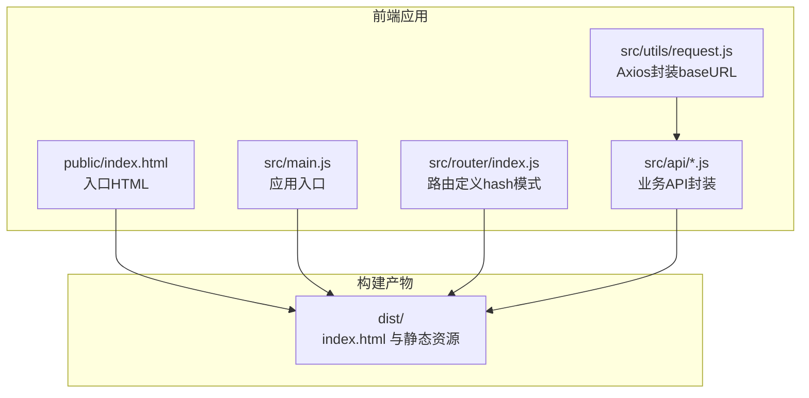
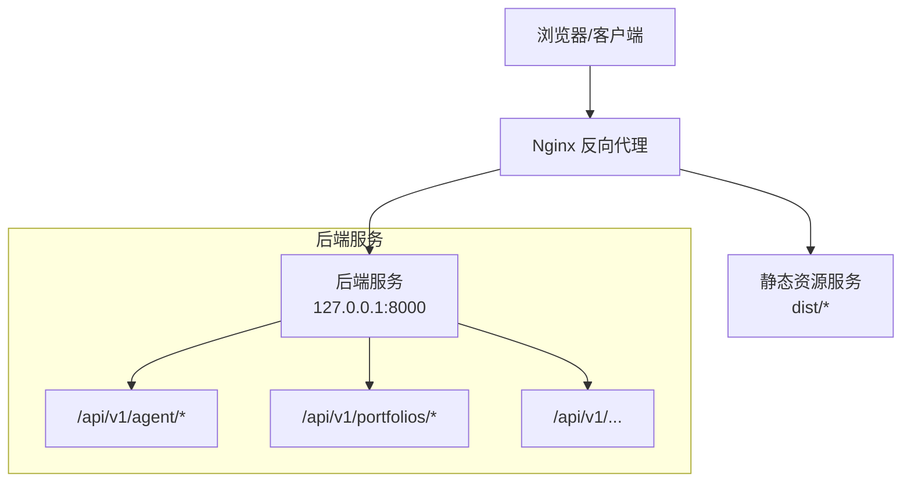
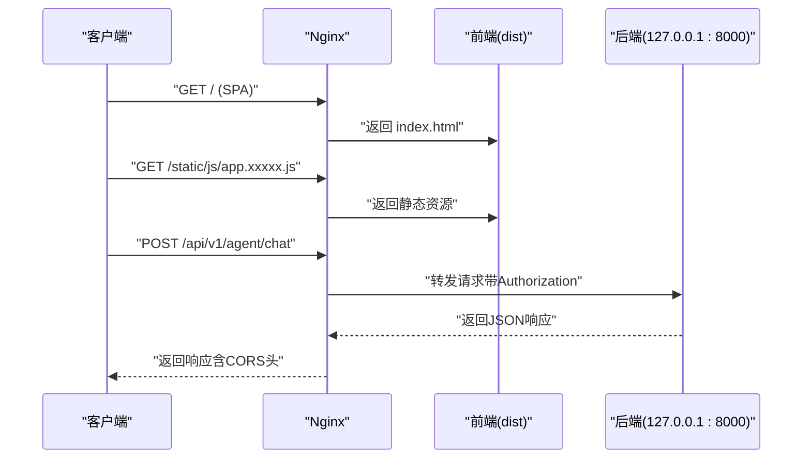

# Nginx部署

<cite>
**本文引用的文件**
- [package.json](file://package.json)
- [vue.config.js](file://vue.config.js)
- [public/index.html](file://public/index.html)
- [src/main.js](file://src/main.js)
- [src/router/index.js](file://src/router/index.js)
- [src/utils/request.js](file://src/utils/request.js)
- [src/api/agent.js](file://src/api/agent.js)
- [src/api/portfolio.js](file://src/api/portfolio.js)
- [scripts/deploy_zy_data_api.py](file://scripts/deploy_zy_data_api.py)
</cite>

## 目录
1. [简介](#简介)
2. [项目结构](#项目结构)
3. [核心组件](#核心组件)
4. [架构总览](#架构总览)
5. [详细组件分析](#详细组件分析)
6. [依赖关系分析](#依赖关系分析)
7. [性能考虑](#性能考虑)
8. [故障排除指南](#故障排除指南)
9. [结论](#结论)
10. [附录](#附录)

## 简介
本指南面向投资组合管理系统在生产环境的 Nginx 部署，目标是帮助运维与开发团队快速、安全地完成前端静态资源与后端 API 的统一入口配置。内容涵盖虚拟主机与 server 块、监听端口与 SSL、静态资源服务与缓存、反向代理与跨域、负载均衡与健康检查、安全加固（HTTPS 强制跳转、安全头、访问控制）、性能优化（缓存、连接池、超时）、日志配置以及部署验证与故障排除。

## 项目结构
前端为基于 Vue 2 的单页应用（SPA），通过 hash 模式的路由实现客户端导航。构建产物将输出到 dist 目录（由构建脚本生成），Nginx 将作为静态资源服务器提供 index.html 与打包后的 JS/CSS/媒体资源，并对后端 API 进行反向代理。

**图表来源**
- [public/index.html:1-12](file://public/index.html#L1-L12)
- [src/main.js:1-31](file://src/main.js#L1-L31)
- [src/router/index.js:346-349](file://src/router/index.js#L346-L349)
- [src/utils/request.js:5-9](file://src/utils/request.js#L5-L9)
- [src/api/agent.js:82-83](file://src/api/agent.js#L82-L83)
- [src/api/portfolio.js:10-12](file://src/api/portfolio.js#L10-L12)

**章节来源**
- [package.json:5-10](file://package.json#L5-L10)
- [vue.config.js:1-17](file://vue.config.js#L1-L17)
- [public/index.html:1-12](file://public/index.html#L1-L12)
- [src/main.js:1-31](file://src/main.js#L1-L31)
- [src/router/index.js:346-349](file://src/router/index.js#L346-L349)
- [src/utils/request.js:5-9](file://src/utils/request.js#L5-L9)
- [src/api/agent.js:82-83](file://src/api/agent.js#L82-L83)
- [src/api/portfolio.js:10-12](file://src/api/portfolio.js#L10-L12)

## 核心组件
- 前端 SPA 入口与路由
  - 入口 HTML 与应用挂载点位于 public/index.html 与 src/main.js。
  - 路由采用 hash 模式，便于静态托管与直连访问。
- API 客户端
  - Axios 实例在 src/utils/request.js 中创建，默认 baseURL 来自环境变量 VUE_APP_BASE_URL。
  - 业务 API 封装在 src/api/*.js，如 AI 助手与组合管理等模块。
- 后端服务定位
  - 脚本 scripts/deploy_zy_data_api.py 显示后端服务默认监听 8000 端口，用于提供 /api/v1/* 接口。

**章节来源**
- [public/index.html:1-12](file://public/index.html#L1-L12)
- [src/main.js:1-31](file://src/main.js#L1-L31)
- [src/router/index.js:346-349](file://src/router/index.js#L346-L349)
- [src/utils/request.js:5-9](file://src/utils/request.js#L5-L9)
- [src/api/agent.js:82-83](file://src/api/agent.js#L82-L83)
- [src/api/portfolio.js:10-12](file://src/api/portfolio.js#L10-L12)
- [scripts/deploy_zy_data_api.py:195-197](file://scripts/deploy_zy_data_api.py#L195-L197)

## 架构总览
下图展示 Nginx 作为统一入口的典型部署拓扑：对外暴露 HTTPS，内部将静态资源直接返回，将 /api/v1/* 请求转发至后端服务（默认 127.0.0.1:8000）。同时，Nginx 提供 gzip 压缩、缓存策略、安全头与访问控制等能力。

[本图为概念性架构示意，不对应具体源码文件，故不附“图表来源”]

## 详细组件分析

### Nginx 虚拟主机与 server 块
- 监听端口
  - 80 端口：用于 HTTP 到 HTTPS 的强制跳转。
  - 443 端口：启用 TLS，配置证书与私钥。
- 主机名与根目录
  - server_name 指定域名。
  - root 指向前端构建目录（dist）。
- 索引页与 SPA 回退
  - index 指定 index.html。
  - location / 匹配所有前端路由，将未命中静态文件的请求回退到 index.html，以支持 hash 路由。

**章节来源**
- [public/index.html:1-12](file://public/index.html#L1-L12)
- [src/router/index.js:346-349](file://src/router/index.js#L346-L349)

### 静态文件服务与缓存策略
- 缓存策略
  - 对 JS/CSS 等静态资源设置较长缓存（如一年），对 index.html 设置短缓存或禁止缓存。
  - 版本化文件名（由构建工具生成）可确保更新时缓存失效。
- gzip 压缩
  - 开启 gzip 并针对文本类资源（text/html、text/css、application/javascript、application/json）启用压缩。
- 目录索引与安全
  - 关闭 autoindex，隐藏目录浏览。
  - 限制对敏感目录（如 .git、node_modules）的访问。

**章节来源**
- [package.json:5-10](file://package.json#L5-L10)
- [vue.config.js:1-17](file://vue.config.js#L1-L17)

### 反向代理与 API 转发
- 路由前缀
  - Nginx 将 /api/v1/* 请求转发至后端服务（默认 127.0.0.1:8000）。
- 跨域处理
  - 在 Nginx 层设置 Access-Control-Allow-Origin、Access-Control-Allow-Methods、Access-Control-Allow-Headers 等响应头。
  - 若需要携带凭据（credentials），需明确允许相应 Origin，且不能使用通配符。
- 请求头传递
  - 保留 Authorization、Content-Type 等必要头部，避免丢失鉴权信息。
- 超时与缓冲
  - proxy_connect_timeout、proxy_send_timeout、proxy_read_timeout 合理设置，避免长连接与慢响应导致的堆积。
  - proxy_buffering 启用可提升高并发下的吞吐。

**章节来源**
- [src/utils/request.js:5-9](file://src/utils/request.js#L5-L9)
- [src/api/agent.js:82-83](file://src/api/agent.js#L82-L83)
- [src/api/portfolio.js:10-12](file://src/api/portfolio.js#L10-L12)
- [scripts/deploy_zy_data_api.py:195-197](file://scripts/deploy_zy_data_api.py#L195-L197)

### 负载均衡与多实例
- 上游集群
  - 定义多个后端实例（如 127.0.0.1:8000、127.0.0.1:8001），使用轮询或 ip_hash 等策略。
- 健康检查
  - 使用 nginx_upstream_check_module 或外部探针定期探测 /health（如后端提供）。
  - 对不可用节点进行摘除，恢复后自动加入。
- 会话保持
  - 对需要粘性会话的场景使用 ip_hash，避免跨实例状态丢失。

**章节来源**
- [scripts/deploy_zy_data_api.py:195-197](file://scripts/deploy_zy_data_api.py#L195-L197)

### 安全配置
- HTTPS 强制跳转
  - 在 80 端口 server 中将所有请求重定向到 https。
- 安全头
  - Content-Security-Policy、X-Frame-Options、X-Content-Type-Options、Referrer-Policy、Permissions-Policy 等。
- 访问控制
  - 限制 /api/v1/* 的来源 IP 白名单（如仅允许内网或特定网段）。
  - 对敏感接口增加速率限制（limit_req_zone + limit_req）。

**章节来源**
- [src/api/agent.js:92-94](file://src/api/agent.js#L92-L94)
- [src/utils/request.js:14-18](file://src/utils/request.js#L14-L18)

### 性能优化
- 缓存策略
  - 对静态资源设置强缓存，对 index.html 设置协商缓存或短缓存。
  - 对动态接口禁用缓存或设置合理的 max-age。
- 连接池与超时
  - worker_connections、worker_processes 合理配置；keepalive_timeout 控制空闲连接时间。
  - proxy_* 超时参数根据业务特性调整。
- 压缩与传输
  - 启用 gzip 并设置合适的 gzip_types 与 gzip_comp_level。
  - 如可用，开启 HTTP/2/3 以降低延迟。

**章节来源**
- [vue.config.js:1-17](file://vue.config.js#L1-L17)
- [src/utils/request.js:5-9](file://src/utils/request.js#L5-L9)

### 日志配置
- 访问日志
  - 自定义 log_format，记录客户端 IP、User-Agent、响应码、请求耗时、上游响应时间。
- 错误日志
  - error_log 指向独立文件，级别设为 warn 或 info，便于排查。
- 分割与归档
  - 结合 logrotate 对日志进行按天切割与压缩归档。

**章节来源**
- [src/router/index.js:346-349](file://src/router/index.js#L346-L349)

## 依赖关系分析
前端通过 Axios 发起 API 请求，请求的 baseURL 默认来自 VUE_APP_BASE_URL 环境变量。后端服务由 Python 脚本部署脚本显示默认监听 8000 端口，提供 /api/v1/* 接口。Nginx 作为统一入口，负责静态资源与 API 的前置处理。

**图表来源**
- [src/utils/request.js:5-9](file://src/utils/request.js#L5-L9)
- [src/api/agent.js:82-83](file://src/api/agent.js#L82-L83)
- [scripts/deploy_zy_data_api.py:195-197](file://scripts/deploy_zy_data_api.py#L195-L197)

**章节来源**
- [src/utils/request.js:5-9](file://src/utils/request.js#L5-L9)
- [src/api/agent.js:82-83](file://src/api/agent.js#L82-L83)
- [src/api/portfolio.js:10-12](file://src/api/portfolio.js#L10-L12)
- [scripts/deploy_zy_data_api.py:195-197](file://scripts/deploy_zy_data_api.py#L195-L197)

## 性能考虑
- 静态资源
  - 使用 CDN 或本地缓存，合理设置 Cache-Control 与 ETag。
- 反向代理
  - 启用 proxy_cache（按路径与状态码缓存静态资源），减少后端压力。
- 超时与并发
  - 根据接口复杂度与数据库响应时间调整 proxy_* 超时。
  - 合理设置 worker_connections 与 keepalive_timeout。
- 压缩
  - gzip 压缩文本类资源，降低带宽占用。

[本节为通用性能建议，不直接分析具体文件，故不附“章节来源”]

## 故障排除指南
- 前端 404 或路由异常
  - 确认 Nginx root 指向正确的 dist 目录，index 正确，location / 对未命中静态文件回退到 index.html。
- API 404 或跨域失败
  - 检查 /api/v1/* 是否正确转发至 127.0.0.1:8000；确认 CORS 响应头已设置；核对 Authorization 是否透传。
- 超时与网络错误
  - 查看 Nginx error_log 与后端日志；确认 proxy_connect_timeout、proxy_send_timeout、proxy_read_timeout 设置是否合理。
- HTTPS 强制跳转无效
  - 检查 80 端口 server 是否存在 301/308 跳转规则，证书链与私钥是否正确加载。
- 缓存问题
  - 清除浏览器缓存或使用无痕模式；确认静态资源版本号更新导致的缓存失效。

**章节来源**
- [src/router/index.js:346-349](file://src/router/index.js#L346-L349)
- [src/utils/request.js:65-93](file://src/utils/request.js#L65-L93)
- [scripts/deploy_zy_data_api.py:195-197](file://scripts/deploy_zy_data_api.py#L195-L197)

## 结论
通过 Nginx 统一入口，投资组合管理系统可实现静态资源高效分发、API 请求稳定转发、安全与性能的全面保障。建议结合实际流量与业务特性，持续优化缓存策略、超时参数与安全头配置，并建立完善的日志与监控体系，确保线上运行稳定可靠。

[本节为总结性内容，不直接分析具体文件，故不附“章节来源”]

## 附录
- 构建与部署要点
  - 使用 npm run build 生成 dist 目录，将 dist 部署到 Nginx root。
  - 确保 VUE_APP_BASE_URL 与后端实际监听地址一致。
- 后端服务参考
  - 后端服务默认监听 8000 端口，提供 /api/v1/* 接口，可通过 uvicorn 启动。

**章节来源**
- [package.json:5-10](file://package.json#L5-L10)
- [scripts/deploy_zy_data_api.py:195-197](file://scripts/deploy_zy_data_api.py#L195-L197)