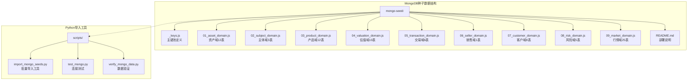
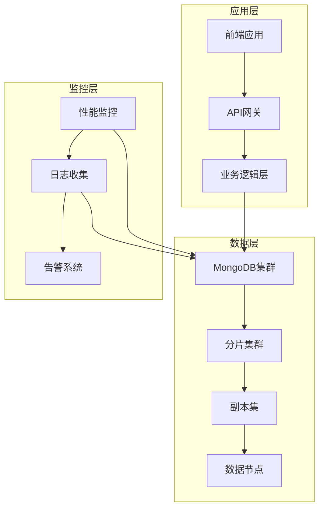
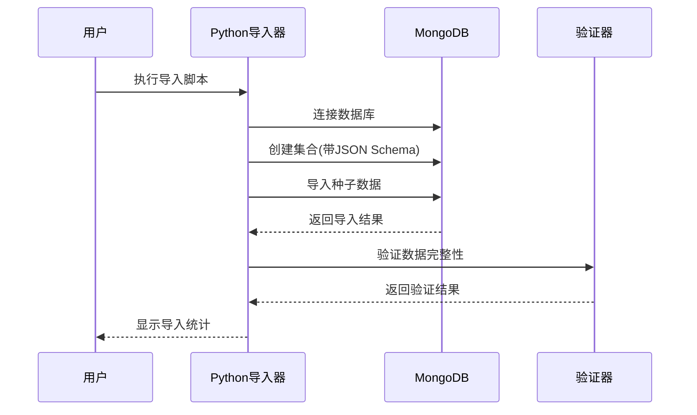
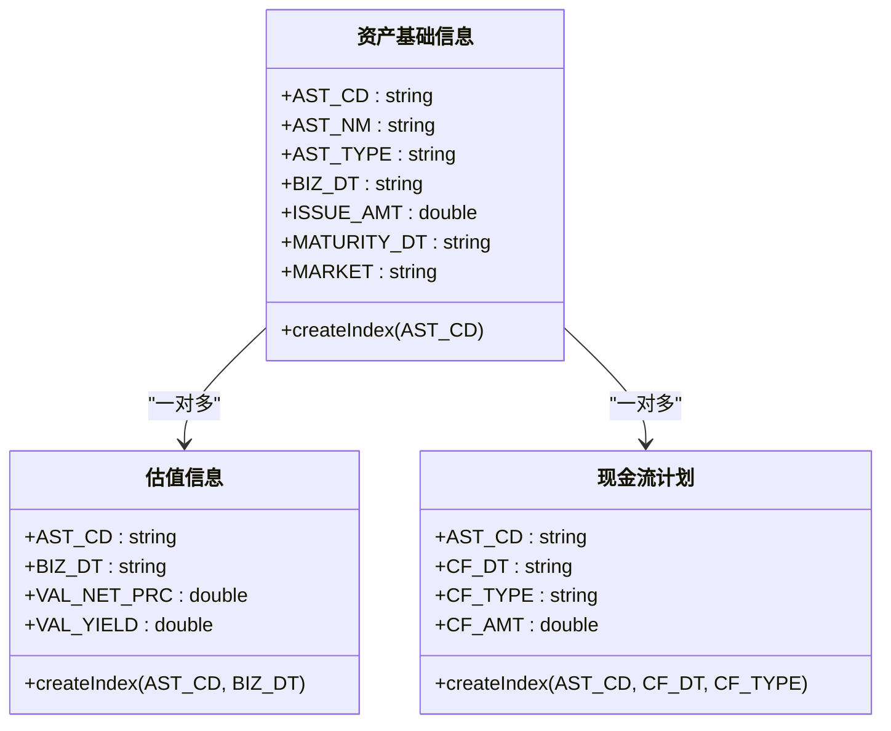
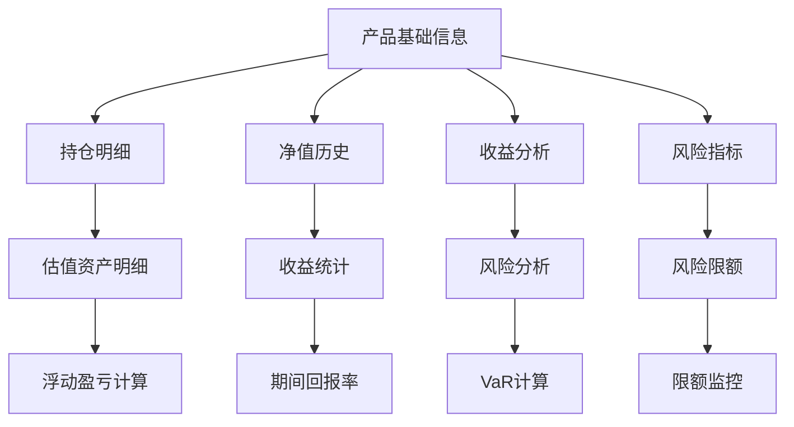
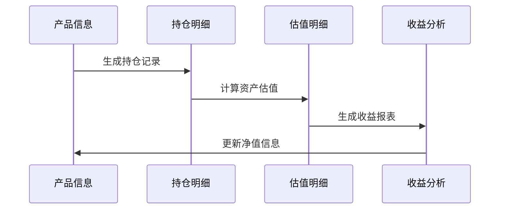
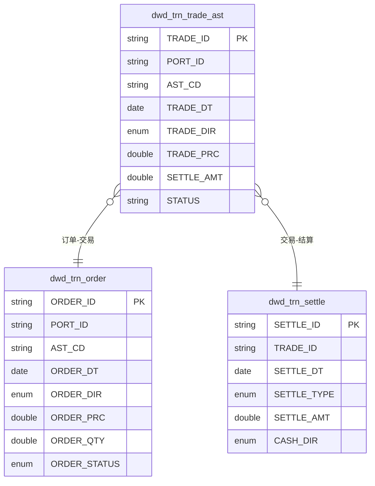
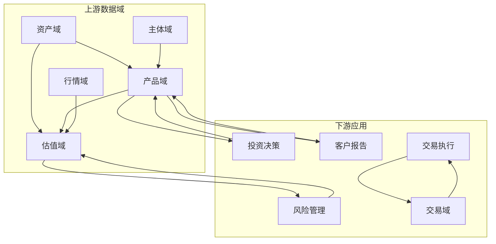
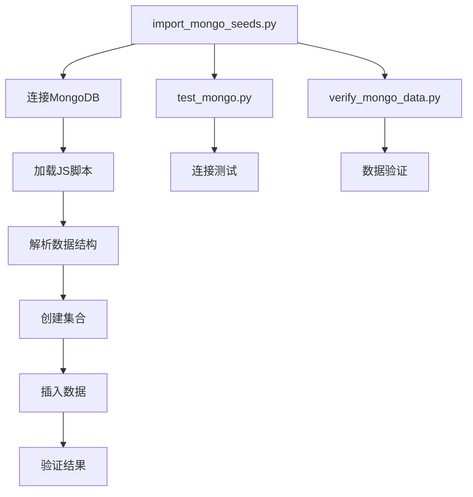
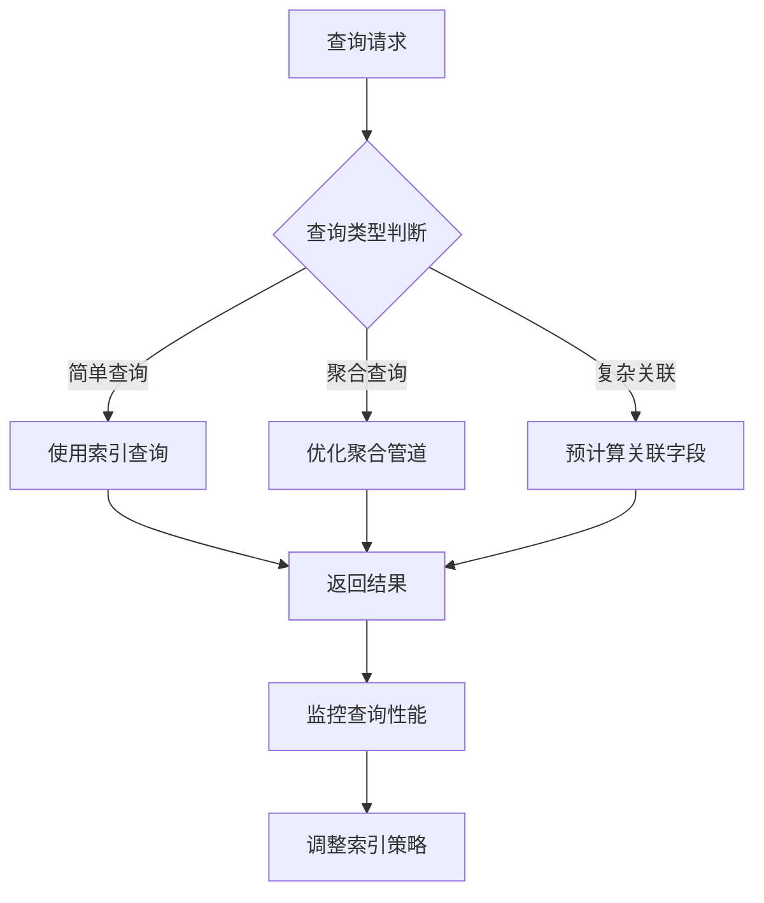

# 数据库部署

<cite>
**本文档引用的文件**
- [mongo-seed/README.md](file://mongo-seed/README.md)
- [mongo-seed/_keys.js](file://mongo-seed/_keys.js)
- [mongo-seed/01_asset_domain.js](file://mongo-seed/01_asset_domain.js)
- [mongo-seed/02_subject_domain.js](file://mongo-seed/02_subject_domain.js)
- [mongo-seed/03_product_domain.js](file://mongo-seed/03_product_domain.js)
- [mongo-seed/04_valuation_domain.js](file://mongo-seed/04_valuation_domain.js)
- [mongo-seed/05_transaction_domain.js](file://mongo-seed/05_transaction_domain.js)
- [mongo-seed/06_seller_domain.js](file://mongo-seed/06_seller_domain.js)
- [mongo-seed/07_customer_domain.js](file://mongo-seed/07_customer_domain.js)
- [mongo-seed/08_risk_domain.js](file://mongo-seed/08_risk_domain.js)
- [mongo-seed/09_market_domain.js](file://mongo-seed/09_market_domain.js)
- [scripts/import_mongo_seeds.py](file://scripts/import_mongo_seeds.py)
- [scripts/test_mongo.py](file://scripts/test_mongo.py)
- [scripts/verify_mongo_data.py](file://scripts/verify_mongo_data.py)
</cite>

## 目录
1. [简介](#简介)
2. [项目结构](#项目结构)
3. [核心组件](#核心组件)
4. [架构概览](#架构概览)
5. [详细组件分析](#详细组件分析)
6. [依赖关系分析](#依赖关系分析)
7. [性能考虑](#性能考虑)
8. [故障排除指南](#故障排除指南)
9. [结论](#结论)
10. [附录](#附录)

## 简介

本指南为投资组合管理系统提供完整的MongoDB数据库部署方案。该系统采用九大数据域模型，包含82个数据集合，涵盖资产、主体、产品、估值、交易、销售、客户、风险和行情等核心业务领域。

系统基于MongoDB 5.0+版本设计，采用JSON Schema进行数据验证，支持高并发读写场景。每个数据域都包含完整的索引策略和数据完整性约束，确保业务数据的准确性和查询效率。

## 项目结构

项目采用模块化的数据域组织方式，每个数据域独立管理其相关的数据集合：



**图表来源**
- [mongo-seed/README.md:1-125](file://mongo-seed/README.md#L1-L125)
- [mongo-seed/_keys.js:1-161](file://mongo-seed/_keys.js#L1-L161)
- [scripts/import_mongo_seeds.py:1-305](file://scripts/import_mongo_seeds.py#L1-L305)

**章节来源**
- [mongo-seed/README.md:1-125](file://mongo-seed/README.md#L1-L125)
- [mongo-seed/_keys.js:1-161](file://mongo-seed/_keys.js#L1-L161)

## 核心组件

### 数据域架构

系统采用九大数据域模型，每个域都有明确的职责边界和数据关系：

| 数据域 | 主要表数量 | 核心职责 | 关键索引策略 |
|--------|------------|----------|-------------|
| 资产域 | 12张表 | 资产基础信息、估值、现金流 | AST_CD主键、BIZ_DT时间索引 |
| 主体域 | 3张表 | 机构信息、财务状况、交易对手 | ISR_ID主键、CNTP_ID主键 |
| 产品域 | 12张表 | 组合信息、持仓、收益 | PORT_ID主键、多维复合索引 |
| 估值域 | 10张表 | 组合估值、风险指标、收益分析 | PORT_ID+BIZ_DT复合索引 |
| 交易域 | 6张表 | 交易流水、委托、结算 | TRADE_ID主键、多维度查询索引 |
| 销售域 | 1张表 | 销售人员信息 | SELLER_ID主键、区域索引 |
| 客户域 | 8张表 | 客户信息、交易、风险评估 | CUSTOMER_ID主键、KYC索引 |
| 风险域 | 5张表 | 风险监控、预警、VaR | 多维度风险指标索引 |
| 行情域 | 25张表 | 市场数据、指数、利率曲线 | 时间序列索引、多市场索引 |

### 数据模型设计原则

1. **审计字段统一**：所有集合包含`etl_dt`（ETL日期）和`src_sys`（来源系统）字段
2. **业务日期格式**：统一使用字符串yyyyMMdd格式存储业务日期
3. **数值精度控制**：金额和比率使用double类型，必要时可升级为decimal128
4. **JSON Schema验证**：每集合通过$jsonSchema约束主键和必填字段
5. **索引策略**：主键字段显式建立唯一索引，高频查询字段建立普通索引

**章节来源**
- [mongo-seed/README.md:114-125](file://mongo-seed/README.md#L114-L125)
- [mongo-seed/_keys.js:1-161](file://mongo-seed/_keys.js#L1-L161)

## 架构概览

系统采用三层架构模式，支持高并发和数据一致性：



**图表来源**
- [mongo-seed/README.md:1-125](file://mongo-seed/README.md#L1-L125)

### 数据导入流程



**图表来源**
- [scripts/import_mongo_seeds.py:185-305](file://scripts/import_mongo_seeds.py#L185-L305)

## 详细组件分析

### 资产域分析

资产域是整个系统的基石，包含12个核心表，覆盖债券、股票、基金等各类资产：



**图表来源**
- [mongo-seed/01_asset_domain.js:28-56](file://mongo-seed/01_asset_domain.js#L28-L56)
- [mongo-seed/01_asset_domain.js:59-91](file://mongo-seed/01_asset_domain.js#L59-L91)
- [mongo-seed/01_asset_domain.js:151-183](file://mongo-seed/01_asset_domain.js#L151-L183)

#### 资产域索引策略

| 集合名称 | 主键索引 | 辅助索引 | 查询场景 |
|----------|----------|----------|----------|
| dwd_ast_info | AST_CD | BIZ_DT | 资产基本信息查询 |
| dwd_ast_info_ch | AST_CD,BIZ_DT | 无 | 中债估值查询 |
| dwd_ast_info_zg | AST_CD,BIZ_DT | 无 | 中证估值查询 |
| dwd_ast_cf_plan | AST_CD,CF_DT,CF_TYPE | 无 | 现金流计划查询 |
| dwd_ast_flow_trade | TRADE_ID | AST_CD,TRADE_DT | 交易流水查询 |

**章节来源**
- [mongo-seed/01_asset_domain.js:28-38](file://mongo-seed/01_asset_domain.js#L28-L38)
- [mongo-seed/01_asset_domain.js:59-68](file://mongo-seed/01_asset_domain.js#L59-L68)
- [mongo-seed/01_asset_domain.js:151-156](file://mongo-seed/01_asset_domain.js#L151-L156)

### 产品域分析

产品域管理投资组合相关信息，包含12个核心表：



**图表来源**
- [mongo-seed/03_product_domain.js:32-96](file://mongo-seed/03_product_domain.js#L32-L96)
- [mongo-seed/03_product_domain.js:99-166](file://mongo-seed/03_product_domain.js#L99-L166)
- [mongo-seed/03_product_domain.js:169-221](file://mongo-seed/03_product_domain.js#L169-L221)

#### 产品域数据流



**图表来源**
- [mongo-seed/03_product_domain.js:99-166](file://mongo-seed/03_product_domain.js#L99-L166)
- [mongo-seed/03_product_domain.js:169-221](file://mongo-seed/03_product_domain.js#L169-L221)

**章节来源**
- [mongo-seed/03_product_domain.js:32-96](file://mongo-seed/03_product_domain.js#L32-L96)
- [mongo-seed/03_product_domain.js:99-166](file://mongo-seed/03_product_domain.js#L99-L166)

### 交易域分析

交易域负责记录所有交易活动，包含6个核心表：



**图表来源**
- [mongo-seed/05_transaction_domain.js:16-47](file://mongo-seed/05_transaction_domain.js#L16-L47)
- [mongo-seed/05_transaction_domain.js:49-73](file://mongo-seed/05_transaction_domain.js#L49-L73)
- [mongo-seed/05_transaction_domain.js:96-120](file://mongo-seed/05_transaction_domain.js#L96-L120)

**章节来源**
- [mongo-seed/05_transaction_domain.js:16-47](file://mongo-seed/05_transaction_domain.js#L16-L47)
- [mongo-seed/05_transaction_domain.js:49-73](file://mongo-seed/05_transaction_domain.js#L49-L73)

## 依赖关系分析

### 数据域间依赖关系



**图表来源**
- [mongo-seed/README.md:67-113](file://mongo-seed/README.md#L67-L113)

### Python导入工具架构



**图表来源**
- [scripts/import_mongo_seeds.py:134-183](file://scripts/import_mongo_seeds.py#L134-L183)
- [scripts/test_mongo.py:1-18](file://scripts/test_mongo.py#L1-L18)
- [scripts/verify_mongo_data.py:1-36](file://scripts/verify_mongo_data.py#L1-L36)

**章节来源**
- [scripts/import_mongo_seeds.py:134-183](file://scripts/import_mongo_seeds.py#L134-L183)
- [scripts/test_mongo.py:1-18](file://scripts/test_mongo.py#L1-L18)
- [scripts/verify_mongo_data.py:1-36](file://scripts/verify_mongo_data.py#L1-L36)

## 性能考虑

### 索引优化策略

基于数据域特点，建议实施以下索引策略：

1. **高频查询字段索引**
   - BIZ_DT（业务日期）：所有快照型表都需要此索引
   - PORT_ID（产品代码）：产品域和估值域常用查询条件
   - AST_CD（资产代码）：资产域和交易域核心查询字段

2. **复合索引设计**
   - dwd_ptl_holding: (PORT_ID, AST_CD, BIZ_DT)
   - dwd_val_asset_detail: (PORT_ID, AST_CD, BIZ_DT)
   - dwd_trn_trade_ast: (PORT_ID, TRADE_DT)

3. **文本搜索索引**
   - dwd_cust_info: (CUSTOMER_NM, CUSTOMER_TYPE)
   - dwd_isr_institution: (ISR_NM, ISR_TYPE)

### 查询性能优化



**图表来源**
- [mongo-seed/README.md:114-125](file://mongo-seed/README.md#L114-L125)

## 故障排除指南

### 常见问题诊断

#### 连接问题
- **MongoDB服务未启动**：检查服务状态和端口监听
- **网络连接异常**：验证防火墙设置和网络连通性
- **认证失败**：检查用户名密码和权限配置

#### 数据导入问题
- **集合创建失败**：检查JSON Schema定义和字段类型
- **索引创建超时**：优化索引大小和服务器资源
- **数据重复冲突**：检查唯一索引约束和数据去重

#### 性能问题
- **查询响应缓慢**：分析执行计划和索引使用情况
- **内存不足**：监控内存使用和优化查询语句
- **磁盘空间不足**：清理历史数据和优化存储策略

**章节来源**
- [scripts/test_mongo.py:1-18](file://scripts/test_mongo.py#L1-L18)
- [scripts/verify_mongo_data.py:30-36](file://scripts/verify_mongo_data.py#L30-L36)

### 数据验证工具

系统提供多种数据验证工具：

1. **连接测试**：验证MongoDB连接状态
2. **数据完整性检查**：验证集合数量和记录条数
3. **业务规则验证**：检查关键业务指标的合理性

**章节来源**
- [scripts/test_mongo.py:1-18](file://scripts/test_mongo.py#L1-L18)
- [scripts/verify_mongo_data.py:1-36](file://scripts/verify_mongo_data.py#L1-L36)

## 结论

本MongoDB数据库部署方案提供了完整的企业级数据管理解决方案。通过九大数据域的模块化设计、严格的索引策略和完善的监控体系，系统能够满足投资组合管理的复杂业务需求。

关键优势包括：
- **模块化架构**：清晰的数据域边界便于维护和扩展
- **高性能设计**：针对业务场景优化的索引和查询策略
- **数据完整性**：JSON Schema约束和数据验证机制
- **运维友好**：自动化导入工具和监控告警系统

建议在生产环境中根据实际业务量和性能要求进一步优化配置参数，并建立完善的数据备份和灾难恢复机制。

## 附录

### 安装步骤

1. **环境准备**
   - 安装MongoDB 5.0+版本
   - 配置系统资源和存储空间
   - 设置网络访问权限

2. **数据库初始化**
   ```bash
   # 使用mongosh执行初始化脚本
   mongosh "mongodb://localhost:27017/zy_data" mongo-seed/00_init.js
   ```

3. **数据导入**
   ```bash
   # 执行Python导入脚本
   python scripts/import_mongo_seeds.py
   ```

4. **验证测试**
   ```bash
   # 运行连接测试
   python scripts/test_mongo.py
   
   # 验证数据完整性
   python scripts/verify_mongo_data.py
   ```

### 配置文件示例

```javascript
// MongoDB连接配置
{
  "host": "localhost",
  "port": 27017,
  "database": "zy_data",
  "username": "admin",
  "password": "password",
  "authSource": "admin"
}

// 索引配置示例
{
  "collections": {
    "dwd_ast_info": [
      {"key": {"AST_CD": 1}, "unique": true},
      {"key": {"BIZ_DT": 1}}
    ],
    "dwd_ptl_holding": [
      {"key": {"PORT_ID": 1, "AST_CD": 1, "BIZ_DT": 1}, "unique": true}
    ]
  }
}
```

### 监控指标

1. **性能指标**
   - 查询响应时间
   - 索引命中率
   - 连接池使用率

2. **业务指标**
   - 数据导入成功率
   - 业务数据完整性
   - 系统可用性

3. **告警阈值**
   - 查询响应时间>1秒
   - 索引命中率<80%
   - 数据导入失败率>1%