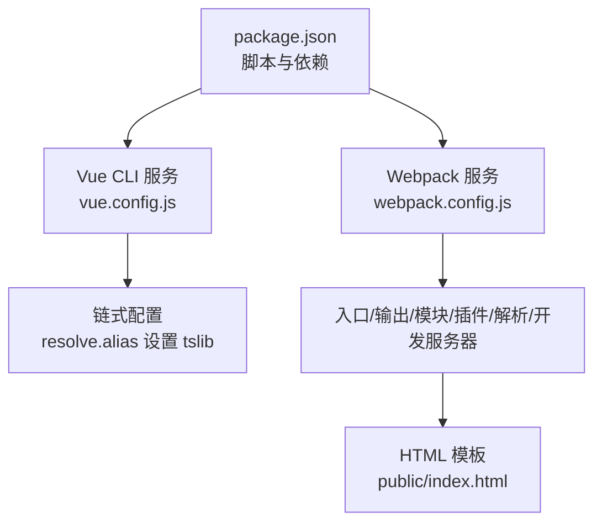
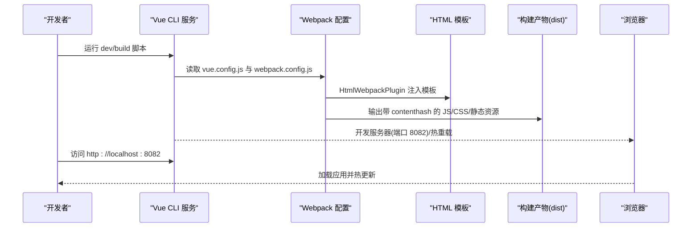
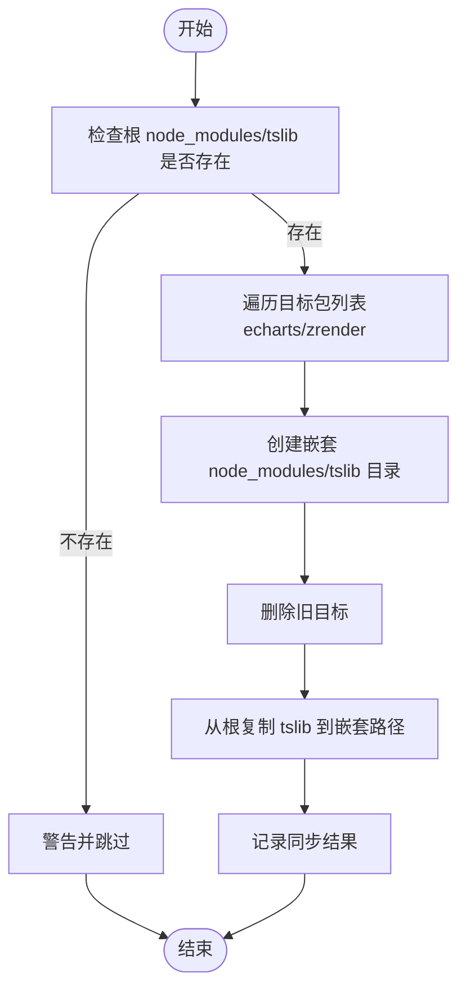
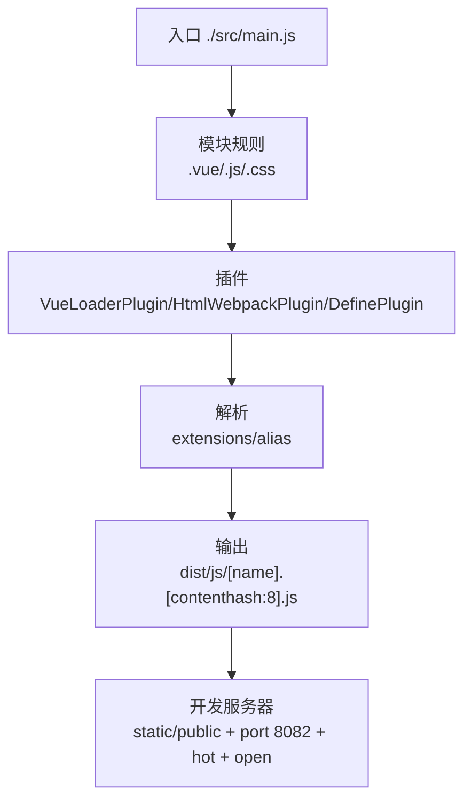
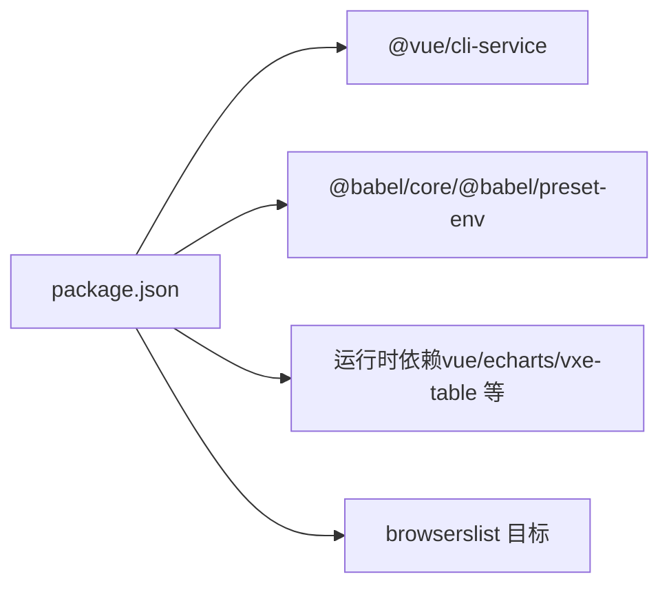

# 构建配置

<cite>
**本文引用的文件**
- [vue.config.js](file://vue.config.js)
- [webpack.config.js](file://webpack.config.js)
- [package.json](file://package.json)
- [.babelrc](file://.babelrc)
- [public/index.html](file://public/index.html)
- [scripts/ensure-nested-tslib.js](file://scripts/ensure-nested-tslib.js)
- [scripts/apply-vxe-table-scroll-fix.js](file://scripts/apply-vxe-table-scroll-fix.js)
- [offline-npm-bundles/OFFLINE_INSTALL.txt](file://offline-npm-bundles/OFFLINE_INSTALL.txt)
- [offline-npm-bundles/PREBUILT_COPY.txt](file://offline-npm-bundles/PREBUILT_COPY.txt)
</cite>

## 目录
1. [简介](#简介)
2. [项目结构](#项目结构)
3. [核心组件](#核心组件)
4. [架构总览](#架构总览)
5. [详细组件分析](#详细组件分析)
6. [依赖分析](#依赖分析)
7. [性能考虑](#性能考虑)
8. [故障排查指南](#故障排查指南)
9. [结论](#结论)
10. [附录](#附录)

## 简介
本指南面向投资组合管理系统的前端构建配置，围绕 Vue CLI 与 Webpack 的配置进行系统化说明，涵盖以下主题：
- Vue CLI 配置项与路径别名（含 tslib 别名）
- Webpack 链式配置与自定义扩展
- 生产构建优化（代码压缩、资源分割、缓存策略）
- 静态资源处理（图片、字体、CSS）
- 开发服务器配置（热重载、代理、端口）
- 构建产物分析与 bundle 优化建议
- 自定义 Webpack 配置与第三方插件集成
- 常见构建失败排查与解决方案

## 项目结构
该工程同时存在 Vue CLI 与独立 Webpack 配置文件，二者职责如下：
- Vue CLI 配置：集中于 vue.config.js，负责链式配置与别名覆盖（如 tslib）。
- 独立 Webpack 配置：集中于 webpack.config.js，负责入口、输出、模块规则、插件、解析与开发服务器。

图表来源
- [package.json:5-9](file://package.json#L5-L9)
- [vue.config.js:5-16](file://vue.config.js#L5-L16)
- [webpack.config.js:6-62](file://webpack.config.js#L6-L62)
- [public/index.html:1-11](file://public/index.html#L1-L11)

章节来源
- [package.json:5-9](file://package.json#L5-L9)
- [vue.config.js:5-16](file://vue.config.js#L5-L16)
- [webpack.config.js:6-62](file://webpack.config.js#L6-L62)
- [public/index.html:1-11](file://public/index.html#L1-L11)

## 核心组件
- Vue CLI 配置（vue.config.js）
  - 使用链式配置在 resolve.alias 中将 tslib 指向本地 node_modules/tslib，确保嵌套依赖（如 echarts/zrender）能稳定解析到 tslib。
  - 同时在 configureWebpack.resolve.alias 中保持一致的别名映射，保证不同入口行为一致。
- 独立 Webpack 配置（webpack.config.js）
  - 入口：src/main.js
  - 输出：dist，JS 文件采用 contenthash 作为命名后缀并启用 clean
  - 模块：.vue、.js、.css 的加载器配置
  - 插件：VueLoaderPlugin、HtmlWebpackPlugin、DefinePlugin 注入环境变量
  - 解析：扩展名与别名（vue$、@）
  - 开发服务器：静态目录 public、压缩、端口 8082、热重载、自动打开浏览器
- Babel 配置（.babelrc）
  - preset-env targets 限定浏览器范围，避免对 IE 低版本兼容
- 脚本与离线安装
  - postinstall 脚本：应用 vxe-table 滚动修复、确保 nested tslib
  - 离线安装说明：针对 marked、dompurify 等包的离线部署指引

章节来源
- [vue.config.js:5-16](file://vue.config.js#L5-L16)
- [webpack.config.js:6-62](file://webpack.config.js#L6-L62)
- [.babelrc:1-14](file://.babelrc#L1-L14)
- [scripts/ensure-nested-tslib.js:1-26](file://scripts/ensure-nested-tslib.js#L1-L26)
- [scripts/apply-vxe-table-scroll-fix.js:1-52](file://scripts/apply-vxe-table-scroll-fix.js#L1-L52)
- [offline-npm-bundles/OFFLINE_INSTALL.txt:29-42](file://offline-npm-bundles/OFFLINE_INSTALL.txt#L29-L42)
- [offline-npm-bundles/PREBUILT_COPY.txt:33-43](file://offline-npm-bundles/PREBUILT_COPY.txt#L33-L43)

## 架构总览
下图展示从开发到生产的构建流程与关键配置点：

图表来源
- [package.json:5-9](file://package.json#L5-L9)
- [vue.config.js:5-16](file://vue.config.js#L5-L16)
- [webpack.config.js:33-62](file://webpack.config.js#L33-L62)
- [public/index.html:1-11](file://public/index.html#L1-L11)

## 详细组件分析

### Vue CLI 配置（路径别名与 tslib）
- 目标：解决嵌套 node_modules 中的 tslib 解析问题，避免 ENOENT 错误
- 实现要点：
  - 通过 chainWebpack 与 configureWebpack.resolve.alias 将 tslib 指向根 node_modules/tslib
  - 与 postinstall 脚本 ensure-nested-tslib 协同，确保 echarts/zrender 的内部依赖也能解析到 tslib

图表来源
- [scripts/ensure-nested-tslib.js:13-25](file://scripts/ensure-nested-tslib.js#L13-L25)
- [vue.config.js:3-8](file://vue.config.js#L3-L8)

章节来源
- [vue.config.js:3-8](file://vue.config.js#L3-L8)
- [scripts/ensure-nested-tslib.js:1-26](file://scripts/ensure-nested-tslib.js#L1-L26)

### 独立 Webpack 配置（入口、输出、模块、插件、解析、开发服务器）
- 入口与输出
  - 入口：src/main.js
  - 输出：dist，JS 文件名包含 contenthash，开启 clean
- 模块规则
  - .vue：vue-loader
  - .js：babel-loader，排除 node_modules
  - .css：vue-style-loader + css-loader
- 插件
  - VueLoaderPlugin：支持 .vue 组件
  - HtmlWebpackPlugin：基于 public/index.html 生成页面
  - DefinePlugin：注入 process.env（NODE_ENV、BASE_URL）
- 解析
  - extensions：.js/.vue/.json
  - alias：vue$ 指向 vue.esm.js，@ 指向 src
- 开发服务器
  - static.directory 指向 public
  - compress=true、port=8082、hot=true、open=true

图表来源
- [webpack.config.js:6-62](file://webpack.config.js#L6-L62)
- [public/index.html:1-11](file://public/index.html#L1-L11)

章节来源
- [webpack.config.js:6-62](file://webpack.config.js#L6-L62)
- [public/index.html:1-11](file://public/index.html#L1-L11)

### Babel 配置（preset-env 与目标浏览器）
- 目标：限制兼容范围，减少 polyfill 体积
- 关键点：targets 中排除 IE 低版本，modules=false 以保留 ES 模块便于 Tree-shaking

章节来源
- [.babelrc:1-14](file://.babelrc#L1-L14)

### 离线安装与第三方包保障
- marked、dompurify 离线安装步骤与注意事项
- 若 npm install 报 Maximum call stack size exceeded，提供清理 node_modules/package-lock.json、升级 npm、或直接解压 tgz 的方案

章节来源
- [offline-npm-bundles/OFFLINE_INSTALL.txt:29-42](file://offline-npm-bundles/OFFLINE_INSTALL.txt#L29-L42)
- [offline-npm-bundles/PREBUILT_COPY.txt:33-43](file://offline-npm-bundles/PREBUILT_COPY.txt#L33-L43)

## 依赖分析
- 构建工具链
  - @vue/cli-service 提供 Vue CLI 服务与默认 Webpack 配置
  - @vue/cli-plugin-babel/router/vuex 提供对应插件
- 运行时依赖
  - vue、vue-router、vuex、element-ui、echarts、vxe-table 等
- 开发依赖
  - @babel/core、@babel/preset-env、vue-template-compiler
- 环境变量与浏览器兼容
  - browserslist 指定目标浏览器范围

图表来源
- [package.json:30-44](file://package.json#L30-L44)

章节来源
- [package.json:30-44](file://package.json#L30-L44)

## 性能考虑
- 生产构建优化建议
  - 代码压缩：使用默认压缩器（terser），确保在生产模式下启用
  - 资源分割：利用动态导入与路由级别的懒加载，拆分首屏与业务包
  - 缓存策略：contenthash 已在输出中启用，建议配合长期缓存与 CDN
- 静态资源优化
  - 图片与字体：使用合适的格式（WebP/AVIF）与尺寸裁剪，结合压缩与懒加载
  - CSS：提取公共样式、移除未使用样式（需配合 PurgeCSS 或类似工具）
- 开发体验
  - 端口 8082 已配置，避免与系统常用端口冲突
  - 热重载与自动打开浏览器提升迭代效率

[本节为通用指导，无需特定文件引用]

## 故障排查指南
- tslib 解析失败（ENOENT）
  - 现象：嵌套依赖（如 echarts/zrender）无法找到 tslib
  - 解决：确认 vue.config.js 中 tslib 别名已生效；执行 postinstall 脚本 ensure-nested-tslib
  - 参考
    - [vue.config.js:3-8](file://vue.config.js#L3-L8)
    - [scripts/ensure-nested-tslib.js:1-26](file://scripts/ensure-nested-tslib.js#L1-L26)
- marked 未定义或运行时报错
  - 现象：浏览器控制台提示 marked 未定义
  - 解决：按离线安装说明将 marked、dompurify 放入 node_modules 并重新编译
  - 参考
    - [offline-npm-bundles/OFFLINE_INSTALL.txt:29-32](file://offline-npm-bundles/OFFLINE_INSTALL.txt#L29-L32)
    - [offline-npm-bundles/PREBUILT_COPY.txt:33-37](file://offline-npm-bundles/PREBUILT_COPY.txt#L33-L37)
- npm install 报 Maximum call stack size exceeded
  - 解决：删除 node_modules 与 package-lock.json 后重试；升级 npm；必要时直接解压 tgz
  - 参考
    - [offline-npm-bundles/OFFLINE_INSTALL.txt:33-37](file://offline-npm-bundles/OFFLINE_INSTALL.txt#L33-L37)
- vxe-table 滚动时访问 reactData.visible 抛错
  - 解决：执行 postinstall 脚本 apply-vxe-table-scroll-fix.js，对 es/lib 产物进行幂等修复
  - 参考
    - [scripts/apply-vxe-table-scroll-fix.js:1-52](file://scripts/apply-vxe-table-scroll-fix.js#L1-L52)
- 开发服务器无法访问或端口占用
  - 现象：浏览器无法打开 http://localhost:8082
  - 解决：检查端口占用情况，修改 webpack.config.js 中 devServer.port 或关闭占用进程
  - 参考
    - [webpack.config.js:53-61](file://webpack.config.js#L53-L61)

章节来源
- [vue.config.js:3-8](file://vue.config.js#L3-L8)
- [scripts/ensure-nested-tslib.js:1-26](file://scripts/ensure-nested-tslib.js#L1-L26)
- [offline-npm-bundles/OFFLINE_INSTALL.txt:29-37](file://offline-npm-bundles/OFFLINE_INSTALL.txt#L29-L37)
- [scripts/apply-vxe-table-scroll-fix.js:1-52](file://scripts/apply-vxe-table-scroll-fix.js#L1-L52)
- [webpack.config.js:53-61](file://webpack.config.js#L53-L61)

## 结论
本项目通过 Vue CLI 与独立 Webpack 配置协同工作，实现了稳定的开发与生产构建能力。重点在于：
- 通过别名与 postinstall 脚本保障第三方嵌套依赖（如 tslib、vxe-table）的稳定性
- 使用 contenthash 与 clean 确保生产构建的可缓存性与整洁性
- 依托 Babel preset-env 控制兼容范围，降低打包体积
- 提供离线安装与故障排查指引，提升团队协作与部署可靠性

[本节为总结，无需特定文件引用]

## 附录
- 构建脚本与依赖
  - dev/build/lint 脚本由 @vue/cli-service 提供
  - browserslist 用于目标浏览器范围
- HTML 模板
  - 基于 public/index.html 生成最终页面，标题可由 HtmlWebpackPlugin 动态注入

章节来源
- [package.json:5-9](file://package.json#L5-L9)
- [public/index.html:1-11](file://public/index.html#L1-L11)