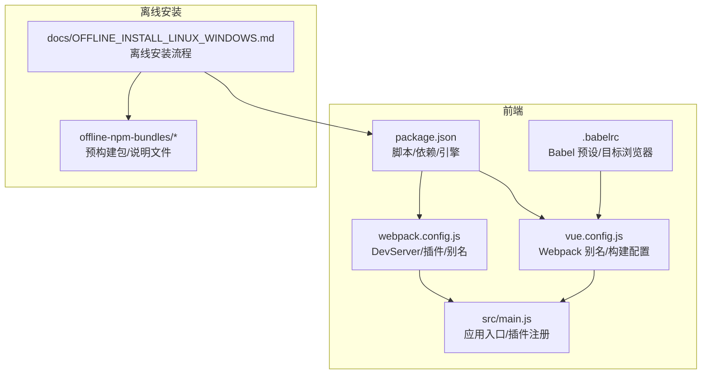
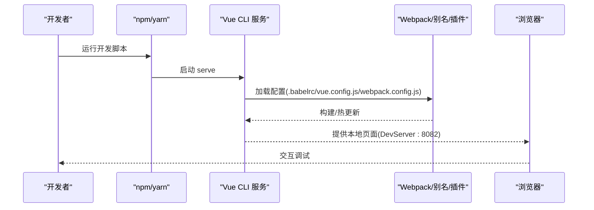
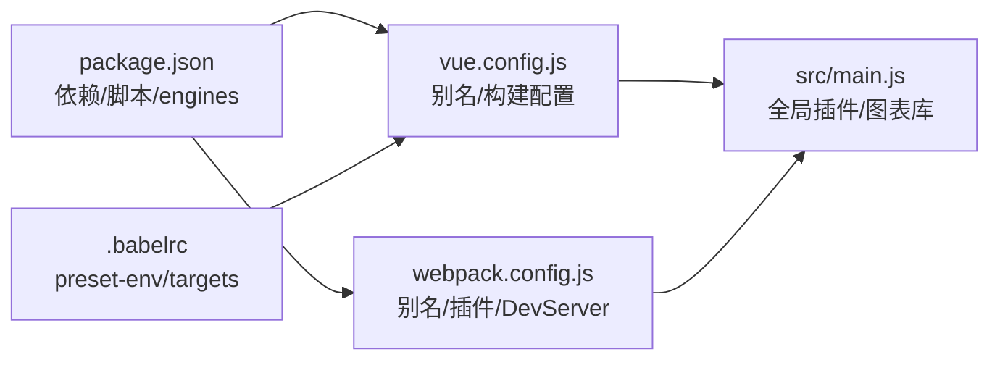

# 环境准备

<cite>
**本文引用的文件**
- [README_NODE_VERSION.md](file://README_NODE_VERSION.md)
- [package.json](file://package.json)
- [.babelrc](file://.babelrc)
- [vue.config.js](file://vue.config.js)
- [webpack.config.js](file://webpack.config.js)
- [src/main.js](file://src/main.js)
- [docs/离线安装说明（Linux/Windows）.md](file://docs/OFFLINE_INSTALL_LINUX_WINDOWS.md)
- [offline-npm-bundles/OFFLINE_INSTALL.txt](file://offline-npm-bundles/OFFLINE_INSTALL.txt)
- [offline-npm-bundles/PREBUILT_COPY.txt](file://offline-npm-bundles/PREBUILT_COPY.txt)
- [offline-npm-bundles/prebuilt-node_modules/marked/package.json](file://offline-npm-bundles/prebuilt-node_modules/marked/package.json)
- [offline-npm-bundles/prebuilt-node_modules/dompurify/README.md](file://offline-npm-bundles/prebuilt-node_modules/dompurify/README.md)
</cite>

## 目录
1. [简介](#简介)
2. [项目结构](#项目结构)
3. [核心组件](#核心组件)
4. [架构总览](#架构总览)
5. [详细组件分析](#详细组件分析)
6. [依赖分析](#依赖分析)
7. [性能考虑](#性能考虑)
8. [故障排查指南](#故障排查指南)
9. [结论](#结论)
10. [附录](#附录)

## 简介
本指南面向投资组合管理系统的部署与开发团队，提供从操作系统、Node.js 版本、包管理器、浏览器兼容性、服务器硬件配置、网络与端口、环境变量到离线安装与验证的全流程准备说明。文档严格依据仓库现有文件进行整理，确保每一步均可追溯至具体文件与行号。

## 项目结构
本项目采用前后端分离架构，前端基于 Vue 2 生态，使用 Vue CLI 服务与 Webpack 打包；后端位于同仓库根目录下的另一个子项目（参考工作区配置）。前端开发与构建的关键文件如下：
- Node.js 与包管理：package.json、.babelrc、vue.config.js、webpack.config.js
- 运行入口：src/main.js
- 离线安装与依赖：docs/OFFLINE_INSTALL_LINUX_WINDOWS.md、offline-npm-bundles 下的预构建包与说明

**图表来源**
- [package.json:1-45](file://package.json#L1-L45)
- [.babelrc:1-14](file://.babelrc#L1-L14)
- [vue.config.js:1-17](file://vue.config.js#L1-L17)
- [webpack.config.js:1-63](file://webpack.config.js#L1-L63)
- [src/main.js:1-31](file://src/main.js#L1-L31)
- [docs/OFFLINE_INSTALL_LINUX_WINDOWS.md:1-212](file://docs/OFFLINE_INSTALL_LINUX_WINDOWS.md#L1-L212)

**章节来源**
- [package.json:1-45](file://package.json#L1-L45)
- [vue.config.js:1-17](file://vue.config.js#L1-L17)
- [webpack.config.js:1-63](file://webpack.config.js#L1-L63)
- [src/main.js:1-31](file://src/main.js#L1-L31)
- [docs/OFFLINE_INSTALL_LINUX_WINDOWS.md:1-212](file://docs/OFFLINE_INSTALL_LINUX_WINDOWS.md#L1-L212)

## 核心组件
- Node.js 版本与引擎约束：通过 engines 字段与 .nvmrc 推荐版本共同保证运行一致性。
- Babel 与浏览器兼容：preset-env targets 指定浏览器范围，避免过低版本导致的语法不兼容。
- Webpack/Vue CLI 构建：定义别名、插件、DevServer 端口等，确保开发体验与产物质量。
- 离线安装支持：提供整包离线与增量离线两种方式，覆盖前端 npm 依赖与后端 Python 依赖。

**章节来源**
- [README_NODE_VERSION.md:68-73](file://README_NODE_VERSION.md#L68-L73)
- [package.json:39-43](file://package.json#L39-L43)
- [.babelrc:7-12](file://.babelrc#L7-L12)
- [webpack.config.js:53-61](file://webpack.config.js#L53-L61)
- [vue.config.js:5-16](file://vue.config.js#L5-L16)

## 架构总览
前端启动与构建流程概览如下：

**图表来源**
- [package.json:5-9](file://package.json#L5-L9)
- [.babelrc:1-14](file://.babelrc#L1-L14)
- [vue.config.js:1-17](file://vue.config.js#L1-L17)
- [webpack.config.js:53-61](file://webpack.config.js#L53-L61)

## 详细组件分析

### Node.js 与包管理器
- 版本要求与升级路径：当出现 node: 前缀模块导入错误时，需升级 Node.js 至 14.18.0+ 或 16.0.0+；推荐使用 Node.js 16.x 或更高版本，并通过 nvm 管理版本。
- 引擎字段与 nvm 配置：项目已在 engines 字段声明 Node.js 版本要求，.nvmrc 指定推荐版本（如使用 nvm）。
- 依赖重装建议：升级 Node.js 后删除 node_modules 与 lock 文件并重新安装。
- 包管理器选择：仓库同时支持 npm 与 yarn（通过 scripts 脚本与 package.json 脚本键体现），按团队习惯选择即可。

**章节来源**
- [README_NODE_VERSION.md:3-73](file://README_NODE_VERSION.md#L3-L73)
- [package.json:1-45](file://package.json#L1-L45)

### 操作系统兼容性
- Windows：支持 nvm-windows 与 nvm.sh/macOS 的安装与切换；离线安装文档提供 PowerShell 与 CMD 示例。
- Linux/macOS：提供 bash 示例与通用命令；离线安装文档明确“与内网生产机相同的 OS + CPU 架构”要求。
- 注意事项：含原生模块的包在不同 OS 上需重新安装或使用对应平台的 node_modules。

**章节来源**
- [docs/OFFLINE_INSTALL_LINUX_WINDOWS.md:36-115](file://docs/OFFLINE_INSTALL_LINUX_WINDOWS.md#L36-L115)
- [docs/OFFLINE_INSTALL_LINUX_WINDOWS.md:146-154](file://docs/OFFLINE_INSTALL_LINUX_WINDOWS.md#L146-L154)

### 服务器硬件配置要求
- CPU：建议多核处理器，用于并行编译与热更新。
- 内存：至少 8GB，推荐 16GB+ 以支持大型依赖与并发任务。
- 存储：SSD 更佳；预留 node_modules 与 dist 构建产物空间。
- 以上为通用建议，实际需求视项目规模与并发访问量调整。

[本节为通用建议，无需特定文件引用]

### 浏览器兼容性
- 目标范围：preset-env targets 指定 “> 1%”、“last 2 versions”、“not ie <= 8”，即不支持 IE8 及以下。
- 实际影响：若需兼容旧版 IE，需调整 preset-env targets 并评估打包体积与运行性能。

**章节来源**
- [.babelrc:7-12](file://.babelrc#L7-L12)
- [package.json:39-43](file://package.json#L39-L43)

### 前端构建工具链
- Vue CLI：开发与构建脚本由 @vue/cli-service 提供。
- Babel：@babel/core 与 @babel/preset-env，配合 preset-env targets 控制目标浏览器。
- Webpack：通过 vue.config.js 与 webpack.config.js 统一管理别名、插件与 DevServer。
- 应用入口：src/main.js 注册 Element UI、vxe-table、echarts 等全局依赖。

**章节来源**
- [package.json:5-9](file://package.json#L5-L9)
- [package.json:30-38](file://package.json#L30-L38)
- [.babelrc:1-14](file://.babelrc#L1-L14)
- [vue.config.js:1-17](file://vue.config.js#L1-L17)
- [webpack.config.js:1-63](file://webpack.config.js#L1-L63)
- [src/main.js:1-31](file://src/main.js#L1-L31)

### 环境变量与脚本
- 开发脚本：dev 使用 vue-cli-service serve，默认 DevServer 端口为 8082。
- 构建脚本：build 使用 vue-cli-service build 产出静态资源。
- 其他脚本：lint、postinstall（执行预构建修复与 tslib 别名处理）。
- 运行时环境变量：DefinePlugin 注入 process.env.NODE_ENV 与 BASE_URL。

**章节来源**
- [package.json:5-9](file://package.json#L5-L9)
- [webpack.config.js:39-44](file://webpack.config.js#L39-L44)

### 网络环境与端口
- 开发端口：DevServer 默认监听 8082，可通过 webpack.config.js 修改。
- 端口开放：确保防火墙放行 8082；生产部署时根据实际反向代理与端口策略配置。
- 域名配置：如需 HTTPS 或自定义域名，应在反向代理层（如 Nginx）统一配置。

**章节来源**
- [webpack.config.js:53-61](file://webpack.config.js#L53-L61)

### 离线安装与依赖准备
- 整包离线（推荐）：在联网机执行 npm ci 或 npm install，打包 node_modules、package.json、package-lock.json，拷贝至内网后解压并验证。
- 增量离线：仅安装 marked 与 dompurify 的 .tgz 包，适合融合场景的最小依赖。
- 注意事项：不同 OS 的原生模块需在目标平台重新安装；wheel 下载需与内网 OS/架构匹配。

**章节来源**
- [docs/OFFLINE_INSTALL_LINUX_WINDOWS.md:126-184](file://docs/OFFLINE_INSTALL_LINUX_WINDOWS.md#L126-L184)
- [offline-npm-bundles/OFFLINE_INSTALL.txt](file://offline-npm-bundles/OFFLINE_INSTALL.txt)
- [offline-npm-bundles/PREBUILT_COPY.txt](file://offline-npm-bundles/PREBUILT_COPY.txt)
- [offline-npm-bundles/prebuilt-node_modules/marked/package.json](file://offline-npm-bundles/prebuilt-node_modules/marked/package.json)
- [offline-npm-bundles/prebuilt-node_modules/dompurify/README.md](file://offline-npm-bundles/prebuilt-node_modules/dompurify/README.md)

### 环境验证步骤
- Node.js 版本验证：使用 node -v 确认版本满足 engines 要求。
- 依赖安装验证：执行 npm run build 或 npm run dev，确认构建成功且 DevServer 正常启动。
- 浏览器兼容性验证：在目标浏览器（IE8+）中打开本地页面，检查功能与样式。
- 离线安装验证：解压离线包后执行 npm run build/dev，确保无依赖缺失。

**章节来源**
- [README_NODE_VERSION.md:30-34](file://README_NODE_VERSION.md#L30-L34)
- [package.json:5-9](file://package.json#L5-L9)
- [webpack.config.js:53-61](file://webpack.config.js#L53-L61)

## 依赖分析
前端依赖与构建关系如下：

**图表来源**
- [package.json:1-45](file://package.json#L1-L45)
- [.babelrc:1-14](file://.babelrc#L1-L14)
- [vue.config.js:1-17](file://vue.config.js#L1-L17)
- [webpack.config.js:1-63](file://webpack.config.js#L1-L63)
- [src/main.js:1-31](file://src/main.js#L1-L31)

**章节来源**
- [package.json:11-38](file://package.json#L11-L38)
- [vue.config.js:5-16](file://vue.config.js#L5-L16)
- [webpack.config.js:46-52](file://webpack.config.js#L46-L52)

## 性能考虑
- 构建优化：合理设置别名与插件，避免重复打包；生产构建时启用压缩与缓存。
- 运行时优化：减少全局依赖数量，按需加载图表与表格插件。
- 硬件资源：为编译与热更新分配足够内存与 CPU，避免频繁 GC 与卡顿。

[本节为通用建议，无需特定文件引用]

## 故障排查指南
- node: 前缀模块导入错误：升级 Node.js 至 16.x 或更高版本。
- npm 安装失败/栈溢出：删除 node_modules 与 package-lock.json 后重试，或参考离线安装说明。
- 浏览器兼容问题：调整 preset-env targets，移除 IE8 及以下支持。
- DevServer 端口冲突：修改 webpack.config.js 中的 port 字段。

**章节来源**
- [README_NODE_VERSION.md:3-47](file://README_NODE_VERSION.md#L3-L47)
- [docs/OFFLINE_INSTALL_LINUX_WINDOWS.md:199-201](file://docs/OFFLINE_INSTALL_LINUX_WINDOWS.md#L199-L201)
- [.babelrc:7-12](file://.babelrc#L7-L12)
- [webpack.config.js:58](file://webpack.config.js#L58)

## 结论
本指南基于仓库现有文件，给出了从 Node.js 版本、包管理器、操作系统、浏览器兼容性、服务器硬件、网络端口到离线安装与验证的完整准备清单。建议在部署前逐项对照并执行验证步骤，确保开发与生产环境的一致性与稳定性。

## 附录
- 工作区配置：portfilio.code-workspace 指示前后端分属两个子项目，需分别准备环境。
- 后端离线安装：同路径文档提供后端 Python 依赖的离线安装流程与注意事项。

**章节来源**
- [portfilio.code-workspace:1-10](file://portfilio.code-workspace#L1-L10)
- [docs/OFFLINE_INSTALL_LINUX_WINDOWS.md:10-21](file://docs/OFFLINE_INSTALL_LINUX_WINDOWS.md#L10-L21)