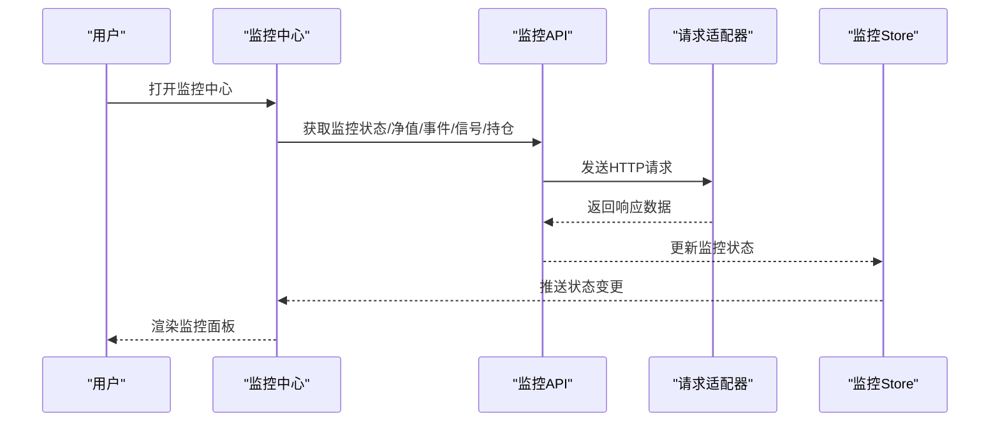
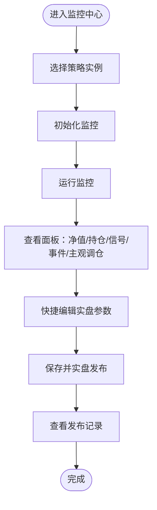
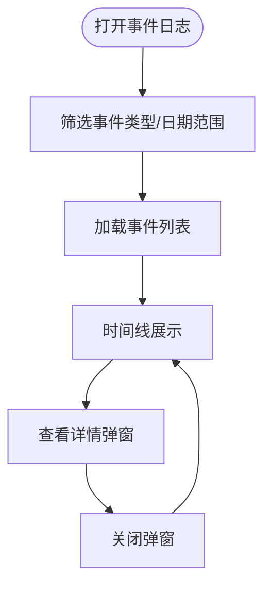
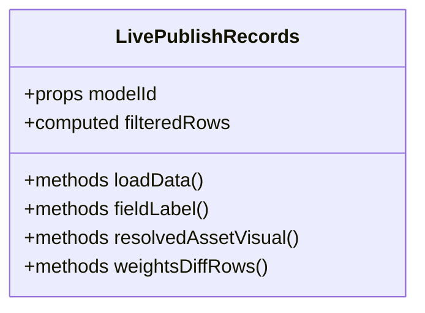
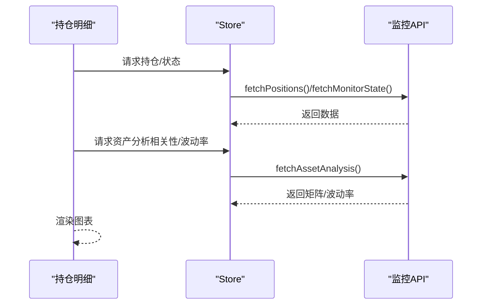
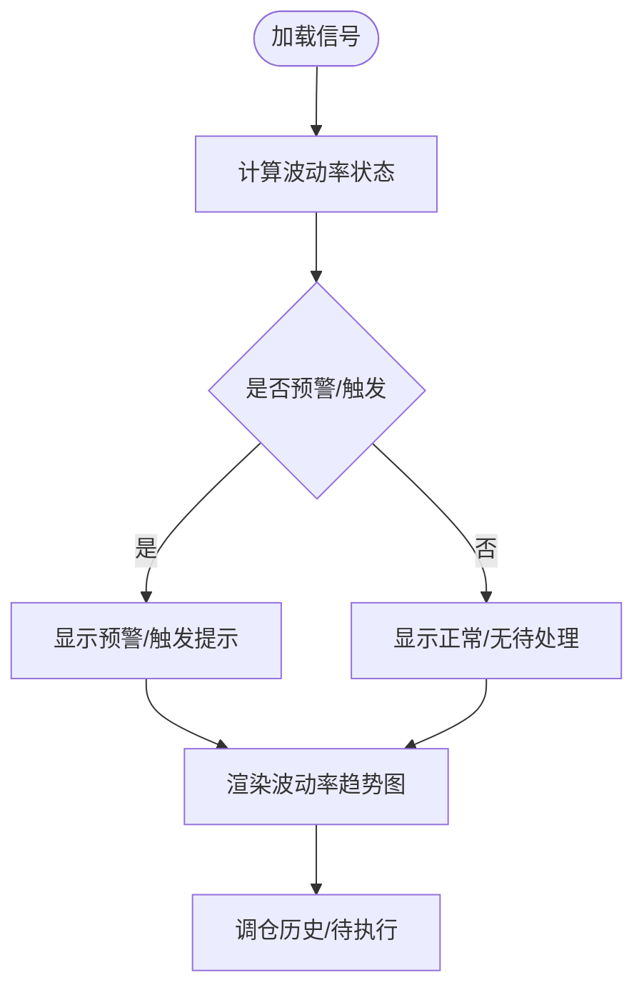
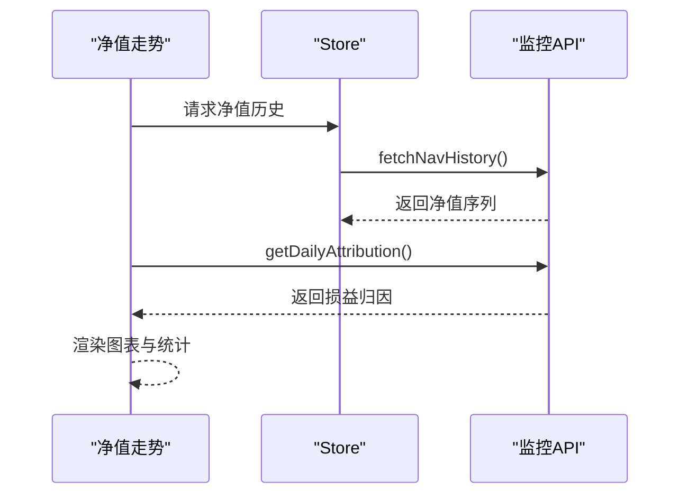
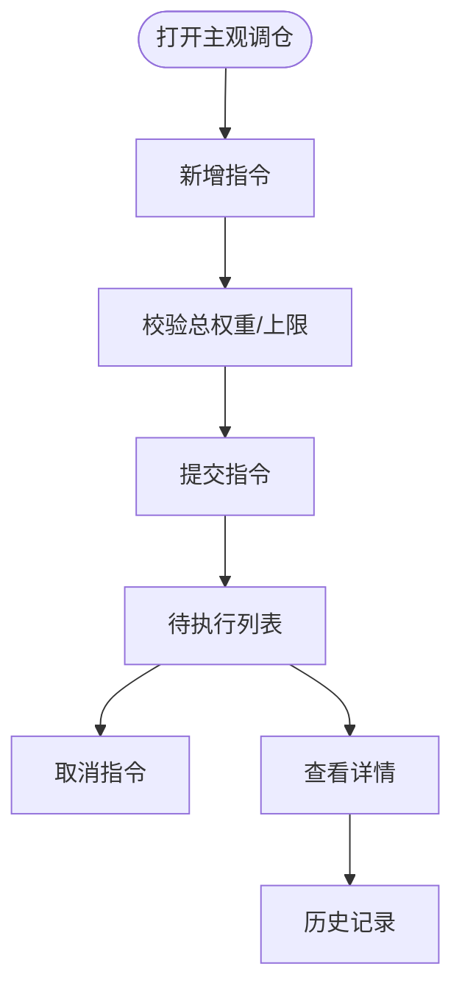
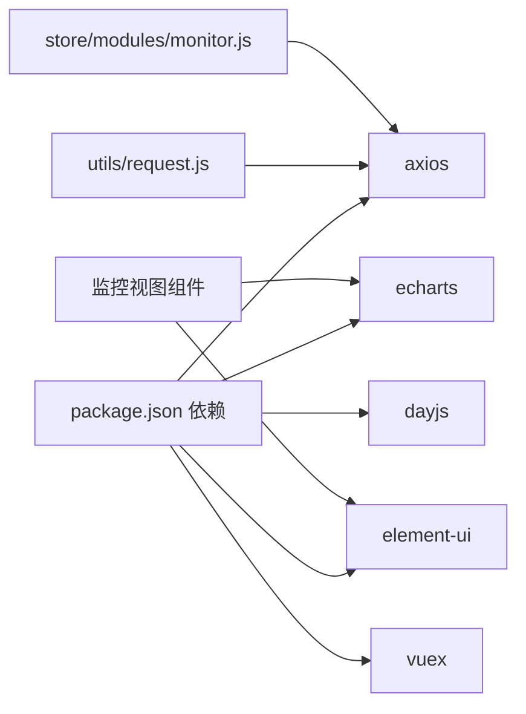

# 监控与日志

<cite>
**本文引用的文件**   
- [src/api/monitor.js](file://src/api/monitor.js)
- [src/store/modules/monitor.js](file://src/store/modules/monitor.js)
- [src/views/monitor/MonitorCenter.vue](file://src/views/monitor/MonitorCenter.vue)
- [src/views/monitor/EventLog.vue](file://src/views/monitor/EventLog.vue)
- [src/views/monitor/LivePublishRecords.vue](file://src/views/monitor/LivePublishRecords.vue)
- [src/views/monitor/Positions.vue](file://src/views/monitor/Positions.vue)
- [src/views/monitor/Signals.vue](file://src/views/monitor/Signals.vue)
- [src/views/monitor/NavHistory.vue](file://src/views/monitor/NavHistory.vue)
- [src/views/monitor/SubjectiveOverride.vue](file://src/views/monitor/SubjectiveOverride.vue)
- [src/views/system/SystemLog.vue](file://src/views/system/SystemLog.vue)
- [src/utils/request.js](file://src/utils/request.js)
- [package.json](file://package.json)
</cite>

## 目录
1. [简介](#简介)
2. [项目结构](#项目结构)
3. [核心组件](#核心组件)
4. [架构总览](#架构总览)
5. [详细组件分析](#详细组件分析)
6. [依赖关系分析](#依赖关系分析)
7. [性能考量](#性能考量)
8. [故障排查指南](#故障排查指南)
9. [结论](#结论)
10. [附录](#附录)

## 简介
本指南面向投资组合管理系统的监控与日志管理，围绕前端监控面板、事件日志、实盘发布记录、持仓与信号、净值与损益归因等模块，系统阐述应用监控配置（性能指标、业务指标、健康检查）、日志采集与分析（前端、后端、错误日志）、实时监控面板、告警配置与升级策略、性能监控（响应时间、吞吐量、资源使用）、分布式追踪、日志分析工具（ELK Stack）、监控仪表板定制与监控数据存储策略。

## 项目结构
前端监控相关模块主要分布在以下目录与文件：
- API 层：监控相关接口封装于监控 API 模块，统一通过请求适配器进行网络调用与错误处理
- Store 层：监控状态集中管理，包括监控实例、净值历史、事件、信号、持仓、主观调仓等
- 视图层：监控中心、事件日志、实盘发布记录、持仓明细、信号监测、净值走势、主观调仓等页面组件
- 工具层：全局请求拦截器，负责统一鉴权、超时与错误提示

```mermaid
graph TB
subgraph "前端"
MC["监控中心<br/>MonitorCenter.vue"]
EL["事件日志<br/>EventLog.vue"]
LPR["实盘发布记录<br/>LivePublishRecords.vue"]
POS["持仓明细<br/>Positions.vue"]
SIG["信号监测<br/>Signals.vue"]
NAV["净值走势<br/>NavHistory.vue"]
SO["主观调仓<br/>SubjectiveOverride.vue"]
SYSLOG["系统日志占位<br/>SystemLog.vue"]
end
subgraph "Store"
MSTORE["监控状态模块<br/>store/modules/monitor.js"]
end
subgraph "API"
API["监控API<br/>api/monitor.js"]
end
subgraph "网络"
REQ["请求适配器<br/>utils/request.js"]
end
MC --> MSTORE
EL --> MSTORE
LPR --> MSTORE
POS --> MSTORE
SIG --> MSTORE
NAV --> MSTORE
SO --> MSTORE
MC --> API
EL --> API
LPR --> API
POS --> API
SIG --> API
NAV --> API
SO --> API
API --> REQ
```

图表来源
- [src/views/monitor/MonitorCenter.vue](file://src/views/monitor/MonitorCenter.vue)
- [src/views/monitor/EventLog.vue](file://src/views/monitor/EventLog.vue)
- [src/views/monitor/LivePublishRecords.vue](file://src/views/monitor/LivePublishRecords.vue)
- [src/views/monitor/Positions.vue](file://src/views/monitor/Positions.vue)
- [src/views/monitor/Signals.vue](file://src/views/monitor/Signals.vue)
- [src/views/monitor/NavHistory.vue](file://src/views/monitor/NavHistory.vue)
- [src/views/monitor/SubjectiveOverride.vue](file://src/views/monitor/SubjectiveOverride.vue)
- [src/store/modules/monitor.js](file://src/store/modules/monitor.js)
- [src/api/monitor.js](file://src/api/monitor.js)
- [src/utils/request.js](file://src/utils/request.js)

章节来源
- [src/views/monitor/MonitorCenter.vue](file://src/views/monitor/MonitorCenter.vue)
- [src/store/modules/monitor.js](file://src/store/modules/monitor.js)
- [src/api/monitor.js](file://src/api/monitor.js)
- [src/utils/request.js](file://src/utils/request.js)

## 核心组件
- 监控中心（MonitorCenter）：聚合监控总览、净值走势、持仓明细、信号监测、主观调仓、事件日志、实盘发布记录
- 事件日志（EventLog）：事件类型筛选、时间线展示、事件详情弹窗、权重对比、波动率重置信息、主观调仓信息
- 实盘发布记录（LivePublishRecords）：实盘版本、操作人、摘要、结构化变更对比（资产、权重、预设调仓）
- 持仓明细（Positions）：汇总卡片、权重分布饼图、资产相关性热力图、波动率柱状图、类别权重小计
- 信号监测（Signals）：风险预警、波动率状态、波动率趋势图、调仓历史与待执行调仓
- 净值走势（NavHistory）：区间统计、净值与日收益双轴图、损益归因、每日收益表、导出
- 主观调仓（SubjectiveOverride）：新增主观调仓、待执行与历史指令、权重对比与等效杠杆
- 系统日志（SystemLog）：占位页面，提示功能开发中

章节来源
- [src/views/monitor/MonitorCenter.vue](file://src/views/monitor/MonitorCenter.vue)
- [src/views/monitor/EventLog.vue](file://src/views/monitor/EventLog.vue)
- [src/views/monitor/LivePublishRecords.vue](file://src/views/monitor/LivePublishRecords.vue)
- [src/views/monitor/Positions.vue](file://src/views/monitor/Positions.vue)
- [src/views/monitor/Signals.vue](file://src/views/monitor/Signals.vue)
- [src/views/monitor/NavHistory.vue](file://src/views/monitor/NavHistory.vue)
- [src/views/monitor/SubjectiveOverride.vue](file://src/views/monitor/SubjectiveOverride.vue)
- [src/views/system/SystemLog.vue](file://src/views/system/SystemLog.vue)

## 架构总览
前端通过监控 API 模块调用后端接口，Store 统一管理监控状态，视图组件按需订阅与更新。请求适配器负责统一鉴权、超时与错误提示。



图表来源
- [src/views/monitor/MonitorCenter.vue](file://src/views/monitor/MonitorCenter.vue)
- [src/api/monitor.js](file://src/api/monitor.js)
- [src/utils/request.js](file://src/utils/request.js)
- [src/store/modules/monitor.js](file://src/store/modules/monitor.js)

## 详细组件分析

### 监控中心（MonitorCenter）
- 功能要点
  - 策略选择与监控实例切换
  - 初始化与运行监控（支持步进暂停）
  - 实盘参数可视化与快捷编辑
  - 子组件聚合：监控总览、净值走势、持仓明细、信号监测、主观调仓、事件日志、实盘发布记录
- 关键交互
  - 初始化对话框、快捷编辑对话框、主观权重编辑器、预设调仓编辑器
  - 与后端接口配合：状态查询、净值历史、事件、信号、持仓、主观调仓、资产分析



图表来源
- [src/views/monitor/MonitorCenter.vue](file://src/views/monitor/MonitorCenter.vue)

章节来源
- [src/views/monitor/MonitorCenter.vue](file://src/views/monitor/MonitorCenter.vue)

### 事件日志（EventLog）
- 功能要点
  - 事件类型筛选（初始化、月度调仓、波动率重置、主观调仓）
  - 日期范围筛选、时间线展示、事件详情弹窗
  - 调仓前后权重对比、波动率重置信息、主观调仓信息、初始化配置
- 性能与可用性
  - 支持分页加载与“加载更多”
  - 折叠面板懒加载，减少首屏压力



图表来源
- [src/views/monitor/EventLog.vue](file://src/views/monitor/EventLog.vue)

章节来源
- [src/views/monitor/EventLog.vue](file://src/views/monitor/EventLog.vue)

### 实盘发布记录（LivePublishRecords）
- 功能要点
  - 实盘版本、操作人、摘要
  - 结构化变更对比：底层资产（标签流）、初始化权重（条形对比）、预设调仓（新增/移除/权重变更）
  - 字段标签映射与富文本差异展示
- 适用场景
  - 对比策略参数与资产变更、验证实盘配置一致性



图表来源
- [src/views/monitor/LivePublishRecords.vue](file://src/views/monitor/LivePublishRecords.vue)

章节来源
- [src/views/monitor/LivePublishRecords.vue](file://src/views/monitor/LivePublishRecords.vue)

### 持仓明细（Positions）
- 功能要点
  - 汇总卡片：总资产、总杠杆、资产数、最大/最小持仓
  - 权重分布饼图、类别权重小计
  - 资产相关性热力图、波动率柱状图（窗口可选）
- 数据来源
  - 持仓数据、监控状态、资产分析（相关性矩阵、波动率）



图表来源
- [src/views/monitor/Positions.vue](file://src/views/monitor/Positions.vue)
- [src/api/monitor.js](file://src/api/monitor.js)
- [src/store/modules/monitor.js](file://src/store/modules/monitor.js)

章节来源
- [src/views/monitor/Positions.vue](file://src/views/monitor/Positions.vue)
- [src/api/monitor.js](file://src/api/monitor.js)
- [src/store/modules/monitor.js](file://src/store/modules/monitor.js)

### 信号监测（Signals）
- 功能要点
  - 风险预警：待执行调仓、波动率超阈值/接近阈值
  - 波动率状态：当前波动率、进度条、距离阈值、各窗口波动率
  - 波动率趋势图（近30日）
  - 调仓历史与待执行调仓详情
- 交互细节
  - 主观策略仅展示波动率，不参与阈值触发
  - 调仓历史支持展开查看权重变化与观察指标



图表来源
- [src/views/monitor/Signals.vue](file://src/views/monitor/Signals.vue)

章节来源
- [src/views/monitor/Signals.vue](file://src/views/monitor/Signals.vue)

### 净值走势（NavHistory）
- 功能要点
  - 时间范围选择、区间统计（区间/年化收益、年化波动率、最大回撤、夏普比率、数据天数）
  - 净值与日收益双轴图、调仓标记点
  - 当日损益归因（按贡献排序的柱状图）、每日收益表、导出CSV
- 数据来源
  - 净值历史、监控状态、损益归因API



图表来源
- [src/views/monitor/NavHistory.vue](file://src/views/monitor/NavHistory.vue)
- [src/api/monitor.js](file://src/api/monitor.js)
- [src/store/modules/monitor.js](file://src/store/modules/monitor.js)

章节来源
- [src/views/monitor/NavHistory.vue](file://src/views/monitor/NavHistory.vue)
- [src/api/monitor.js](file://src/api/monitor.js)
- [src/store/modules/monitor.js](file://src/store/modules/monitor.js)

### 主观调仓（SubjectiveOverride）
- 功能要点
  - 新增主观调仓：执行日期、目标权重网格、权重合计与等效杠杆、权重上限提示
  - 待执行指令列表：状态标签、操作（取消/详情）
  - 历史指令记录：状态筛选、详情对比（当前/目标权重、变动）
- 交互细节
  - 表单校验：总权重不超过最大杠杆×100%
  - 与策略上下文联动：底层资产与展示名、权重上限



图表来源
- [src/views/monitor/SubjectiveOverride.vue](file://src/views/monitor/SubjectiveOverride.vue)

章节来源
- [src/views/monitor/SubjectiveOverride.vue](file://src/views/monitor/SubjectiveOverride.vue)

### 系统日志（SystemLog）
- 现状：占位页面，提示“功能开发中”
- 建议：后续接入后端系统日志接口，实现操作审计与错误日志检索

章节来源
- [src/views/system/SystemLog.vue](file://src/views/system/SystemLog.vue)

## 依赖关系分析
- 组件耦合
  - MonitorCenter 作为容器组件，聚合多个子面板，与 Store 交互频繁
  - 各面板组件相对独立，通过 Store 与 API 解耦
- 外部依赖
  - axios：统一网络请求
  - echarts：图表渲染
  - element-ui：UI 组件库
- 错误处理
  - 请求适配器统一处理 401、403、404、超时等错误，并给出用户提示



图表来源
- [package.json](file://package.json)
- [src/utils/request.js](file://src/utils/request.js)
- [src/store/modules/monitor.js](file://src/store/modules/monitor.js)

章节来源
- [package.json](file://package.json)
- [src/utils/request.js](file://src/utils/request.js)
- [src/store/modules/monitor.js](file://src/store/modules/monitor.js)

## 性能考量
- 响应时间
  - 请求默认超时 60 秒，针对初始化与范围运行接口设置了更高超时（10 分钟、5 分钟）
  - 建议：根据数据规模优化后端分页与缓存策略，前端按需加载与懒渲染
- 吞吐量
  - 图表组件在大数据集下需注意渲染性能，建议使用虚拟滚动与分页
  - 批量请求合并：如同时加载净值与资产分析，可考虑并发 Promise
- 资源使用
  - 图表销毁：组件销毁时释放 ECharts 实例，避免内存泄漏
  - 图表自适应：监听窗口 resize，动态调整尺寸

章节来源
- [src/api/monitor.js](file://src/api/monitor.js)
- [src/views/monitor/Positions.vue](file://src/views/monitor/Positions.vue)
- [src/views/monitor/NavHistory.vue](file://src/views/monitor/NavHistory.vue)

## 故障排查指南
- 常见错误与提示
  - 401 未授权：自动登出并提示重新登录
  - 403 拒绝访问：显示具体拒绝原因
  - 404 资源不存在：提示资源不存在（可配置跳过全局提示）
  - 超时/网络失败：区分策略轻量接口与重数据接口，给出针对性提示
- 建议流程
  - 检查后端服务是否启动、网络是否正常
  - 核对 VUE_APP_BASE_URL 环境变量
  - 缩小查询范围（日期、分页）以定位性能瓶颈
  - 查看浏览器开发者工具 Network 与 Console

章节来源
- [src/utils/request.js](file://src/utils/request.js)

## 结论
该监控体系以 Store 驱动、API 统一、视图解耦为核心设计，覆盖净值、信号、持仓、事件、主观调仓与发布记录等关键领域。建议后续完善系统日志、引入分布式追踪与 ELK 集成、建立告警与升级策略、优化性能与资源使用，并扩展监控仪表板与数据归档能力。

## 附录

### 监控与日志配置建议

- 应用监控配置
  - 性能指标收集：前端使用 Performance API 与自定义埋点（如页面渲染耗时、接口耗时、图表渲染耗时）
  - 业务指标监控：净值/信号/调仓事件计数、波动率阈值命中率、主观调仓执行成功率
  - 健康检查：定时探测后端接口可用性与响应时间

- 日志管理
  - 前端日志：错误捕获、网络异常、用户交互轨迹
  - 后端日志：请求链路日志、业务日志、性能日志
  - 错误日志：结构化错误信息、堆栈、上下文参数

- 实时监控面板
  - 配置：策略实例切换、初始化/运行控制、参数快捷编辑、步进暂停
  - 事件日志：类型筛选、时间线、详情弹窗、权重/波动率/主观调仓信息
  - 监控中心：净值、持仓、信号、事件、主观调仓、发布记录聚合

- 告警配置
  - 阈值设置：波动率阈值、调仓频率、最大杠杆、权重偏离
  - 通知渠道：站内消息、邮件、IM 通知
  - 告警升级策略：首次/二次/三次告警分别升级到不同级别与接收人

- 性能监控
  - 响应时间：接口耗时、图表渲染耗时、页面首屏时间
  - 吞吐量：并发请求数、图表绘制帧率
  - 资源使用：CPU、内存、网络带宽

- 分布式追踪
  - 请求链路跟踪：为关键接口打点，记录调用链与耗时
  - 性能瓶颈定位：结合火焰图与慢查询日志

- 日志分析工具（ELK Stack）
  - 集成：前端错误上报、后端日志采集、指标上报
  - 聚合：统一时间戳、策略实例标识、用户会话
  - 搜索查询：基于关键词、时间范围、策略实例、事件类型

- 监控仪表板定制
  - KPI 指标：净值增长率、最大回撤、夏普比率、波动率、调仓次数
  - 自定义报表：按策略/时间维度生成报告

- 监控数据存储
  - 长期存储策略：按月/季归档，保留关键指标与事件快照
  - 数据归档规则：历史数据压缩、冷热分离、索引优化