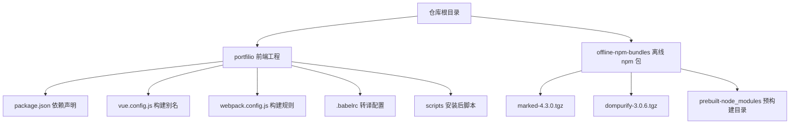
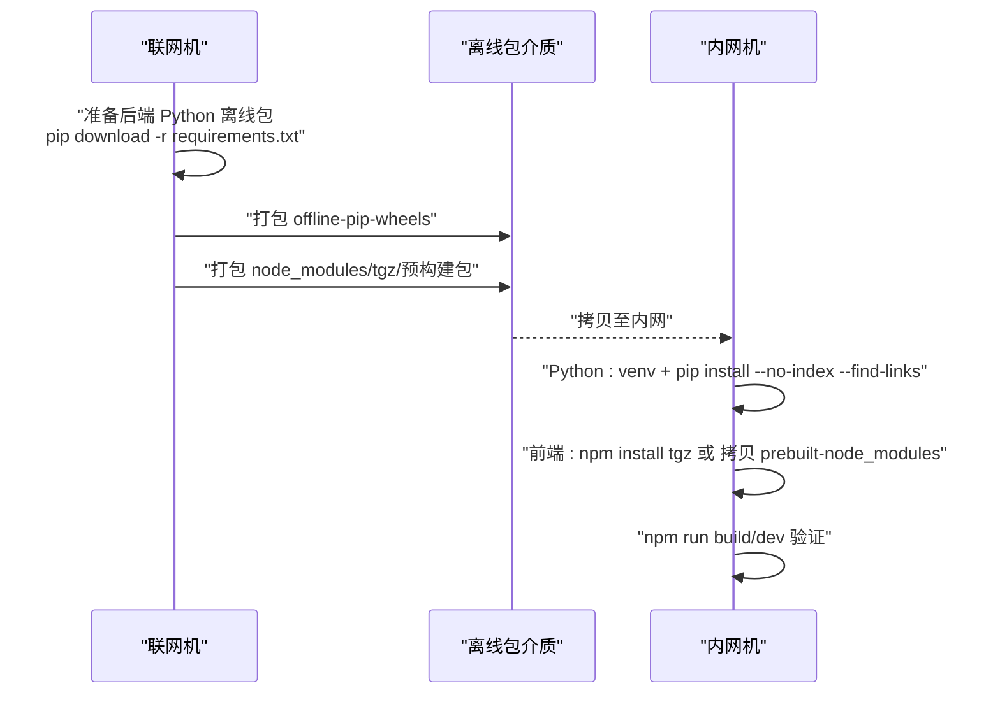
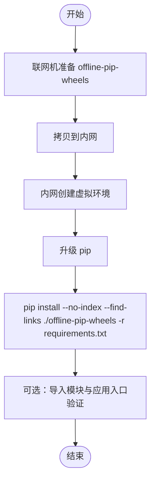
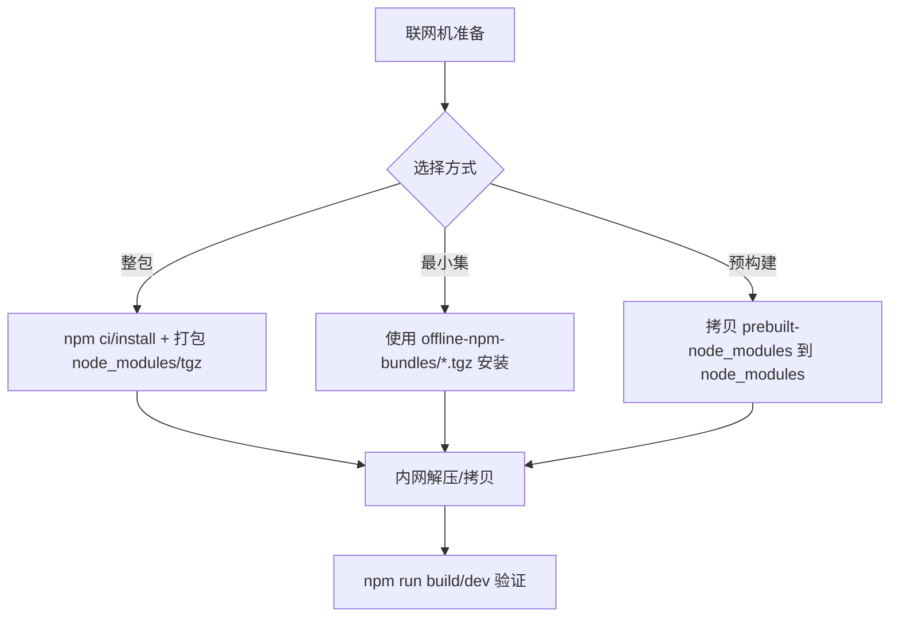
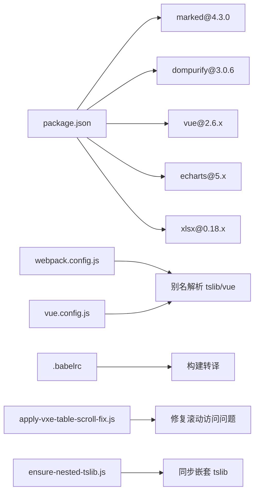

# 离线安装

<cite>
**本文引用的文件**   
- [OFFLINE_INSTALL_LINUX_WINDOWS.md](file://docs/OFFLINE_INSTALL_LINUX_WINDOWS.md)
- [OFFLINE_INSTALL.txt](file://offline-npm-bundles/OFFLINE_INSTALL.txt)
- [PREBUILT_COPY.txt](file://offline-npm-bundles/PREBUILT_COPY.txt)
- [package.json](file://package.json)
- [README_NODE_VERSION.md](file://README_NODE_VERSION.md)
- [vue.config.js](file://vue.config.js)
- [webpack.config.js](file://webpack.config.js)
- [.babelrc](file://.babelrc)
- [apply-vxe-table-scroll-fix.js](file://scripts/apply-vxe-table-scroll-fix.js)
- [ensure-nested-tslib.js](file://scripts/ensure-nested-tslib.js)
</cite>

## 目录
1. [简介](#简介)
2. [项目结构](#项目结构)
3. [核心组件](#核心组件)
4. [架构总览](#架构总览)
5. [详细组件分析](#详细组件分析)
6. [依赖关系分析](#依赖关系分析)
7. [性能考虑](#性能考虑)
8. [故障排查指南](#故障排查指南)
9. [结论](#结论)
10. [附录](#附录)

## 简介
本指南面向在内网或无外网环境中部署“投资组合管理系统”的工程团队，提供前后端离线安装的完整流程与最佳实践。内容基于仓库内的离线安装文档与预构建包，涵盖：
- 后端 Python 依赖离线下载与安装
- 前端 npm 依赖离线准备与安装
- 预构建 node_modules 的拷贝策略
- 不同操作系统（Windows/Linux）的具体命令与注意事项
- 离线安装验证、常见问题与维护建议

## 项目结构
本项目前端位于 portfilio 目录，包含 Vue 2 + CLI 构建配置、Webpack 配置、Babel 配置以及若干安装后脚本。离线 npm 包与预构建 node_modules 位于 offline-npm-bundles 目录。

图表来源
- [package.json:1-45](file://package.json#L1-L45)
- [vue.config.js:1-17](file://vue.config.js#L1-L17)
- [webpack.config.js:1-63](file://webpack.config.js#L1-L63)
- [.babelrc:1-14](file://.babelrc#L1-L14)
- [OFFLINE_INSTALL_LINUX_WINDOWS.md:1-212](file://docs/OFFLINE_INSTALL_LINUX_WINDOWS.md#L1-L212)
- [OFFLINE_INSTALL.txt:1-43](file://offline-npm-bundles/OFFLINE_INSTALL.txt#L1-L43)
- [PREBUILT_COPY.txt:1-44](file://offline-npm-bundles/PREBUILT_COPY.txt#L1-L44)

章节来源
- [package.json:1-45](file://package.json#L1-L45)
- [vue.config.js:1-17](file://vue.config.js#L1-L17)
- [webpack.config.js:1-63](file://webpack.config.js#L1-L63)
- [.babelrc:1-14](file://.babelrc#L1-L14)
- [OFFLINE_INSTALL_LINUX_WINDOWS.md:1-212](file://docs/OFFLINE_INSTALL_LINUX_WINDOWS.md#L1-L212)
- [OFFLINE_INSTALL.txt:1-43](file://offline-npm-bundles/OFFLINE_INSTALL.txt#L1-L43)
- [PREBUILT_COPY.txt:1-44](file://offline-npm-bundles/PREBUILT_COPY.txt#L1-L44)

## 核心组件
- 前端依赖与构建
  - package.json 声明了运行时与开发时依赖，包括 marked、dompurify 等关键包。
  - vue.config.js 与 webpack.config.js 提供构建别名与规则，确保 tslib、vue 等模块解析稳定。
  - .babelrc 配置转译目标与模块策略。
- 离线 npm 包
  - OFFLINE_INSTALL.txt 与 PREBUILT_COPY.txt 提供两种离线安装方式：tgz 包安装与预构建 node_modules 直接拷贝。
- 安装后脚本
  - apply-vxe-table-scroll-fix.js 与 ensure-nested-tslib.js 在安装后自动修复与同步嵌套 tslib，提升稳定性。

章节来源
- [package.json:11-28](file://package.json#L11-L28)
- [vue.config.js:5-16](file://vue.config.js#L5-L16)
- [webpack.config.js:6-52](file://webpack.config.js#L6-L52)
- [.babelrc:1-14](file://.babelrc#L1-L14)
- [OFFLINE_INSTALL.txt:1-43](file://offline-npm-bundles/OFFLINE_INSTALL.txt#L1-L43)
- [PREBUILT_COPY.txt:1-44](file://offline-npm-bundles/PREBUILT_COPY.txt#L1-L44)
- [apply-vxe-table-scroll-fix.js:1-52](file://scripts/apply-vxe-table-scroll-fix.js#L1-L52)
- [ensure-nested-tslib.js:1-26](file://scripts/ensure-nested-tslib.js#L1-L26)

## 架构总览
离线安装涉及“联网机准备离线包”和“内网机安装与验证”两大阶段。前端与后端分别采用不同的离线策略，但都强调“包与依赖的完整性”。

图表来源
- [OFFLINE_INSTALL_LINUX_WINDOWS.md:34-123](file://docs/OFFLINE_INSTALL_LINUX_WINDOWS.md#L34-L123)
- [OFFLINE_INSTALL_LINUX_WINDOWS.md:126-184](file://docs/OFFLINE_INSTALL_LINUX_WINDOWS.md#L126-L184)
- [OFFLINE_INSTALL.txt:1-43](file://offline-npm-bundles/OFFLINE_INSTALL.txt#L1-L43)
- [PREBUILT_COPY.txt:1-44](file://offline-npm-bundles/PREBUILT_COPY.txt#L1-L44)

## 详细组件分析

### 后端 Python 依赖离线安装（Linux/Windows）
- 联网机准备
  - 在与内网目标机相同架构与 Python 主版本的机器上，下载 requirements.txt 中的 wheel 至 offline-pip-wheels 目录。
  - 注意：Windows 与 Linux 的 wheel 不可混用。
- 内网机安装
  - 创建虚拟环境，升级 pip，使用 --no-index 与 --find-links 指向本地目录完成安装。
- 验证
  - 导入关键模块与应用入口，确保可用。

图表来源
- [OFFLINE_INSTALL_LINUX_WINDOWS.md:34-123](file://docs/OFFLINE_INSTALL_LINUX_WINDOWS.md#L34-L123)

章节来源
- [OFFLINE_INSTALL_LINUX_WINDOWS.md:34-123](file://docs/OFFLINE_INSTALL_LINUX_WINDOWS.md#L34-L123)

### 前端 npm 依赖离线安装（Linux/Windows）
- 整包离线（推荐）
  - 在干净目录执行 npm ci 或 npm install，打包 node_modules、package.json、package-lock.json。
  - 内网解压后执行 npm run build 或 npm run dev 验证。
- 仅融合新增（最小集）
  - 使用仓库提供的 marked 与 dompurify tgz 包进行安装；若遇 peer 依赖冲突可追加 --legacy-peer-deps。
- 预构建 node_modules 直接拷贝
  - 将 prebuilt-node_modules/marked 与 prebuilt-node_modules/dompurify 覆盖到内网项目的 node_modules，并在 package.json dependencies 中补充版本号后验证。

图表来源
- [OFFLINE_INSTALL_LINUX_WINDOWS.md:126-184](file://docs/OFFLINE_INSTALL_LINUX_WINDOWS.md#L126-L184)
- [OFFLINE_INSTALL.txt:1-43](file://offline-npm-bundles/OFFLINE_INSTALL.txt#L1-L43)
- [PREBUILT_COPY.txt:1-44](file://offline-npm-bundles/PREBUILT_COPY.txt#L1-L44)

章节来源
- [OFFLINE_INSTALL_LINUX_WINDOWS.md:126-184](file://docs/OFFLINE_INSTALL_LINUX_WINDOWS.md#L126-L184)
- [OFFLINE_INSTALL.txt:1-43](file://offline-npm-bundles/OFFLINE_INSTALL.txt#L1-L43)
- [PREBUILT_COPY.txt:1-44](file://offline-npm-bundles/PREBUILT_COPY.txt#L1-L44)

### Node.js 版本与兼容性
- 若遇到 node:url 相关错误，需升级 Node.js 至 16.x 或更高版本；也可按说明降级特定依赖版本。
- README_NODE_VERSION.md 提供了升级与验证步骤，建议在升级后重新安装依赖。

章节来源
- [README_NODE_VERSION.md:1-73](file://README_NODE_VERSION.md#L1-L73)

### 构建与别名配置
- vue.config.js 与 webpack.config.js 通过别名将 tslib 指向根 node_modules，避免嵌套缺失导致的 ENOENT。
- .babelrc 配置转译目标，确保浏览器兼容与模块策略。

章节来源
- [vue.config.js:5-16](file://vue.config.js#L5-L16)
- [webpack.config.js:6-52](file://webpack.config.js#L6-L52)
- [.babelrc:1-14](file://.babelrc#L1-L14)

### 安装后脚本
- apply-vxe-table-scroll-fix.js：对 vxe-table 滚动时访问 reactData 的潜在未初始化问题进行幂等修复。
- ensure-nested-tslib.js：在 postinstall 阶段将根 node_modules/tslib 递归复制到 echarts/zrender 的嵌套 node_modules，保证打包稳定。

章节来源
- [apply-vxe-table-scroll-fix.js:1-52](file://scripts/apply-vxe-table-scroll-fix.js#L1-L52)
- [ensure-nested-tslib.js:1-26](file://scripts/ensure-nested-tslib.js#L1-L26)

## 依赖关系分析
前端依赖与安装流程的关键关系如下：

图表来源
- [package.json:11-28](file://package.json#L11-L28)
- [webpack.config.js:46-52](file://webpack.config.js#L46-L52)
- [vue.config.js:5-16](file://vue.config.js#L5-L16)
- [.babelrc:1-14](file://.babelrc#L1-L14)
- [apply-vxe-table-scroll-fix.js:1-52](file://scripts/apply-vxe-table-scroll-fix.js#L1-L52)
- [ensure-nested-tslib.js:1-26](file://scripts/ensure-nested-tslib.js#L1-L26)

章节来源
- [package.json:11-28](file://package.json#L11-L28)
- [webpack.config.js:46-52](file://webpack.config.js#L46-L52)
- [vue.config.js:5-16](file://vue.config.js#L5-L16)
- [.babelrc:1-14](file://.babelrc#L1-L14)
- [apply-vxe-table-scroll-fix.js:1-52](file://scripts/apply-vxe-table-scroll-fix.js#L1-L52)
- [ensure-nested-tslib.js:1-26](file://scripts/ensure-nested-tslib.js#L1-L26)

## 性能考虑
- 离线安装优先使用整包 node_modules 打包，减少内网安装时的依赖解析与网络回溯成本。
- 预构建 node_modules 直接拷贝可绕过 npm 安装过程，适合极端网络受限环境。
- 在内网首次部署时建议使用完整 requirements.txt 下载 wheel，避免遗漏依赖导致反复重装。

## 故障排查指南
- pip 安装找不到包
  - 确认 --find-links 指向的目录包含该包及其所有传递依赖的 wheel；如缺失，回到联网机对 requirements.txt 再次执行 pip download 补齐。
- tiktoken 在部分环境无 wheel
  - 需要在内网具备 C 编译工具链才能从源码构建；更稳妥是在联网机下载对应平台的 wheel 一并带入。
- Python 版本不一致
  - 下载 wheel 的 Python 小版本尽量与内网一致（如均为 3.11.x）。
- npm 栈溢出或安装失败
  - 删除 node_modules 与 package-lock.json 后重试；或升级 npm；参考离线安装说明中的替代方案。
- Node.js 版本问题
  - 遇到 node:url 相关错误，升级 Node.js 至 16.x 或更高版本；或按说明降级特定依赖版本。
- 构建别名导致的模块解析问题
  - 确认 vue.config.js 与 webpack.config.js 的别名配置生效；tslib 与 vue 的路径应指向根 node_modules。

章节来源
- [OFFLINE_INSTALL_LINUX_WINDOWS.md:187-202](file://docs/OFFLINE_INSTALL_LINUX_WINDOWS.md#L187-L202)
- [OFFLINE_INSTALL.txt:33-37](file://offline-npm-bundles/OFFLINE_INSTALL.txt#L33-L37)
- [README_NODE_VERSION.md:1-73](file://README_NODE_VERSION.md#L1-L73)
- [vue.config.js:5-16](file://vue.config.js#L5-L16)
- [webpack.config.js:46-52](file://webpack.config.js#L46-L52)

## 结论
通过“联网机离线包准备 + 内网机离线安装”的双阶段流程，结合整包打包、tgz 安装与预构建 node_modules 拷贝三种方式，可以在严格网络隔离环境下高效完成投资组合管理系统的部署。建议首次部署采用整包离线策略，后续维护可通过内网私服或增量 tgz 包实现快速更新。

## 附录
- 文件对照
  - 后端依赖声明：portfilio-end/requirements.txt
  - 前端依赖声明：portfilio/package.json、package-lock.json
- 后端环境变量示例：portfilio-end/.env.example

章节来源
- [OFFLINE_INSTALL_LINUX_WINDOWS.md:204-212](file://docs/OFFLINE_INSTALL_LINUX_WINDOWS.md#L204-L212)