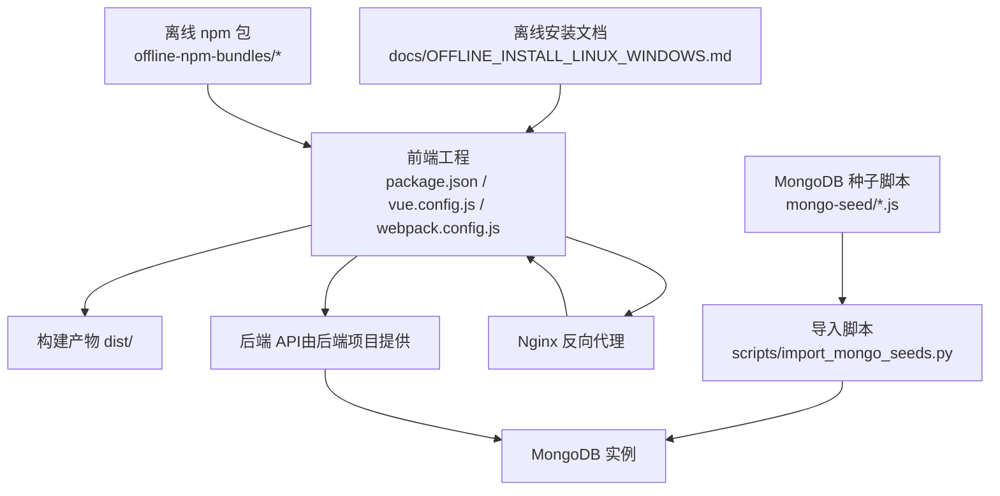
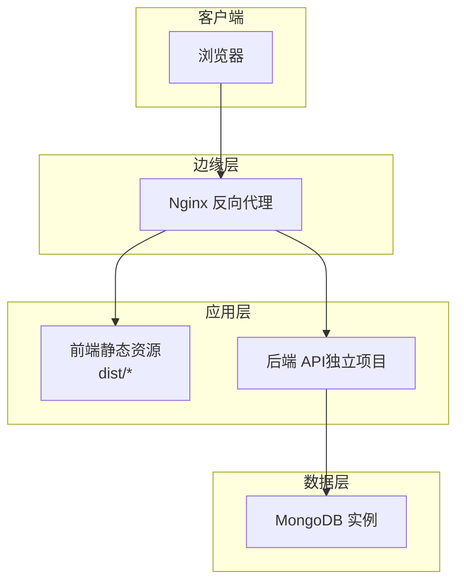
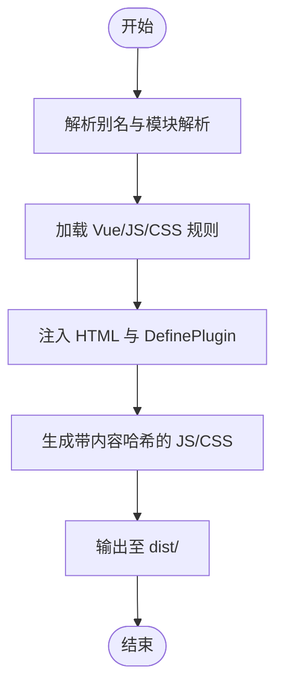
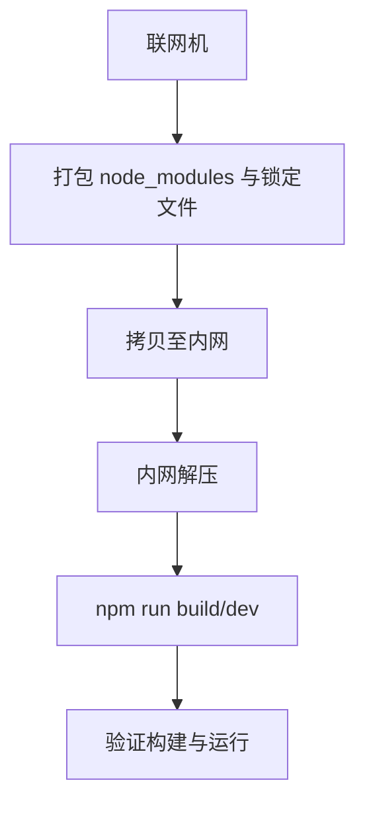
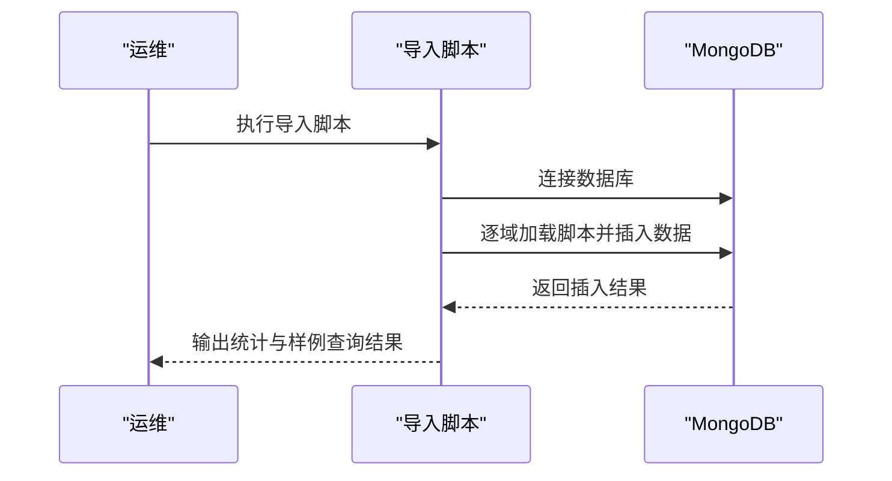
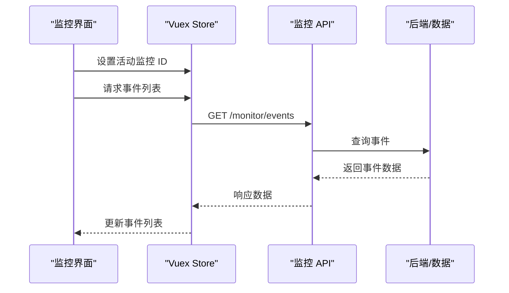
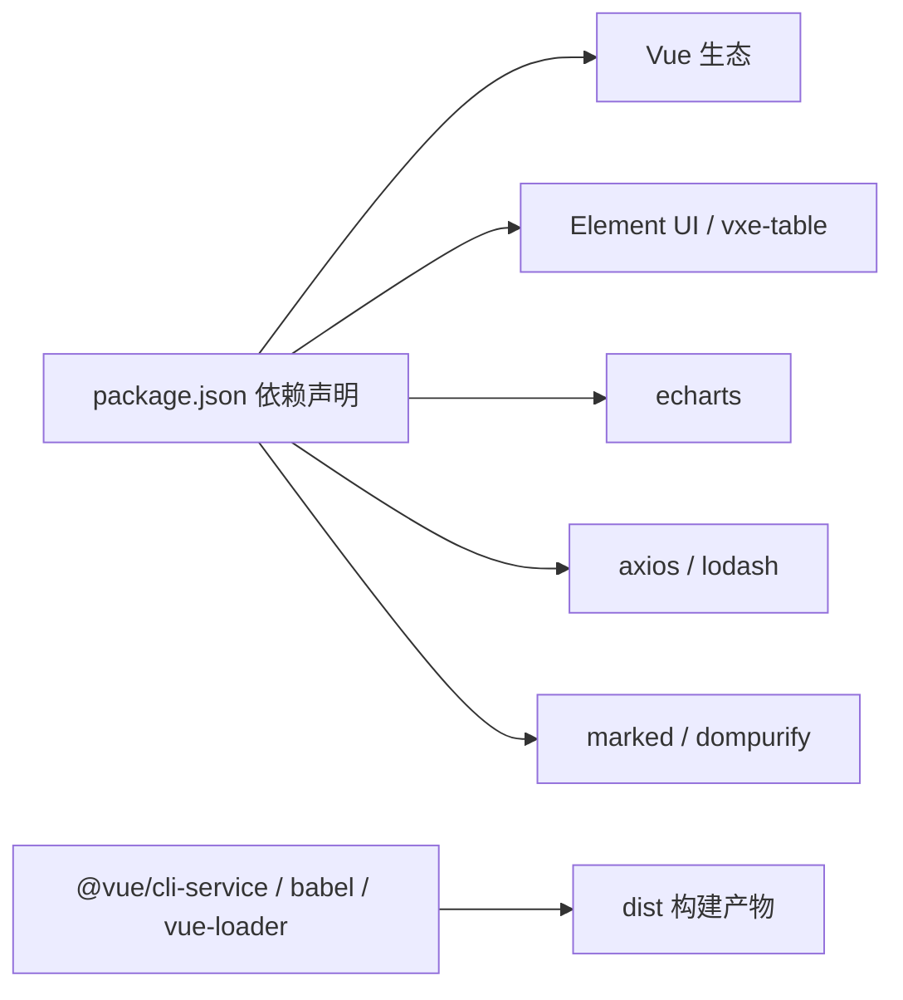

# 部署指南

<cite>
**本文引用的文件**
- [package.json](file://package.json)
- [README_NODE_VERSION.md](file://README_NODE_VERSION.md)
- [vue.config.js](file://vue.config.js)
- [webpack.config.js](file://webpack.config.js)
- [.babelrc](file://.babelrc)
- [src/main.js](file://src/main.js)
- [docs/OFFLINE_INSTALL_LINUX_WINDOWS.md](file://docs/OFFLINE_INSTALL_LINUX_WINDOWS.md)
- [offline-npm-bundles/OFFLINE_INSTALL.txt](file://offline-npm-bundles/OFFLINE_INSTALL.txt)
- [mongo-seed/README.md](file://mongo-seed/README.md)
- [scripts/import_mongo_seeds.py](file://scripts/import_mongo_seeds.py)
- [scripts/deploy_zy_data_api.py](file://scripts/deploy_zy_data_api.py)
- [src/api/monitor.js](file://src/api/monitor.js)
- [src/store/modules/monitor.js](file://src/store/modules/monitor.js)
- [src/views/monitor/MonitorCenter.vue](file://src/views/monitor/MonitorCenter.vue)
- [src/views/monitor/LivePublishRecords.vue](file://src/views/monitor/LivePublishRecords.vue)
- [src/views/strategy/LiveMonitoring.vue](file://src/views/strategy/LiveMonitoring.vue)
- [portfilio.code-workspace](file://portfilio.code-workspace)
</cite>

## 目录
1. [简介](#简介)
2. [项目结构](#项目结构)
3. [核心组件](#核心组件)
4. [架构总览](#架构总览)
5. [详细组件分析](#详细组件分析)
6. [依赖关系分析](#依赖关系分析)
7. [性能考虑](#性能考虑)
8. [故障排除指南](#故障排除指南)
9. [结论](#结论)
10. [附录](#附录)

## 简介
本指南面向运维人员，提供投资组合管理系统的生产部署全流程说明，涵盖服务器与操作系统要求、硬件资源、Nginx与静态资源优化、反向代理、离线安装、数据库部署与备份、监控与日志、安全加固、部署验证与回滚策略等。系统前端基于 Vue 2 生态，构建产物用于静态托管；后端与数据域脚本位于同一仓库的“端”侧，配合 MongoDB 提供数据能力。

## 项目结构
- 前端工程位于仓库根目录，包含构建配置、依赖与入口文件。
- 文档与离线安装包位于 docs 与 offline-npm-bundles 目录。
- MongoDB 种子数据与导入脚本位于 mongo-seed 与 scripts 目录。
- 监控与日志相关前端组件位于 src/views/monitor 与 src/store/modules/monitor.js。
- 与后端联动的部署脚本位于 scripts/deploy_zy_data_api.py。

图表来源
- [package.json:1-45](file://package.json#L1-L45)
- [vue.config.js:1-17](file://vue.config.js#L1-L17)
- [webpack.config.js:1-63](file://webpack.config.js#L1-L63)
- [docs/OFFLINE_INSTALL_LINUX_WINDOWS.md:1-212](file://docs/OFFLINE_INSTALL_LINUX_WINDOWS.md#L1-L212)
- [offline-npm-bundles/OFFLINE_INSTALL.txt:1-43](file://offline-npm-bundles/OFFLINE_INSTALL.txt#L1-L43)
- [mongo-seed/README.md:1-125](file://mongo-seed/README.md#L1-L125)
- [scripts/import_mongo_seeds.py:1-305](file://scripts/import_mongo_seeds.py#L1-L305)

章节来源
- [package.json:1-45](file://package.json#L1-L45)
- [vue.config.js:1-17](file://vue.config.js#L1-L17)
- [webpack.config.js:1-63](file://webpack.config.js#L1-L63)
- [docs/OFFLINE_INSTALL_LINUX_WINDOWS.md:1-212](file://docs/OFFLINE_INSTALL_LINUX_WINDOWS.md#L1-L212)
- [offline-npm-bundles/OFFLINE_INSTALL.txt:1-43](file://offline-npm-bundles/OFFLINE_INSTALL.txt#L1-L43)
- [mongo-seed/README.md:1-125](file://mongo-seed/README.md#L1-L125)
- [scripts/import_mongo_seeds.py:1-305](file://scripts/import_mongo_seeds.py#L1-L305)

## 核心组件
- 前端构建与运行
  - 使用 Vue CLI 服务进行开发与构建，支持别名与打包优化。
  - 构建输出包含带内容哈希的 JS/CSS，利于缓存与更新。
- 离线安装与依赖
  - 提供整包 node_modules 离线打包与最小化 tgz 安装两种方式。
  - 针对 Windows/Linux 的差异与注意事项明确。
- 数据库与种子数据
  - 提供 MongoDB 集合结构、JSON Schema 校验与样例数据导入脚本。
  - 支持按域批量导入与结果统计。
- 监控与日志
  - 前端提供监控中心、事件日志、实盘发布记录等视图。
  - Vuex Store 管理监控状态与加载状态。

章节来源
- [package.json:5-10](file://package.json#L5-L10)
- [vue.config.js:5-16](file://vue.config.js#L5-L16)
- [webpack.config.js:8-12](file://webpack.config.js#L8-L12)
- [docs/OFFLINE_INSTALL_LINUX_WINDOWS.md:126-184](file://docs/OFFLINE_INSTALL_LINUX_WINDOWS.md#L126-L184)
- [offline-npm-bundles/OFFLINE_INSTALL.txt:1-43](file://offline-npm-bundles/OFFLINE_INSTALL.txt#L1-L43)
- [mongo-seed/README.md:114-125](file://mongo-seed/README.md#L114-L125)
- [scripts/import_mongo_seeds.py:18-34](file://scripts/import_mongo_seeds.py#L18-L34)
- [src/views/monitor/MonitorCenter.vue:585-606](file://src/views/monitor/MonitorCenter.vue#L585-L606)
- [src/store/modules/monitor.js:1-24](file://src/store/modules/monitor.js#L1-L24)

## 架构总览
系统采用前后端分离架构：前端构建产物静态托管于 Nginx，后端 API 由独立后端项目提供，前端通过反向代理访问后端接口；MongoDB 作为数据存储，种子脚本负责初始化与样例数据导入。

图表来源
- [src/api/monitor.js:65-126](file://src/api/monitor.js#L65-L126)
- [scripts/import_mongo_seeds.py:18-20](file://scripts/import_mongo_seeds.py#L18-L20)

## 详细组件分析

### 前端构建与静态资源优化
- 构建入口与输出
  - 入口文件为 src/main.js，输出目录 dist，JS 文件名包含内容哈希，便于长期缓存与灰度发布。
- Webpack 配置要点
  - Vue、JS、CSS 加载器与插件配置，HTML 模板注入，DefinePlugin 注入环境变量。
- Vue CLI 与别名
  - vue.config.js 设置 tslib 别名与 webpack 别名，保证依赖一致性。
- Babel 目标
  - .babelrc 指定浏览器目标，确保兼容性与体积平衡。

图表来源
- [webpack.config.js:6-45](file://webpack.config.js#L6-L45)
- [vue.config.js:5-16](file://vue.config.js#L5-L16)
- [.babelrc:1-14](file://.babelrc#L1-L14)

章节来源
- [webpack.config.js:6-45](file://webpack.config.js#L6-L45)
- [vue.config.js:5-16](file://vue.config.js#L5-L16)
- [.babelrc:1-14](file://.babelrc#L1-L14)

### 离线安装与依赖管理
- 整包离线（推荐）
  - 在联网机执行 npm ci 并打包 node_modules、package.json、package-lock.json，拷贝至内网后解压，直接构建或运行。
- 最小化 tgz（增量）
  - 使用仓库提供的 marked 与 dompurify tgz，内网安装后验证。
- 常见问题
  - pip/no-index 找不到包：确保离线目录包含所有传递依赖；tiktoken 无 wheel：在联网机下载对应平台 wheel；npm 栈溢出：清理 node_modules 与 lock 后重试或升级 npm。

图表来源
- [docs/OFFLINE_INSTALL_LINUX_WINDOWS.md:126-184](file://docs/OFFLINE_INSTALL_LINUX_WINDOWS.md#L126-L184)
- [offline-npm-bundles/OFFLINE_INSTALL.txt:1-43](file://offline-npm-bundles/OFFLINE_INSTALL.txt#L1-L43)

章节来源
- [docs/OFFLINE_INSTALL_LINUX_WINDOWS.md:1-212](file://docs/OFFLINE_INSTALL_LINUX_WINDOWS.md#L1-L212)
- [offline-npm-bundles/OFFLINE_INSTALL.txt:1-43](file://offline-npm-bundles/OFFLINE_INSTALL.txt#L1-L43)

### 数据库部署与种子数据导入
- 集群与实例
  - 推荐使用 MongoDB 副本集或分片集群，启用认证与加密传输。
- 初始化与样例数据
  - 使用 mongo-seed 目录脚本与 import_mongo_seeds.py 批量导入，按域顺序执行，支持重复导入与唯一键冲突跳过。
- Schema 与索引
  - 每个集合添加宽松 JSON Schema 校验；为主键与高频过滤字段建立索引。
- 备份策略
  - 建议使用逻辑导出（mongodump）与物理快照结合，定期校验恢复。

图表来源
- [mongo-seed/README.md:27-51](file://mongo-seed/README.md#L27-L51)
- [scripts/import_mongo_seeds.py:185-305](file://scripts/import_mongo_seeds.py#L185-L305)

章节来源
- [mongo-seed/README.md:1-125](file://mongo-seed/README.md#L1-L125)
- [scripts/import_mongo_seeds.py:1-305](file://scripts/import_mongo_seeds.py#L1-L305)

### 监控与日志管理
- 前端监控视图
  - MonitorCenter 展示事件日志与实盘发布记录；LiveMonitoring 展示策略运行变更日志。
- 状态管理
  - Vuex Store 管理监控状态、加载状态与事件列表，支持按监控 ID 获取信号与事件。
- 日志采集
  - 建议在 Nginx 与后端应用分别采集访问日志与业务日志，并集中存储与检索。

图表来源
- [src/views/monitor/MonitorCenter.vue:585-606](file://src/views/monitor/MonitorCenter.vue#L585-L606)
- [src/store/modules/monitor.js:81-211](file://src/store/modules/monitor.js#L81-L211)
- [src/api/monitor.js:65-126](file://src/api/monitor.js#L65-L126)

章节来源
- [src/views/monitor/MonitorCenter.vue:585-606](file://src/views/monitor/MonitorCenter.vue#L585-L606)
- [src/views/monitor/LivePublishRecords.vue:246-298](file://src/views/monitor/LivePublishRecords.vue#L246-L298)
- [src/views/strategy/LiveMonitoring.vue:214-247](file://src/views/strategy/LiveMonitoring.vue#L214-L247)
- [src/store/modules/monitor.js:1-211](file://src/store/modules/monitor.js#L1-L211)
- [src/api/monitor.js:65-126](file://src/api/monitor.js#L65-L126)

### 安全配置与访问控制
- SSL/TLS
  - Nginx 配置 HTTPS，使用受信 CA 证书与强密码套件。
- 访问控制
  - 限制对后端 API 的访问，仅允许来自内网或特定网段；启用 Basic Auth 或 JWT。
- 防火墙
  - 仅开放 80/443（Nginx）与 MongoDB 端口（如 27017），关闭不必要的端口。
- 静态资源安全
  - 开启 XSS 保护头，CDN 缓存策略与安全响应头。

章节来源
- [src/api/monitor.js:65-126](file://src/api/monitor.js#L65-L126)

### 反向代理与静态资源优化
- Nginx 配置要点
  - 静态资源根目录指向 dist，开启 gzip/br 压缩与缓存头；代理后端 API 路径前缀。
- 缓存与回源
  - JS/CSS 带内容哈希，可长期缓存；HTML 动态刷新；图片与媒体按需缓存。
- 健康检查与超时
  - 配置后端健康检查与超时时间，避免长连接阻塞。

章节来源
- [webpack.config.js:8-12](file://webpack.config.js#L8-L12)
- [vue.config.js:5-16](file://vue.config.js#L5-L16)

### 部署验证与回滚策略
- 部署验证
  - 访问首页与关键页面，确认静态资源加载；调用监控 API 获取信号与事件；检查数据库集合数量与样例数据。
- 回滚策略
  - 保留上一个版本的 dist 目录与后端二进制；切换 Nginx 配置指向旧版本；必要时回退数据库迁移。
- 自动化
  - 结合 CI/CD 执行部署脚本与验证，失败自动回滚。

章节来源
- [scripts/deploy_zy_data_api.py:219-248](file://scripts/deploy_zy_data_api.py#L219-L248)

## 依赖关系分析
- 前端依赖
  - Vue 2、Element UI、vxe-table、echarts、axios、lodash、marked、dompurify 等。
- 构建依赖
  - @vue/cli-service、@babel/core、babel-loader、vue-loader 等。
- Node.js 版本要求
  - 项目要求 Node.js >= 16（或 >= 14.18），建议使用 LTS 版本。

图表来源
- [package.json:11-38](file://package.json#L11-L38)
- [README_NODE_VERSION.md:9-34](file://README_NODE_VERSION.md#L9-L34)

章节来源
- [package.json:11-38](file://package.json#L11-L38)
- [README_NODE_VERSION.md:1-73](file://README_NODE_VERSION.md#L1-L73)

## 性能考虑
- 构建优化
  - 使用内容哈希文件名与代码分割，减少首屏加载时间。
- 运行时优化
  - 启用 Nginx 压缩与缓存；合理设置静态资源 TTL；后端接口超时与并发限制。
- 数据库优化
  - 为高频查询字段建立索引；分批导入数据；定期分析慢查询。

章节来源
- [webpack.config.js:8-12](file://webpack.config.js#L8-L12)
- [mongo-seed/README.md:114-121](file://mongo-seed/README.md#L114-L121)

## 故障排除指南
- Node.js 版本问题
  - 若出现 node:url 相关错误，升级到 Node.js 16.x 或更高版本。
- npm 安装失败
  - 清理 node_modules 与 package-lock.json 后重试；升级 npm；使用离线 tgz 安装。
- MongoDB 连接失败
  - 检查 URI、认证与网络连通性；确认服务已启动。
- 部署脚本异常
  - 查看脚本输出与日志，按提示修复后端项目路径与路由注册。

章节来源
- [README_NODE_VERSION.md:48-66](file://README_NODE_VERSION.md#L48-L66)
- [offline-npm-bundles/OFFLINE_INSTALL.txt:33-37](file://offline-npm-bundles/OFFLINE_INSTALL.txt#L33-L37)
- [scripts/import_mongo_seeds.py:194-202](file://scripts/import_mongo_seeds.py#L194-L202)
- [scripts/deploy_zy_data_api.py:219-248](file://scripts/deploy_zy_data_api.py#L219-L248)

## 结论
本指南提供了从前端构建、离线安装、数据库初始化、反向代理配置到监控与安全加固的完整部署路径。建议在生产环境中遵循最小权限、最小暴露面与可回滚的原则，结合自动化工具实现稳定交付。

## 附录
- 开发工作区
  - 工作区包含前端与后端两个目录，便于联调与部署。

章节来源
- [portfilio.code-workspace:1-10](file://portfilio.code-workspace#L1-L10)