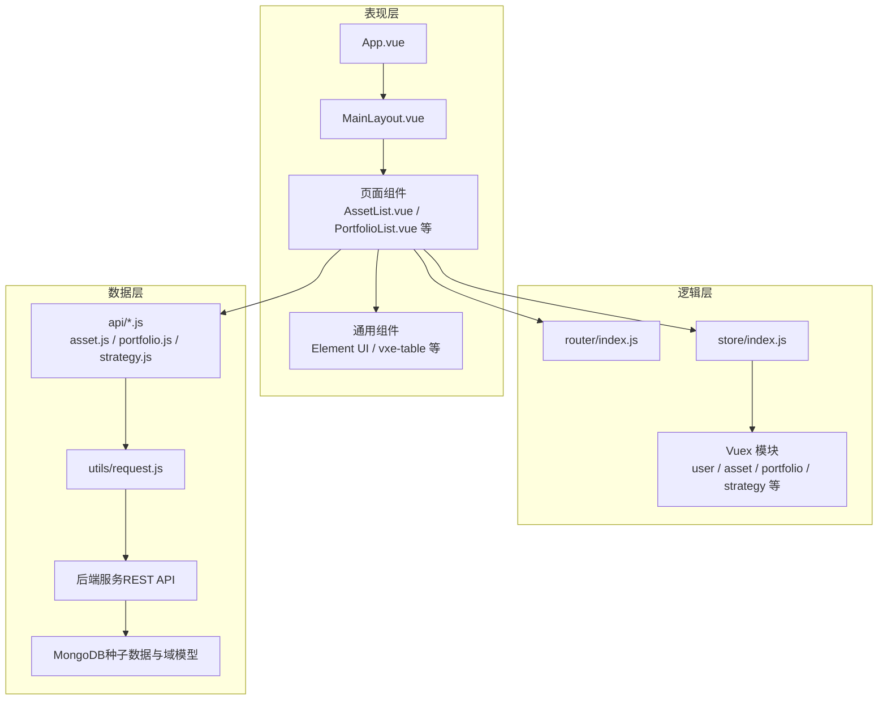
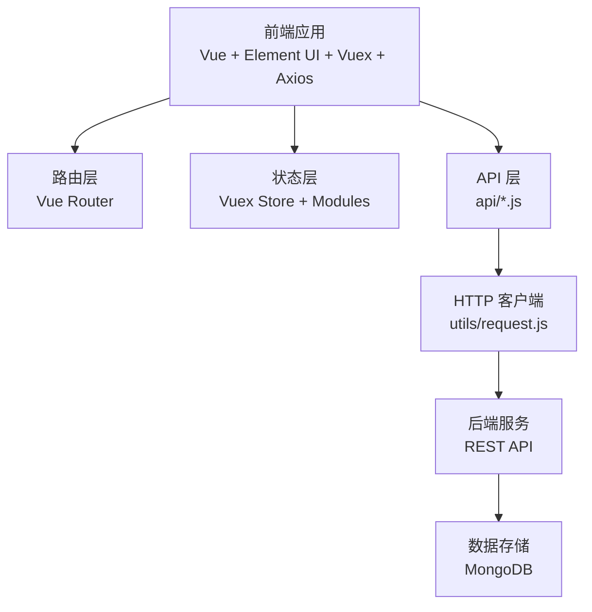
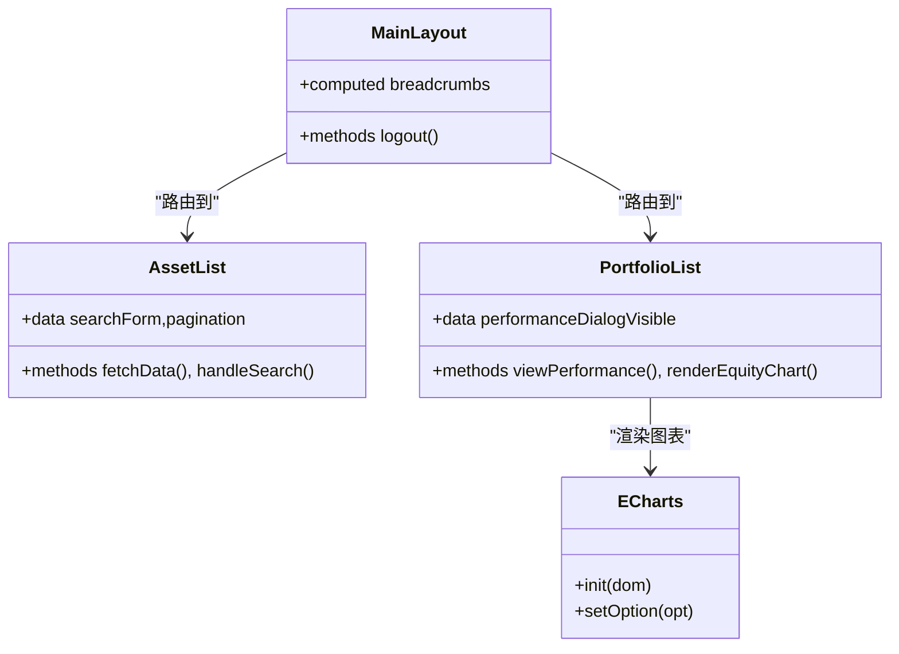
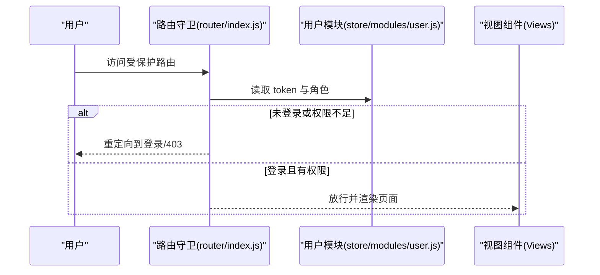
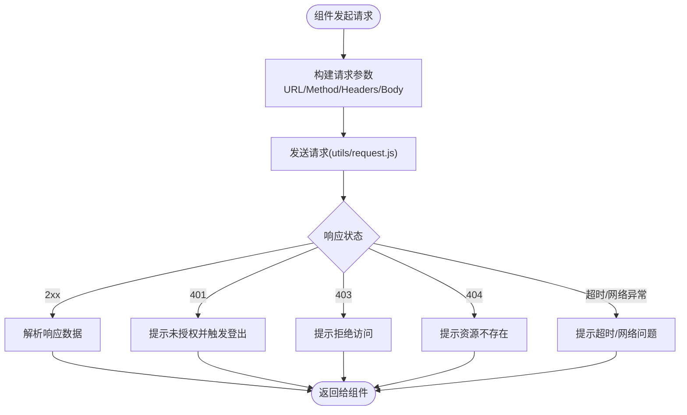
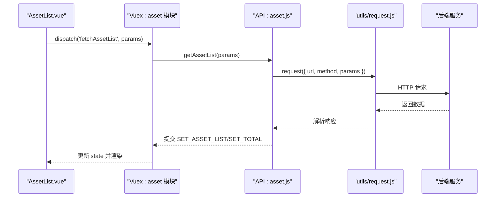
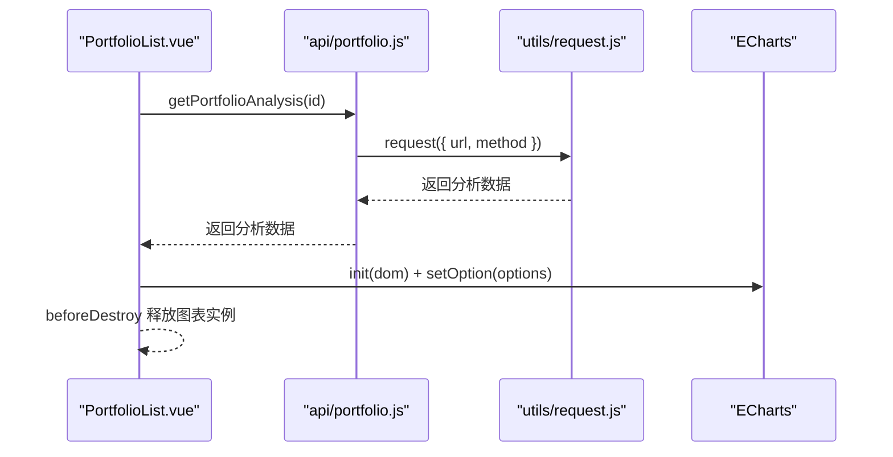
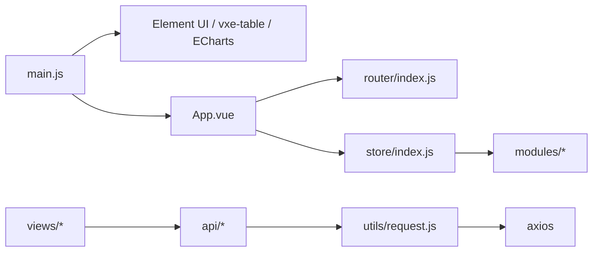

# 分层架构设计

<cite>
**本文引用的文件**
- [src/main.js](file://src/main.js)
- [src/App.vue](file://src/App.vue)
- [src/router/index.js](file://src/router/index.js)
- [src/store/index.js](file://src/store/index.js)
- [src/store/modules/user.js](file://src/store/modules/user.js)
- [src/store/modules/asset.js](file://src/store/modules/asset.js)
- [src/store/modules/portfolio.js](file://src/store/modules/portfolio.js)
- [src/utils/request.js](file://src/utils/request.js)
- [src/api/asset.js](file://src/api/asset.js)
- [src/api/portfolio.js](file://src/api/portfolio.js)
- [src/api/strategy.js](file://src/api/strategy.js)
- [src/layout/MainLayout.vue](file://src/layout/MainLayout.vue)
- [src/views/asset/AssetList.vue](file://src/views/asset/AssetList.vue)
- [src/views/portfolio/PortfolioList.vue](file://src/views/portfolio/PortfolioList.vue)
- [package.json](file://package.json)
</cite>

## 目录
1. [引言](#引言)
2. [项目结构](#项目结构)
3. [核心组件](#核心组件)
4. [架构总览](#架构总览)
5. [详细组件分析](#详细组件分析)
6. [依赖分析](#依赖分析)
7. [性能考虑](#性能考虑)
8. [故障排查指南](#故障排查指南)
9. [结论](#结论)
10. [附录](#附录)

## 引言
本设计文档面向“投资组合管理系统”，基于前端三层架构（表现层、逻辑层、数据层）进行系统化梳理，重点说明：
- 表现层（Vue 组件）的组件化设计，包括页面组件、业务组件与通用组件的层次结构；
- 逻辑层（Vue Router + Vuex）的路由管理与状态管理机制，包括嵌套路由与模块化状态；
- 数据层（API + MongoDB）的接口设计与数据访问模式，包括 RESTful 设计原则与连接策略；
- 各层职责边界与交互方式，提供数据流向图与组件关系图；
- 结合具体实现示例与最佳实践指导。

## 项目结构
系统采用 Vue 2 + Element UI + Vuex + Vue Router 的经典前端栈，结合 Axios 封装统一请求与拦截器，路由采用 hash 模式，状态按领域模块拆分。

**图表来源**
- [src/App.vue:1-116](file://src/App.vue#L1-L116)
- [src/layout/MainLayout.vue:1-330](file://src/layout/MainLayout.vue#L1-L330)
- [src/router/index.js:1-378](file://src/router/index.js#L1-L378)
- [src/store/index.js:1-44](file://src/store/index.js#L1-L44)
- [src/utils/request.js:1-100](file://src/utils/request.js#L1-L100)
- [src/api/asset.js:1-284](file://src/api/asset.js#L1-L284)
- [src/api/portfolio.js:1-72](file://src/api/portfolio.js#L1-L72)
- [src/api/strategy.js:1-295](file://src/api/strategy.js#L1-L295)

**章节来源**
- [src/main.js:1-31](file://src/main.js#L1-L31)
- [src/App.vue:1-116](file://src/App.vue#L1-L116)
- [src/router/index.js:1-378](file://src/router/index.js#L1-L378)
- [src/store/index.js:1-44](file://src/store/index.js#L1-L44)
- [package.json:1-45](file://package.json#L1-L45)

## 核心组件
- 应用入口与全局配置：应用通过入口文件挂载根组件，注册 UI 插件与图表库，注入全局工具。
- 根组件与路由出口：根组件仅包含路由出口，实际布局与页面由布局组件与视图组件承担。
- 路由与菜单：路由定义了完整的嵌套路由树，配合布局组件的菜单与面包屑联动。
- 状态管理：Store 以模块化方式组织用户、资产、组合、策略等子域状态，支持命名空间访问。
- 请求封装：Axios 实例统一处理基础地址、超时、鉴权头与错误提示，减少重复逻辑。

**章节来源**
- [src/main.js:1-31](file://src/main.js#L1-L31)
- [src/App.vue:1-116](file://src/App.vue#L1-L116)
- [src/layout/MainLayout.vue:1-330](file://src/layout/MainLayout.vue#L1-L330)
- [src/router/index.js:1-378](file://src/router/index.js#L1-L378)
- [src/store/index.js:1-44](file://src/store/index.js#L1-L44)
- [src/utils/request.js:1-100](file://src/utils/request.js#L1-L100)

## 架构总览
系统采用“表现层-逻辑层-数据层”三层分离：
- 表现层：负责页面渲染、交互与可视化（图表、表格、对话框等），通过组件化复用与布局统一风格。
- 逻辑层：负责路由导航与状态流转，路由守卫控制权限与登录态，Vuex 模块化管理业务状态。
- 数据层：通过 API 层对接后端 REST 接口，Axios 统一处理请求与响应，后端服务连接 MongoDB 存储数据。

**图表来源**
- [src/router/index.js:1-378](file://src/router/index.js#L1-L378)
- [src/store/index.js:1-44](file://src/store/index.js#L1-L44)
- [src/api/asset.js:1-284](file://src/api/asset.js#L1-L284)
- [src/api/portfolio.js:1-72](file://src/api/portfolio.js#L1-L72)
- [src/api/strategy.js:1-295](file://src/api/strategy.js#L1-L295)
- [src/utils/request.js:1-100](file://src/utils/request.js#L1-L100)

## 详细组件分析

### 表现层组件化设计
- 页面组件（Views）：承载具体业务页面，如资产列表、组合列表等，负责数据拉取、交互与视图渲染。
- 业务组件（Components）：在页面内复用的业务单元，如资产表单、报价卡片、图表对话框等。
- 通用组件（UI）：Element UI、vxe-table、ECharts 等，提供统一的交互与展示能力。

**图表来源**
- [src/layout/MainLayout.vue:1-330](file://src/layout/MainLayout.vue#L1-L330)
- [src/views/asset/AssetList.vue:1-346](file://src/views/asset/AssetList.vue#L1-L346)
- [src/views/portfolio/PortfolioList.vue:1-372](file://src/views/portfolio/PortfolioList.vue#L1-L372)

**章节来源**
- [src/layout/MainLayout.vue:1-330](file://src/layout/MainLayout.vue#L1-L330)
- [src/views/asset/AssetList.vue:1-346](file://src/views/asset/AssetList.vue#L1-L346)
- [src/views/portfolio/PortfolioList.vue:1-372](file://src/views/portfolio/PortfolioList.vue#L1-L372)

### 逻辑层：路由与状态管理
- 路由管理：采用 hash 模式，定义顶层与嵌套路由，配合路由守卫实现登录态校验与角色权限控制。
- 状态管理：Store 按领域模块拆分，如用户、资产、组合、策略等，支持命名空间访问，提升可维护性。

**图表来源**
- [src/router/index.js:351-375](file://src/router/index.js#L351-L375)
- [src/store/modules/user.js:1-119](file://src/store/modules/user.js#L1-L119)

**章节来源**
- [src/router/index.js:1-378](file://src/router/index.js#L1-L378)
- [src/store/modules/user.js:1-119](file://src/store/modules/user.js#L1-L119)
- [src/store/index.js:1-44](file://src/store/index.js#L1-L44)

### 数据层：API 与请求封装
- API 设计：遵循 RESTful 原则，资源路径清晰，动词使用恰当（GET/POST/PUT/DELETE/PATCH），部分接口针对长耗时任务设置较长超时。
- 请求封装：Axios 实例统一添加 Authorization 头，集中处理 401、403、404 等错误，提供友好提示与兜底行为。

**图表来源**
- [src/utils/request.js:1-100](file://src/utils/request.js#L1-L100)
- [src/api/asset.js:1-284](file://src/api/asset.js#L1-L284)
- [src/api/portfolio.js:1-72](file://src/api/portfolio.js#L1-L72)
- [src/api/strategy.js:1-295](file://src/api/strategy.js#L1-L295)

**章节来源**
- [src/utils/request.js:1-100](file://src/utils/request.js#L1-L100)
- [src/api/asset.js:1-284](file://src/api/asset.js#L1-L284)
- [src/api/portfolio.js:1-72](file://src/api/portfolio.js#L1-L72)
- [src/api/strategy.js:1-295](file://src/api/strategy.js#L1-L295)

### 关键流程示例：资产列表加载与导入
- 加载流程：页面组件通过 Vuex 派发动作获取资产列表，状态模块处理分页与总数，组件渲染表格与分页。
- 导入流程：组件触发文件上传，调用 API 方法，等待后端处理结果并刷新列表。

**图表来源**
- [src/views/asset/AssetList.vue:204-219](file://src/views/asset/AssetList.vue#L204-L219)
- [src/store/modules/asset.js:47-94](file://src/store/modules/asset.js#L47-L94)
- [src/api/asset.js:7-21](file://src/api/asset.js#L7-L21)
- [src/utils/request.js:1-100](file://src/utils/request.js#L1-L100)

**章节来源**
- [src/views/asset/AssetList.vue:1-346](file://src/views/asset/AssetList.vue#L1-L346)
- [src/store/modules/asset.js:1-183](file://src/store/modules/asset.js#L1-L183)
- [src/api/asset.js:1-284](file://src/api/asset.js#L1-L284)

### 关键流程示例：组合业绩图表渲染
- 组件触发分析接口，拿到净值曲线数据后，借助 ECharts 渲染权益曲线。
- 注意在组件销毁时释放图表实例，避免内存泄漏。

**图表来源**
- [src/views/portfolio/PortfolioList.vue:233-251](file://src/views/portfolio/PortfolioList.vue#L233-L251)
- [src/views/portfolio/PortfolioList.vue:271-349](file://src/views/portfolio/PortfolioList.vue#L271-L349)
- [src/api/portfolio.js:49-55](file://src/api/portfolio.js#L49-L55)
- [src/utils/request.js:1-100](file://src/utils/request.js#L1-L100)

**章节来源**
- [src/views/portfolio/PortfolioList.vue:1-372](file://src/views/portfolio/PortfolioList.vue#L1-L372)
- [src/api/portfolio.js:1-72](file://src/api/portfolio.js#L1-L72)

## 依赖分析
- 组件耦合：页面组件通过 Vuex 与 API 间接耦合，降低对具体实现细节的依赖；布局组件与路由强关联，但通过路由守卫解耦权限判断。
- 外部依赖：Axios、Element UI、vxe-table、ECharts、dayjs 等，均在入口文件中统一注册，便于版本升级与替换。
- 模块化：Vuex 模块按业务域划分，避免全局状态膨胀；API 文件按资源划分，职责清晰。

**图表来源**
- [src/main.js:1-31](file://src/main.js#L1-L31)
- [src/App.vue:1-116](file://src/App.vue#L1-L116)
- [src/router/index.js:1-378](file://src/router/index.js#L1-L378)
- [src/store/index.js:1-44](file://src/store/index.js#L1-L44)
- [src/utils/request.js:1-100](file://src/utils/request.js#L1-L100)
- [package.json:1-45](file://package.json#L1-L45)

**章节来源**
- [src/main.js:1-31](file://src/main.js#L1-L31)
- [package.json:1-45](file://package.json#L1-L45)

## 性能考虑
- 请求超时与长任务：针对回测、发布等长耗时接口设置较高超时，避免误判失败；普通列表与行情请求统一默认较长超时，提升稳定性。
- 图表渲染：在组件销毁时释放 ECharts 实例，避免内存泄漏；对大数据集采用必要的采样或懒渲染策略。
- 状态缓存：Vuex 模块缓存常用列表与总数，减少重复请求；对复杂计算使用 getters 缓存结果。
- 分页与懒加载：表格组件支持虚拟滚动与分页，降低一次性渲染压力。

## 故障排查指南
- 登录态失效：401 时自动清除本地 token 并提示重新登录；检查路由守卫与用户模块状态。
- 权限不足：403 时提示拒绝访问；核对路由 meta.roles 与用户角色。
- 资源不存在：404 时提示资源不存在；检查 API 路径与后端接口。
- 网络或超时：根据请求 URL 特征提示“后端未启动/网络异常/超时”，建议检查后端服务与环境变量配置。
- 导入失败：Excel 导入接口返回错误明细，组件弹窗展示错误列表并提示重试。

**章节来源**
- [src/router/index.js:351-375](file://src/router/index.js#L351-L375)
- [src/store/modules/user.js:1-119](file://src/store/modules/user.js#L1-L119)
- [src/utils/request.js:27-96](file://src/utils/request.js#L27-L96)

## 结论
本系统通过清晰的三层架构实现了表现、逻辑与数据的有效解耦：表现层以组件化为核心，逻辑层以路由与状态管理为中枢，数据层以 API 与请求封装为桥梁。模块化的状态与资源化的 API 使系统具备良好的扩展性与可维护性。建议在后续迭代中进一步完善权限体系、引入更细粒度的缓存与错误恢复策略，并持续优化长任务的进度反馈与用户体验。

## 附录
- 最佳实践
  - 在页面组件中仅做“粘合层”，将业务逻辑下沉到 Vuex 动作与 API 方法。
  - 使用命名空间模块管理状态，避免命名冲突与全局污染。
  - 对长耗时接口明确超时策略与重试机制，提供进度提示。
  - 统一错误处理与提示，避免组件分散处理导致体验不一致。
  - 对图表与表格等重型组件，在生命周期钩子中做好资源释放。