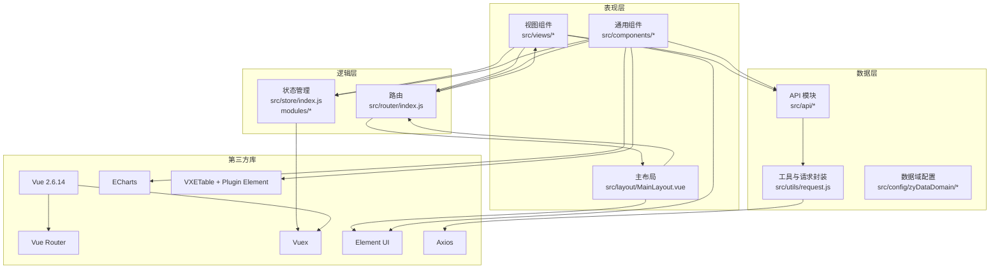
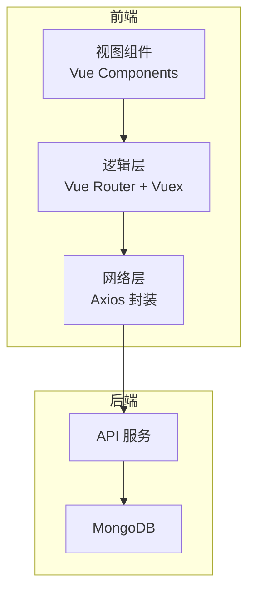
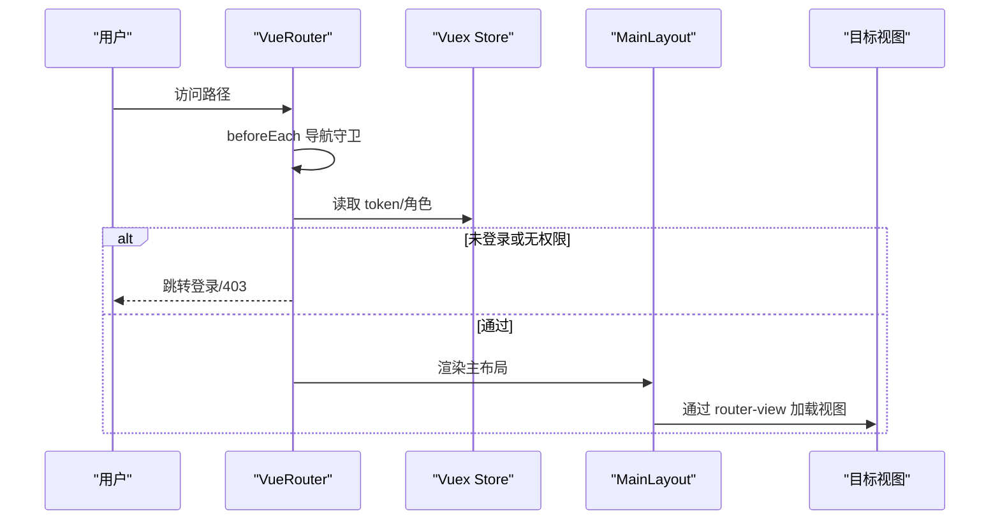
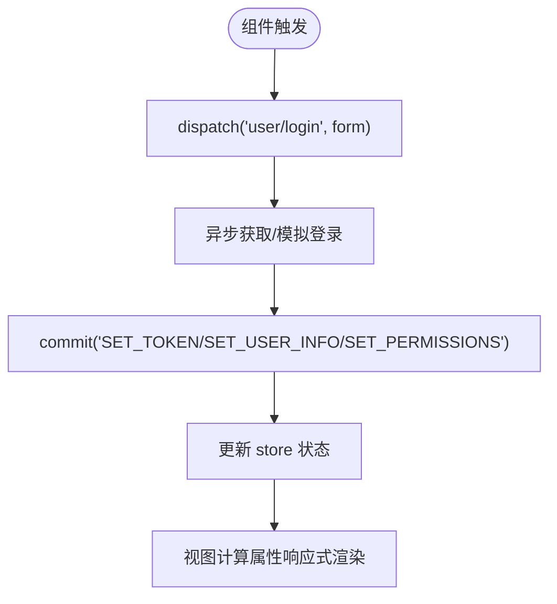
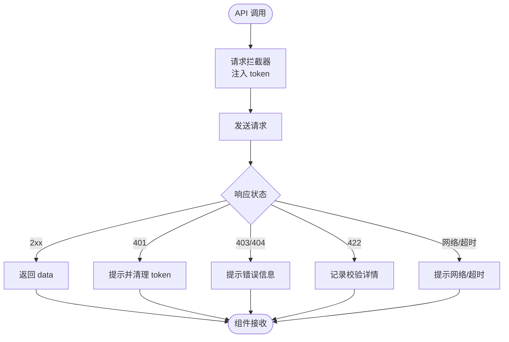
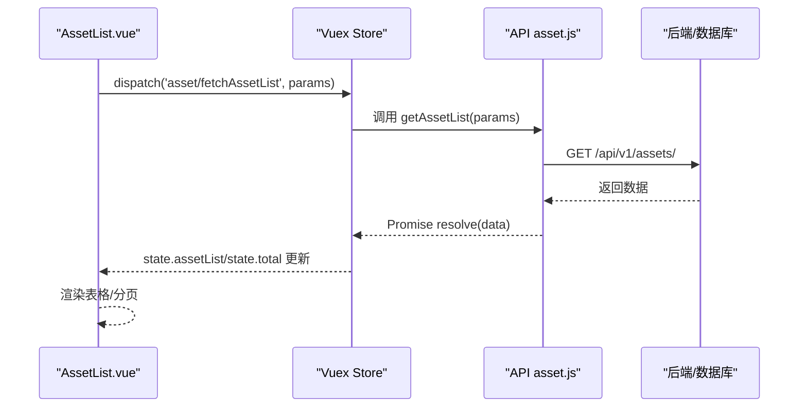
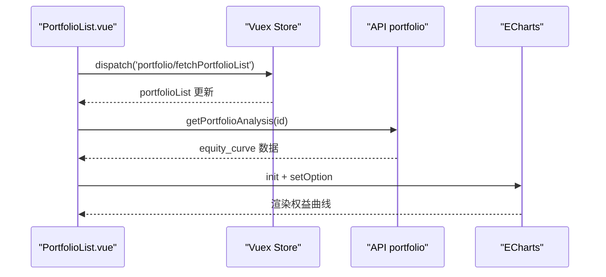
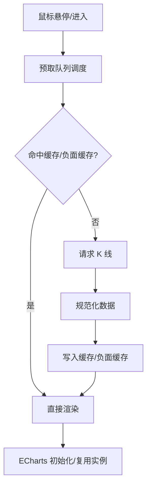
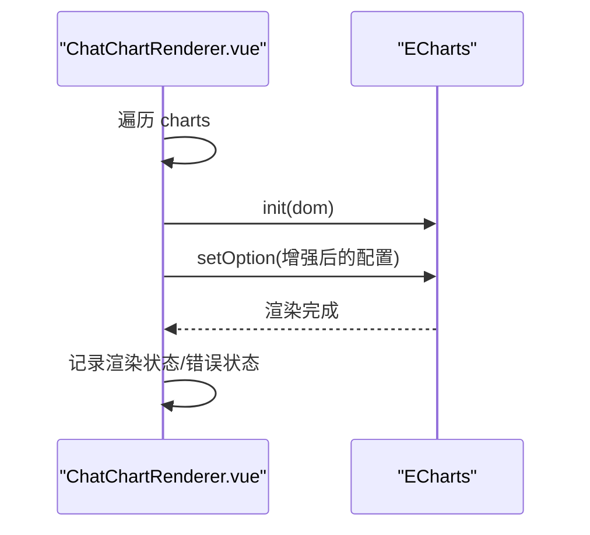
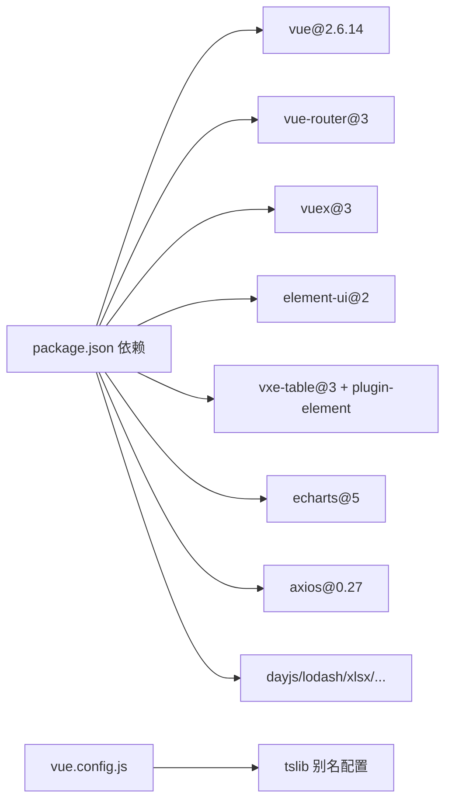

# 技术架构

<cite>
**本文引用的文件**
- [package.json](file://package.json)
- [vue.config.js](file://vue.config.js)
- [src/main.js](file://src/main.js)
- [src/App.vue](file://src/App.vue)
- [src/router/index.js](file://src/router/index.js)
- [src/store/index.js](file://src/store/index.js)
- [src/store/modules/user.js](file://src/store/modules/user.js)
- [src/layout/MainLayout.vue](file://src/layout/MainLayout.vue)
- [src/utils/request.js](file://src/utils/request.js)
- [src/api/asset.js](file://src/api/asset.js)
- [src/views/asset/AssetList.vue](file://src/views/asset/AssetList.vue)
- [src/views/portfolio/PortfolioList.vue](file://src/views/portfolio/PortfolioList.vue)
- [src/components/AssetMiniChart.vue](file://src/components/AssetMiniChart.vue)
- [src/components/ChatChartRenderer.vue](file://src/components/ChatChartRenderer.vue)
- [src/config/zyDataDomain/index.js](file://src/config/zyDataDomain/index.js)
</cite>

## 目录
1. [引言](#引言)
2. [项目结构](#项目结构)
3. [核心组件](#核心组件)
4. [架构总览](#架构总览)
5. [详细组件分析](#详细组件分析)
6. [依赖关系分析](#依赖关系分析)
7. [性能考量](#性能考量)
8. [故障排查指南](#故障排查指南)
9. [结论](#结论)
10. [附录](#附录)

## 引言
本文件面向投资组合管理系统（Portfilio），提供系统的技术架构文档。重点阐述以下方面：
- 整体架构模式：采用前后端分离的单页应用（SPA）设计，前端基于 Vue.js 2.6.14 + Vue Router + Vuex，后端通过 REST API 提供数据。
- MVVM 架构模式（Vue.js）：视图层（Components）、逻辑层（Router + Store）、数据层（API + MongoDB）清晰分层。
- Flux 架构模式（Vuex）：集中式状态管理，通过 State + Mutations + Actions + Getters 形成单向数据流。
- 前后端交互：Axios 封装统一请求与错误处理，路由守卫结合权限控制，Element UI + ECharts + VXETable 构建交互与可视化。
- 可扩展性与模块化：按功能域划分视图与模块，API 层抽象清晰，便于扩展新领域与新功能。

## 项目结构
前端采用典型的 Vue CLI 项目结构，围绕“表现层（Views/Components）—逻辑层（Router/Store）—数据层（API/Utils）”进行组织。核心目录与职责如下：
- src/main.js：应用入口，安装 Element UI、虚拟滚动、VXETable 插件，挂载根组件。
- src/App.vue：根组件，承载路由视图。
- src/router/index.js：路由定义与守卫，实现鉴权、面包屑、菜单联动。
- src/store/index.js：Vuex 根仓库，按模块拆分 user、asset、strategy、portfolio、benchmark、monitor、agent。
- src/layout/MainLayout.vue：主布局，侧边菜单、面包屑、头部用户信息与折叠控制。
- src/utils/request.js：Axios 实例封装，统一添加 Authorization、错误处理与提示。
- src/api/*：按领域划分的 API 模块，如资产、组合、策略、市场等，统一对外暴露方法。
- src/views/*：页面级视图，按模块组织，如资产、组合、策略、分析、监控、系统管理。
- src/components/*：通用组件，如迷你图表、聊天图表渲染器、对话面板等。
- src/config/zyDataDomain/*：数据域配置聚合，提供域、表、字段等元数据工具函数。
- vue.config.js：构建别名与 tslib 优化，保证兼容性与打包稳定性。

**图表来源**
- [src/main.js:1-31](file://src/main.js#L1-L31)
- [src/App.vue:1-116](file://src/App.vue#L1-L116)
- [src/router/index.js:1-378](file://src/router/index.js#L1-L378)
- [src/store/index.js:1-44](file://src/store/index.js#L1-L44)
- [src/utils/request.js:1-100](file://src/utils/request.js#L1-L100)
- [src/api/asset.js:1-284](file://src/api/asset.js#L1-L284)
- [src/layout/MainLayout.vue:1-330](file://src/layout/MainLayout.vue#L1-L330)
- [src/components/AssetMiniChart.vue:1-493](file://src/components/AssetMiniChart.vue#L1-L493)
- [src/components/ChatChartRenderer.vue:1-599](file://src/components/ChatChartRenderer.vue#L1-L599)
- [src/config/zyDataDomain/index.js:1-80](file://src/config/zyDataDomain/index.js#L1-L80)

**章节来源**
- [src/main.js:1-31](file://src/main.js#L1-L31)
- [src/App.vue:1-116](file://src/App.vue#L1-L116)
- [src/router/index.js:1-378](file://src/router/index.js#L1-L378)
- [src/store/index.js:1-44](file://src/store/index.js#L1-L44)
- [vue.config.js:1-17](file://vue.config.js#L1-L17)

## 核心组件
- 应用入口与插件注册
  - 在入口文件中安装 Element UI、虚拟滚动、VXETable 及其 Element 插件，并将 ECharts 注册到 Vue 原型，供组件使用。
- 路由与导航
  - 使用 Vue Router 定义多级嵌套路由，支持菜单联动、面包屑、权限校验与登录拦截。
- 状态管理
  - Vuex 模块化管理用户、资产、组合、策略、基准、监控、代理等状态，提供统一的加载状态与折叠状态。
- 请求封装
  - Axios 实例统一设置基础地址、超时、Token 注入与错误处理，对 401/403/404/5xx 等场景进行提示与兜底。
- API 模块
  - 按领域拆分 API 方法，如资产列表、K 线、导入、组合业绩分析等，统一返回 Promise，便于组件消费。
- 通用组件
  - 资产迷你图表（AssetMiniChart）：K 线缓存、预取并发控制、ECharts 渲染与生命周期管理。
  - 聊天图表渲染器（ChatChartRenderer）：增强后端返回的 ECharts 配置，自动布局、标签旋转、滚动图例、数据缩放等。
- 数据域配置
  - 聚合九大数据域的 schema 与工具函数，提供查找域/表、扁平表清单、汇总信息等。

**章节来源**
- [src/main.js:1-31](file://src/main.js#L1-L31)
- [src/router/index.js:1-378](file://src/router/index.js#L1-L378)
- [src/store/index.js:1-44](file://src/store/index.js#L1-L44)
- [src/store/modules/user.js:1-119](file://src/store/modules/user.js#L1-L119)
- [src/utils/request.js:1-100](file://src/utils/request.js#L1-L100)
- [src/api/asset.js:1-284](file://src/api/asset.js#L1-L284)
- [src/components/AssetMiniChart.vue:1-493](file://src/components/AssetMiniChart.vue#L1-L493)
- [src/components/ChatChartRenderer.vue:1-599](file://src/components/ChatChartRenderer.vue#L1-L599)
- [src/config/zyDataDomain/index.js:1-80](file://src/config/zyDataDomain/index.js#L1-L80)

## 架构总览
系统采用 MVVM + Flux 的混合架构：
- MVVM（Vue.js）：视图（Views/Components）绑定模型（Store/Props），通过事件驱动更新模型。
- Flux（Vuex）：单向数据流，Action 触发 Mutation 改变 State，组件通过 Getter/State 计算属性响应式渲染。
- 前后端分离：前端 SPA 通过 Axios 调用后端 API，后端存储于 MongoDB（通过 API 提供数据）。

**图表来源**
- [src/router/index.js:1-378](file://src/router/index.js#L1-L378)
- [src/store/index.js:1-44](file://src/store/index.js#L1-L44)
- [src/utils/request.js:1-100](file://src/utils/request.js#L1-L100)
- [src/api/asset.js:1-284](file://src/api/asset.js#L1-L284)

## 详细组件分析

### 路由与导航（MVVM 视图层）
- 功能要点
  - 多级嵌套路由：资产、策略、组合、分析、AI 助手、系统管理等模块化组织。
  - 菜单与面包屑联动：根据当前路由动态展开菜单、生成面包屑。
  - 权限守卫：登录拦截、角色校验、403 处理。
  - Hash 模式路由，适配部署与兼容性。
- 关键流程
  - 进入页面 → 设置标题 → 校验 token 与角色 → 匹配菜单项 → 渲染 MainLayout + 子视图。

**图表来源**
- [src/router/index.js:351-375](file://src/router/index.js#L351-L375)
- [src/layout/MainLayout.vue:144-217](file://src/layout/MainLayout.vue#L144-L217)

**章节来源**
- [src/router/index.js:1-378](file://src/router/index.js#L1-L378)
- [src/layout/MainLayout.vue:1-330](file://src/layout/MainLayout.vue#L1-L330)

### 状态管理（Flux：Vuex）
- 结构
  - 根 Store 启用模块 user、asset、strategy、portfolio、benchmark、monitor、agent。
  - 提供通用 loading/collapsed 状态与对应 mutations/actions。
- 用户模块
  - 状态：token、userInfo、permissions。
  - 行为：登录（本地模拟）、登出、获取用户信息。
  - 计算属性：登录态、角色、用户名、权限判断。
- 流程
  - 组件 dispatch → Action 执行异步 → Commit Mutation → State 更新 → 视图响应。

**图表来源**
- [src/store/modules/user.js:28-100](file://src/store/modules/user.js#L28-L100)
- [src/store/index.js:23-42](file://src/store/index.js#L23-L42)

**章节来源**
- [src/store/index.js:1-44](file://src/store/index.js#L1-L44)
- [src/store/modules/user.js:1-119](file://src/store/modules/user.js#L1-L119)

### 请求封装与错误处理
- 能力
  - 默认超时 60 秒，适配行情/列表等长任务。
  - 自动注入 Authorization: Bearer token。
  - 统一错误处理：401 清理 token 并提示；403/404/422/网络异常分别提示；策略类接口超时给出针对性建议。
- 使用
  - API 模块统一调用 request 实例，组件通过 Promise/async await 消费结果。

**图表来源**
- [src/utils/request.js:11-97](file://src/utils/request.js#L11-L97)

**章节来源**
- [src/utils/request.js:1-100](file://src/utils/request.js#L1-L100)
- [src/api/asset.js:1-284](file://src/api/asset.js#L1-L284)

### 视图组件与数据流

#### 资产列表（AssetList）
- 功能
  - 查询条件（代码/名称/分类）、分页、导入模板下载、Excel 批量导入。
  - VXETable 展示资产列表，Element UI 表单与对话框配合。
  - 与 Vuex 模块 asset 协作，维护资产列表与加载状态。
- 数据流
  - 组件 created → dispatch('asset/fetchAssetList') → store 更新 → 组件渲染。

**图表来源**
- [src/views/asset/AssetList.vue:201-219](file://src/views/asset/AssetList.vue#L201-L219)
- [src/api/asset.js:7-21](file://src/api/asset.js#L7-L21)

**章节来源**
- [src/views/asset/AssetList.vue:1-346](file://src/views/asset/AssetList.vue#L1-L346)
- [src/api/asset.js:1-284](file://src/api/asset.js#L1-L284)

#### 组合列表（PortfolioList）
- 功能
  - 展示组合关键指标（净值、收益、回撤、夏普等）。
  - 性能详情对话框：调用 API 获取权益曲线，使用 ECharts 渲染。
- 数据流
  - 组件 created → dispatch('portfolio/fetchPortfolioList') → store 更新 → 组件渲染。
  - 性能详情 → 调用 portfolio API → 渲染图表。

**图表来源**
- [src/views/portfolio/PortfolioList.vue:186-197](file://src/views/portfolio/PortfolioList.vue#L186-L197)
- [src/views/portfolio/PortfolioList.vue:233-251](file://src/views/portfolio/PortfolioList.vue#L233-L251)
- [src/views/portfolio/PortfolioList.vue:271-350](file://src/views/portfolio/PortfolioList.vue#L271-L350)

**章节来源**
- [src/views/portfolio/PortfolioList.vue:1-372](file://src/views/portfolio/PortfolioList.vue#L1-L372)

### 通用组件与可视化

#### 资产迷你图表（AssetMiniChart）
- 能力
  - K 线缓存（含“无数据/错误”负面缓存）、并发去重、预取队列（最多 4 并发）。
  - 规范化数据（过滤无效、按日期排序、取最近 N 条）、ECharts 渲染与实例复用。
  - 支持外部覆盖数据（如表格区间一致），避免二次请求。
- 生命周期
  - beforeDestroy 释放实例，避免内存泄漏。

**图表来源**
- [src/components/AssetMiniChart.vue:49-120](file://src/components/AssetMiniChart.vue#L49-L120)
- [src/components/AssetMiniChart.vue:261-339](file://src/components/AssetMiniChart.vue#L261-L339)
- [src/components/AssetMiniChart.vue:341-432](file://src/components/AssetMiniChart.vue#L341-L432)

**章节来源**
- [src/components/AssetMiniChart.vue:1-493](file://src/components/AssetMiniChart.vue#L1-L493)

#### 聊天图表渲染器（ChatChartRenderer）
- 能力
  - 增强后端返回的 ECharts 配置：tooltip confine、legend 滚动、xAxis 自动旋转、grid 适配、颜色与样式统一。
  - 自适应容器尺寸、响应式 resize、骨架屏与错误兜底。
- 使用
  - 组件接收 charts 数组与 ref 前缀，内部遍历渲染多个图表。

**图表来源**
- [src/components/ChatChartRenderer.vue:406-452](file://src/components/ChatChartRenderer.vue#L406-L452)
- [src/components/ChatChartRenderer.vue:47-313](file://src/components/ChatChartRenderer.vue#L47-L313)

**章节来源**
- [src/components/ChatChartRenderer.vue:1-599](file://src/components/ChatChartRenderer.vue#L1-L599)

### 数据域配置（ZY 数据域）
- 能力
  - 聚合九大数据域（资产、主体、产品、估值、交易、卖方、客户、风险、市场）。
  - 提供查找域/表、扁平表清单、汇总信息等工具函数。
- 用途
  - 为“数据分析/数据接入中心”等模块提供统一的元数据入口。

**章节来源**
- [src/config/zyDataDomain/index.js:1-80](file://src/config/zyDataDomain/index.js#L1-L80)

## 依赖关系分析
- 技术栈与版本
  - Vue 生态：Vue 2.6.14、Vue Router 3、Vuex 3。
  - UI：Element UI 2。
  - 表格：VXETable 3 + VXETable Plugin Element。
  - 图表：ECharts 5。
  - 网络：Axios 0.27。
  - 工具：dayjs、lodash、xlsx、marked、dompurify、codemirror、vue-virtual-scroller。
- 构建与兼容
  - vue.config.js 配置 tslib 别名，解决 nested tslib 问题，提升兼容性与打包稳定性。

**图表来源**
- [package.json:11-29](file://package.json#L11-L29)
- [vue.config.js:5-16](file://vue.config.js#L5-L16)

**章节来源**
- [package.json:1-45](file://package.json#L1-L45)
- [vue.config.js:1-17](file://vue.config.js#L1-L17)

## 性能考量
- 前端性能
  - VXETable 虚拟滚动与滚动优化，适合大数据量表格。
  - ECharts 实例复用与 dispose 管理，减少频繁初始化开销。
  - 资产迷你图表的模块级缓存与预取并发控制，降低请求风暴与重复渲染。
  - 路由过渡动画与骨架屏，改善用户体验。
- 网络性能
  - Axios 默认 60 秒超时，策略类接口提供更明确的超时提示与排查建议。
  - 批量导入与行情导入接口放宽超时，满足大体量数据处理。
- 构建性能
  - tslib 别名配置减少嵌套依赖带来的体积与兼容问题。

[本节为通用性能指导，无需特定文件引用]

## 故障排查指南
- 登录与权限
  - 未登录或 token 失效：路由守卫将跳转登录；请求拦截器 401 清理 token 并提示。
  - 角色无权限：403 提示，检查路由 meta.roles 与用户角色。
- 网络与超时
  - 策略类接口超时：检查后端服务是否启动、API 地址是否正确、MongoDB 是否可连。
  - 大数据量请求：缩小时间范围或使用“同步行情”。
- 图表渲染
  - 图表空白或报错：确认 ECharts 已全局注册、容器尺寸已确定后再渲染、错误状态与骨架屏提示。
- 表格与导入
  - 表格卡顿：开启虚拟滚动、减少列数与复杂渲染、使用 VXETable 的滚动优化。
  - 导入失败：检查文件格式、字段映射、后端解析日志。

**章节来源**
- [src/router/index.js:351-375](file://src/router/index.js#L351-L375)
- [src/utils/request.js:33-97](file://src/utils/request.js#L33-L97)
- [src/components/ChatChartRenderer.vue:406-452](file://src/components/ChatChartRenderer.vue#L406-L452)

## 结论
Portfilio 前端以 Vue.js 为核心，结合 Vue Router 与 Vuex，形成清晰的 MVVM + Flux 架构。通过 Element UI、VXETable、ECharts 等组件库与可视化方案，支撑资产、组合、策略、分析等多领域业务。请求封装与路由守卫保障了安全与体验。整体设计具备良好的模块化与可扩展性，便于后续迭代与功能拓展。

## 附录
- 技术选型说明
  - Vue.js 2.6.14：稳定生态与长期支持，适合中大型项目演进。
  - Element UI：成熟 UI 组件库，与项目风格契合。
  - VXETable：高性能表格，适合金融数据密集场景。
  - ECharts：专业图表库，配合聊天图表渲染器实现丰富的可视化能力。
  - Axios：简洁可靠的 HTTP 客户端，配合统一拦截器实现一致的错误处理。

[本节为概念性总结，无需特定文件引用]