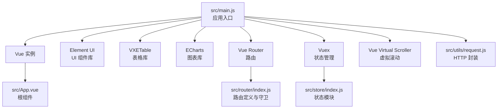
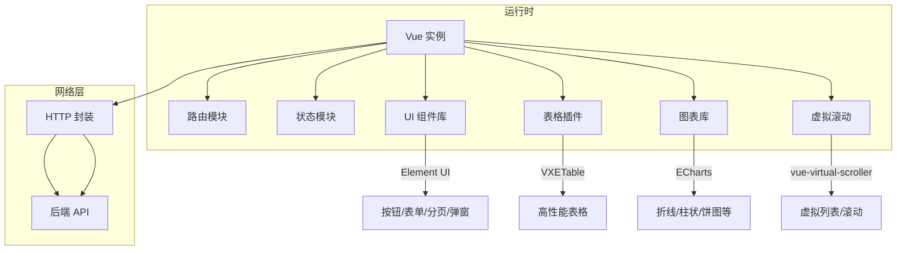
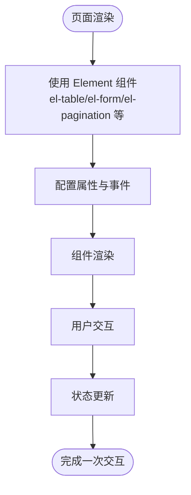
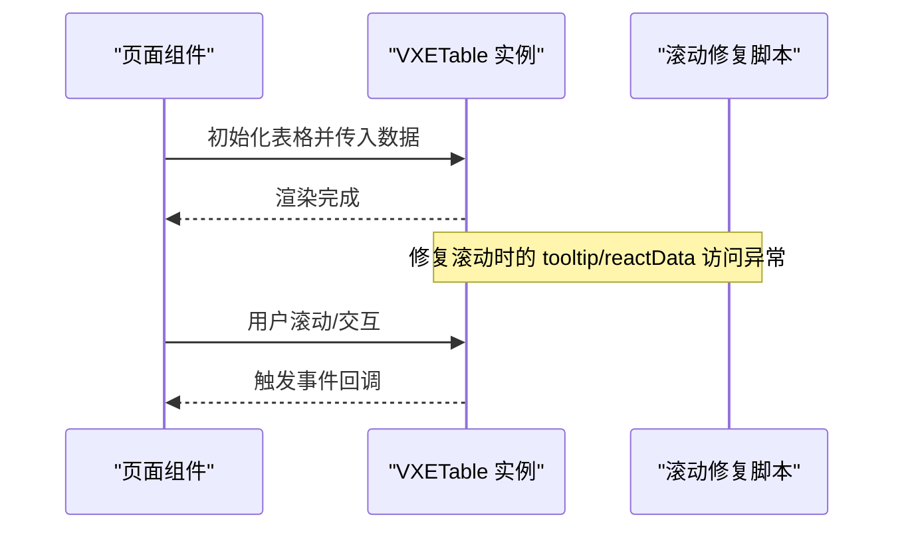
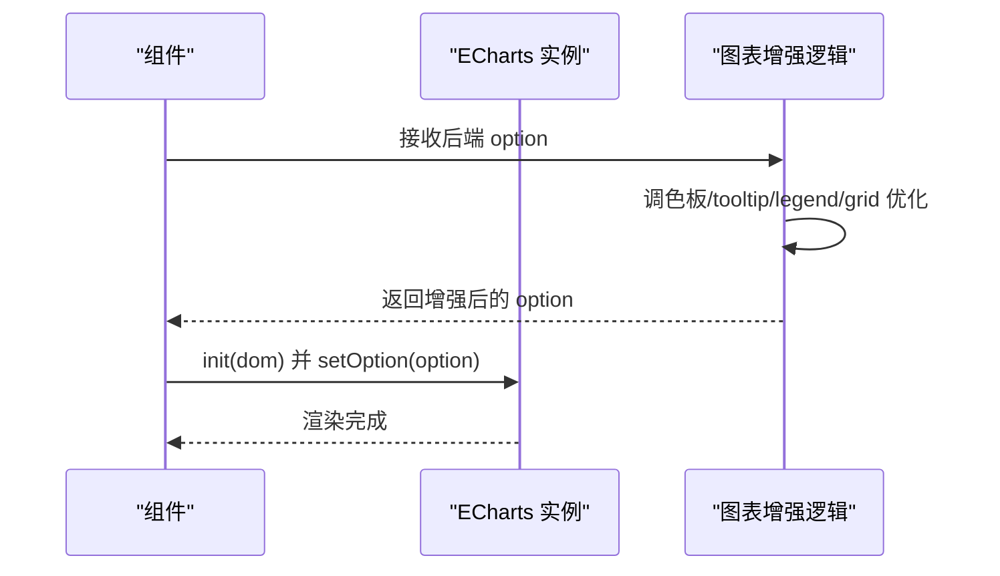
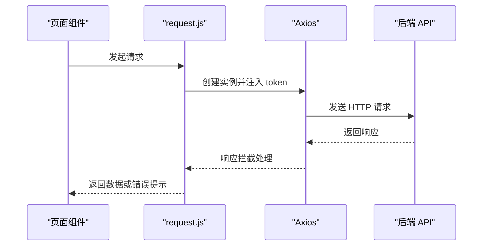
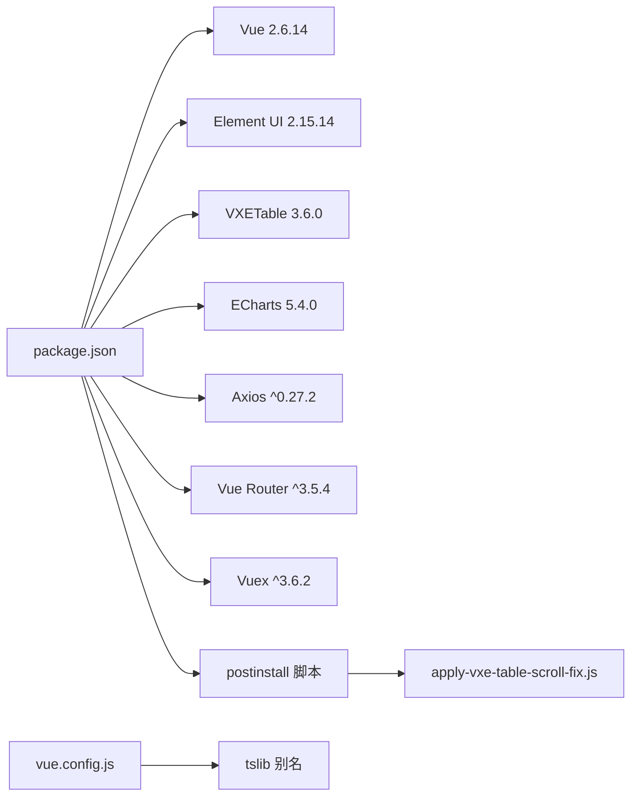

# 技术选型与依赖

<cite>
**本文引用的文件**
- [package.json](file://package.json)
- [vue.config.js](file://vue.config.js)
- [src/main.js](file://src/main.js)
- [src/App.vue](file://src/App.vue)
- [src/router/index.js](file://src/router/index.js)
- [src/store/index.js](file://src/store/index.js)
- [src/utils/request.js](file://src/utils/request.js)
- [scripts/apply-vxe-table-scroll-fix.js](file://scripts/apply-vxe-table-scroll-fix.js)
- [src/components/ChatChartRenderer.vue](file://src/components/ChatChartRenderer.vue)
- [src/views/analysis/DataHub/HubQueryPanel.vue](file://src/views/analysis/DataHub/HubQueryPanel.vue)
- [src/views/analysis/ZyDataDomain/RecordTable.vue](file://src/views/analysis/ZyDataDomain/RecordTable.vue)
- [src/components/BacktestMiniChart.vue](file://src/components/BacktestMiniChart.vue)
</cite>

## 目录
1. [引言](#引言)
2. [项目结构](#项目结构)
3. [核心组件](#核心组件)
4. [架构总览](#架构总览)
5. [详细组件分析](#详细组件分析)
6. [依赖关系分析](#依赖关系分析)
7. [性能考量](#性能考量)
8. [故障排查指南](#故障排查指南)
9. [结论](#结论)
10. [附录](#附录)

## 引言
本文件聚焦于前端技术栈的选型与依赖分析，围绕以下目标展开：
- 解释 Vue.js 2.6.14 的选择原因（成熟度、生态与社区支持）
- 说明 Element UI 2.15.14 的优势（组件丰富、开发体验）
- 阘述 VXETable 3.6.0 的高性能表格定位（大数据量处理、灵活配置）
- 分析 ECharts 5.4.0 的数据可视化能力（图表类型与交互）
- 说明 Axios、Vue Router、Vuex 等关键依赖的作用与选型考虑
- 提供版本兼容性说明与升级建议

## 项目结构
本项目采用 Vue CLI 生成的单页应用结构，核心入口在 src/main.js 中完成框架、UI 组件库、图表库与表格插件的全局注册，并通过路由与状态管理组织页面与数据流。

**图示来源**
- [src/main.js:1-31](file://src/main.js#L1-L31)
- [src/App.vue:1-116](file://src/App.vue#L1-L116)
- [src/router/index.js:1-378](file://src/router/index.js#L1-L378)
- [src/store/index.js:1-44](file://src/store/index.js#L1-L44)
- [src/utils/request.js:1-100](file://src/utils/request.js#L1-L100)

**章节来源**
- [src/main.js:1-31](file://src/main.js#L1-L31)
- [src/App.vue:1-116](file://src/App.vue#L1-L116)
- [src/router/index.js:1-378](file://src/router/index.js#L1-L378)
- [src/store/index.js:1-44](file://src/store/index.js#L1-L44)
- [src/utils/request.js:1-100](file://src/utils/request.js#L1-L100)

## 核心组件
- Vue.js 2.6.14：提供响应式数据绑定与组件化视图层，稳定生态与广泛兼容性使其成为本项目首选。
- Element UI 2.15.14：提供丰富的 UI 组件（表单、表格、分页、弹窗等），统一的设计语言与完善的中文生态，显著提升开发效率。
- VXETable 3.6.0：在 Element UI 基础上提供高性能表格能力，支持大数据量渲染、复杂列配置与插件扩展。
- ECharts 5.4.0：强大的可视化库，支持多种图表类型与交互，结合项目中的图表增强逻辑实现一致的视觉风格与交互体验。
- Axios：封装统一的 HTTP 请求与响应拦截，集中处理鉴权、错误提示与超时控制。
- Vue Router：基于 hash 模式的路由管理，配合全局守卫实现权限与标题控制。
- Vuex：模块化状态管理，集中管理用户、资产、策略、组合等业务状态。

**章节来源**
- [package.json:11-29](file://package.json#L11-L29)
- [src/main.js:1-31](file://src/main.js#L1-L31)
- [src/router/index.js:346-378](file://src/router/index.js#L346-L378)
- [src/store/index.js:13-44](file://src/store/index.js#L13-L44)
- [src/utils/request.js:1-100](file://src/utils/request.js#L1-L100)

## 架构总览
前端整体采用“入口注册 + 路由驱动 + 状态管理”的模式，UI 层以 Element UI 为基础，通过 VXETable 扩展表格能力，ECharts 提供可视化能力，Axios 统一处理网络请求。

**图示来源**
- [src/main.js:1-31](file://src/main.js#L1-L31)
- [src/router/index.js:1-378](file://src/router/index.js#L1-L378)
- [src/store/index.js:1-44](file://src/store/index.js#L1-L44)
- [src/utils/request.js:1-100](file://src/utils/request.js#L1-L100)

## 详细组件分析

### Vue.js 2.6.14 选型说明
- 成熟度与稳定性：Vue 2 在企业级项目中经过长期验证，生态完善，问题修复及时。
- 生态与社区：配套工具链（CLI、Router、Vuex）成熟，文档与教程丰富，便于团队协作与维护。
- 与 Element UI/VXETable/ECharts 的良好兼容性：确保组件库与图表库在 Vue 2 环境下的稳定运行。

**章节来源**
- [package.json:21](file://package.json#L21)
- [src/main.js:1-31](file://src/main.js#L1-L31)

### Element UI 2.15.14 选型说明
- 丰富的 UI 组件：表单、表格、分页、弹窗、标签等组件覆盖常见业务场景。
- 开发体验：组件属性与事件设计直观，配合 TypeScript（项目中使用）可获得更好的类型提示与约束。
- 样式定制：通过全局样式覆盖实现统一的品牌风格与阅读体验。

**图示来源**
- [src/views/analysis/DataHub/HubQueryPanel.vue:126-189](file://src/views/analysis/DataHub/HubQueryPanel.vue#L126-L189)
- [src/views/analysis/ZyDataDomain/RecordTable.vue:27-77](file://src/views/analysis/ZyDataDomain/RecordTable.vue#L27-L77)
- [src/App.vue:46-114](file://src/App.vue#L46-L114)

**章节来源**
- [package.json:17](file://package.json#L17)
- [src/views/analysis/DataHub/HubQueryPanel.vue:126-189](file://src/views/analysis/DataHub/HubQueryPanel.vue#L126-L189)
- [src/views/analysis/ZyDataDomain/RecordTable.vue:27-77](file://src/views/analysis/ZyDataDomain/RecordTable.vue#L27-L77)
- [src/App.vue:46-114](file://src/App.vue#L46-L114)

### VXETable 3.6.0 选型说明
- 高性能表格：适合大数据量场景，结合虚拟滚动与懒加载减少 DOM 压力。
- 插件化扩展：通过 vxe-table-plugin-element 与 Element UI 协同，复用现有 UI 风格。
- 表格增强：项目中通过补丁脚本修复滚动时的潜在异常，保障稳定性。

**图示来源**
- [src/main.js:9-20](file://src/main.js#L9-L20)
- [scripts/apply-vxe-table-scroll-fix.js:1-52](file://scripts/apply-vxe-table-scroll-fix.js#L1-L52)

**章节来源**
- [package.json:25](file://package.json#L25)
- [src/main.js:9-20](file://src/main.js#L9-L20)
- [scripts/apply-vxe-table-scroll-fix.js:1-52](file://scripts/apply-vxe-table-scroll-fix.js#L1-L52)

### ECharts 5.4.0 选型说明
- 图表类型丰富：支持折线、柱状、饼图、散点等多种图表，满足数据分析与展示需求。
- 交互能力强：tooltip、legend、缩放、框选等交互能力完善，结合项目中的增强逻辑实现一致的视觉风格。
- 与聊天/回测场景结合：在聊天渲染器与回测迷你图中均有应用，提升信息传达效率。

**图示来源**
- [src/main.js:8](file://src/main.js#L8)
- [src/components/ChatChartRenderer.vue:37-199](file://src/components/ChatChartRenderer.vue#L37-L199)
- [src/components/BacktestMiniChart.vue:147-200](file://src/components/BacktestMiniChart.vue#L147-L200)

**章节来源**
- [package.json:16](file://package.json#L16)
- [src/main.js:8](file://src/main.js#L8)
- [src/components/ChatChartRenderer.vue:37-199](file://src/components/ChatChartRenderer.vue#L37-L199)
- [src/components/BacktestMiniChart.vue:147-200](file://src/components/BacktestMiniChart.vue#L147-L200)

### Axios、Vue Router、Vuex 选型说明
- Axios：统一的 HTTP 封装，包含请求/响应拦截、鉴权头注入、错误分类处理与超时控制，降低各页面重复代码。
- Vue Router：基于 hash 的路由模式，全局守卫负责标题设置、登录校验与角色权限控制，保证页面一致性与安全性。
- Vuex：模块化状态管理，集中处理 loading 状态、侧边栏折叠等通用状态，便于跨组件共享与调试。

**图示来源**
- [src/utils/request.js:1-100](file://src/utils/request.js#L1-L100)
- [src/router/index.js:351-378](file://src/router/index.js#L351-L378)
- [src/store/index.js:23-42](file://src/store/index.js#L23-L42)

**章节来源**
- [package.json:12](file://package.json#L12)
- [src/utils/request.js:1-100](file://src/utils/request.js#L1-L100)
- [src/router/index.js:351-378](file://src/router/index.js#L351-L378)
- [src/store/index.js:23-42](file://src/store/index.js#L23-L42)

## 依赖关系分析
- 版本锁定与兼容性：项目通过 package.json 明确锁定各依赖版本，确保构建与运行的一致性。
- 构建别名与兼容：vue.config.js 将 tslib 指向本地 node_modules，避免嵌套依赖导致的重复打包问题。
- 表格滚动修复：通过 postinstall 脚本在安装阶段对 vxe-table 源码进行幂等修复，解决滚动时的异常访问问题。

**图示来源**
- [package.json:11-29](file://package.json#L11-L29)
- [vue.config.js:1-17](file://vue.config.js#L1-L17)
- [scripts/apply-vxe-table-scroll-fix.js:1-52](file://scripts/apply-vxe-table-scroll-fix.js#L1-L52)

**章节来源**
- [package.json:11-29](file://package.json#L11-L29)
- [vue.config.js:1-17](file://vue.config.js#L1-L17)
- [scripts/apply-vxe-table-scroll-fix.js:1-52](file://scripts/apply-vxe-table-scroll-fix.js#L1-L52)

## 性能考量
- 表格性能：结合 VXETable 与 Element UI 的插件化方案，针对大数据量场景进行渲染优化；必要时可引入虚拟滚动进一步降低内存占用。
- 图表性能：在聊天渲染器中对标签截断、tooltip confine、legend 滚动等进行优化，减少布局抖动与重绘开销。
- 资源加载：通过构建别名与依赖去重策略，减少重复打包体积，提升首屏加载速度。
- 网络层：统一的超时与错误处理，避免长时间阻塞影响用户体验。

**章节来源**
- [src/components/ChatChartRenderer.vue:37-199](file://src/components/ChatChartRenderer.vue#L37-L199)
- [vue.config.js:1-17](file://vue.config.js#L1-L17)
- [src/utils/request.js:1-100](file://src/utils/request.js#L1-L100)

## 故障排查指南
- 表格滚动异常：若出现 tooltip 或校验提示未初始化导致的访问异常，可通过 postinstall 脚本自动修复；如修复失败，检查 vxe-table 源码路径是否存在。
- 路由与权限：登录态失效或权限不足会导致跳转到登录页或 403，检查 store 中 token 与角色信息是否正确。
- 网络请求：超时或连接失败时，根据错误消息提示检查后端服务状态、网络连通性与环境变量配置。
- 图表渲染：若图表未显示或报错，确认 $echarts 已全局注册，且容器 DOM 存在后再初始化实例。

**章节来源**
- [scripts/apply-vxe-table-scroll-fix.js:1-52](file://scripts/apply-vxe-table-scroll-fix.js#L1-L52)
- [src/router/index.js:351-378](file://src/router/index.js#L351-L378)
- [src/utils/request.js:36-96](file://src/utils/request.js#L36-L96)
- [src/main.js:22](file://src/main.js#L22)

## 结论
本项目在 Vue 2 生态下，通过 Element UI、VXETable、ECharts 等成熟库构建了稳定高效的前端体系。Axios、Vue Router、Vuex 提供了统一的网络、路由与状态管理能力。版本锁定与构建别名策略确保了兼容性与性能。建议在后续迭代中持续关注各依赖的安全更新与废弃特性，制定有序的升级计划。

## 附录
- 版本兼容性与升级建议
  - Vue 2.6.14：保持与 Element UI 2.x、VXETable 3.x、ECharts 5.x 的兼容性，升级时优先评估 Element UI/VXETable 的兼容版本。
  - Element UI 2.15.14：关注官方安全公告，必要时升级到最新补丁版本。
  - VXETable 3.6.0：留意滚动修复脚本的维护成本，若官方后续版本修复相关问题，可移除脚本。
  - ECharts 5.4.0：关注新版本的交互与主题变更，必要时调整项目中的增强逻辑。
  - Axios：升级时注意拦截器行为变化，确保鉴权与错误处理逻辑不变。
  - Vue Router/Vuex：遵循官方迁移指南，逐步适配新版本 API。

**章节来源**
- [package.json:11-29](file://package.json#L11-L29)
- [scripts/apply-vxe-table-scroll-fix.js:1-52](file://scripts/apply-vxe-table-scroll-fix.js#L1-L52)