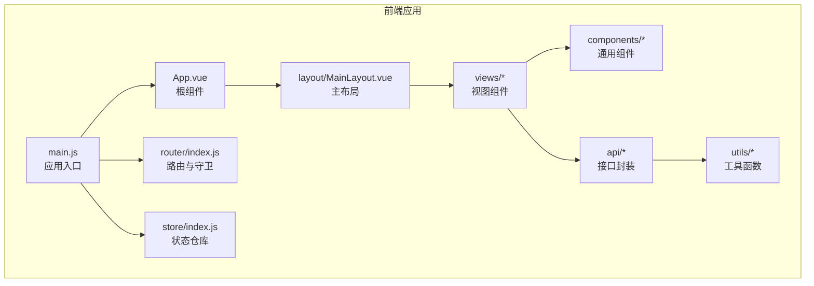
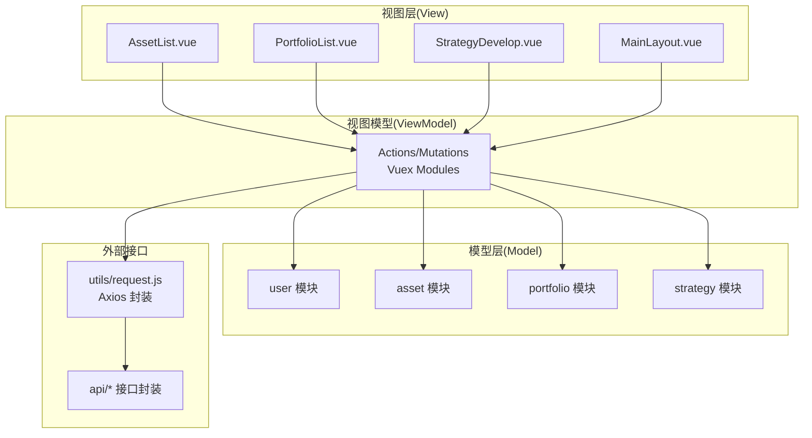
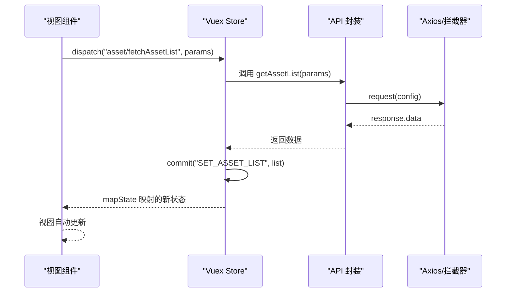
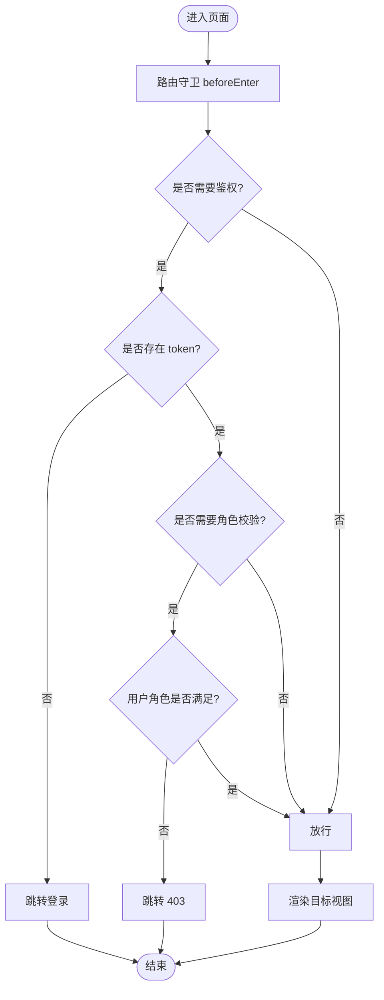
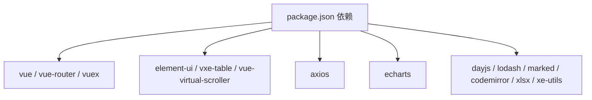

# 整体架构模式

<cite>
**本文引用的文件**
- [main.js](file://src/main.js)
- [App.vue](file://src/App.vue)
- [router/index.js](file://src/router/index.js)
- [store/index.js](file://src/store/index.js)
- [store/modules/user.js](file://src/store/modules/user.js)
- [store/modules/asset.js](file://src/store/modules/asset.js)
- [store/modules/portfolio.js](file://src/store/modules/portfolio.js)
- [layout/MainLayout.vue](file://src/layout/MainLayout.vue)
- [views/asset/AssetList.vue](file://src/views/asset/AssetList.vue)
- [views/portfolio/PortfolioList.vue](file://src/views/portfolio/PortfolioList.vue)
- [views/strategy/StrategyDevelop.vue](file://src/views/strategy/StrategyDevelop.vue)
- [api/asset.js](file://src/api/asset.js)
- [utils/request.js](file://src/utils/request.js)
- [components/SubjectiveWeightsFormPanel.vue](file://src/components/SubjectiveWeightsFormPanel.vue)
- [package.json](file://package.json)
- [vue.config.js](file://vue.config.js)
</cite>

## 目录
1. [引言](#引言)
2. [项目结构](#项目结构)
3. [核心组件](#核心组件)
4. [架构总览](#架构总览)
5. [详细组件分析](#详细组件分析)
6. [依赖关系分析](#依赖关系分析)
7. [性能考量](#性能考量)
8. [故障排查指南](#故障排查指南)
9. [结论](#结论)
10. [附录](#附录)

## 引言
本文件面向投资组合管理系统，系统采用前后端分离的 SPA 架构，前端基于 Vue.js 2.x + Vue Router + Vuex，结合 Element UI、vxe-table、ECharts 等生态组件，实现 MVVM 架构与 Flux（Vuex）模式的工程化落地。文档围绕以下主题展开：
- MVVM 架构在 Vue.js 中的职责分离与数据绑定机制
- Flux 架构在 Vuex 中的单向数据流、Actions、Mutations、State 设计
- 前后端分离的路由管理与状态管理策略
- 组件化架构与父子组件通信、事件传递体系
- 实际代码示例路径与最佳实践

## 项目结构
项目采用“按功能域分层 + 模块化”的组织方式：
- 应用入口与全局配置：main.js、App.vue、vue.config.js
- 路由层：router/index.js（Hash 模式、路由守卫、权限控制）
- 状态层：store/index.js（模块化拆分 user/asset/portfolio/strategy 等）
- 视图层：views 下按业务域划分（资产、组合、策略、分析、监控、系统）
- 组件层：components 下通用交互组件
- API 层：api 下按领域划分的接口封装
- 工具层：utils 下网络请求、格式化、工具函数
- 布局层：layout 下主布局 MainLayout.vue

**图表来源**
- [main.js:1-31](file://src/main.js#L1-L31)
- [App.vue:1-116](file://src/App.vue#L1-L116)
- [router/index.js:1-378](file://src/router/index.js#L1-L378)
- [store/index.js:1-44](file://src/store/index.js#L1-L44)
- [layout/MainLayout.vue:1-330](file://src/layout/MainLayout.vue#L1-L330)

**章节来源**
- [main.js:1-31](file://src/main.js#L1-L31)
- [App.vue:1-116](file://src/App.vue#L1-L116)
- [router/index.js:1-378](file://src/router/index.js#L1-L378)
- [store/index.js:1-44](file://src/store/index.js#L1-L44)
- [vue.config.js:1-17](file://vue.config.js#L1-L17)

## 核心组件
- 应用入口与初始化：在 main.js 中注册 Element UI、虚拟滚动、vxe-table 插件，并挂载 Vue 实例，注入路由与状态。
- 根组件：App.vue 作为路由出口，承载全局样式与基础排版。
- 路由系统：router/index.js 定义 Hash 路由、嵌套路由、菜单路由映射、路由守卫（标题、鉴权、角色校验）。
- 状态系统：store/index.js 组合模块化子模块，统一暴露 State/Mutations/Actions；各模块（user/asset/portfolio 等）实现各自领域状态。
- 主布局：MainLayout.vue 提供侧边栏菜单、面包屑、头部用户信息、折叠切换、登出流程。
- 视图组件：AssetList.vue、PortfolioList.vue、StrategyDevelop.vue 等通过 mapState/mapGetters/mapActions 与 Vuex 交互，发起 API 请求并渲染数据。
- API 封装：api/asset.js 等对 axios 进行二次封装，统一处理参数、响应与错误。
- 工具函数：utils/request.js 提供请求/响应拦截器、错误处理、Token 注入。

**章节来源**
- [main.js:1-31](file://src/main.js#L1-L31)
- [App.vue:1-116](file://src/App.vue#L1-L116)
- [router/index.js:1-378](file://src/router/index.js#L1-L378)
- [store/index.js:1-44](file://src/store/index.js#L1-L44)
- [layout/MainLayout.vue:1-330](file://src/layout/MainLayout.vue#L1-L330)
- [views/asset/AssetList.vue:1-346](file://src/views/asset/AssetList.vue#L1-L346)
- [views/portfolio/PortfolioList.vue:1-372](file://src/views/portfolio/PortfolioList.vue#L1-L372)
- [views/strategy/StrategyDevelop.vue:1-434](file://src/views/strategy/StrategyDevelop.vue#L1-L434)
- [api/asset.js:1-284](file://src/api/asset.js#L1-L284)
- [utils/request.js:1-100](file://src/utils/request.js#L1-L100)

## 架构总览
系统采用 MVVM + Flux（Vuex）双模式协同：
- Model：Vuex Modules（user/asset/portfolio 等）承载业务数据与逻辑
- View：Vue 组件负责渲染与用户交互
- ViewModel：Vuex Actions/Mutations 负责协调 Model 与 View 的数据流
- 单向数据流：View -> Action -> Mutation -> State -> View

**图表来源**
- [views/asset/AssetList.vue:1-346](file://src/views/asset/AssetList.vue#L1-L346)
- [views/portfolio/PortfolioList.vue:1-372](file://src/views/portfolio/PortfolioList.vue#L1-L372)
- [views/strategy/StrategyDevelop.vue:1-434](file://src/views/strategy/StrategyDevelop.vue#L1-L434)
- [layout/MainLayout.vue:1-330](file://src/layout/MainLayout.vue#L1-L330)
- [store/modules/user.js:1-119](file://src/store/modules/user.js#L1-L119)
- [store/modules/asset.js:1-183](file://src/store/modules/asset.js#L1-L183)
- [store/modules/portfolio.js:1-106](file://src/store/modules/portfolio.js#L1-L106)
- [api/asset.js:1-284](file://src/api/asset.js#L1-L284)
- [utils/request.js:1-100](file://src/utils/request.js#L1-L100)

## 详细组件分析

### MVVM 在 Vue.js 中的应用
- 职责分离
  - Model：Vuex Modules（如 user/asset/portfolio）维护状态与业务逻辑
  - View：Vue 组件（如 AssetList.vue、PortfolioList.vue、StrategyDevelop.vue）负责渲染与交互
  - ViewModel：Vuex Actions/Mutations 作为中介，协调 Model 与 View 的数据流
- 数据绑定机制
  - 计算属性与响应式：组件通过 mapState/mapGetters 访问 Store，实现双向数据绑定
  - 事件驱动：组件通过 dispatch/commit 触发状态变更，自动触发视图更新
  - 示例路径
    - [views/asset/AssetList.vue:198-219](file://src/views/asset/AssetList.vue#L198-L219) 使用 mapState 访问 asset 模块状态
    - [views/portfolio/PortfolioList.vue:183-185](file://src/views/portfolio/PortfolioList.vue#L183-L185) 使用 mapState 访问 portfolio 模块状态
    - [views/strategy/StrategyDevelop.vue:223-244](file://src/views/strategy/StrategyDevelop.vue#L223-L244) 使用 mapState 访问 asset 与 strategy 模块状态

**章节来源**
- [views/asset/AssetList.vue:198-219](file://src/views/asset/AssetList.vue#L198-L219)
- [views/portfolio/PortfolioList.vue:183-185](file://src/views/portfolio/PortfolioList.vue#L183-L185)
- [views/strategy/StrategyDevelop.vue:223-244](file://src/views/strategy/StrategyDevelop.vue#L223-L244)

### Flux（Vuex）在系统中的实现
- 单向数据流
  - View 发起 Action（异步），Action 提交 Mutation（同步），Mutation 修改 State，State 驱动 View 更新
- 核心要素
  - State：集中存储应用状态（如 loading/collapsed、用户信息、资产列表、组合列表）
  - Mutations：唯一修改 State 的方式，保证状态变更可追踪
  - Actions：封装异步逻辑（如 API 调用），提交 Mutations
  - Getters：派生状态，供组件读取
- 示例路径
  - [store/index.js:23-42](file://src/store/index.js#L23-L42) 定义全局 state/mutations/actions
  - [store/modules/user.js:28-100](file://src/store/modules/user.js#L28-L100) 定义用户登录/登出/权限等 Actions
  - [store/modules/asset.js:47-159](file://src/store/modules/asset.js#L47-L159) 定义资产列表/新增/更新/删除等 Actions 与 Mutations
  - [store/modules/portfolio.js:38-87](file://src/store/modules/portfolio.js#L38-L87) 定义组合列表/创建/更新/删除等 Actions 与 Mutations

**图表来源**
- [store/modules/asset.js:47-94](file://src/store/modules/asset.js#L47-L94)
- [api/asset.js:7-21](file://src/api/asset.js#L7-L21)
- [utils/request.js:11-32](file://src/utils/request.js#L11-L32)

**章节来源**
- [store/index.js:23-42](file://src/store/index.js#L23-L42)
- [store/modules/user.js:28-100](file://src/store/modules/user.js#L28-L100)
- [store/modules/asset.js:47-159](file://src/store/modules/asset.js#L47-L159)
- [store/modules/portfolio.js:38-87](file://src/store/modules/portfolio.js#L38-L87)
- [api/asset.js:7-21](file://src/api/asset.js#L7-L21)
- [utils/request.js:11-32](file://src/utils/request.js#L11-L32)

### 前后端分离架构与路由管理
- SPA 与 Hash 路由
  - 路由模式：Hash 模式，便于静态部署与本地开发
  - 路由守卫：统一设置页面标题、鉴权（token）、角色权限（roles）
- 菜单与路由映射
  - MainLayout.vue 中的 el-menu 与路由 path 对齐，支持 router 属性直连
- 示例路径
  - [router/index.js:346-375](file://src/router/index.js#L346-L375) 路由守卫与标题设置
  - [layout/MainLayout.vue:11-96](file://src/layout/MainLayout.vue#L11-L96) 侧边栏菜单与面包屑

**图表来源**
- [router/index.js:351-375](file://src/router/index.js#L351-L375)
- [layout/MainLayout.vue:108-138](file://src/layout/MainLayout.vue#L108-L138)

**章节来源**
- [router/index.js:346-375](file://src/router/index.js#L346-L375)
- [layout/MainLayout.vue:108-138](file://src/layout/MainLayout.vue#L108-L138)

### 组件化架构与父子通信
- 组件化理念
  - 视图层组件（views）聚焦业务场景，复用通用组件（components）
  - 通用组件通过 props 接收数据，通过 $emit 抛出事件，实现解耦
- 父子通信机制
  - Props 下行：父组件向子组件传递数据与回调
  - Events 上行：子组件通过 $emit 向父组件传递事件与数据
  - 示例路径
    - [components/SubjectiveWeightsFormPanel.vue:142-148](file://src/components/SubjectiveWeightsFormPanel.vue#L142-L148) 子组件抛出 update:manualWeightAdjustments 事件
    - [views/strategy/StrategyDevelop.vue:348-368](file://src/views/strategy/StrategyDevelop.vue#L348-L368) 父组件监听并处理事件
- 事件传递系统
  - 组件内部通过 $emit 触发自定义事件
  - 父组件通过 v-on 或 .native 修饰符接收事件
  - 示例路径
    - [components/SubjectiveWeightsFormPanel.vue:142-148](file://src/components/SubjectiveWeightsFormPanel.vue#L142-L148)
    - [views/strategy/StrategyDevelop.vue:348-368](file://src/views/strategy/StrategyDevelop.vue#L348-L368)

**章节来源**
- [components/SubjectiveWeightsFormPanel.vue:142-148](file://src/components/SubjectiveWeightsFormPanel.vue#L142-L148)
- [views/strategy/StrategyDevelop.vue:348-368](file://src/views/strategy/StrategyDevelop.vue#L348-L368)

### 最佳实践与代码示例路径
- Vue 实例初始化
  - [main.js:16-30](file://src/main.js#L16-L30) 注册 UI 插件、图表库、虚拟滚动，创建 Vue 实例并挂载
- 路由配置与守卫
  - [router/index.js:346-375](file://src/router/index.js#L346-L375) Hash 路由、嵌套路由、守卫逻辑
- 状态管理
  - [store/index.js:13-43](file://src/store/index.js#L13-L43) 模块化 Store、全局 state/mutations/actions
  - [store/modules/user.js:112-119](file://src/store/modules/user.js#L112-L119) namespaced 模块导出
  - [store/modules/asset.js:176-183](file://src/store/modules/asset.js#L176-L183) namespaced 模块导出
  - [store/modules/portfolio.js:99-106](file://src/store/modules/portfolio.js#L99-L106) namespaced 模块导出
- API 与请求拦截
  - [api/asset.js:7-21](file://src/api/asset.js#L7-L21) GET 资产列表
  - [utils/request.js:11-32](file://src/utils/request.js#L11-L32) 请求拦截器注入 Authorization
  - [utils/request.js:27-97](file://src/utils/request.js#L27-L97) 响应拦截器统一错误处理
- 视图组件与状态交互
  - [views/asset/AssetList.vue:198-219](file://src/views/asset/AssetList.vue#L198-L219) mapState 读取状态、dispatch 触发 Action
  - [views/portfolio/PortfolioList.vue:183-197](file://src/views/portfolio/PortfolioList.vue#L183-L197) mapState 读取状态、dispatch 触发 Action
  - [views/strategy/StrategyDevelop.vue:223-277](file://src/views/strategy/StrategyDevelop.vue#L223-L277) mapState 读取状态、watch 监听、dispatch 触发 Action

**章节来源**
- [main.js:16-30](file://src/main.js#L16-L30)
- [router/index.js:346-375](file://src/router/index.js#L346-L375)
- [store/index.js:13-43](file://src/store/index.js#L13-L43)
- [store/modules/user.js:112-119](file://src/store/modules/user.js#L112-L119)
- [store/modules/asset.js:176-183](file://src/store/modules/asset.js#L176-L183)
- [store/modules/portfolio.js:99-106](file://src/store/modules/portfolio.js#L99-L106)
- [api/asset.js:7-21](file://src/api/asset.js#L7-L21)
- [utils/request.js:11-32](file://src/utils/request.js#L11-L32)
- [utils/request.js:27-97](file://src/utils/request.js#L27-L97)
- [views/asset/AssetList.vue:198-219](file://src/views/asset/AssetList.vue#L198-L219)
- [views/portfolio/PortfolioList.vue:183-197](file://src/views/portfolio/PortfolioList.vue#L183-L197)
- [views/strategy/StrategyDevelop.vue:223-277](file://src/views/strategy/StrategyDevelop.vue#L223-L277)

## 依赖关系分析
- 前端依赖
  - Vue 生态：vue、vue-router、vuex、vue-template-compiler
  - UI 生态：element-ui、vxe-table、vue-virtual-scroller
  - 图表：echarts
  - 网络：axios
  - 工具：dayjs、lodash、marked、codemirror、xlsx、xe-utils
- 构建与别名
  - vue.config.js 配置 tslib 别名，解决嵌套依赖问题

**图表来源**
- [package.json:11-28](file://package.json#L11-L28)
- [vue.config.js:5-16](file://vue.config.js#L5-L16)

**章节来源**
- [package.json:11-28](file://package.json#L11-L28)
- [vue.config.js:5-16](file://vue.config.js#L5-L16)

## 性能考量
- 虚拟滚动与表格优化
  - 使用 vue-virtual-scroller 与 vxe-table 提升大数据表格渲染性能
- 图表渲染
  - ECharts 按需初始化与销毁，避免内存泄漏（见 PortfolioList.vue beforeDestroy）
- 请求超时与并发
  - axios 默认 60 秒超时，针对行情/导入等大体量请求可适当放宽
- 路由懒加载
  - 路由组件使用动态导入，减少首屏体积

**章节来源**
- [views/portfolio/PortfolioList.vue:351-355](file://src/views/portfolio/PortfolioList.vue#L351-L355)
- [utils/request.js:5-9](file://src/utils/request.js#L5-L9)
- [router/index.js:9-11](file://src/router/index.js#L9-L11)

## 故障排查指南
- 登录与权限
  - 路由守卫会根据 token 与角色进行跳转，若出现循环跳转，检查 store.state.user.token 与 userInfo
- 网络请求
  - utils/request.js 统一处理 401/403/404/超时等错误，组件内捕获业务错误
- 资产列表加载
  - 若资产列表为空，确认 API 返回结构与 store.modules.asset 的数据映射逻辑
- 组合详情与图表
  - 确保 ECharts 实例在组件销毁时 dispose，避免重复渲染

**章节来源**
- [router/index.js:351-375](file://src/router/index.js#L351-L375)
- [utils/request.js:27-97](file://src/utils/request.js#L27-L97)
- [store/modules/asset.js:62-86](file://src/store/modules/asset.js#L62-L86)
- [views/portfolio/PortfolioList.vue:351-355](file://src/views/portfolio/PortfolioList.vue#L351-L355)

## 结论
本系统通过 MVVM 与 Flux（Vuex）的协同，实现了清晰的职责分离与稳定的单向数据流；配合路由守卫与模块化状态管理，确保了权限控制与业务扩展性。组件化设计与事件传递机制提升了代码复用与可维护性。建议在后续迭代中进一步完善 API 错误分级与埋点上报，增强可观测性与用户体验。

## 附录
- 关键文件索引
  - 应用入口与初始化：[main.js:16-30](file://src/main.js#L16-L30)
  - 根组件与路由出口：[App.vue:1-116](file://src/App.vue#L1-L116)
  - 路由与守卫：[router/index.js:346-375](file://src/router/index.js#L346-L375)
  - 全局状态与模块：[store/index.js:13-43](file://src/store/index.js#L13-L43)
  - 用户模块：[store/modules/user.js:112-119](file://src/store/modules/user.js#L112-L119)
  - 资产模块：[store/modules/asset.js:176-183](file://src/store/modules/asset.js#L176-L183)
  - 组合模块：[store/modules/portfolio.js:99-106](file://src/store/modules/portfolio.js#L99-L106)
  - 主布局：[layout/MainLayout.vue:108-138](file://src/layout/MainLayout.vue#L108-L138)
  - 资产列表视图：[views/asset/AssetList.vue:198-219](file://src/views/asset/AssetList.vue#L198-L219)
  - 组合列表视图：[views/portfolio/PortfolioList.vue:183-197](file://src/views/portfolio/PortfolioList.vue#L183-L197)
  - 策略开发视图：[views/strategy/StrategyDevelop.vue:223-277](file://src/views/strategy/StrategyDevelop.vue#L223-L277)
  - 资产 API 封装：[api/asset.js:7-21](file://src/api/asset.js#L7-L21)
  - 请求拦截器：[utils/request.js:11-32](file://src/utils/request.js#L11-L32)
  - 响应拦截器：[utils/request.js:27-97](file://src/utils/request.js#L27-L97)
  - 通用组件事件：[components/SubjectiveWeightsFormPanel.vue:142-148](file://src/components/SubjectiveWeightsFormPanel.vue#L142-L148)