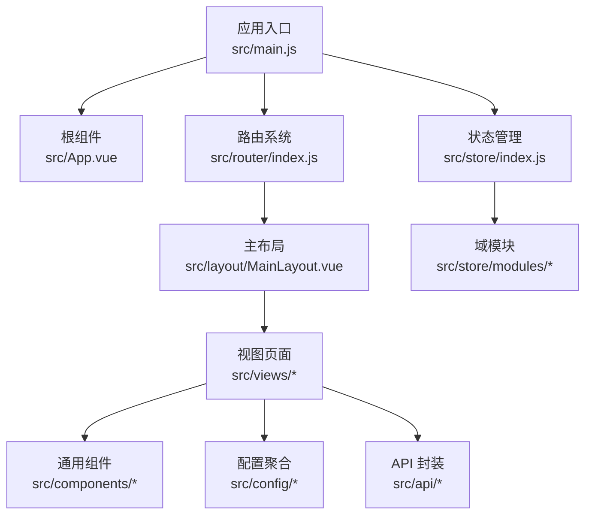
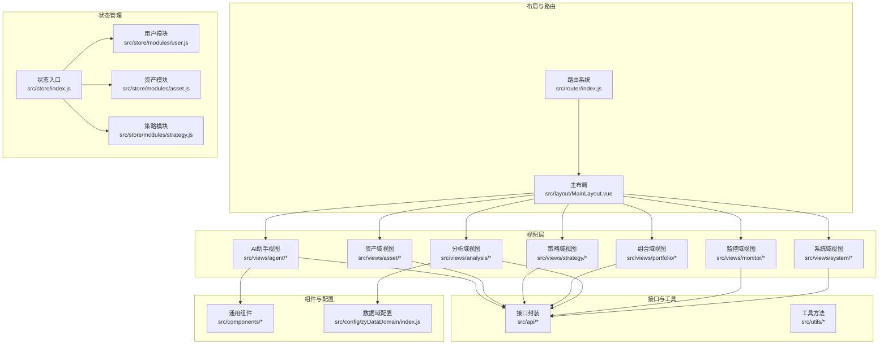
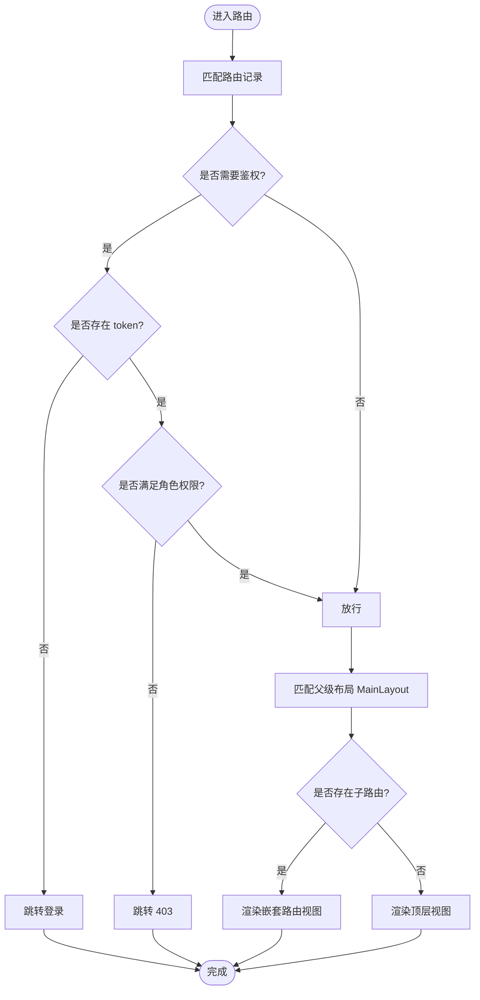
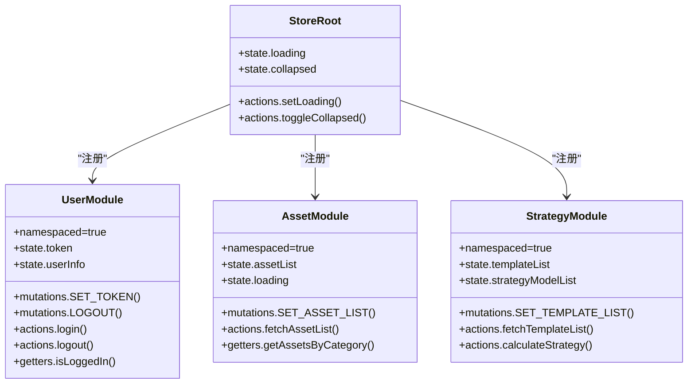
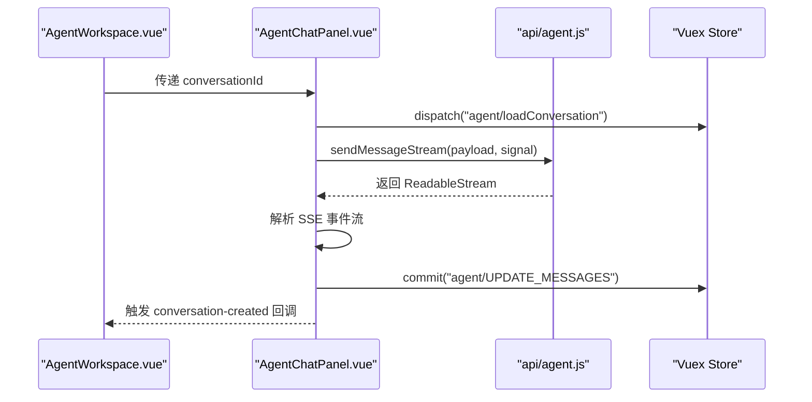
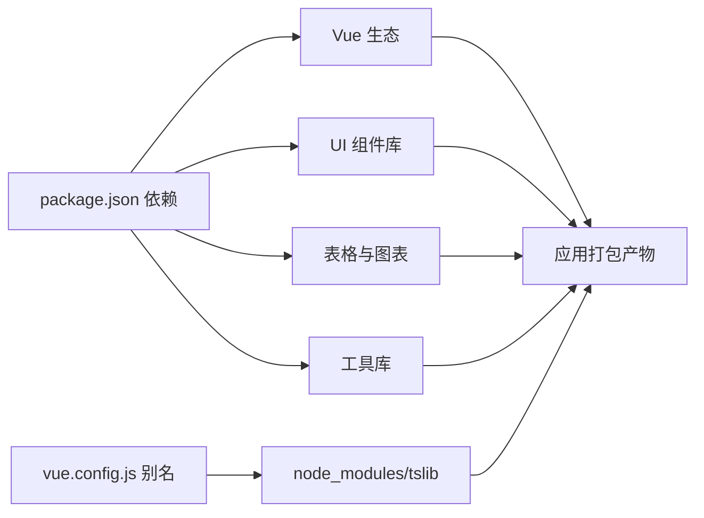

# 模块化与组织结构

<cite>
**本文引用的文件**
- [src/main.js](file://src/main.js)
- [src/App.vue](file://src/App.vue)
- [src/router/index.js](file://src/router/index.js)
- [src/layout/MainLayout.vue](file://src/layout/MainLayout.vue)
- [src/store/index.js](file://src/store/index.js)
- [src/store/modules/user.js](file://src/store/modules/user.js)
- [src/store/modules/asset.js](file://src/store/modules/asset.js)
- [src/store/modules/strategy.js](file://src/store/modules/strategy.js)
- [src/components/AgentChatPanel.vue](file://src/components/AgentChatPanel.vue)
- [src/views/agent/AgentWorkspace.vue](file://src/views/agent/AgentWorkspace.vue)
- [src/api/agent.js](file://src/api/agent.js)
- [src/config/zyDataDomain/index.js](file://src/config/zyDataDomain/index.js)
- [package.json](file://package.json)
- [vue.config.js](file://vue.config.js)
</cite>

## 目录
1. [引言](#引言)
2. [项目结构](#项目结构)
3. [核心组件](#核心组件)
4. [架构总览](#架构总览)
5. [详细组件分析](#详细组件分析)
6. [依赖分析](#依赖分析)
7. [性能考虑](#性能考虑)
8. [故障排查指南](#故障排查指南)
9. [结论](#结论)
10. [附录](#附录)

## 引言
本文件系统性梳理项目的模块化与组织结构，围绕以下主题展开：
- 功能域划分的模块组织方式
- 路由模块化设计（嵌套路由与动态路由）
- 状态管理模块化（Vuex 模块划分与命名空间）
- 组件模块化（可复用组件与组件库构建思路）
- 文件组织结构的命名规范与目录层级设计
- 模块间依赖关系与加载策略
- 具体代码示例路径（以源码路径代替具体代码）

## 项目结构
项目采用基于功能域的分层模块化组织：
- 视图层：views 下按业务域划分（资产、策略、组合、分析、监控、系统、AI助手等）
- 布局层：layout 提供统一主布局 MainLayout.vue
- 状态层：store/modules 下按域拆分 Vuex 模块
- 路由层：router/index.js 定义顶层路由与嵌套路由
- 组件层：components 提供通用可复用组件
- 配置层：config 下按领域聚合配置（如 ZY 数据域）
- API 层：api 下封装后端接口
- 工具层：utils 提供通用工具方法

**图示来源**
- [src/main.js:1-31](file://src/main.js#L1-L31)
- [src/App.vue:1-116](file://src/App.vue#L1-L116)
- [src/router/index.js:1-378](file://src/router/index.js#L1-L378)
- [src/layout/MainLayout.vue:1-330](file://src/layout/MainLayout.vue#L1-L330)
- [src/store/index.js:1-44](file://src/store/index.js#L1-L44)

**章节来源**
- [src/main.js:1-31](file://src/main.js#L1-L31)
- [src/App.vue:1-116](file://src/App.vue#L1-L116)
- [src/router/index.js:1-378](file://src/router/index.js#L1-L378)
- [src/layout/MainLayout.vue:1-330](file://src/layout/MainLayout.vue#L1-L330)
- [src/store/index.js:1-44](file://src/store/index.js#L1-L44)

## 核心组件
- 应用入口与依赖注入：在入口文件中注册 Element UI、虚拟滚动、图表与表格插件，挂载路由与状态管理。
- 根组件：承载路由出口，负责全局样式与基础布局占位。
- 主布局：提供侧边菜单、面包屑、头部用户信息与内容区过渡动画。
- 路由系统：定义顶层路由与嵌套路由，结合路由守卫实现鉴权与标题设置。
- 状态管理：集中注册域模块，提供公共状态与动作（如布局折叠）。

**章节来源**
- [src/main.js:1-31](file://src/main.js#L1-L31)
- [src/App.vue:1-116](file://src/App.vue#L1-L116)
- [src/layout/MainLayout.vue:144-218](file://src/layout/MainLayout.vue#L144-L218)
- [src/router/index.js:351-375](file://src/router/index.js#L351-L375)
- [src/store/index.js:13-43](file://src/store/index.js#L13-L43)

## 架构总览
整体采用“视图-布局-路由-状态-组件-配置-接口”分层，模块边界清晰，职责分离：
- 视图层通过路由懒加载与嵌套路由实现功能域隔离
- 布局层统一控制导航、面包屑与用户交互
- 状态层以命名空间域模块管理业务域数据与行为
- 组件层提供高复用的通用 UI 与业务组件
- 配置层对齐业务域元数据与工具函数
- 接口层抽象后端服务，支持流式与非流式通信

**图示来源**
- [src/router/index.js:7-344](file://src/router/index.js#L7-L344)
- [src/layout/MainLayout.vue:1-330](file://src/layout/MainLayout.vue#L1-L330)
- [src/store/index.js:3-22](file://src/store/index.js#L3-L22)
- [src/store/modules/user.js:112-119](file://src/store/modules/user.js#L112-L119)
- [src/store/modules/asset.js:176-183](file://src/store/modules/asset.js#L176-L183)
- [src/store/modules/strategy.js:461-468](file://src/store/modules/strategy.js#L461-L468)
- [src/config/zyDataDomain/index.js:1-80](file://src/config/zyDataDomain/index.js#L1-L80)
- [src/api/agent.js:1-168](file://src/api/agent.js#L1-L168)

## 详细组件分析

### 路由模块化设计（嵌套路由与动态路由）
- 嵌套路由：以 MainLayout 为父级容器，子路由通过 children 定义，形成“域-子页”的层次结构；例如资产、策略、组合、分析、系统、AI助手等域均采用此模式。
- 动态路由：通过路由守卫实现鉴权与权限控制，根据 meta.roles 控制菜单可见性与访问权限；同时动态设置页面标题。
- 路由懒加载：视图组件采用动态导入，按需加载，降低首屏体积。
- 重定向与通配：提供 /404 与 /302 重定向，确保异常路径友好处理。

**图示来源**
- [src/router/index.js:351-375](file://src/router/index.js#L351-L375)
- [src/layout/MainLayout.vue:170-172](file://src/layout/MainLayout.vue#L170-L172)

**章节来源**
- [src/router/index.js:7-344](file://src/router/index.js#L7-L344)
- [src/router/index.js:351-375](file://src/router/index.js#L351-L375)
- [src/layout/MainLayout.vue:144-218](file://src/layout/MainLayout.vue#L144-L218)

### 状态管理模块化（Vuex 域模块与命名空间）
- 模块划分：按业务域拆分，如 user、asset、strategy、portfolio、benchmark、monitor、agent 等，入口集中注册。
- 命名空间：各模块启用 namespaced，避免状态与动作命名冲突，便于跨域组合使用。
- 公共状态：在根 store 维护通用状态（如 loading、collapsed）与动作（如 toggleCollapsed）。
- 示例路径：
  - [用户模块（命名空间）:112-119](file://src/store/modules/user.js#L112-L119)
  - [资产模块（命名空间）:176-183](file://src/store/modules/asset.js#L176-L183)
  - [策略模块（命名空间）:461-468](file://src/store/modules/strategy.js#L461-L468)

**图示来源**
- [src/store/index.js:13-43](file://src/store/index.js#L13-L43)
- [src/store/modules/user.js:112-119](file://src/store/modules/user.js#L112-L119)
- [src/store/modules/asset.js:176-183](file://src/store/modules/asset.js#L176-L183)
- [src/store/modules/strategy.js:461-468](file://src/store/modules/strategy.js#L461-L468)

**章节来源**
- [src/store/index.js:3-22](file://src/store/index.js#L3-L22)
- [src/store/modules/user.js:112-119](file://src/store/modules/user.js#L112-L119)
- [src/store/modules/asset.js:176-183](file://src/store/modules/asset.js#L176-L183)
- [src/store/modules/strategy.js:461-468](file://src/store/modules/strategy.js#L461-L468)

### 组件模块化（可复用组件与组件库构建）
- 通用组件：提供聊天面板、数据表格、图表渲染、输入框、模板卡片等，具备良好的可复用性与扩展性。
- 组件职责单一：如 AgentChatPanel 负责流式对话、消息渲染、工具调用解析与资产/回测追踪。
- 事件与属性解耦：通过 props 与事件向上传递状态，降低耦合度。
- 组件库构建建议：将通用组件抽取为独立包，提供明确的 API 文档与主题变量，配合 Storybook 进行演示与回归。

**图示来源**
- [src/views/agent/AgentWorkspace.vue:107-157](file://src/views/agent/AgentWorkspace.vue#L107-L157)
- [src/components/AgentChatPanel.vue:228-800](file://src/components/AgentChatPanel.vue#L228-L800)
- [src/api/agent.js:78-112](file://src/api/agent.js#L78-L112)

**章节来源**
- [src/views/agent/AgentWorkspace.vue:107-279](file://src/views/agent/AgentWorkspace.vue#L107-L279)
- [src/components/AgentChatPanel.vue:228-800](file://src/components/AgentChatPanel.vue#L228-L800)
- [src/api/agent.js:1-168](file://src/api/agent.js#L1-L168)

### 文件组织结构与命名规范
- 目录层级：views、layout、store/modules、components、config、api、utils、router、styles 等，按职责划分。
- 命名规范：
  - 视图文件：按域命名（如 asset、strategy、portfolio、analysis、monitor、system、agent）
  - 组件文件：语义化命名（如 AgentChatPanel.vue、ChatDataTable.vue、AssetChartDialog.vue）
  - 配置文件：按域聚合（如 zyDataDomain 下的 01_asset.js、02_subject.js 等）
  - API 文件：按业务域命名（如 agent.js、strategy.js、asset.js）
  - Vuex 模块：与域一一对应（如 user.js、asset.js、strategy.js）
- 路由文件：index.js，集中管理所有路由与嵌套路由。

**章节来源**
- [src/router/index.js:1-378](file://src/router/index.js#L1-L378)
- [src/config/zyDataDomain/index.js:1-80](file://src/config/zyDataDomain/index.js#L1-L80)

## 依赖分析
- 运行时依赖：Vue 2、Vue Router、Vuex、Element UI、vxe-table、echarts、vue-virtual-scroller 等。
- 构建与别名：通过 vue.config.js 将 tslib 指向本地 node_modules，避免重复打包。
- 模块加载策略：路由懒加载 + 组件按需引入，减少初始包体；Vuex 模块按需提交与读取，避免全局污染。

**图示来源**
- [package.json:11-28](file://package.json#L11-L28)
- [vue.config.js:5-16](file://vue.config.js#L5-L16)

**章节来源**
- [package.json:1-45](file://package.json#L1-L45)
- [vue.config.js:1-17](file://vue.config.js#L1-L17)

## 性能考虑
- 路由懒加载：通过动态导入按需加载视图组件，显著降低首屏资源消耗。
- 组件懒加载：通用组件按需引入，避免不必要的依赖。
- 虚拟滚动：大量数据表格采用虚拟滚动，提升渲染性能。
- 图表与表格：按需引入样式与插件，避免全量引入导致体积膨胀。
- Vuex 模块：启用命名空间，避免全局状态膨胀；仅在必要时提交与监听。

## 故障排查指南
- 路由守卫问题：若出现无法进入受保护页面，检查 token 与角色权限是否正确写入 store；确认 meta.roles 与用户角色匹配。
- 权限菜单异常：检查 MainLayout 中 defaultOpeneds 与 activeMenu 的计算逻辑，确保与当前路由路径一致。
- 流式对话中断：若出现回复串话或无法停止，检查 AgentChatPanel 中的 AbortController 与 _sseOwnerConversationId 的一致性。
- API 超时与错误：关注 api/agent.js 中的超时配置与错误处理，必要时增加重试与降级策略。

**章节来源**
- [src/router/index.js:351-375](file://src/router/index.js#L351-L375)
- [src/layout/MainLayout.vue:154-186](file://src/layout/MainLayout.vue#L154-L186)
- [src/components/AgentChatPanel.vue:468-487](file://src/components/AgentChatPanel.vue#L468-L487)
- [src/api/agent.js:78-112](file://src/api/agent.js#L78-L112)

## 结论
本项目通过“功能域驱动”的模块化设计，实现了路由、状态、组件与配置的清晰分层与职责分离。嵌套路由与动态路由策略有效支撑了多域页面的组织；Vuex 命名空间域模块提升了状态管理的可维护性；通用组件与配置聚合为后续组件库建设打下基础。建议持续优化模块边界与接口契约，完善单元测试与文档，进一步提升可扩展性与可维护性。

## 附录
- 最佳实践清单
  - 路由：统一使用动态导入；嵌套路由保持父子关系清晰；meta 字段标准化（title、roles、hidden 等）。
  - 状态：启用 namespaced；动作与提交尽量幂等；避免跨模块强耦合。
  - 组件：单一职责；props 与事件解耦；提供默认值与校验；支持主题与尺寸定制。
  - 配置：按域聚合；提供查询与工具函数；对外暴露稳定 API。
  - 接口：统一错误处理与超时；区分流式与非流式；提供 mock 与降级方案。
  - 构建：合理使用别名与 externals；按需引入第三方库；关注包体积与加载性能。