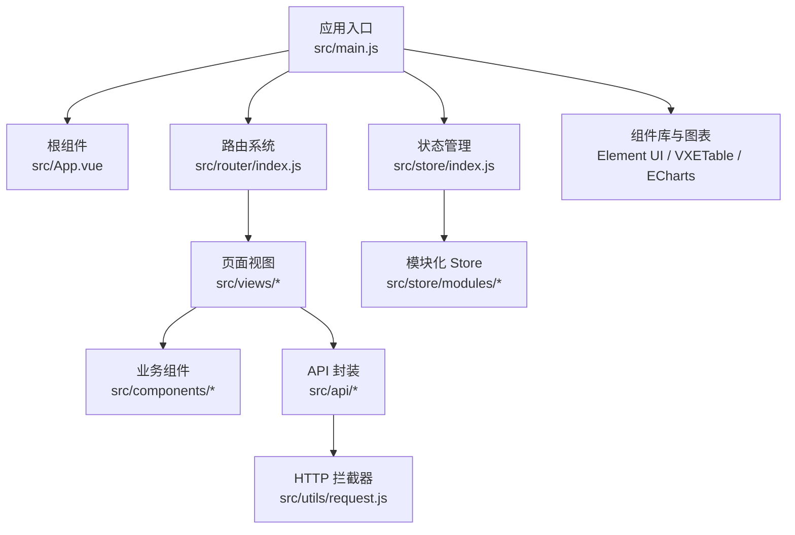
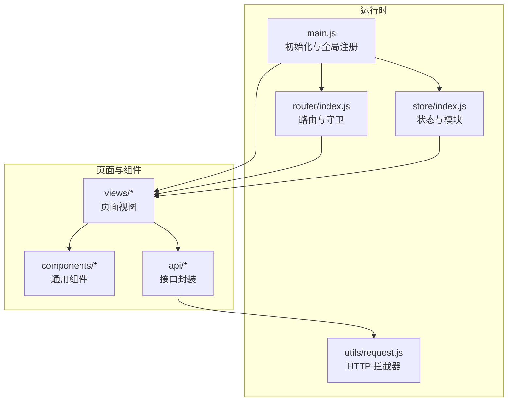
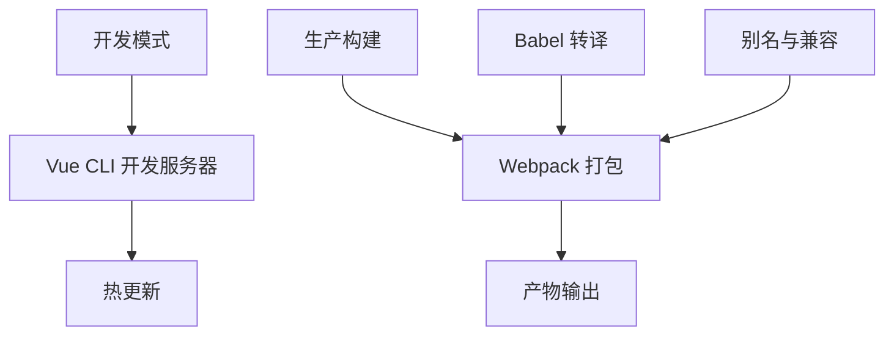
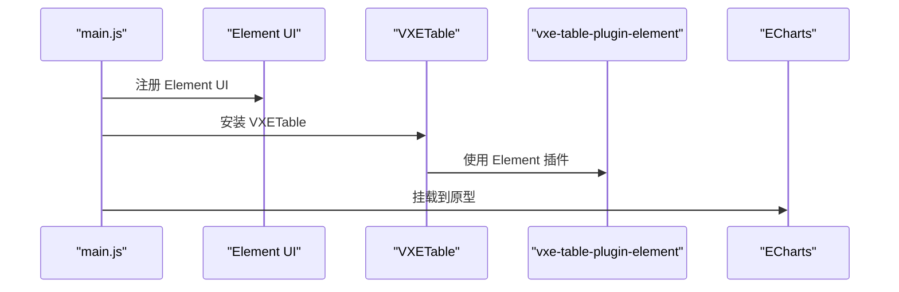
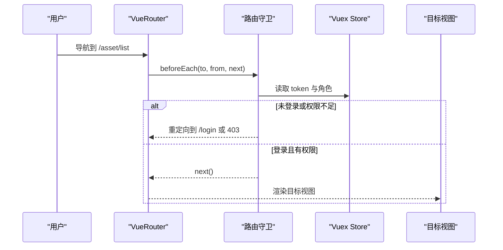
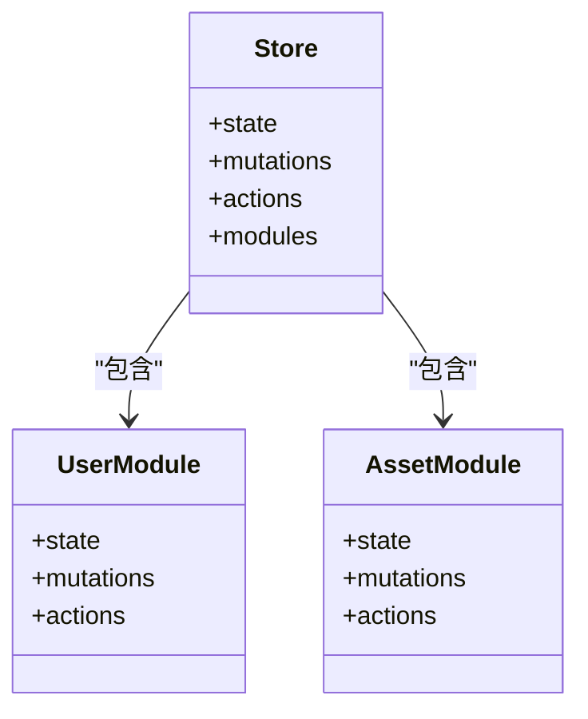
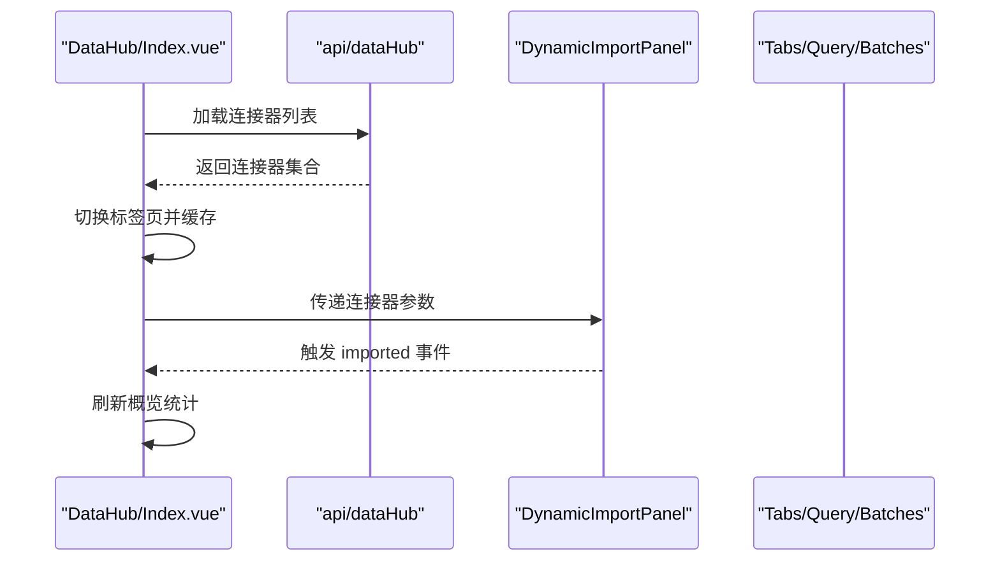
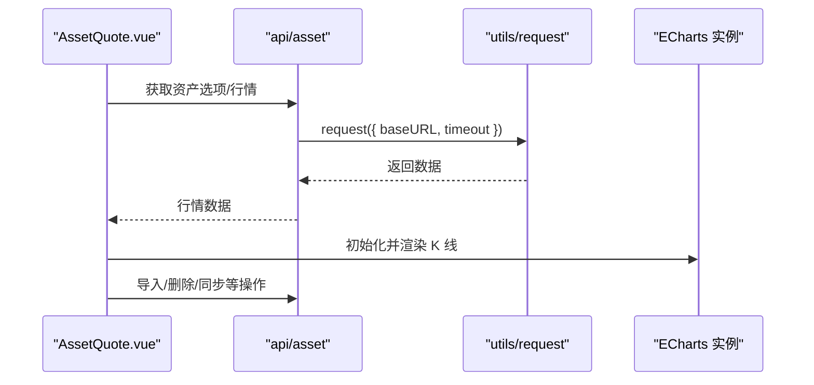
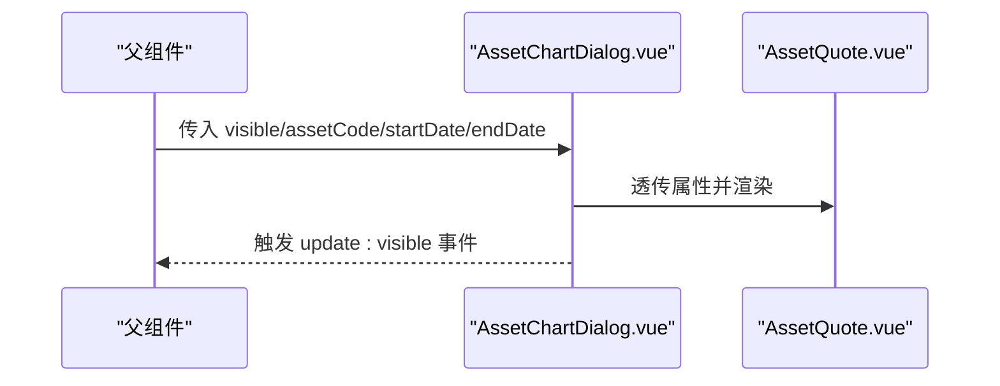
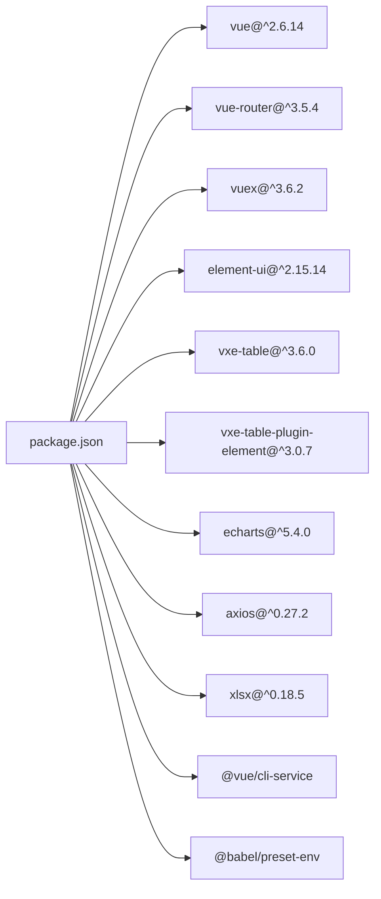

# 技术栈说明

<cite>
**本文引用的文件**
- [package.json](file://package.json)
- [vue.config.js](file://vue.config.js)
- [.babelrc](file://.babelrc)
- [webpack.config.js](file://webpack.config.js)
- [src/main.js](file://src/main.js)
- [src/App.vue](file://src/App.vue)
- [src/router/index.js](file://src/router/index.js)
- [src/store/index.js](file://src/store/index.js)
- [src/config/zyDataDomain/index.js](file://src/config/zyDataDomain/index.js)
- [src/components/AssetChartDialog.vue](file://src/components/AssetChartDialog.vue)
- [src/views/analysis/DataHub/Index.vue](file://src/views/analysis/DataHub/Index.vue)
- [src/api/asset.js](file://src/api/asset.js)
- [src/utils/request.js](file://src/utils/request.js)
- [src/views/asset/AssetQuote.vue](file://src/views/asset/AssetQuote.vue)
</cite>

## 目录
1. [引言](#引言)
2. [项目结构](#项目结构)
3. [核心组件](#核心组件)
4. [架构总览](#架构总览)
5. [详细组件分析](#详细组件分析)
6. [依赖分析](#依赖分析)
7. [性能考量](#性能考量)
8. [故障排查指南](#故障排查指南)
9. [结论](#结论)
10. [附录](#附录)

## 引言
本技术栈说明面向投资组合管理系统（Portfilio）前端侧，系统基于 Vue.js 2 生态，采用 Element UI 组件库、VXETable 高性能表格、ECharts 数据可视化、Vuex 状态管理与 Vue Router 路由管理，并通过 Vue CLI 与 Webpack 构建体系配合 Babel 转译与 ESLint 规范。本文将从技术选型原因、优势、实际应用与集成方式等方面进行系统阐述，并提供学习路径建议与常见问题排查方法。

## 项目结构
项目采用典型的 Vue CLI 项目组织方式，核心目录与职责如下：
- src：源代码根目录
  - api：统一的后端接口封装
  - components：可复用的业务与通用组件
  - views：页面级视图组件
  - router：路由定义与守卫
  - store：状态管理模块
  - utils：工具函数与拦截器
  - config：配置与常量
  - layout：布局组件
  - main.js：应用入口
  - App.vue：根组件
- public：静态资源与入口 HTML
- 构建配置：vue.config.js、webpack.config.js、.babelrc
- 依赖与脚本：package.json

**图示来源**
- [src/main.js:1-31](file://src/main.js#L1-L31)
- [src/App.vue:1-116](file://src/App.vue#L1-L116)
- [src/router/index.js:1-378](file://src/router/index.js#L1-L378)
- [src/store/index.js:1-44](file://src/store/index.js#L1-L44)

**章节来源**
- [src/main.js:1-31](file://src/main.js#L1-L31)
- [src/App.vue:1-116](file://src/App.vue#L1-L116)
- [src/router/index.js:1-378](file://src/router/index.js#L1-L378)
- [src/store/index.js:1-44](file://src/store/index.js#L1-L44)

## 核心组件
- Vue.js 2.6.14：渐进式框架，提供响应式数据与组件化能力，适配复杂业务场景与长线维护。
- Element UI 2.15.14：完备的桌面端组件库，提供表格、表单、对话框、导航等高频 UI，与项目风格高度契合。
- VXETable 3.6.0 + vxe-table-plugin-element：高性能表格解决方案，支持大数据量渲染、虚拟滚动、列拖拽、排序筛选等，满足资产行情与数据明细的强交互需求。
- ECharts 5.4.0：专业可视化库，用于绘制 K 线、趋势图与统计图表，结合业务数据实现直观展示。
- Vuex 3.6.2：集中式状态管理，模块化拆分用户、资产、策略、组合、监控、代理等模块，统一数据流。
- Vue Router 3.5.4：支持嵌套路由、动态路由、路由守卫与权限控制，满足多模块菜单与权限校验。
- Vue CLI 5 + Webpack 4：构建与打包工具链，配合 Babel 转译与别名配置，保障兼容性与开发体验。
- Axios + 自定义拦截器：统一请求与错误处理，集中处理鉴权、超时、401/403/404 等业务场景。

**章节来源**
- [package.json:11-29](file://package.json#L11-L29)
- [src/main.js:1-31](file://src/main.js#L1-L31)
- [src/App.vue:46-114](file://src/App.vue#L46-L114)
- [src/router/index.js:351-375](file://src/router/index.js#L351-L375)
- [src/store/index.js:13-43](file://src/store/index.js#L13-L43)
- [src/utils/request.js:1-100](file://src/utils/request.js#L1-L100)

## 架构总览
系统采用“入口初始化 → 路由与权限 → 状态管理 → 组件与页面 → API 通信”的分层架构。Element UI 提供基础 UI，VXETable 与 ECharts 在页面中承担数据与可视化职责；Axios 搭配拦截器统一处理认证与错误；Vuex 模块化管理业务状态；Vue Router 实现菜单驱动的权限控制。

**图示来源**
- [src/main.js:1-31](file://src/main.js#L1-L31)
- [src/router/index.js:1-378](file://src/router/index.js#L1-L378)
- [src/store/index.js:1-44](file://src/store/index.js#L1-L44)
- [src/utils/request.js:1-100](file://src/utils/request.js#L1-L100)

## 详细组件分析

### Vue 生态与构建工具链
- Vue CLI 服务：提供开发服务器、热更新、构建与打包命令，简化工程化流程。
- Webpack 配置：自定义入口、输出、loader、插件与别名，确保开发与生产环境一致。
- Babel 转译：preset-env 面向现代浏览器，保留 ES 模块以便 Tree-shaking。
- TypeScript 兼容：通过 vue.config.js 将 tslib 指向本地副本，避免嵌套依赖导致的重复打包。

**图示来源**
- [vue.config.js:5-16](file://vue.config.js#L5-L16)
- [webpack.config.js:6-62](file://webpack.config.js#L6-L62)
- [.babelrc:1-14](file://.babelrc#L1-L14)
- [package.json:5-9](file://package.json#L5-L9)

**章节来源**
- [vue.config.js:1-17](file://vue.config.js#L1-L17)
- [webpack.config.js:1-63](file://webpack.config.js#L1-L63)
- [.babelrc:1-14](file://.babelrc#L1-L14)
- [package.json:1-45](file://package.json#L1-L45)

### Element UI 与 VXETable 集成
- Element UI：全局注册主题样式与组件，统一按钮、表格、对话框等 UI 风格。
- VXETable：引入样式与 Element 插件，启用 Element UI 渲染器，提升表格在 Element 环境下的可用性与一致性。
- 虚拟滚动：在大型数据表格中开启滚动优化，降低渲染压力。
- 图表注入：将 ECharts 挂载到 Vue 原型，便于在组件中直接使用。

**图示来源**
- [src/main.js:5-22](file://src/main.js#L5-L22)

**章节来源**
- [src/main.js:1-31](file://src/main.js#L1-L31)
- [src/App.vue:46-114](file://src/App.vue#L46-L114)

### 路由与权限控制
- 嵌套路由：主布局与多模块子路由，支持面包屑与菜单联动。
- 路由守卫：根据 meta 标记与用户 token 控制访问，支持角色过滤。
- 动态标题：根据路由 meta.title 设置页面标题。

**图示来源**
- [src/router/index.js:351-375](file://src/router/index.js#L351-L375)

**章节来源**
- [src/router/index.js:1-378](file://src/router/index.js#L1-L378)

### 状态管理与模块化
- 模块划分：user、asset、strategy、portfolio、benchmark、monitor、agent 等模块化组织。
- 全局状态：loading、collapsed 等通用状态，提供 mutations 与 actions。
- 组件使用：通过 mapState/mapGetters/mapActions 等辅助函数在组件中消费状态。

**图示来源**
- [src/store/index.js:13-43](file://src/store/index.js#L13-L43)

**章节来源**
- [src/store/index.js:1-44](file://src/store/index.js#L1-L44)

### 数据接入中心（DataHub）与表格交互
- Element Tabs + Select + Button：提供连接器选择、概览统计与标签页切换。
- 动态导入面板与批次历史：通过 keep-alive 缓存与懒加载减少首屏压力。
- VXETable：在“行情明细”页使用，支持固定列、排序、多选与批量删除。

**图示来源**
- [src/views/analysis/DataHub/Index.vue:96-197](file://src/views/analysis/DataHub/Index.vue#L96-L197)

**章节来源**
- [src/views/analysis/DataHub/Index.vue:1-247](file://src/views/analysis/DataHub/Index.vue#L1-L247)

### 资产行情与可视化
- 资产选择、日期范围、精度控制：通过 Element 表单控件实现。
- ECharts：K 线图容器与数据渲染，支持缩放与提示。
- VXETable：行情明细表格，支持固定列、排序、多选与批量删除。
- 手动录入与导入：支持 Excel 模板下载、多资产宽表解析与进度轮询。

**图示来源**
- [src/views/asset/AssetQuote.vue:656-660](file://src/views/asset/AssetQuote.vue#L656-L660)
- [src/api/asset.js:1-284](file://src/api/asset.js#L1-L284)
- [src/utils/request.js:1-100](file://src/utils/request.js#L1-L100)

**章节来源**
- [src/views/asset/AssetQuote.vue:1-800](file://src/views/asset/AssetQuote.vue#L1-L800)
- [src/api/asset.js:1-284](file://src/api/asset.js#L1-L284)
- [src/utils/request.js:1-100](file://src/utils/request.js#L1-L100)

### 对话框与组件复用
- AssetChartDialog：封装资产行情对话框，支持外部传参与事件通信，内部复用 AssetQuote 子组件。
- Element Dialog + Scoped 样式：通过自定义类名与深度选择器控制对话框内容区样式。

**图示来源**
- [src/components/AssetChartDialog.vue:22-68](file://src/components/AssetChartDialog.vue#L22-L68)

**章节来源**
- [src/components/AssetChartDialog.vue:1-78](file://src/components/AssetChartDialog.vue#L1-L78)

### 数据域配置与工具
- ZY 数据域聚合：将 9 个业务域的 schema 聚合导出，提供查找域、表与汇总信息的工具函数。
- 用途：在数据分析与数据域管理页面中，用于树形展示、表单渲染与字段映射。

**章节来源**
- [src/config/zyDataDomain/index.js:1-80](file://src/config/zyDataDomain/index.js#L1-L80)

## 依赖分析
- 运行时依赖
  - Vue 生态：vue、vue-router、vuex、element-ui、vxe-table、vxe-table-plugin-element、echarts、vue-virtual-scroller
  - 工具与网络：axios、dayjs、lodash、xlsx、marked、dompurify、xe-utils
- 开发依赖
  - Vue CLI 与 Babel：@vue/cli-service、@vue/cli-plugin-*、@babel/core、@babel/preset-env
  - 构建与别名：webpack、vue-loader、html-webpack-plugin、webpack-dev-server
- 版本兼容性
  - Vue 2.6.x 与 Element UI 2.x、VXETable 3.x、ECharts 5.x、Vuex 3.x、Vue Router 3.x 均在同一生态链内，版本号范围满足兼容要求。
  - tslib 通过 vue.config.js 显式别名，避免嵌套依赖导致的重复打包与体积膨胀。

**图示来源**
- [package.json:11-38](file://package.json#L11-L38)

**章节来源**
- [package.json:1-45](file://package.json#L1-L45)
- [vue.config.js:3-7](file://vue.config.js#L3-L7)

## 性能考量
- 大表格优化
  - VXETable 启用虚拟滚动与横向滚动配置，减少 DOM 节点数量，提升渲染性能。
  - 固定列与列宽控制，避免频繁重排。
- 资源加载
  - 按需加载路由组件，减少首屏体积。
  - keep-alive 缓存标签页组件，避免重复渲染。
- 图表渲染
  - ECharts 实例在组件销毁时清理，防止内存泄漏。
- 网络与超时
  - Axios 默认较长超时，针对大文件/批量导入场景设置更高超时阈值。
  - 错误拦截器统一提示，区分网络超时与业务错误。

**章节来源**
- [src/views/asset/AssetQuote.vue:326-401](file://src/views/asset/AssetQuote.vue#L326-L401)
- [src/utils/request.js:5-9](file://src/utils/request.js#L5-L9)
- [src/utils/request.js:65-96](file://src/utils/request.js#L65-L96)

## 故障排查指南
- 登录与权限
  - 未登录或 token 失效：路由守卫将重定向到登录页；检查 store 中 token 与 userInfo。
- 网络与超时
  - 401：拦截器触发登出并提示；检查后端鉴权与前端 Authorization 头。
  - 403/404：根据提示定位资源或权限问题；必要时关闭全局 404 提示以避免干扰。
  - 超时：根据提示检查后端服务、网络与请求参数（如日期范围）。
- 表格与图表
  - 表格空白或卡顿：检查数据量与虚拟滚动配置；确认列宽与固定列设置。
  - 图表不显示：确认容器尺寸与实例初始化时机；组件销毁时清理实例。
- 构建与兼容
  - tslib 冲突：确保 vue.config.js 中别名指向本地 tslib。
  - Babel 目标：检查 .babelrc targets 与浏览器兼容范围。

**章节来源**
- [src/router/index.js:351-375](file://src/router/index.js#L351-L375)
- [src/utils/request.js:11-96](file://src/utils/request.js#L11-L96)
- [vue.config.js:3-7](file://vue.config.js#L3-L7)
- [.babelrc:7-10](file://.babelrc#L7-L10)

## 结论
本项目以 Vue 2 生态为核心，结合 Element UI、VXETable 与 ECharts 构建了功能完备、交互流畅的投资组合管理界面。通过模块化的路由与状态管理、统一的 API 封装与拦截器，实现了清晰的数据流与良好的可维护性。构建工具链保证了开发效率与产物质量，第三方库的集成与版本兼容性经过实践验证，适合在金融数据密集场景下长期演进。

## 附录
- 学习路径建议
  - Vue 基础：组件、指令、生命周期、计算属性与侦听器
  - Vue Router：路由定义、嵌套路由、路由守卫与编程式导航
  - Vuex：State、Mutations、Actions、Modules 与辅助函数
  - Element UI：常用表单、表格、对话框与布局组件
  - VXETable：基础表格、列配置、排序筛选、虚拟滚动与插件
  - ECharts：初始化、配置项与事件处理
  - 构建与工具：Vue CLI、Webpack、Babel、ESLint 与别名配置
- 常用脚本
  - 开发：npm run dev
  - 构建：npm run build
  - 代码检查：npm run lint