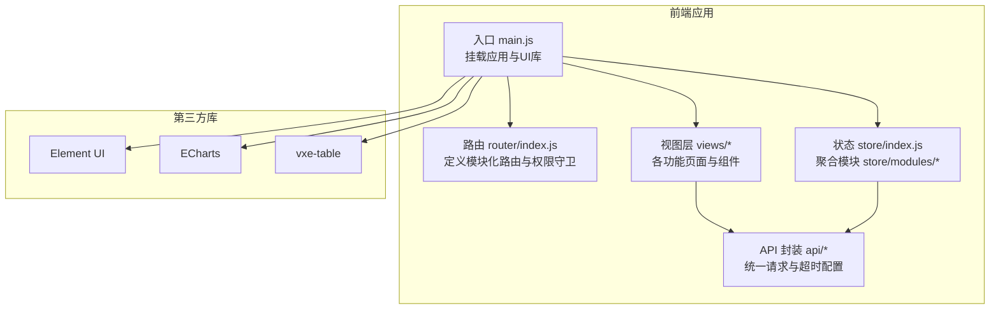
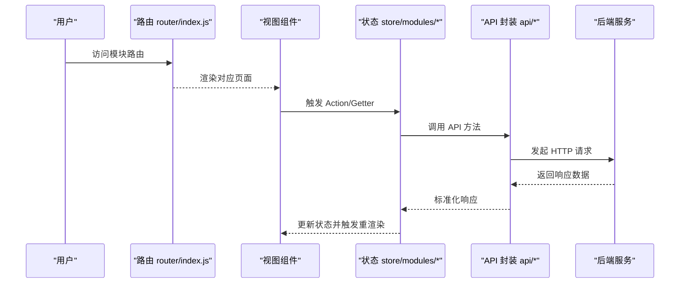
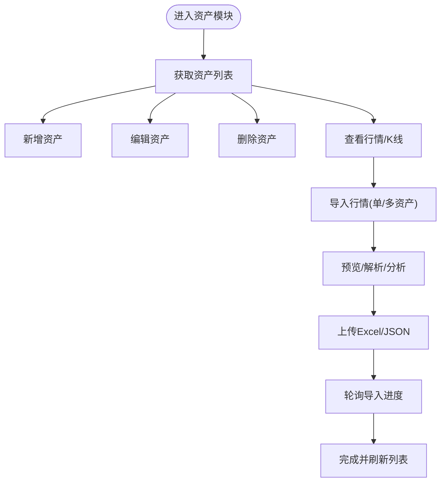
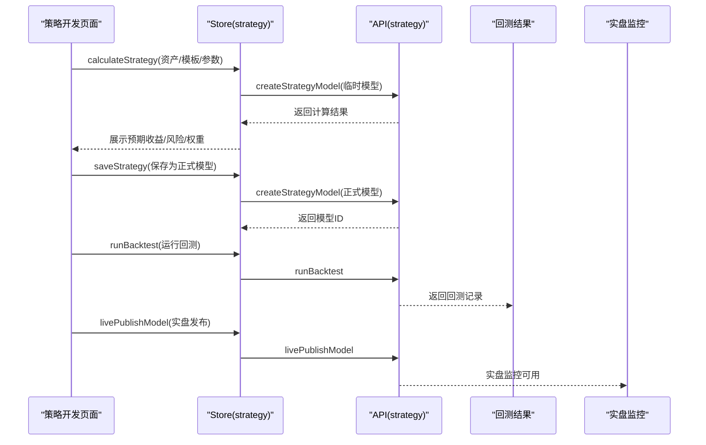
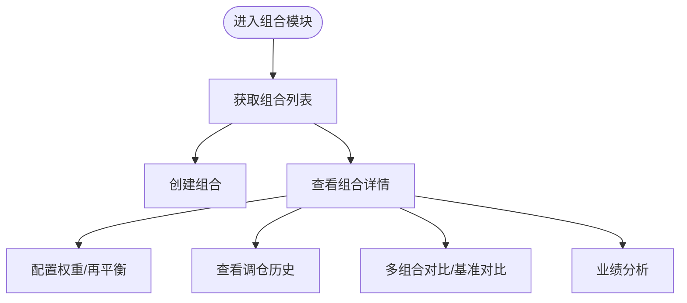
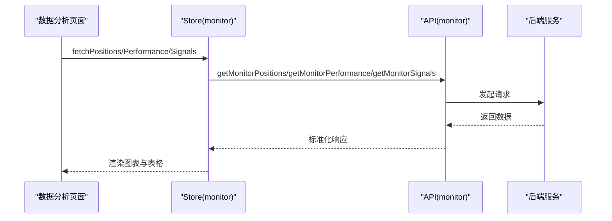
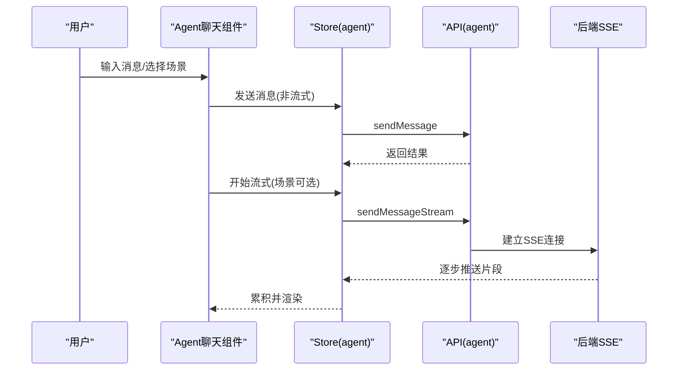
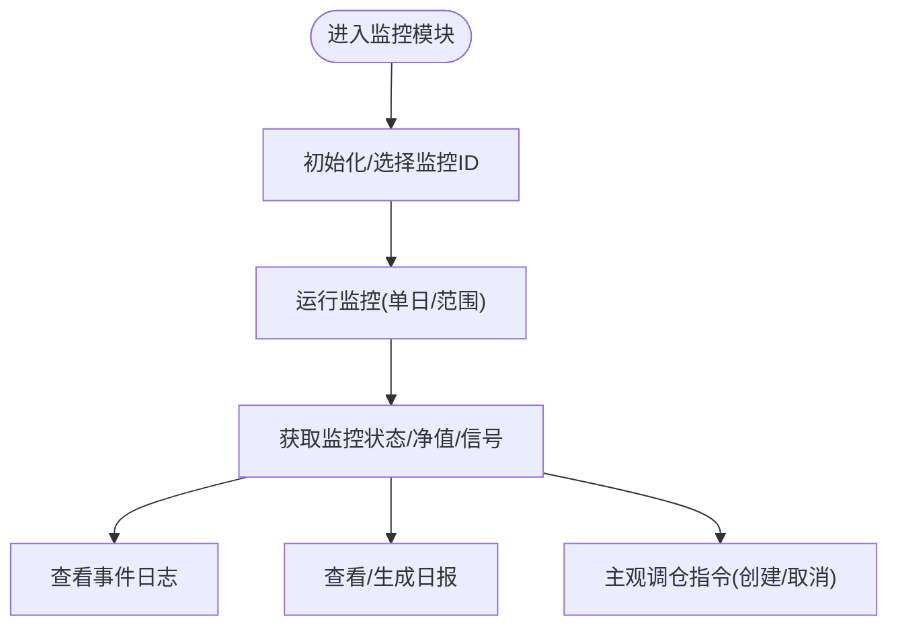
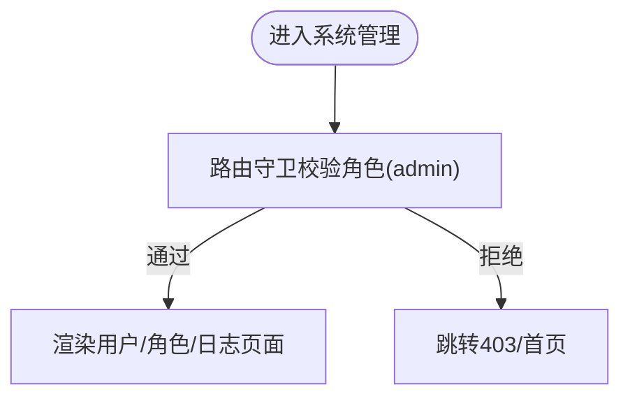
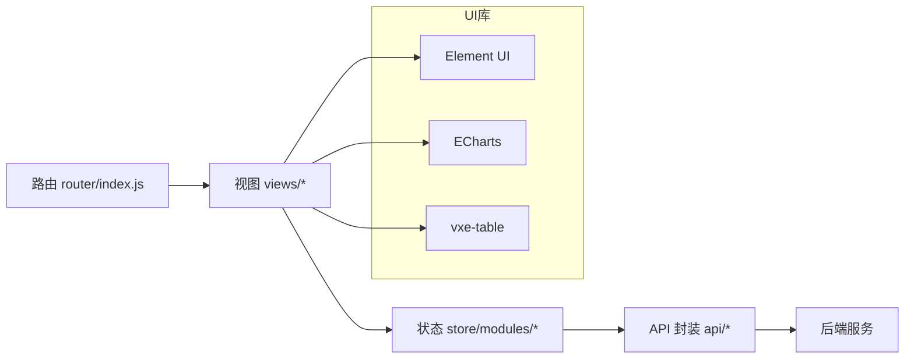

# 核心功能特性

<cite>
**本文引用的文件**
- [package.json](file://package.json)
- [README_NODE_VERSION.md](file://README_NODE_VERSION.md)
- [src/main.js](file://src/main.js)
- [src/router/index.js](file://src/router/index.js)
- [src/App.vue](file://src/App.vue)
- [src/api/asset.js](file://src/api/asset.js)
- [src/api/strategy.js](file://src/api/strategy.js)
- [src/api/portfolio.js](file://src/api/portfolio.js)
- [src/api/analysis.js](file://src/api/analysis.js)
- [src/api/agent.js](file://src/api/agent.js)
- [src/api/monitor.js](file://src/api/monitor.js)
- [src/store/index.js](file://src/store/index.js)
- [src/store/modules/asset.js](file://src/store/modules/asset.js)
- [src/store/modules/strategy.js](file://src/store/modules/strategy.js)
- [src/store/modules/portfolio.js](file://src/store/modules/portfolio.js)
- [src/store/modules/agent.js](file://src/store/modules/agent.js)
- [src/store/modules/monitor.js](file://src/store/modules/monitor.js)
</cite>

## 目录
1. [简介](#简介)
2. [项目结构](#项目结构)
3. [核心组件](#核心组件)
4. [架构总览](#架构总览)
5. [详细组件分析](#详细组件分析)
6. [依赖分析](#依赖分析)
7. [性能考虑](#性能考虑)
8. [故障排查指南](#故障排查指南)
9. [结论](#结论)
10. [附录](#附录)

## 简介
本文件面向投资组合管理系统（Portfilio）的核心功能特性，围绕八大模块进行系统化说明：资产管理、策略管理、组合管理、数据分析、AI智能助手、监控系统、系统管理。文档不仅阐述各模块的使用场景与核心价值，还深入解析前端API封装、Vuex状态管理与路由组织之间的协作关系及数据流转路径，帮助技术与非技术读者快速理解并高效使用系统。

## 项目结构
系统采用前后端分离的前端工程化架构，基于 Vue 2 + Vuex + Vue Router + Element UI + ECharts + vxe-table 技术栈构建。前端通过统一的 Axios 请求封装对接后端 API，路由负责页面导航与权限控制，Vuex 提供跨组件状态共享与持久化能力。

**图表来源**
- [src/main.js:1-31](file://src/main.js#L1-L31)
- [src/router/index.js:1-378](file://src/router/index.js#L1-L378)
- [src/store/index.js:1-44](file://src/store/index.js#L1-L44)

**章节来源**
- [package.json:1-45](file://package.json#L1-L45)
- [README_NODE_VERSION.md:1-73](file://README_NODE_VERSION.md#L1-L73)
- [src/main.js:1-31](file://src/main.js#L1-L31)
- [src/router/index.js:1-378](file://src/router/index.js#L1-L378)
- [src/App.vue:1-116](file://src/App.vue#L1-L116)

## 核心组件
- 路由与权限：通过路由元信息与全局前置守卫实现登录校验与角色过滤，确保受保护模块的安全访问。
- API 层：各模块 API 文件集中封装 HTTP 请求，统一处理超时、错误与响应格式，便于组件层解耦。
- 状态管理：Vuex 模块化管理资产、策略、组合、监控、AI 对话等状态，提供统一的读取、更新与派发机制。
- 视图与交互：Element UI、ECharts、vxe-table 提供丰富的表格、图表与表单能力，支撑数据密集型界面。

**章节来源**
- [src/router/index.js:351-375](file://src/router/index.js#L351-L375)
- [src/store/index.js:13-43](file://src/store/index.js#L13-L43)

## 架构总览
系统采用“路由驱动页面 + API 封装 + Vuex 状态”的三层协作模式。前端页面通过路由进入对应模块，调用 API 层发起请求，API 层经由 Axios 统一处理，最终由后端服务返回数据，写入 Vuex 模块状态，组件订阅状态并渲染视图。

**图表来源**
- [src/router/index.js:1-378](file://src/router/index.js#L1-L378)
- [src/store/modules/asset.js:47-94](file://src/store/modules/asset.js#L47-L94)
- [src/store/modules/strategy.js:71-84](file://src/store/modules/strategy.js#L71-L84)
- [src/store/modules/monitor.js:81-106](file://src/store/modules/monitor.js#L81-L106)
- [src/api/asset.js:7-21](file://src/api/asset.js#L7-L21)
- [src/api/strategy.js:7-13](file://src/api/strategy.js#L7-L13)
- [src/api/monitor.js:9-17](file://src/api/monitor.js#L9-L17)

## 详细组件分析

### 资产管理模块
- 功能要点
  - 资产增删改查：支持分页、筛选与激活状态管理。
  - 行情导入：支持单资产与多资产行情导入，提供模板下载与解析预览。
  - K线图表：按交易日历裁剪或全周期展示，支持区间缺失覆盖度查询。
- 使用场景
  - 新增/维护资产基础信息与属性。
  - 批量导入历史行情，保障回测与分析数据完整性。
  - 查看资产K线，辅助策略开发与组合配置。
- 实现方式
  - API 封装：资产列表、详情、创建、更新、删除；K线、模板下载、Excel 导入、JSON 导入、批量删除与覆盖度查询。
  - 状态管理：资产列表、总数、加载状态与选中集合。
  - 路由组织：资产库管理子路由，包含列表、新增、编辑、行情查看。
- 数据流转
  - 组件调用 Store 的资产 Action → API 封装 → 后端 → 写入 Store → 组件渲染。

**图表来源**
- [src/api/asset.js:7-284](file://src/api/asset.js#L7-L284)
- [src/store/modules/asset.js:47-158](file://src/store/modules/asset.js#L47-L158)
- [src/router/index.js:26-59](file://src/router/index.js#L26-L59)

**章节来源**
- [src/api/asset.js:7-284](file://src/api/asset.js#L7-L284)
- [src/store/modules/asset.js:1-183](file://src/store/modules/asset.js#L1-L183)
- [src/router/index.js:26-59](file://src/router/index.js#L26-L59)

### 策略管理模块
- 功能要点
  - 模板库：模板的增删改查与有效性校验。
  - 策略开发：基于模板创建策略模型，支持临时计算与保存。
  - 回测执行：按模型运行回测，支持备注更新与指标计算。
  - 实盘发布：支持实盘发布/取消、配置更新与监控数据获取。
- 使用场景
  - 快速复用策略模板，进行策略开发与参数优化。
  - 执行回测评估策略表现，输出对比分析。
  - 将策略实盘发布，纳入日常监控与人工干预。
- 实现方式
  - API 封装：模板 CRUD、策略模型 CRUD、回测运行、实盘发布/配置、监控数据、变更日志。
  - 状态管理：模板列表、策略模型列表、当前模板/模型、加载状态；提供计算与保存策略的 Action。
  - 路由组织：策略管理子路由，包含模板库、策略模型、回测执行、业绩基准等。
- 数据流转
  - 组件调用 Store 的策略 Action → API 封装 → 后端 → 写入 Store → 组件渲染与交互。

**图表来源**
- [src/store/modules/strategy.js:365-400](file://src/store/modules/strategy.js#L365-L400)
- [src/store/modules/strategy.js:176-185](file://src/store/modules/strategy.js#L176-L185)
- [src/store/modules/strategy.js:230-256](file://src/store/modules/strategy.js#L230-L256)
- [src/api/strategy.js:50-295](file://src/api/strategy.js#L50-L295)
- [src/router/index.js:60-122](file://src/router/index.js#L60-L122)

**章节来源**
- [src/store/modules/strategy.js:1-468](file://src/store/modules/strategy.js#L1-L468)
- [src/api/strategy.js:1-295](file://src/api/strategy.js#L1-L295)
- [src/router/index.js:60-122](file://src/router/index.js#L60-L122)

### 组合管理模块
- 功能要点
  - 组合创建：新建模拟组合，设定基础信息。
  - 权重配置：支持主观权重矩阵与再平衡设置。
  - 对比分析：多组合对比与基准对比。
  - 交易历史：查看调仓历史与交易记录。
- 使用场景
  - 构建模拟组合，进行权重初始化与再平衡。
  - 对比不同组合的收益与风险特征。
  - 追踪调仓历史，评估组合执行效果。
- 实现方式
  - API 封装：组合列表、详情、创建、删除、调仓记录、分析数据。
  - 状态管理：组合列表、当前组合、基准集合。
  - 路由组织：组合管理子路由，包含列表、创建、详情、再平衡、历史、业绩、基准、对比。
- 数据流转
  - 组件调用 Store 的组合 Action → API 封装 → 后端 → 写入 Store → 组件渲染。

**图表来源**
- [src/api/portfolio.js:7-72](file://src/api/portfolio.js#L7-L72)
- [src/store/modules/portfolio.js:38-87](file://src/store/modules/portfolio.js#L38-L87)
- [src/router/index.js:123-179](file://src/router/index.js#L123-L179)

**章节来源**
- [src/api/portfolio.js:1-72](file://src/api/portfolio.js#L1-L72)
- [src/store/modules/portfolio.js:1-106](file://src/store/modules/portfolio.js#L1-L106)
- [src/router/index.js:123-179](file://src/router/index.js#L123-L179)

### 数据分析模块
- 功能要点
  - 资产分析：指标、相关性矩阵、时间序列与仪表盘数据。
  - 大类资产指数：指数计算与可视化。
  - 日常监控：监控中心、信号、事件日志、净值与持仓。
  - 数据接入中心：多资产行情导入、权重与估值导入、汇率与日历管理、ZY 数据域管理。
- 使用场景
  - 基于指标与相关性矩阵进行资产配置决策。
  - 通过数据接入中心标准化导入各类市场数据。
  - 在监控中心实时掌握组合运行状态。
- 实现方式
  - API 封装：资产指标、相关性矩阵、时间序列、仪表盘；监控状态、净值、信号、事件、报告、主观调仓；数据导入与分析。
  - 状态管理：监控模块聚合净值、信号、事件、报告、主观指令等状态。
  - 路由组织：资产分析、大类资产指数、数据接入中心、ZY 数据域、日常监控等。
- 数据流转
  - 组件调用 Store 的监控 Action → API 封装 → 后端 → 写入 Store → 组件渲染。

**图表来源**
- [src/store/modules/monitor.js:81-190](file://src/store/modules/monitor.js#L81-L190)
- [src/api/monitor.js:46-73](file://src/api/monitor.js#L46-L73)
- [src/api/analysis.js:7-43](file://src/api/analysis.js#L7-L43)
- [src/router/index.js:180-246](file://src/router/index.js#L180-L246)

**章节来源**
- [src/store/modules/monitor.js:1-416](file://src/store/modules/monitor.js#L1-L416)
- [src/api/monitor.js:1-227](file://src/api/monitor.js#L1-L227)
- [src/api/analysis.js:1-43](file://src/api/analysis.js#L1-L43)
- [src/router/index.js:180-246](file://src/router/index.js#L180-L246)

### AI智能助手模块
- 功能要点
  - 对话式分析：支持流式与非流式对话，支持场景化对话与附件上传。
  - 报告生成：报告列表、详情、导出与删除。
  - 知识记忆：记忆列表、搜索与删除。
  - 分析模板：模板管理与执行。
- 使用场景
  - 通过自然语言进行资产分析与策略解读。
  - 生成并导出结构化报告，沉淀知识。
  - 基于模板快速执行分析任务。
- 实现方式
  - API 封装：对话、记忆、报告、分析模板、附件上传；流式对话使用原生 fetch + SSE。
  - 状态管理：对话列表、当前对话、消息列表、流式内容、场景映射。
  - 路由组织：智能对话、对话历史、知识记忆、报告中心、分析模板、场景管理。
- 数据流转
  - 组件调用 Store 的 Agent Action → API 封装（含流式）→ 后端 → 写入 Store → 组件渲染与流式拼接。

**图表来源**
- [src/store/modules/agent.js:84-213](file://src/store/modules/agent.js#L84-L213)
- [src/api/agent.js:3-168](file://src/api/agent.js#L3-L168)
- [src/router/index.js:276-333](file://src/router/index.js#L276-L333)

**章节来源**
- [src/store/modules/agent.js:1-230](file://src/store/modules/agent.js#L1-L230)
- [src/api/agent.js:1-168](file://src/api/agent.js#L1-L168)
- [src/router/index.js:276-333](file://src/router/index.js#L276-L333)

### 监控系统模块
- 功能要点
  - 实时监控：净值历史、信号状态、事件日志、持仓明细、绩效指标。
  - 信号预警：主动触发监控、范围运行、初始化。
  - 事件日志：按类型与数量限制查询。
  - 主观调仓：指令创建、取消与状态管理。
- 使用场景
  - 实时跟踪组合净值与风险信号，及时预警。
  - 通过主观调仓干预组合权重，满足特殊需求。
  - 生成日报并归档事件日志，形成可追溯的运营记录。
- 实现方式
  - API 封装：监控状态、净值、信号、事件、报告、主观指令；资产分析指标与相关性矩阵。
  - 状态管理：监控上下文、净值、信号、事件、报告、主观指令、资产指标与相关性矩阵。
  - 路由组织：监控中心、信号、事件日志、净值与持仓、主观调仓、日报等。
- 数据流转
  - 组件调用 Store 的 Monitor Action → API 封装 → 后端 → 写入 Store → 组件渲染。

**图表来源**
- [src/store/modules/monitor.js:253-302](file://src/store/modules/monitor.js#L253-L302)
- [src/store/modules/monitor.js:324-341](file://src/store/modules/monitor.js#L324-L341)
- [src/api/monitor.js:77-126](file://src/api/monitor.js#L77-L126)
- [src/router/index.js:242-246](file://src/router/index.js#L242-L246)

**章节来源**
- [src/store/modules/monitor.js:1-416](file://src/store/modules/monitor.js#L1-L416)
- [src/api/monitor.js:1-227](file://src/api/monitor.js#L1-L227)
- [src/router/index.js:242-246](file://src/router/index.js#L242-L246)

### 系统管理模块
- 功能要点
  - 用户管理：用户列表、角色分配与权限控制。
  - 角色管理：角色权限配置与访问控制。
  - 操作日志：系统操作审计与追踪。
- 使用场景
  - 管理员为团队成员分配角色与权限。
  - 审计系统操作，确保合规与安全。
- 实现方式
  - 路由组织：系统管理子路由，包含用户管理、角色管理、操作日志，均需 admin 角色访问。
  - 权限控制：全局路由守卫根据用户角色过滤菜单与页面。
- 数据流转
  - 管理员在系统管理页面进行操作，路由守卫拦截无权访问，确保安全边界。

**图表来源**
- [src/router/index.js:247-273](file://src/router/index.js#L247-L273)
- [src/router/index.js:364-371](file://src/router/index.js#L364-L371)

**章节来源**
- [src/router/index.js:247-273](file://src/router/index.js#L247-L273)
- [src/router/index.js:364-371](file://src/router/index.js#L364-L371)

## 依赖分析
- 前端依赖
  - Vue 2、Vue Router、Vuex：提供组件化与状态管理基础。
  - Element UI、vxe-table、ECharts：提供 UI 与可视化能力。
  - Axios：统一 HTTP 请求封装。
- 模块耦合
  - 路由与视图：强绑定，通过路由懒加载组织模块页面。
  - API 与状态：API 封装为 Store 提供数据源，Store 为组件提供状态。
  - 监控与数据分析：监控模块同时服务于日常监控与数据分析页面，存在跨模块数据复用。

**图表来源**
- [src/router/index.js:1-378](file://src/router/index.js#L1-L378)
- [src/store/index.js:13-22](file://src/store/index.js#L13-L22)
- [src/main.js:16-20](file://src/main.js#L16-L20)

**章节来源**
- [package.json:11-29](file://package.json#L11-L29)
- [src/store/index.js:1-44](file://src/store/index.js#L1-L44)
- [src/main.js:1-31](file://src/main.js#L1-L31)

## 性能考虑
- 超时与并发
  - 回测、初始化监控、多资产导入等计算密集或 IO 密集操作设置了较高超时阈值，避免误判失败。
- 批量与分页
  - 资产列表与监控事件采用分页加载，降低一次性渲染压力。
- 图表渲染
  - 使用 ECharts 渲染 K 线与相关性矩阵，建议在大数据量场景下启用采样或虚拟滚动。
- 状态更新
  - Store 中对消息列表采用去重合并策略，避免重复渲染与内存占用。

[本节为通用指导，无需列出具体文件来源]

## 故障排查指南
- 登录与权限
  - 若出现 401/403，检查路由守卫是否正确校验 token 与角色。
- 节点版本
  - 出现 node:url 相关错误时，升级 Node.js 至 16.x 或更高版本。
- 请求失败
  - 查看 API 封装中的超时设置与错误日志，确认后端服务可达性与接口返回格式。
- 监控未初始化
  - 监控状态/净值/信号等接口在未初始化时可能返回空数据，需先执行初始化或选择正确的监控 ID。

**章节来源**
- [src/router/index.js:351-375](file://src/router/index.js#L351-L375)
- [README_NODE_VERSION.md:1-73](file://README_NODE_VERSION.md#L1-L73)
- [src/api/monitor.js:9-17](file://src/api/monitor.js#L9-L17)

## 结论
Portfilio 通过清晰的模块划分与统一的前端架构，实现了从资产与策略到组合与监控的全链路闭环。API 封装与 Vuex 状态管理有效降低了组件耦合，路由守卫确保了访问安全。AI 智能助手进一步提升了分析效率与知识沉淀能力。建议在后续迭代中持续优化大数据量场景下的渲染性能，并完善异常与可观测性监控。

[本节为总结性内容，无需列出具体文件来源]

## 附录
- 关键路由与模块映射
  - 资产库管理：资产列表、新增、编辑、行情查看。
  - 策略管理：模板库、策略模型、回测执行、业绩基准。
  - 组合管理：列表、创建、详情、再平衡、历史、业绩、基准、对比。
  - 数据分析：资产分析、大类资产指数、数据接入中心、ZY 数据域、日常监控。
  - AI 智能助手：智能对话、对话历史、知识记忆、报告中心、分析模板、场景管理。
  - 系统管理：用户管理、角色管理、操作日志（admin 角色）。

**章节来源**
- [src/router/index.js:7-344](file://src/router/index.js#L7-L344)