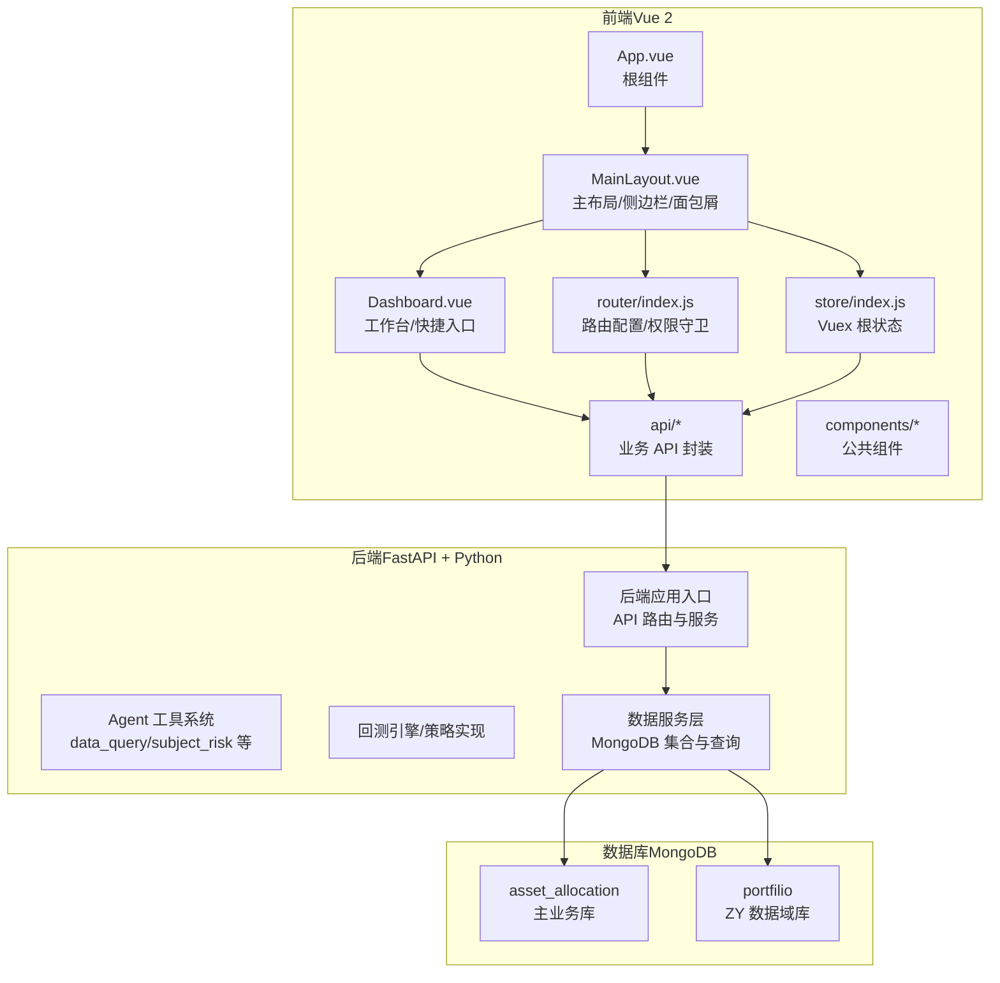
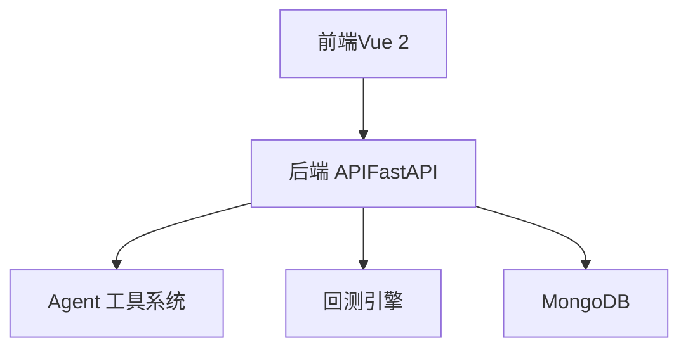
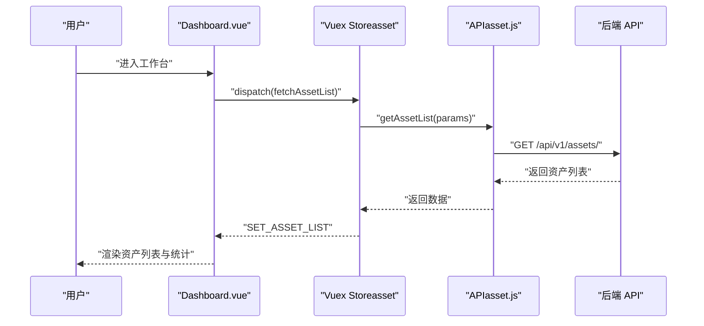
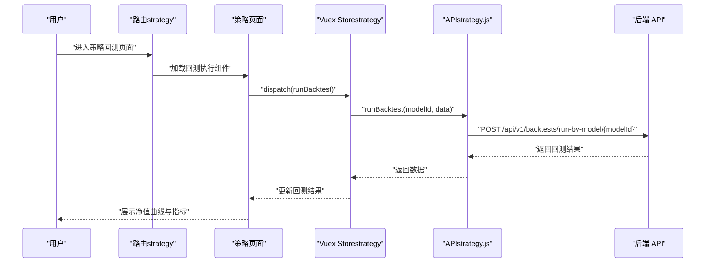
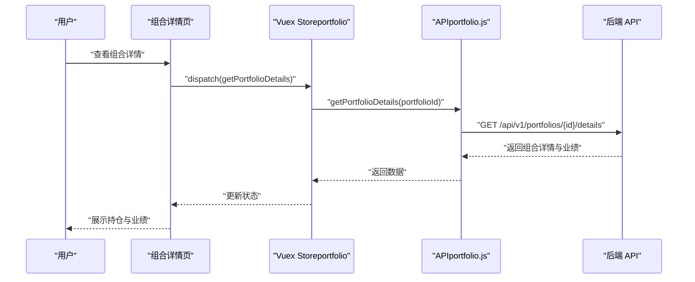
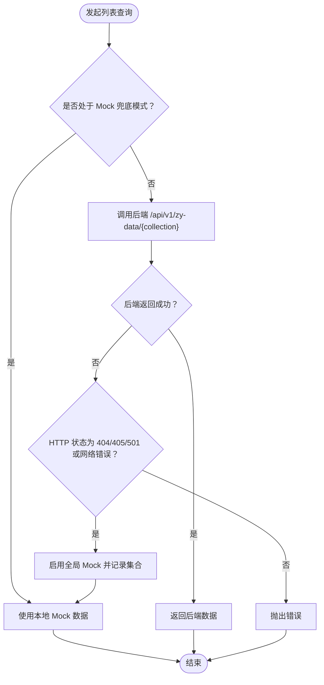
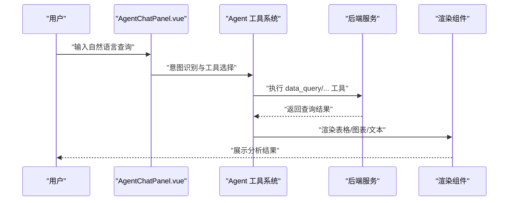
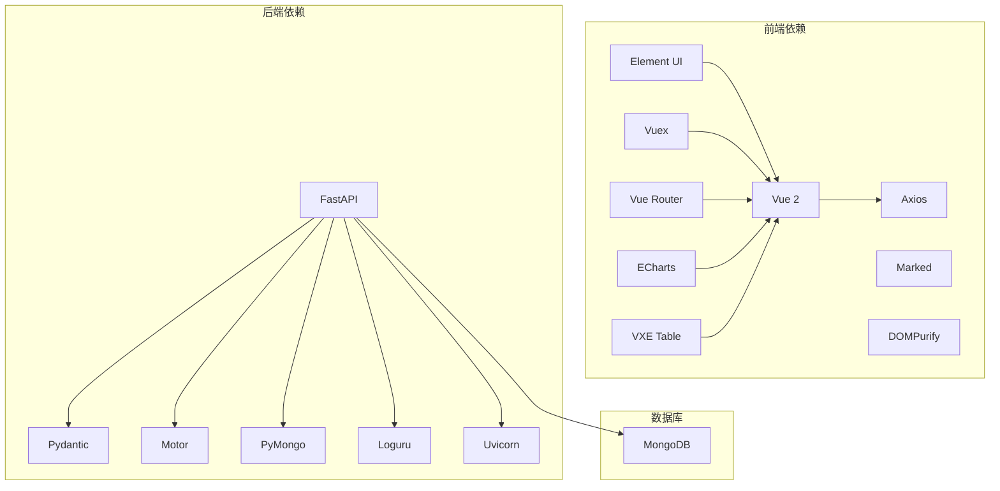

# 项目介绍

<cite>
**本文引用的文件**
- [package.json](file://package.json)
- [README_NODE_VERSION.md](file://README_NODE_VERSION.md)
- [CHANGELOG_0228_后变更记录.md](file://CHANGELOG_0228_后变更记录.md)
- [项目全景分析文档.md](file://项目全景分析文档.md)
- [src/main.js](file://src/main.js)
- [src/App.vue](file://src/App.vue)
- [src/router/index.js](file://src/router/index.js)
- [src/store/index.js](file://src/store/index.js)
- [src/views/Dashboard.vue](file://src/views/Dashboard.vue)
- [src/layout/MainLayout.vue](file://src/layout/MainLayout.vue)
- [src/api/asset.js](file://src/api/asset.js)
- [src/api/portfolio.js](file://src/api/portfolio.js)
- [src/api/strategy.js](file://src/api/strategy.js)
- [src/api/zyDataDomain.js](file://src/api/zyDataDomain.js)
- [src/store/modules/asset.js](file://src/store/modules/asset.js)
</cite>

## 目录
1. [简介](#简介)
2. [项目结构](#项目结构)
3. [核心组件](#核心组件)
4. [架构总览](#架构总览)
5. [详细组件分析](#详细组件分析)
6. [依赖分析](#依赖分析)
7. [性能考虑](#性能考虑)
8. [故障排查指南](#故障排查指南)
9. [结论](#结论)
10. [附录](#附录)

## 简介
智能投研系统（Portfolio Intelligence Platform，简称 Portfilio）是一个面向金融机构的投资组合管理、风险分析与智能决策支持平台。项目通过“前端 Vue 2 + 后端 FastAPI + MongoDB”的技术栈，提供资产管理、策略回测、组合优化、风险监控、智能对话（Agent）与数据接入中心等核心能力，帮助用户提升投资决策效率、降低管理成本、增强风险控制能力。

本项目旨在：
- 提供统一的资产与组合管理入口，支撑多资产类型（债券、股票、基金、指数等）的全生命周期管理；
- 提供策略回测与实盘监控能力，覆盖从模型开发、回测验证到实盘发布的全流程；
- 通过智能对话系统，实现自然语言驱动的数据查询与分析，降低分析门槛；
- 构建完善的 ZY 数据域管理能力，支持通用 CRUD 与 Mock 兜底，保障开发与演示体验；
- 依托多市场行情数据与风险域数据，提供风险监控与舆情预警能力。

## 项目结构
前端采用 Vue 2 + Element UI + Vuex + Vue Router，结合 ECharts、VXE Table 等组件库，形成清晰的页面与模块划分。路由与布局组件负责导航与权限控制，API 层封装后端接口，Store 模块负责状态管理。项目还提供了完整的开发与部署说明、Node.js 版本要求以及常见问题排查指引。

**图表来源**
- [src/App.vue:1-116](file://src/App.vue#L1-L116)
- [src/layout/MainLayout.vue:1-330](file://src/layout/MainLayout.vue#L1-L330)
- [src/views/Dashboard.vue:1-371](file://src/views/Dashboard.vue#L1-L371)
- [src/router/index.js:1-378](file://src/router/index.js#L1-L378)
- [src/store/index.js:1-44](file://src/store/index.js#L1-L44)
- [项目全景分析文档.md:416-486](file://项目全景分析文档.md#L416-L486)

**章节来源**
- [src/main.js:1-31](file://src/main.js#L1-L31)
- [src/App.vue:1-116](file://src/App.vue#L1-L116)
- [src/layout/MainLayout.vue:1-330](file://src/layout/MainLayout.vue#L1-L330)
- [src/router/index.js:1-378](file://src/router/index.js#L1-L378)
- [src/store/index.js:1-44](file://src/store/index.js#L1-L44)
- [项目全景分析文档.md:416-486](file://项目全景分析文档.md#L416-L486)

## 核心组件
- 资产管理模块：提供资产注册、行情导入、K线查询、批量导入与模板下载等功能，支持多资产类型与多市场数据接入。
- 策略管理模块：提供策略模型模板库、策略模型创建与维护、回测执行与结果分析、实盘发布与监控、业绩基准管理等。
- 组合管理模块：支持模拟组合创建、再平衡设置、调仓历史、业绩分析与多组合对比。
- 智能对话模块：基于 Agent 的自然语言查询与分析，支持 data_query、portfolio_analyze、strategy_backtest 等工具。
- 数据接入中心：提供数据资产与 ZY 数据域管理，支持通用 CRUD 与 Mock 兜底，保障开发与演示体验。
- 风险监控模块：提供日常监控、事件日志、信号与风险主题的查询与分析。

**章节来源**
- [src/api/asset.js:1-284](file://src/api/asset.js#L1-L284)
- [src/api/strategy.js:1-295](file://src/api/strategy.js#L1-L295)
- [src/api/portfolio.js:1-72](file://src/api/portfolio.js#L1-L72)
- [src/api/zyDataDomain.js:1-190](file://src/api/zyDataDomain.js#L1-L190)
- [项目全景分析文档.md:683-726](file://项目全景分析文档.md#L683-L726)

## 架构总览
系统采用前后端分离架构，前端通过 Axios 调用后端 API，后端提供 FastAPI 路由与服务，数据层使用 MongoDB。项目还提供了 Agent 工具系统与回测引擎，支撑策略开发与实盘监控。

**图表来源**
- [项目全景分析文档.md:21-44](file://项目全景分析文档.md#L21-L44)
- [项目全景分析文档.md:337-415](file://项目全景分析文档.md#L337-L415)

**章节来源**
- [项目全景分析文档.md:21-44](file://项目全景分析文档.md#L21-L44)
- [项目全景分析文档.md:337-415](file://项目全景分析文档.md#L337-L415)

## 详细组件分析

### 资产管理组件分析
资产管理模块提供资产全生命周期管理能力，包括资产列表、资产详情、资产创建与更新、删除、K线数据查询、批量行情导入与模板下载等。API 封装了资产相关的增删改查与行情导入接口，并支持多资产 Excel 导入与进度轮询。

**图表来源**
- [src/views/Dashboard.vue:160-256](file://src/views/Dashboard.vue#L160-L256)
- [src/store/modules/asset.js:47-94](file://src/store/modules/asset.js#L47-L94)
- [src/api/asset.js:7-21](file://src/api/asset.js#L7-L21)

**章节来源**
- [src/api/asset.js:1-284](file://src/api/asset.js#L1-L284)
- [src/store/modules/asset.js:1-183](file://src/store/modules/asset.js#L1-L183)
- [src/views/Dashboard.vue:1-371](file://src/views/Dashboard.vue#L1-L371)

### 策略管理组件分析
策略管理模块提供策略模型模板库、策略模型创建与维护、回测执行与结果分析、实盘发布与监控、业绩基准管理等。API 封装了策略模型的增删改查、回测执行、权重上限查询、实盘配置与监控等接口。

**图表来源**
- [src/router/index.js:60-122](file://src/router/index.js#L60-L122)
- [src/api/strategy.js:85-93](file://src/api/strategy.js#L85-L93)

**章节来源**
- [src/api/strategy.js:1-295](file://src/api/strategy.js#L1-L295)
- [src/router/index.js:1-378](file://src/router/index.js#L1-L378)

### 组合管理组件分析
组合管理模块提供模拟组合的创建、再平衡设置、调仓历史、业绩分析与多组合对比。API 封装了组合的增删改查、分析数据查询、调仓记录查询与详情获取等接口。

**图表来源**
- [src/api/portfolio.js:65-72](file://src/api/portfolio.js#L65-L72)

**章节来源**
- [src/api/portfolio.js:1-72](file://src/api/portfolio.js#L1-L72)

### ZY 数据域组件分析
ZY 数据域提供通用 CRUD 能力，支持优先调用后端接口，当后端返回 404/网络错误时自动降级到本地 Mock（localStorage）兜底，保障开发与演示体验。同时提供集合列表、计数、创建、更新、删除等接口。

**图表来源**
- [src/api/zyDataDomain.js:26-46](file://src/api/zyDataDomain.js#L26-L46)
- [src/api/zyDataDomain.js:69-96](file://src/api/zyDataDomain.js#L69-L96)

**章节来源**
- [src/api/zyDataDomain.js:1-190](file://src/api/zyDataDomain.js#L1-L190)

### 智能对话组件分析
智能对话模块通过 Agent 路由与工具系统，实现自然语言驱动的数据查询与分析。前端提供对话面板、表格与图表渲染组件，后端提供 data_query、portfolio_analyze、strategy_backtest 等工具。

**图表来源**
- [项目全景分析文档.md:337-415](file://项目全景分析文档.md#L337-L415)

**章节来源**
- [项目全景分析文档.md:337-415](file://项目全景分析文档.md#L337-L415)

## 依赖分析
前端依赖包括 Vue 2、Element UI、Vuex、Vue Router、ECharts、VXE Table、Axios、Marked、DOMPurify 等，构建工具为 Vue CLI + Webpack。后端依赖包括 FastAPI、Pydantic、Motor、PyMongo、Loguru、Uvicorn 等。数据库为 MongoDB，包含 asset_allocation 与 portfilio 两个库。

**图表来源**
- [package.json:11-29](file://package.json#L11-L29)
- [项目全景分析文档.md:48-84](file://项目全景分析文档.md#L48-L84)

**章节来源**
- [package.json:1-45](file://package.json#L1-L45)
- [项目全景分析文档.md:48-84](file://项目全景分析文档.md#L48-L84)

## 性能考虑
- 前端性能优化：使用 VXE Table 的虚拟滚动、ECharts 数据降采样、懒加载与代码分割，减少大数据量下的渲染压力。
- 后端性能优化：MongoDB 索引优化（如 AST_CD、BIZ_DT、PORT_ID）、分页查询限制（query ≤ 1000）、聚合查询限制结果集、查询超时控制。
- 缓存策略：localStorage 存储 Mock 数据、会话级数据上下文（DataContext），为后续实现 LRU 缓存提供基础。

**章节来源**
- [项目全景分析文档.md:627-643](file://项目全景分析文档.md#L627-L643)

## 故障排查指南
- 后端启动失败：检查 MongoDB 是否运行、环境变量配置是否正确、日志输出是否异常。
- 前端 API 404：确认后端服务已启动、Vue 代理配置正确、API 路由已注册。
- data_query 返回无数据：重启后端服务刷新集合注册表、检查 MongoDB 中是否存在数据、确认集合名已在元数据中注册。
- Mock 数据不更新：清除 localStorage 中的 ZY 数据域 Mock 数据并刷新页面。

**章节来源**
- [项目全景分析文档.md:728-760](file://项目全景分析文档.md#L728-L760)

## 结论
Portfilio 通过统一的前端界面与后端服务，构建了覆盖资产管理、策略回测、组合优化、风险监控与智能对话的完整投资研究平台。其模块化设计与通用 CRUD 能力，使得系统既能满足金融机构的日常运营需求，又能在开发与演示阶段保持高可用性。随着后续功能增强与技术优化（如实时行情、组合优化算法、Vue 3 升级、Redis 缓存与测试体系完善），系统将持续提升用户体验与业务价值。

## 附录
- 版本信息：当前前端版本为 1.0.0，基准版本 0228（2025-02-28），变更记录详见变更日志。
- 许可证信息：项目为私有仓库，未在 package.json 中声明公开许可证。
- 开发团队背景：项目文档与代码由内部团队维护，后端位于 portfilio-end 目录，前端位于 portfilio 目录，前后端联动开发与部署。
- Node.js 版本要求：推荐使用 Node.js 16.x 或更高版本，若低于 16.0.0 需按文档指引升级或降级依赖。

**章节来源**
- [CHANGELOG_0228_后变更记录.md:1-66](file://CHANGELOG_0228_后变更记录.md#L1-L66)
- [package.json:1-45](file://package.json#L1-L45)
- [README_NODE_VERSION.md:1-73](file://README_NODE_VERSION.md#L1-L73)
- [项目全景分析文档.md:1-800](file://项目全景分析文档.md#L1-L800)