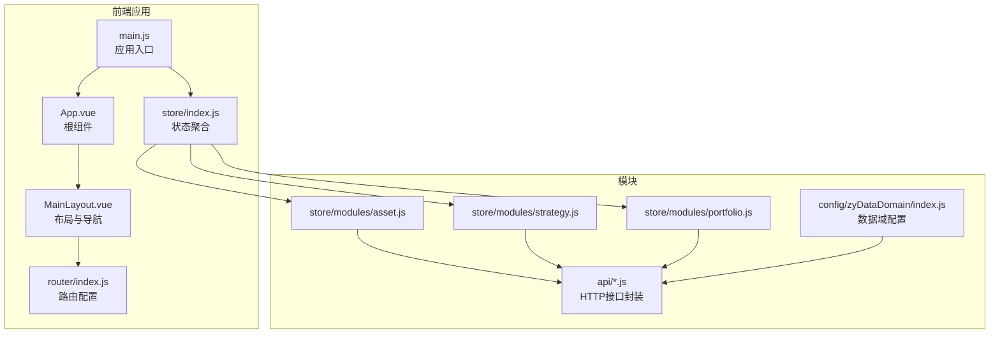
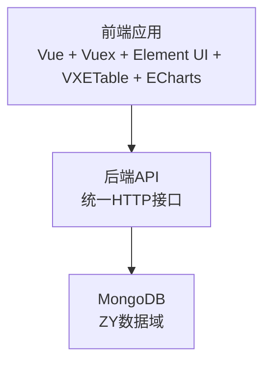
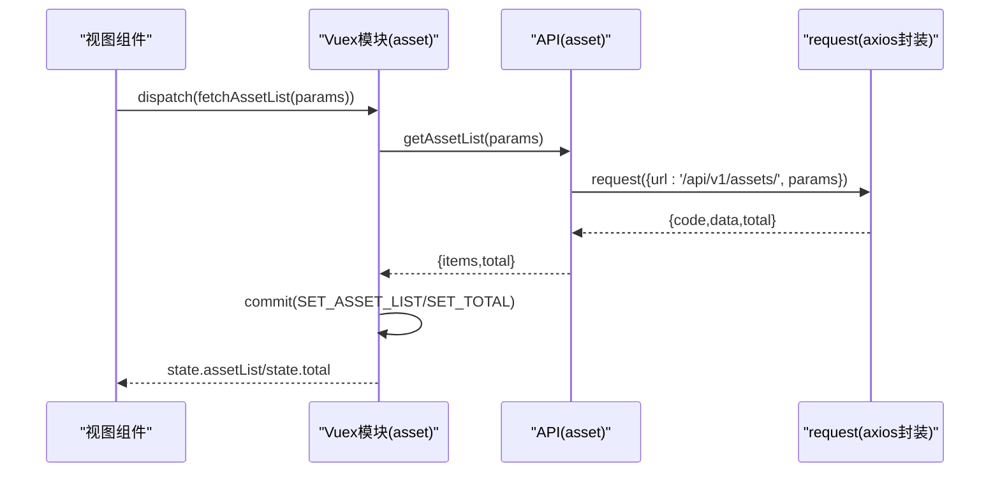
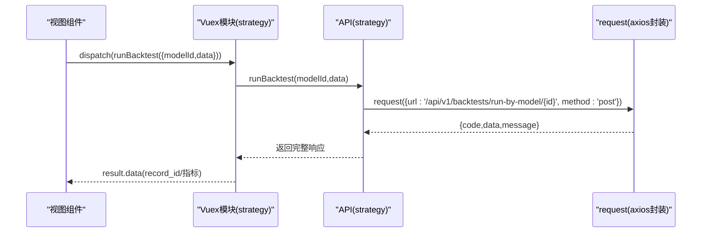
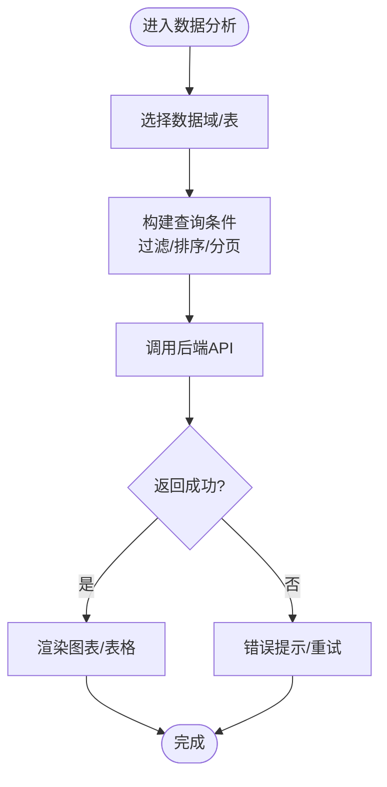
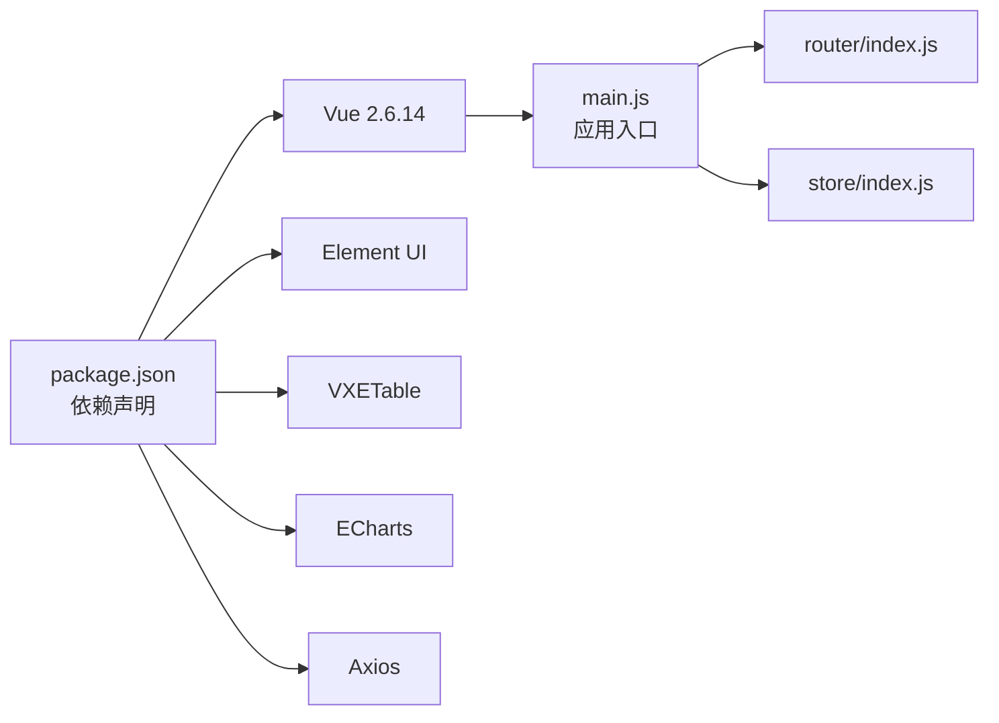

# 项目概述

<cite>
**本文档引用的文件**
- [package.json](file://package.json)
- [main.js](file://src/main.js)
- [App.vue](file://src/App.vue)
- [vue.config.js](file://vue.config.js)
- [README_NODE_VERSION.md](file://README_NODE_VERSION.md)
- [router/index.js](file://src/router/index.js)
- [store/index.js](file://src/store/index.js)
- [layout/MainLayout.vue](file://src/layout/MainLayout.vue)
- [store/modules/asset.js](file://src/store/modules/asset.js)
- [store/modules/strategy.js](file://src/store/modules/strategy.js)
- [store/modules/portfolio.js](file://src/store/modules/portfolio.js)
- [api/asset.js](file://src/api/asset.js)
- [api/strategy.js](file://src/api/strategy.js)
- [config/zyDataDomain/index.js](file://src/config/zyDataDomain/index.js)
- [docs/MongoDB_ZY数据域表结构清单.md](file://docs/MongoDB_ZY数据域表结构清单.md)
- [mongo-seed/README.md](file://mongo-seed/README.md)
- [utils/request.js](file://src/utils/request.js)
</cite>

## 目录
1. [简介](#简介)
2. [项目结构](#项目结构)
3. [核心组件](#核心组件)
4. [架构总览](#架构总览)
5. [详细组件分析](#详细组件分析)
6. [依赖关系分析](#依赖关系分析)
7. [性能考虑](#性能考虑)
8. [故障排查指南](#故障排查指南)
9. [结论](#结论)
10. [附录](#附录)

## 简介
投资组合管理系统（Portfilio）是一个面向投研与组合管理的前端应用，采用 Vue.js 2.6.14 + Element UI + VXETable + ECharts 技术栈构建。系统围绕“资产管理、策略管理、组合管理、数据分析、AI智能助手、监控系统”六大核心模块展开，提供从资产行情导入、策略回测与实盘发布、组合构建与再平衡、到数据接入与风险监控的全链路能力。

系统采用 MVVM + Flux 的架构范式：Vue 负责视图层（MVVM），Vuex 负责状态管理（Flux），API 层封装 HTTP 请求与错误处理，MongoDB 作为数据域存储（ZY 数据域），并通过后端 API 提供统一的数据访问与业务编排。

## 项目结构
项目采用“路由驱动 + 模块化状态管理”的组织方式，核心目录与职责如下：
- src/api：封装各业务模块的 HTTP 接口，统一通过 axios 封装的 request 工具发起请求
- src/store/modules：按领域拆分状态模块（asset、strategy、portfolio、monitor、agent 等）
- src/views：按模块划分的页面视图，配合路由实现页面级组件
- src/components：可复用的通用组件（图表、对话、表格、导入面板等）
- src/config：数据域配置（ZY 数据域 schema 聚合与工具函数）
- public：静态资源与入口 HTML
- scripts/docs/offline：辅助脚本与离线安装/集成指南

**图表来源**
- [App.vue:1-116](file://src/App.vue#L1-L116)
- [MainLayout.vue:1-330](file://src/layout/MainLayout.vue#L1-L330)
- [router/index.js:1-378](file://src/router/index.js#L1-L378)
- [store/index.js:1-44](file://src/store/index.js#L1-L44)
- [main.js:1-31](file://src/main.js#L1-L31)

**章节来源**
- [package.json:1-45](file://package.json#L1-L45)
- [vue.config.js:1-17](file://vue.config.js#L1-L17)
- [README_NODE_VERSION.md:1-73](file://README_NODE_VERSION.md#L1-L73)

## 核心组件
- 路由与导航：基于 Vue Router 的 hash 模式，支持面包屑、动态菜单与权限控制
- 状态管理：Vuex 模块化，集中管理 loading、collapsed 等全局状态及各模块数据
- 组件生态：Element UI + VXETable（增强表格）+ ECharts（可视化）+ 虚拟滚动（提升大数据表格性能）
- 数据域：ZY 数据域（MongoDB）提供 82 张表的统一 schema 与工具函数，支撑数据分析与数据接入中心

**章节来源**
- [router/index.js:1-378](file://src/router/index.js#L1-L378)
- [store/index.js:1-44](file://src/store/index.js#L1-L44)
- [layout/MainLayout.vue:1-330](file://src/layout/MainLayout.vue#L1-L330)
- [config/zyDataDomain/index.js:1-80](file://src/config/zyDataDomain/index.js#L1-L80)

## 架构总览
系统采用 MVVM + Flux 的分层架构：
- 视图层（MVVM）：Vue 组件负责渲染与交互
- 状态层（Flux）：Vuex Store 管理模块状态与动作
- 服务层（API）：Axios 封装统一请求与错误处理
- 数据层（MongoDB）：ZY 数据域 schema 与索引策略，提供结构化数据支撑

**图表来源**
- [main.js:1-31](file://src/main.js#L1-L31)
- [utils/request.js:1-100](file://src/utils/request.js#L1-L100)
- [docs/MongoDB_ZY数据域表结构清单.md:1-379](file://docs/MongoDB_ZY数据域表结构清单.md#L1-L379)

## 详细组件分析

### 资产管理模块
- 功能要点：资产列表、新增/编辑、行情导入（Excel/JSON）、K线查询、价格覆盖率检查、批量删除等
- 数据流：Store 调用 API -> 后端返回标准化数据 -> Store 更新本地状态 -> 视图渲染
- 关键接口：资产列表、资产选项、创建/更新/删除、K线、价格导入、覆盖率缺口

**图表来源**
- [store/modules/asset.js:1-183](file://src/store/modules/asset.js#L1-L183)
- [api/asset.js:1-284](file://src/api/asset.js#L1-L284)
- [utils/request.js:1-100](file://src/utils/request.js#L1-L100)

**章节来源**
- [store/modules/asset.js:1-183](file://src/store/modules/asset.js#L1-L183)
- [api/asset.js:1-284](file://src/api/asset.js#L1-L284)

### 策略管理模块
- 功能要点：模板库、策略模型、回测执行、发布/实盘发布、实时监控、配置管理、手动调仓确认
- 数据流：Store 调用 API -> 后端返回 {code,data,message} -> 组件统一从 result.data 取 payload（如 record_id）

**图表来源**
- [store/modules/strategy.js:1-468](file://src/store/modules/strategy.js#L1-L468)
- [api/strategy.js:1-295](file://src/api/strategy.js#L1-L295)
- [utils/request.js:1-100](file://src/utils/request.js#L1-L100)

**章节来源**
- [store/modules/strategy.js:1-468](file://src/store/modules/strategy.js#L1-L468)
- [api/strategy.js:1-295](file://src/api/strategy.js#L1-L295)

### 组合管理模块
- 功能要点：组合列表、创建、详情、再平衡、历史、业绩分析、基准对比、多组合对比
- 数据流：Store 调用 API -> 后端返回组合数据 -> Store 更新列表/当前组合 -> 视图渲染

**章节来源**
- [store/modules/portfolio.js:1-106](file://src/store/modules/portfolio.js#L1-L106)

### 数据分析与数据域
- 数据域配置：聚合 9 大域（资产、主体、产品、估值、交易、销售、客户、风险、行情），提供 findDomain/findTable/flatTables/domainSummary 等工具
- MongoDB 表结构：82 张表，统一审计字段与索引策略，支持跨表关联与快照查询

**图表来源**
- [config/zyDataDomain/index.js:1-80](file://src/config/zyDataDomain/index.js#L1-L80)
- [docs/MongoDB_ZY数据域表结构清单.md:1-379](file://docs/MongoDB_ZY数据域表结构清单.md#L1-L379)

**章节来源**
- [config/zyDataDomain/index.js:1-80](file://src/config/zyDataDomain/index.js#L1-L80)
- [docs/MongoDB_ZY数据域表结构清单.md:1-379](file://docs/MongoDB_ZY数据域表结构清单.md#L1-L379)
- [mongo-seed/README.md:1-125](file://mongo-seed/README.md#L1-L125)

### AI智能助手与监控系统
- AI助手：提供智能对话、场景管理、报告中心、分析模板、数据模板与知识记忆管理
- 监控系统：日常监控、事件日志、实时发布记录、信号与头寸管理、主观权重快照与覆盖

**章节来源**
- [router/index.js:276-333](file://src/router/index.js#L276-L333)
- [router/index.js:242-246](file://src/router/index.js#L242-L246)

## 依赖关系分析
- 技术栈选择
  - Vue.js 2.6.14：稳定生态与组件化开发
  - Element UI：成熟 UI 组件库，适配后台管理系统
  - VXETable：高性能表格，支持虚拟滚动与复杂交互
  - ECharts：专业可视化，满足金融图表需求
  - Axios：统一请求封装与错误处理
- 构建与运行
  - Node.js 版本要求：>= 16（或 >= 14.18.0），推荐使用 nvm 管理版本
  - Webpack 别名：tslib 指向本地 node_modules，避免依赖冲突

**图表来源**
- [package.json:1-45](file://package.json#L1-L45)
- [main.js:1-31](file://src/main.js#L1-L31)
- [router/index.js:1-378](file://src/router/index.js#L1-L378)
- [store/index.js:1-44](file://src/store/index.js#L1-L44)

**章节来源**
- [package.json:1-45](file://package.json#L1-L45)
- [README_NODE_VERSION.md:1-73](file://README_NODE_VERSION.md#L1-L73)
- [vue.config.js:1-17](file://vue.config.js#L1-L17)

## 性能考虑
- 大数据表格：VXETable + 虚拟滚动，降低 DOM 压力
- 图表渲染：ECharts 按需加载与懒渲染，避免一次性渲染过多图表
- 请求超时：统一 60s 超时，策略类接口放宽至 5 分钟以上，保障长耗时任务
- 缓存与分页：后端返回分页数据，前端仅缓存必要字段，减少内存占用
- 路由懒加载：路由组件按需加载，缩短首屏加载时间

## 故障排查指南
- 节点版本问题：若出现 node:url 相关错误，升级 Node.js 至 16.x 或更高版本
- 请求超时/网络异常：检查后端服务是否启动、网络连通性、VUE_APP_BASE_URL 配置
- 401/403/404：根据响应状态进行登出、权限提示或资源不存在提示
- MongoDB 数据域：使用 mongo-seed 脚本或 Python 导入脚本初始化数据，核对索引与审计字段

**章节来源**
- [README_NODE_VERSION.md:1-73](file://README_NODE_VERSION.md#L1-L73)
- [utils/request.js:1-100](file://src/utils/request.js#L1-L100)
- [mongo-seed/README.md:1-125](file://mongo-seed/README.md#L1-L125)
- [docs/MongoDB_ZY数据域表结构清单.md:1-379](file://docs/MongoDB_ZY数据域表结构清单.md#L1-L379)

## 结论
Portfilio 以清晰的模块划分与稳定的前端技术栈，构建了覆盖资产管理、策略管理、组合管理、数据分析、AI助手与监控的完整投研体系。通过 VXETable 与 ECharts 的高效渲染、Vuex 的模块化状态管理、以及 ZY 数据域的结构化数据支撑，系统在易用性与可扩展性之间取得良好平衡。建议后续持续完善后端接口文档与自动化测试，进一步提升开发效率与系统稳定性。

## 附录
- 开发与运行
  - 使用 npm 脚本 dev/build/lint，postinstall 自动应用 vxe-table 滚动修复与 tslib 确保
- 数据导入
  - 支持 mongo-seed 脚本与 Python 导入脚本，一键初始化 82 张表与索引
- 在线/离线部署
  - 提供离线安装与合并指南，便于无外网环境部署

**章节来源**
- [package.json:5-10](file://package.json#L5-L10)
- [mongo-seed/README.md:1-125](file://mongo-seed/README.md#L1-L125)
- [docs/MongoDB_ZY数据域表结构清单.md:327-379](file://docs/MongoDB_ZY数据域表结构清单.md#L327-L379)