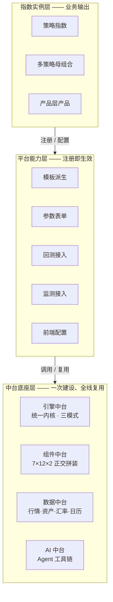

```mermaid
flowchart LR
    subgraph RD["① 研发"]
        R1["因子研究"]
        R2["策略原型"]
        R3["回测验证"]
        R4["参数优选"]
    end
    subgraph BD["② 构建"]
        B1["三支柱拼装"]
        B2["模板注册"]
        B3["Schema 参数"]
        B4["组合封装（母组合/产品层）"]
    end
    subgraph OP["③ 运营"]
        O1["发布上线"]
        O2["模拟交易"]
        O3["再平衡执行"]
        O4["业绩跟踪"]
    end
    subgraph DM["④ 日常管理"]
        D1["日级监控"]
        D2["信号检测"]
        D3["波动率控制"]
        D4["日报 + Agent"]
    end

    RD -->|"验证通过"| BD
    BD -->|"配置实例化"| OP
    OP -->|"转入常态"| DM
    DM -.->|"信号回流 · 参数迭代"| RD
```

# 两页PPT：通过本系统管理指数全生命周期

> 主题：怎么通过这个系统管理指数的**研发、构建、运营、日常管理**。
> 关键词：**全链路 · 端到端 · 平台化 · 中台化**。
> 版式纪律：图表优先——每页一张核心大图占版面约 70%，一句导语，要点不超过 4 条；细节留给口播，不上版面。

## 页面分工总览

| 页 | 关键词 | 回答的问题 | 核心图形 |
|---|---|---|---|
| P1 | 全链路 × 端到端 | 系统如何管住一个指数的一生 | 横向四段流水线 + 闭环回流 + 同源引擎带 |
| P2 | 平台化 × 中台化 | 系统凭什么支撑任意多个指数 | 三层能力底座（实例层 / 平台层 / 中台层） |

---

## 第一页：全链路 × 端到端

### 页面文案（可直接上版面）

- **主标题**：一个指数的一生：一条流水线管到底
- **关键词徽章**：〔全链路〕〔端到端〕
- **导语（一句话）**：研发 → 构建 → 运营 → 日常管理，四阶段在同一系统内流转——无断点、无翻译损耗。

### 版式布局（16:9）

```
┌────────────────────────────────────────────────────────────────┐
│ 标题区（约 12%）                                                 │
│ 主标题：一个指数的一生：一条流水线管到底      〔全链路〕〔端到端〕   │
│ 导 语：研发→构建→运营→日常管理，同一系统内流转，无断点、无翻译损耗    │
├────────────────────────────────────────────────────────────────┤
│ 核心图区（约 65%）：横向四段流水线 + 闭环回流 + 同源引擎带          │
│                                                                │
│  ┌───────────┐   ┌───────────┐   ┌───────────┐   ┌───────────┐ │
│  │ ① 研发     │ → │ ② 构建     │ → │ ③ 运营     │ → │ ④ 日常管理 │ │
│  ├───────────┤   ├───────────┤   ├───────────┤   ├───────────┤ │
│  │ 因子研究   │   │ 三支柱拼装  │   │ 发布上线   │   │ 日级监控   │ │
│  │ 策略原型   │   │ 模板注册   │   │ 模拟交易   │   │ 信号检测   │ │
│  │ 回测验证   │   │ Schema参数 │   │ 再平衡执行 │   │ 波动率控制 │ │
│  │ 参数优选   │   │ 组合封装   │   │ 业绩跟踪   │   │ 日报+Agent│ │
│  └───────────┘   └───────────┘   └───────────┘   └───────────┘ │
│        ↑                                                │       │
│        └────────── 信号回流 · 参数迭代 · 指数进化 ───────────┘       │
│  ═════════════════════════════════════════════════════════    │
│  ⚙ 同源引擎带：BacktestEngine 统一内核                            │
│     回测 = 日常监控 = 模拟交易 · 口径永不分叉                      │
├────────────────────────────────────────────────────────────────┤
│ 要点条（约 15%，每条一行）                                        │
│ ● 全链路·无断点 —— 四阶段 16 项能力一站覆盖，指数不出系统           │
│ ● 端到端·零翻译 —— 研究员原型即生产模板，同一套三支柱语言           │
│ ● 端到端·口径一致 —— 三种运行模式共用同一内核，研究结论即实控行为     │
└────────────────────────────────────────────────────────────────┘
```

### 核心图表（Mermaid，可直接截图入PPT）



### 口播提示（备注页，不上版面）

- 这条流水线上任何一环都不需要切换工具：原型在系统里写、回测在系统里跑、指数在系统里配置、监控在系统里跑。
- 引擎带是关键：多数平台"回测一套逻辑、实盘另一套逻辑"，本系统回测、日常监控、模拟交易三种模式共用同一个 BacktestEngine 内核。
- 虚线回流：日常监控的信号回流到研发环节，参数调整后重走"验证→发布"，指数持续进化。

---

## 第二页：平台化 × 中台化

### 页面文案（可直接上版面）

- **主标题**：指数是配置出来的，不是重复开发出来的
- **关键词徽章**：〔平台化〕〔中台化〕
- **导语（一句话）**：上层指数实例千变万化，底层能力一次建设、全线复用——新增指数，不新增系统。

### 版式布局（16:9）

```
┌────────────────────────────────────────────────────────────────┐
│ 标题区（约 12%）                                                 │
│ 主标题：指数是配置出来的，不是重复开发出来的   〔平台化〕〔中台化〕   │
│ 导 语：上层实例千变万化，底层能力一次建设、全线复用                  │
├────────────────────────────────────────────────────────────────┤
│ 核心图区（约 68%）：三层能力底座（上窄下宽）                        │
│                                                                │
│           ┌──────────────────────────────────────┐             │
│           │ 指数实例层（业务输出）                   │             │
│           │ 策略指数 · 多策略母组合 · 产品层产品      │             │
│           └──────────────────△───────────────────┘             │
│                 一行注册，处处派生（注册 / 配置 ↓）                │
│           ┌──────────────────┴───────────────────┐             │
│           │ 平台能力层（注册即生效）                 │             │
│           │ 模板派生 · 参数表单 · 回测接入 ·          │             │
│           │ 监测接入 · 前端配置                     │             │
│           └──────────────────△───────────────────┘             │
│                        能力复用（调用 ↓）                         │
│  ┌──────────────┬──────────────┬──────────────┬──────────────┐ │
│  │ 引擎中台       │ 组件中台       │ 数据中台      │ AI 中台        │ │
│  │──────────────│──────────────│──────────────│──────────────│ │
│  │ 统一内核       │ 7 选择器      │ 行情 · 资产   │ Agent 工具链  │ │
│  │ 回测/监控/     │ 12 配置模型   │ 汇率 · 日历   │ 监控查询      │ │
│  │ 模拟交易       │ 2 控制器      │ 数据资产盘点  │ 研究助手      │ │
│  └──────────────┴──────────────┴──────────────┴──────────────┘ │
├────────────────────────────────────────────────────────────────┤
│ 要点条（约 15%，每条一行）                                        │
│ ● 平台化·注册即生效 —— 登记一行，模板/表单/回测/监测全自动派生       │
│ ● 平台化·Schema 治理 —— 参数可审计、可版本化，界面自动渲染          │
│ ● 中台化·引擎与组件 —— 统一内核三模式复用；7×12×2 正交拼装          │
│ ● 中台化·数据与 AI —— 数据单源供给；Agent 贯穿研究与运营            │
└────────────────────────────────────────────────────────────────┘
```

### 核心图表（Mermaid，可直接截图入PPT）



### 口播提示（备注页，不上版面）

- 平台化的检验标准：新增第 22 个策略单元，系统代码要不要改？答案是不需要——注册即生效。
- 中台化的检验标准：回测、监控、模拟交易三条线同时在工作，用的是同一个内核、同一份数据、同一套组件。
- 21 个策略单元按三支柱正交拆解，任何新想法只要能归入某一环，就能与既有组件拼装成新指数——新指数是新组合，不是新代码。

---

## 与现有汇报材料的关系

- 本两页是"系统如何管理指数"的**总纲页**；《策略库介绍_金融工程视角》为策略库能力**细页**（三支柱 + 理论族谱），按需追加在其后。
- 全部表述均有系统实现支撑：统一内核三模式复用（`app/backtesting/engine.py`）、注册即生效（STRATEGY_MANIFEST 注册表）、监控日级步进与日报（`app/monitor`）、Agent 工具链（`app/agent`）。
