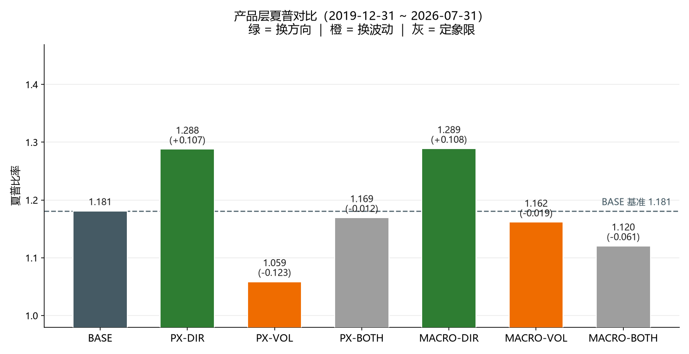
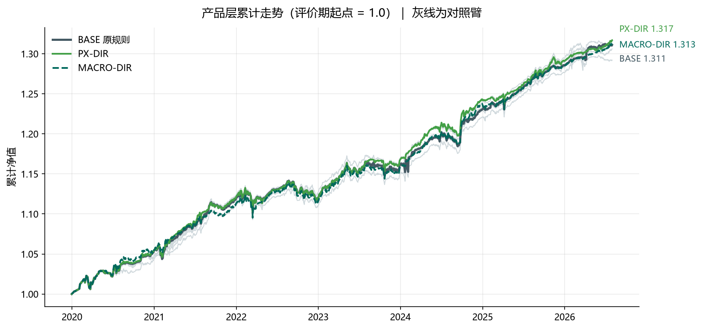
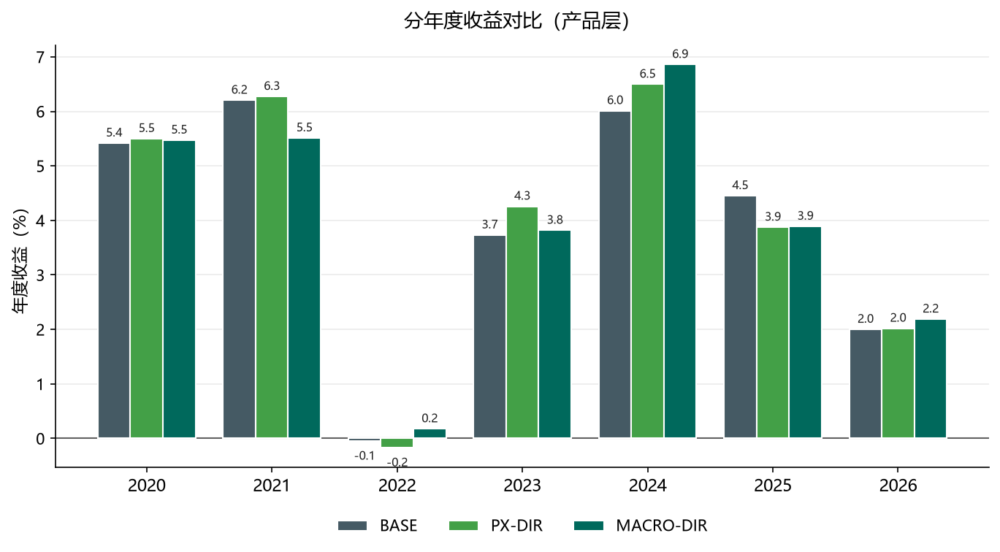
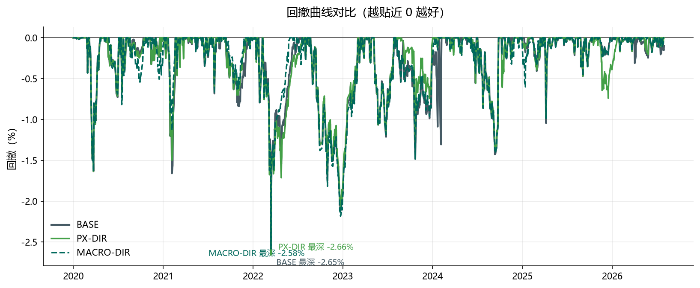
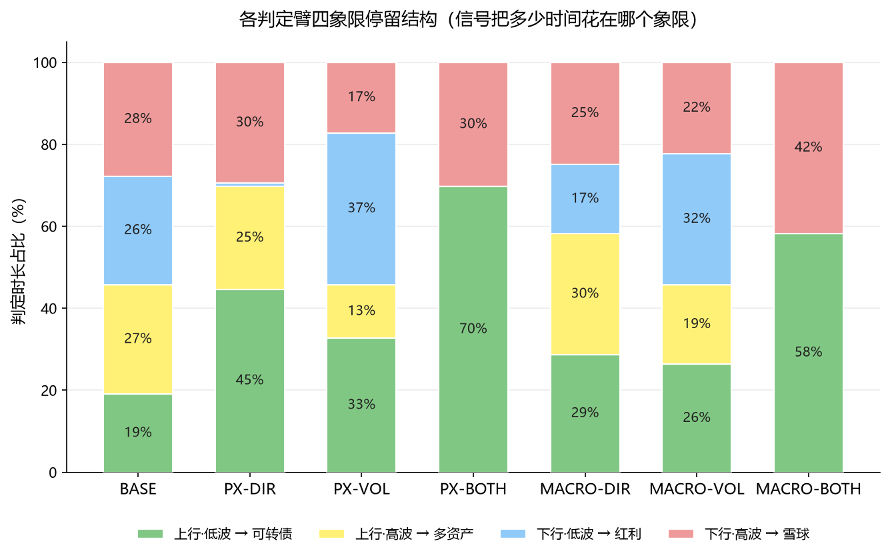
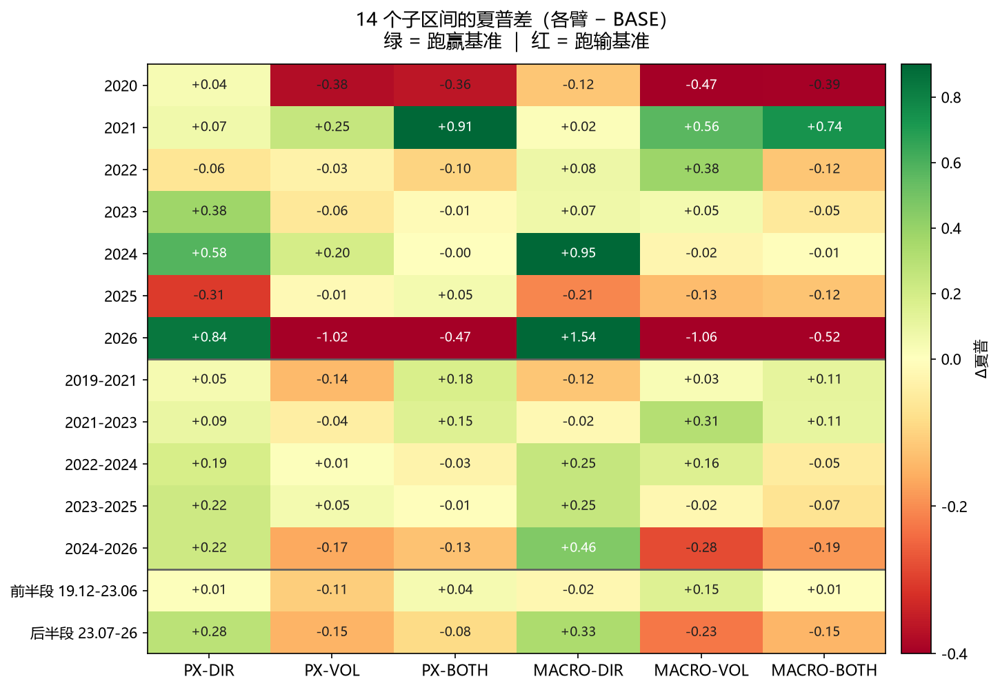

# 四象限判定方式对比实验报告——宏观 HMM 判定 vs 原规则

> **评价期**：2019-12-31 ~ 2026-07-31（约 6.3 年交易口径 / 6.6 年自然口径）｜ **版本**：v3.1 ｜ **日期**：2026-10-08
> **上游实验**：任务 A（四象限×HMM 增益）、任务 B（HMM 宏观机制体系）｜ **配图**：`images/` 下 6 张（本文内嵌）

---

## 一、一页速览

**一句话结论**：四象限策略的"方向判定"改用 HMM 机制识别后，产品层夏普从 **1.181 → 1.289**（+0.108），同时波动、回撤、Calmar 全面改善；"波动判定"换 HMM 没有效果（-0.019）；两个一起换反而变差（-0.061）。

**核心结果**（产品层，评价期 2019-12-31 ~ 2026-07-31）：

| 判定臂 | 年化 | 波动 | 夏普 | 最大回撤 | Calmar | vs BASE |
|---|---|---|---|---|---|---|
| BASE 原规则 | 4.37% | 2.01% | 1.181 | -2.65% | 1.650 | — |
| **PX-DIR 换方向** | 4.45% | 1.90% | **1.288** | -2.66% | 1.673 | **+0.107** |
| PX-VOL 换波动 | 4.13% | 2.02% | 1.059 | -2.65% | 1.560 | -0.122 |
| PX-BOTH 定象限 | 4.40% | 2.05% | 1.169 | -2.66% | 1.653 | -0.012 |
| **MACRO-DIR 换方向** | 4.40% | **1.86%** | **1.289** | **-2.58%** | **1.703** | **+0.108** |
| MACRO-VOL 换波动 | 4.37% | 2.04% | 1.162 | -2.75% | 1.586 | -0.019 |
| MACRO-BOTH 定象限 | 4.31% | 2.06% | 1.120 | -2.67% | 1.614 | -0.061 |

**三条要点**：

1. **有效的是"换方向"**：两种来源（价格/宏观）都能把夏普从 1.18 提升到 1.29 附近，且提升主要来自"波动变小、回撤变浅"，而不是"收益变高"（年化仅 +0.03~0.08pp）
2. **无效的是"换波动"**：HMM 的波动标签与原规则在测同一件事，没有新信息
3. **有害的是"定象限"**：3 个隐状态装不下 2×2 四种象限组合，且 HMM 的"方向标签"内含错误假设（高波不等于下跌）

---

## 二、背景知识（读这份报告需要的 3 件事）

### 2.1 四象限策略怎么工作

策略每天要回答两个问题：**方向**（上行还是下行？）× **波动**（高波还是低波？）。两个答案组合成四个象限，每个象限让某一个子策略"更出力"（权重乘以 1.5）：

| | 低波（low_vol） | 高波（high_vol） |
|---|---|---|
| **上行（up）** | 可转债 convertible | 多资产 multi_asset |
| **下行（down）** | 红利 dividend | 雪球 snowball |

四个子策略（多资产、雪球、可转债、红利）的本体完全不动，实验只改"根据什么来判断当前处于哪个象限"。

### 2.2 什么是 HMM（一句话版）

**HMM = 隐马尔可夫模型**，一种无监督学习方法。它假设市场背后有一条看不见的"机制链"，每个机制会按自己的统计规律生成我们能观察到的数据。给它数据（价格或宏观指标），它会自动"训练"出几个机制状态——我们使用 3 个状态，并按波动大小固定其含义：

| 状态 | 含义 | 直白理解 |
|---|---|---|
| 0 | 低波扩张 | 平静的顺风期 |
| 1 | 过渡 | 说不清的模糊期 |
| 2 | 高波危机 | 剧烈动荡期 |

它与"阈值规则"的最大区别：状态有**记忆**（约 98% 概率延续到第二天）——判断一旦做出，不会因为价格抖一下而立刻改口。

### 2.3 "判定方式"的替换矩阵

实验把两个判定维度分别交给 HMM，形成 3 种换法 × 2 种信息来源：

| | 换方向（DIR） | 换波动（VOL） | 定象限（BOTH） |
|---|---|---|---|
| **价格 HMM（PX-）** | PX-DIR | PX-VOL | PX-BOTH |
| **宏观 HMM（MACRO-）** | MACRO-DIR | MACRO-VOL | MACRO-BOTH |
| 原规则（什么都不换） | — | **BASE（基准）** | — |

- **换方向**：方向信号 = HMM 状态（0→上行、2→下行、过渡态 1→维持上一判断）；波动信号保持原规则（HV20 百分位）
- **换波动**：波动信号 = HMM 状态（0→低波、2→高波）；方向保持原规则（SMA60 偏离 ±5%）
- **定象限**：方向+波动都用 HMM 状态，直接映射象限（0→上行低波、2→下行高波）

两种来源的区别：**价格 HMM** 只看沪深300 的收益与波动；**宏观 HMM** 看 4 个宏观特征（增长、通胀、流动性、波动）。两边具体“吃”哪些指标、怎么加工，2.4 节给出完整清单。

### 2.4 两种来源具体吃什么数据：因子 / 指标清单

**来源一：价格 HMM（PX- 系列）——只吃沪深300 自身行情（2 个输入维度）**

| 输入维度 | 计算定义 | 扮演角色 |
|---|---|---|
| 日收益 ret | 沪深300 收盘价的日简单收益率 | 机制收益特征 |
| 对数波动 logRV20 | ln（20 日滚动收益标准差 × √252） | 机制波动特征 ＋ **状态排序依据** |

- 输入只有“沪深300 的价格与波动”两类信息，全部日频更新，不引入任何外部数据
- 状态语义按 logRV20 的均值排序：0 = 低波扩张、2 = 高波危机（1 为过渡）
- 它与原规则的 HV20 百分位同源（都由价格算出）——这正是第 5.2 节“换波动没有新信息”的根源

**来源二：宏观 HMM（MACRO- 系列）——吃 4 维宏观特征（来自任务 B 因子库，PIT 对齐）**

| 输入维度 | 原始指标 | 平稳化变换 | 经济含义 |
|---|---|---|---|
| growth 增长 | 制造业 PMI（月度，50 为荣枯线） | 63 日差分（≈3 个月景气动量） | 经济扩张 / 收缩动能 |
| inflation 通胀 | PPI 同比 − CPI 同比（剪刀差） | 21 日差分（≈1 个月变化） | 工业品相对消费品价格压力的变化 |
| liquidity 流动性 | 国债 10Y − 2Y 期限利差 | 不变换（利差本身平稳） | 资金面松紧与利率曲线形态 |
| vol 波动 | 沪深300 logRV20（与价格侧同口径） | 不变换（对数已平稳） | 市场动荡程度 ＋ **状态排序依据** |

统一预处理：4 维全部做 **252 日滚动 Z-Score 标准化**（仅用当日及以前数据）并截断 ±4——HMM 实际“看到”的是每个因子相对自身近一年常态的偏离度（单位：σ），而不是绝对水平。

- 数据来源：宏观指标取自任务 B 因子库缓存（`scripts/ml_bl_research/cache/dataset.pkl`，指标按发布日 PIT 生效）；价格与波动取自沪深300 日线
- 两个 HMM 的状态排序都用“波动维度”（价格侧 logRV20、宏观侧 vol 维），保证 0 / 1 / 2 状态在两边的含义一致

**一句话对照**：价格 HMM 看“市场自己在怎么走”（收益、波动）；宏观 HMM 看“宏观环境在怎么变”（增长、通胀、流动性）再叠加市场波动。

---

## 三、实验设计（怎么保证结论可信）

### 3.1 公平性：只换一个零件

| 保证项 | 具体做法 |
|---|---|
| 子策略不动 | 直接使用四象限原型的子策略缓存净值，不重训、不改参数 |
| 分配器不动 | QuadrantAllocator（月度调仓 + 侧重系数 ×1.5）原样保留 |
| 产品层不动 | VolTargetController（2% 波动目标 + 短债 + 现金 15%）原样保留 |
| 评价期不动 | 2019-12-31 起（与原型设定一致） |
| 对齐校验 | BASE 基准夏普 1.181 与上游实验 100% 复现 |

### 3.2 无未来函数（因果口径）

HMM 每天的判断只使用**当天及以前**的数据（前向滤波）。这一点不是形式主义——旧版实验（任务 A）的 HMM 判断隐含了最长约 21 天的"未来信息"，使表观增益虚增到 +0.204；改为严格因果后，增益收敛为 **+0.107**。**约一半的"提升"实为作弊**。本报告所有数字均为无作弊口径。

### 3.3 HMM 的工程参数（简述）

训练窗口 500 日、每 63 个交易日重训一次、8 个随机种子重启取优、持续性过滤（persist≥0.55）。拟合质量：价格 HMM 29/29 段全部达标、宏观 HMM 64/64 段全部达标。

---

## 四、实验结果

### 4.1 夏普对比（最直观的一张图）

两根绿色柱子（两种"换方向"）显著高出 BASE 基准线约 0.11；橙色柱子（换波动）全场最低；灰色柱子（定象限）无功无过。

### 4.2 累计走势（评价期起点 = 1.0）

两条绿色曲线（PX-DIR、MACRO-DIR）在大部分时间位于蓝线（BASE）之上，终值 1.317 / 1.313 vs 1.311。差异不大但方向一致——这就是"小幅但系统性的改善"的长相。

### 4.3 完整绩效表

**产品层**（主表，含日胜率）：

| 判定臂 | 年化 | 波动 | 夏普 | 最大回撤 | Calmar | 日胜率 |
|---|---|---|---|---|---|---|
| BASE | 4.37% | 2.01% | 1.181 | -2.65% | 1.650 | 59.7% |
| PX-DIR | 4.45% | 1.90% | 1.288 | -2.66% | 1.673 | 60.0% |
| PX-VOL | 4.13% | 2.02% | 1.059 | -2.65% | 1.560 | 58.1% |
| PX-BOTH | 4.40% | 2.05% | 1.169 | -2.66% | 1.653 | 58.0% |
| MACRO-DIR | 4.40% | 1.86% | 1.289 | -2.58% | 1.703 | 60.5% |
| MACRO-VOL | 4.37% | 2.04% | 1.162 | -2.75% | 1.586 | 58.6% |
| MACRO-BOTH | 4.31% | 2.06% | 1.120 | -2.67% | 1.614 | 58.2% |

**组合层**（子策略配置层，对分配器输出的直接检验）：

| 判定臂 | 年化 | 波动 | 夏普 | 最大回撤 | Calmar |
|---|---|---|---|---|---|
| BASE | 5.20% | 2.78% | 1.149 | -3.96% | 1.314 |
| PX-DIR | 5.15% | 2.72% | 1.159 | -4.09% | 1.258 |
| PX-VOL | 4.71% | 2.85% | 0.949 | -3.96% | 1.190 |
| PX-BOTH | 5.17% | 3.02% | 1.051 | -4.09% | 1.264 |
| MACRO-DIR | 5.06% | 2.54% | **1.207** | -3.70% | **1.370** |
| MACRO-VOL | 5.04% | 2.73% | 1.111 | -3.77% | 1.336 |
| MACRO-BOTH | 5.06% | 2.97% | 1.029 | -3.70% | 1.368 |

组合层的结论与产品层一致：MACRO-DIR 夏普与 Calmar 均为全场最高。

### 4.4 分年度收益

| 年份 | BASE | PX-DIR | MACRO-DIR | 亮点 |
|---|---|---|---|---|
| 2020 | 5.4% | 5.5% | 5.5% | 三臂接近 |
| 2021 | 6.2% | 6.3% | 5.5% | 结构市，DIR 无优势 |
| 2022 | -0.05% | -0.17% | **+0.18%** | **熊市：只有宏观 DIR 转正** |
| 2023 | 3.7% | **4.3%** | 3.8% | PX-DIR 领先 |
| 2024 | 6.0% | 6.5% | **6.9%** | MACRO-DIR 全场最佳 |
| 2025 | **4.5%** | 3.9% | 3.9% | **DIR 类共同跑输** |
| 2026（至 7 月） | 2.0% | 2.0% | **2.2%** | MACRO-DIR 领先 |

三个观察：①熊市（2022）是宏观 DIR 的主场；②2025 年是共同的例外（后文风险提示）；③没有一年出现大比分落后。

### 4.5 回撤结构

三条回撤曲线高度接近（最深都在 -2.6% 附近），MACRO-DIR 的最深回撤 -2.58% 为全场最浅。差异体现在细枝末节——这正是"小幅系统性改善"的证据形态。

### 4.6 信号结构（机理证据）

各判定臂把时间花在哪个象限（时长占比）：

| 臂 | 上行低波 | 上行高波 | 下行低波 | 下行高波 | 切换次数 | 平均停留 |
|---|---|---|---|---|---|---|
| BASE | 19.1% | 26.7% | 26.4% | 27.8% | 40 | 38.9 日 |
| PX-DIR | 44.6% | 25.0% | 0.8% | 29.5% | 43 | 36.2 日 |
| MACRO-DIR | 28.7% | 29.6% | 16.8% | 25.0% | 54 | 29.0 日 |
| MACRO-VOL | 26.3% | 19.4% | 31.9% | 22.3% | 44 | 35.4 日 |
| MACRO-BOTH | 58.2% | — | — | 41.8% | 29 | 53.2 日 |

关键对比：从 BASE 到 MACRO-DIR，"下行低波"象限（最易误判、收益贫瘠）从 26.4% 压缩到 16.8%，"上行低波"（可转债出力时段）从 19.1% 提升到 28.7%。MACRO-BOTH 则退化成只有两个象限。

---

## 五、原理解析："三个为什么"

### 5.1 为什么"换方向"有效（+0.108）

**机理**（三层）：

1. **原规则的方向判定先天会抖**：SMA60 均线本身滞后约 1 个半月，价格贴着 ±5% 阈值反复穿越时判定会来回改口
2. **HMM 状态自带"不退就不改向"的惰性**：自转移概率约 0.98，一旦判定进入某机制，平均停留 29 日；配合"过渡态维持上一判断"的设计，方向从"每天考试"变成"机制不退就不改卷"
3. **影响的是时间分配**：该进攻的时间变多（上行低波 19%→29%）、最尴尬的格局变少（下行低波 26%→17%）——**不是猜对更多涨跌，而是减少无效防守**

**注意收益构成**：夏普的提升几乎全部来自波动下降（2.01%→1.86%），年化只多了 0.03pp。**这是一个"更稳"的改造，不是"更能赚"的改造**。

**熊市验证**：2022 年产品层 MACRO-DIR +0.18%（BASE -0.05%），为全场少数正收益臂——宏观状态对收缩期的识别提供了实际防守价值。

### 5.2 为什么"换波动"没用（-0.019）

一句话：**没有新信息**。

原规则的波动判定（HV20 百分位）与 HMM 的波动标签，都在测量"市场波动的高低"——HMM 的波动维度本身就是从价格算出来的（logRV20），与 HV20 高度同源。换波动就像**把温度计从摄氏度改成华氏度**：读数形式变了，测量对象没变。

且波动判定一旦判错，会通过"×1.5 侧重"机制放大错误。实测两版换波动（1.06 / 1.16）都低于 BASE——结论：**这个位置保持原规则就好**。

### 5.3 为什么"定象限"反而变差（-0.061）

两个原因：

1. **容量不够**：3 个隐状态最多表达 2 个象限 + 1 个过渡，2×2 四种组合必然缺位。实测 MACRO-BOTH 退化成"下行高波 42% + 上行低波 58%"的二象限摆动系统
2. **方向标签不可信**：HMM 的状态语义是按波动大小排序定义的，"低波≈上行、高波≈下行"只是我们贴上的假设。跨实验诊断推翻了它：A 股历史上，宏观 HMM 的"高波危机"状态里条件年化收益为 **+22%**——高波动并不等于下跌（暴涨同样伴随高波动）

**同一 HMM 的三种用法对照**：

| 用法 | 效果（vs BASE） |
|---|---|
| 只用它换方向 | **+0.108**（有效） |
| 只用它换波动 | -0.019（无效） |
| 两维都用（定象限） | -0.061（被方向标签的噪声拖累） |

### 5.4 逐臂小结

| 臂 | 做了什么 | 结果 | 一句话点评 |
|---|---|---|---|
| BASE | 不换（基准） | 1.181 | 简单但有效的起点 |
| PX-DIR | 价格状态换方向 | +0.107 | 推荐候选：一致性最好（85.7% 区间跑赢） |
| PX-VOL | 价格状态换波动 | -0.122 | 信息冗余，明确不推荐 |
| PX-BOTH | 价格状态定象限 | -0.012 | 容量不足，无功无过 |
| MACRO-DIR | 宏观状态换方向 | +0.108 | 推荐候选：风险指标全场最优 |
| MACRO-VOL | 宏观状态换波动 | -0.019 | 同 PX-VOL，不推荐 |
| MACRO-BOTH | 宏观状态定象限 | -0.061 | 方向标签噪声拖累 |

### 5.5 价格与宏观怎么选

| 比较项 | PX-DIR | MACRO-DIR |
|---|---|---|
| 产品层夏普 / 增益 | 1.288 / +0.107 | 1.289 / +0.108 |
| 波动 / 最大回撤 / Calmar | 1.90% / -2.66% / 1.673 | **1.86% / -2.58% / 1.703** |
| 多区间正差占比 | **85.7%**（12/14） | 64.3%（9/14） |
| 多区间平均优势 | +0.184 | **+0.247** |
| 性格 | 稳（几乎每段都赢一点） | 弹性大（平均赢更多，但个别段输） |

**仲裁**：增益几乎等价，差异在性格。看重"逐段时间都稳"→ PX-DIR；看重"风险指标最优"→ MACRO-DIR。

---

## 六、稳定性检验（14 个子区间）

把 6.6 年切成 14 个子区间（7 个年度 + 5 个两年滚动窗 + 前后半段），每段都算"该臂夏普 − BASE 夏普"：

| 臂 | 跑赢区间数 | 比例 | 平均优势 | 最差区间 |
|---|---|---|---|---|
| **PX-DIR** | **12/14** | **85.7%** | +0.184 | -0.306（2025） |
| MACRO-DIR | 9/14 | 64.3% | **+0.247** | -0.208（2025） |
| PX-VOL | 4/14 | 28.6% | -0.114 | — |
| PX-BOTH | 5/14 | 35.7% | +0.010 | — |
| MACRO-VOL | 7/14 | 50.0% | -0.040 | — |
| MACRO-BOTH | 4/14 | 28.6% | -0.050 | — |

读图：**前两列（DIR 类）绿色连片，2025 年两列同时转红**——这是全实验最大的警示点。

**跨框架互证**：在另一条更长的实验线上（2014-2026，12.6 年、31 个子区间、不同的资产框架），方向条件修正（HMM-A2）同样表现为"小幅正期望"（61.3% 区间正差、平均 +0.029）——**"方向有效、波动无效"的规律在更长样本上成立**。

---

## 七、结论与落地建议

1. **采纳形态**：保留原规则波动判定（HV20 百分位），把方向判定替换为 HMM 状态映射（0→上行、2→下行、过渡态维持）。实现成本低：分配器、产品层、调仓流程零改动
2. **版本选择**：一致性优先选 PX-DIR（85.7% 区间跑赢）；风险指标与平均优势优先选 MACRO-DIR
3. **风险提示（诚实清单）**：
   - 2025 年 DIR 类落后 BASE（3.87%/3.89% vs 4.45%）——机制信号对快速风格切换存在滞后
   - 样本仅 6.3 年交易口径，不宜过度外推
   - 替换后换手上升（组合层 1.00x vs 0.46x），成本敏感场景需复核
4. **纪律要求**：任何上线评估必须使用因果口径（本报告口径），禁止使用"段内平滑"类含未来信息的版本（会虚增近一倍增益）

---

## 八、后续待补充工作

| # | 工作 | 为什么重要 |
|---|---|---|
| 1 | HMM 重训频率敏感性（63 天→21 天） | 状态平均停留 29 天 + 只在月初调仓，可能存在反应延迟 |
| 2 | 2025 年 DIR 拖累归因 | 判断是"信号慢半拍"还是"映射失灵"，决定要不要"机制+趋势"双确认 |
| 3 | 调仓联动测试 | 状态月中变化要等下月初（最长 20 天时滞），试"状态切换即触发" |
| 4 | 过渡态软处理 | 过渡态占 45% 时间且一律"维持"，可改为按概率软过渡 |
| 5 | 显式方向建模 | 给 HMM 加趋势特征或扩到 4 状态，从根上解决"方向标签不可信" |
| 6 | 成本压力测试 | 换手上升后的滑点敏感性验证 |
| 7 | BL 同风险对照 | BL 系列与机制臂风险预算不同（5% vs 1.9%），需同风险下重比（承接前序） |
| 8 | 实时推演验证 | 以最新数据按月滚动模拟，检验可部署性 |

---

## 附录 A：技术口径与诊断

**HMM 参数**：3 状态；训练窗口 500 日；每 63 交易日重训；8 随机种子重启；持续性过滤 persist≥0.55；状态语义按波动维度均值排序固定；推理用对数域前向滤波（严格因果）。

**观测设计**：价格 HMM = 沪深300 [日收益, logRV20]（2 维）；宏观 HMM = [增长 ΔPMI(63), 通胀 ΔPPI-CPI(21), 流动性 10Y-2Y 期限利差, 波动 logRV20]，滚动 Z-Score(252) 截断 ±4（4 维）；各指标的原始定义与数据来源见 2.4 节。

**映射规则**：状态 0 → up/low_vol；状态 2 → down/high_vol；状态 1 → 维持上一状态。象限 → 子策略：up_low_vol→可转债、up_high_vol→多资产、down_low_vol→红利、down_high_vol→雪球。

**拟合质量**：价格 HMM 29/29 段达标（最新段 2026-06-04 起，persist 0.960；自转移 0.970/0.980/0.960）；宏观 HMM 64/64 段达标（最新段 2026-06-02 起，persist 0.981；自转移 0.983/0.982/0.981）。

**前瞻偏差对照**：任务 A 平滑口径增益 +0.204 → 本实验因果口径 +0.107（虚增约一半）。

## 附录 B：术语表

| 术语 | 含义 |
|---|---|
| 夏普比率 | （年化收益 − 无风险利率）÷ 年化波动率。每承担一单位"日常起伏"风险的超额收益。rf=2% |
| Calmar（卡玛）比率 | 年化收益 ÷ 最大回撤绝对值。每承担一单位"最坏亏损"的收益 |
| 最大回撤（MDD） | 净值从最高点到后续最低点的最大跌幅 |
| SMA60 | 60 日简单移动平均线（约 3 个月的价格中枢） |
| HV20 | 20 日历史波动率；原规则用其在过去 252 日的百分位（30/70 分界）判断高/低波 |
| HMM | 隐马尔可夫模型；从数据中无监督学习"隐藏的状态链"的统计模型 |
| 前向滤波 | 只用当前及历史数据推断当前状态的方法（无未来函数） |
| 过渡态 | HMM 的中间状态（状态 1）；本实验定义为"维持上一判断" |

## 附录 C：交付物清单

| 类型 | 路径 |
|---|---|
| 实验脚本 | `scripts/quadrant_signal_compare_experiment.py` |
| 多区间检验脚本 | `scripts/multi_period_robustness.py` |
| 配图生成脚本 | `scripts/quadrant_report_charts.py` |
| 结果导出 | `exports/_quadrant_signal_compare_20260930_151259.json / .xlsx / .png` |
| 多区间导出 | `exports/multi_period_robustness_20260930_160751.xlsx` |
| 日志 | `logs/_quadrant_signal_compare_experiment.txt`、`logs/_multi_period_robustness.txt` |
| 配图 | `docs/images/fig1_sharpe.png` ~ `fig6_drawdown.png` |
