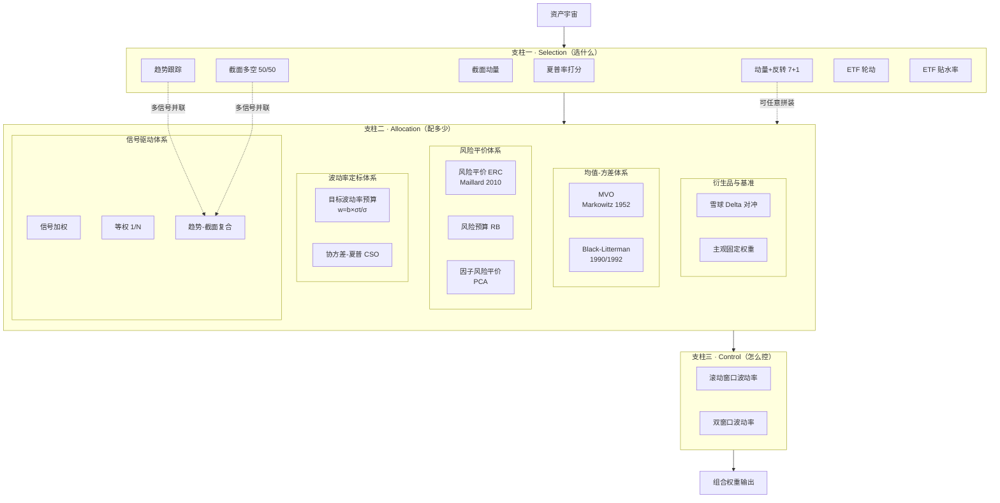

# 策略库介绍：一个金融工程视角

> 面向对外汇报与培训受众的系统策略库说明。
> 核心观点：本系统的策略库不是一份"策略名单"，而是一个**工程化的策略构建体系**——
> 它将经典金融工程理论族以统一的三层架构工厂化承载，使每一个策略都可拆解、可组合、可治理。

---

## 一、定位：策略工厂，而非策略清单

传统量化系统的策略库往往是"策略脚本的集合"：每个策略独立编码、参数散落、复用困难。本系统采取了不同的路线：

- **正交拆解**：任何策略都被拆解为三个相互独立的环节——**选什么（Selection）、配多少（Allocation）、怎么控（Control）**。
- **注册即生效**：新策略只需在注册表中登记一行，其模板、参数表单、回测与监测接入全部自动派生。
- **源码即资产**：每个策略的完整源码随模板入库，策略研究成果天然沉淀为系统资产。

换言之，策略库提供的不是"现成的 21 个策略"，而是"生产任意策略的能力"。

---

## 二、三支柱架构：一条单向流水线

策略的生成遵循一条严格的单向流水线：

```
资产宇宙 → Selection（选什么） → Allocation（配多少） → Control（怎么控） → 组合权重
```

| 支柱 | 职责 | 规模 |
|---|---|---|
| **Selection** 资产选择 | 基于因子信号决定"持有谁" | 7 个选择器 |
| **Allocation** 权重配置 | 基于组合理论决定"持有多少" | 12 个配置模型 |
| **Control** 风险控制 | 基于日常监测决定"何时收缩" | 2 个波动率控制器 |

三支柱的价值在于**正交性**：选择器可以被任意配置模型复用，控制层可以挂载在任意策略之上。例如"夏普率打分选股"与"目标波动率定标"本是两个独立研究，在系统中它们可以自由拼装成一个完整策略，而无需重新编码。

---

## 三、策略理论族全景：经典金融工程的完整谱系

策略库的 21 个策略单元并非随意堆砌，而是覆盖了金融工程发展史上的主要理论族。按理论脉络梳理如下。

### 3.1 Allocation 层：组合构建理论族（12 个）

#### （1）均值-方差体系 —— 现代组合理论的起点

| 策略 | 理论锚点 |
|---|---|
| **均值-方差优化 (MVO)** | Markowitz (1952)《Portfolio Selection》。支持最小方差、目标收益、最大夏普三种优化模式，是全部组合理论的公共基座。 |
| **Black-Litterman 贝叶斯配置** | Black & Litterman (1990, 1992)。通过逆优化从市场均衡权重推导隐含收益，以 Idzorek (2005) 方法融合主观观点，最终在贝叶斯后验上做均值-方差优化——解决了 MVO 对预期收益过度敏感的经典缺陷。 |

#### （2）风险平价体系 —— 从"配资金"到"配风险"

| 策略 | 理论锚点 |
|---|---|
| **风险平价 (ERC)** | Maillard, Roncalli & Teïletche (2010)。通过约束优化使每个资产的风险贡献相等，是全天候（All Weather）思想的规范化表达。 |
| **风险预算 (RB)** | Roncalli 风险预算框架的一般化：允许用户指定非均匀的风险预算向量，支持按 Sharpe、Sortino 或手动三种方式生成预算。 |
| **因子风险平价 (Factor RP)** | 先以主成分分析（PCA）将资产协方差分解到因子空间，再在因子维度实现等风险贡献——风险控制从"资产维度"升级为"因子维度"，对应 Qian (2006) 以来的因子风险平价研究脉络。 |

#### （3）波动率定标体系 —— 风险目标化管理

| 策略 | 理论锚点 |
|---|---|
| **目标波动率预算 (TVB)** | 闭式解 w = b × σ_target / σ：以组合目标波动率为锚，对风险预算做波动率定标，对应 Moreira & Muir (2017) "Volatility-Managed Portfolios" 的风险管理思想。支持标签等分、选中资产等权、反方差三种预算来源，并内置杠杆上限与单资产上限的三重约束缩放。 |
| **协方差-夏普优化 (CSO)** | 自研双目标框架：在最小化组合方差的目标函数中引入 Sharpe 增强项，兼顾风险压缩与收益增强。 |

#### （4）信号驱动体系 —— 因子研究的落地通道

| 策略 | 说明 |
|---|---|
| **信号加权** | 将上游选择器输出的因子分数直接映射为权重（信号越强、权重越大），无信号时退化为等权。 |
| **等权 (1/N)** | DeMiguel, Garlappi & Uppal (2009) 意义上的朴素基准：对选中资产等权分配，常作为复杂模型的对照基线。 |
| **趋势-截面复合** | 趋势跟踪与截面多空双信号按可配置权重混合，归一化输出，支持多空交易。 |

#### （5）衍生品复制与基准工具

| 策略 | 说明 |
|---|---|
| **类雪球结构 Delta 对冲** | 以蒙特卡洛方法定价雪球（Autocallable）期权并计算 Delta，通过动态调整 ETF 仓位复制雪球结构的风险收益特征，支持单合约与多合约滚动。 |
| **主观固定权重** | 用户直接指定权重，用于基准组合构建与主观判断配置。 |

### 3.2 Selection 层：因子信号族（7 个）

| 选择器 | 理论锚点 |
|---|---|
| **动量 + 反转 (7+1)** | 动量因子（Jegadeesh & Titman, 1993）与反转因子（De Bondt & Thaler, 1985）的组合表达：7 个动量维度 + 1 个反转维度联合选股。 |
| **夏普率综合打分** | 基于短期、中期、长期三层窗口的夏普率（Sharpe, 1966）综合排序选优。 |
| **截面动量** | 滚动累计收益率截面排序，持有动量最强的品种。 |
| **趋势跟踪** | 时序动量思想（Moskowitz, Ooi & Pedersen, 2012）：每个品种独立判断多空方向。 |
| **截面多空 (50/50)** | 做多前 50%、做空后 50%，用于指数化多空组合的构建。 |
| **ETF 轮动** | 统一模板承载四种子策略：波动率轮动、收益+乖离率、混合因子、强势突破。 |
| **ETF 贴水率** | 基于期货贴水率滚动分位点信号的择券逻辑，低贴水率开仓、反波动率加权。 |

### 3.3 Control 层：波动率控制族（2 个）

| 控制器 | 说明 |
|---|---|
| **滚动窗口波动率** | 短、中、长三窗口监测组合实现波动率，超过阈值时按 σ_target / σ 比例缩放权重。 |
| **双窗口波动率** | 双窗口交叉确认机制，降低单一窗口噪声导致的误触发。 |

---

## 四、组合机制：策略是"拼装"出来的

三支柱架构的直接产物是**策略的组合式生成**。每个策略在注册时就声明自己的三层组合配置：

- **单层策略**：如风险平价，仅启用 Allocation 层，对全部资产直接优化。
- **双层策略**：如"动量+反转选股 + 等权配置"，Selection 与 Allocation 协作。
- **复合策略**：如"趋势-截面复合"，通过多信号机制**并联**两个选择器（趋势跟踪与截面多空各占可配置权重），信号混合归一化后再挂接波动率控制器。

这意味着：**策略复合是配置出来的，不是重新编码出来的**。研究员的一个新想法，只要能归入三支柱中的某一环，就可以与既有组件自由拼装成新策略。

---

## 五、工程治理：让策略库可持续生长

支撑上述能力的，是三项工程治理机制：

1. **单点注册，处处派生**
   策略库维护唯一注册清单。新增策略只需登记一行，模板生成、参数表单、前端配置界面、回测与监测接入全部自动完成——策略数量的增长不带来维护成本的增长。

2. **参数 Schema 驱动**
   每个策略以声明式 Schema 定义自己的参数（名称、类型、取值边界、默认值），前端配置界面据此自动渲染。参数不再散落在代码中，而是成为可审计、可版本化的治理对象。

3. **研究员通道同源化**
   研究员的原型策略（如 18 资产夏普率风险预算、12 资产动量混合）同样以三支柱语言表达，与生产策略走同一套回测与日常监测链路——研究与生产之间不存在"翻译损耗"。

---

## 附：三支柱流水线与策略族谱



---

## 参考

- Markowitz, H. (1952). Portfolio Selection. *The Journal of Finance*, 7(1).
- Black, F., & Litterman, R. (1992). Global Portfolio Optimization. *Financial Analysts Journal*, 48(5).
- Idzorek, T. (2005). A Step-by-Step Guide to the Black-Litterman Model.
- Maillard, S., Roncalli, T., & Teïletche, J. (2010). The Properties of Equally Weighted Risk Contribution Portfolios. *The Journal of Portfolio Management*, 36(4).
- Qian, E. (2006). On the Financial Interpretation of Risk Contribution. *Journal of Asset Management*, 6.
- Sharpe, W. (1966). Mutual Fund Performance. *The Journal of Business*, 39(1).
- Jegadeesh, N., & Titman, S. (1993). Returns to Buying Winners and Selling Losers. *The Journal of Finance*, 48(1).
- De Bondt, W., & Thaler, R. (1985). Does the Stock Market Overreact? *The Journal of Finance*, 40(3).
- Moskowitz, T., Ooi, Y. H., & Pedersen, L. (2012). Time Series Momentum. *Journal of Financial Economics*, 104(2).
- Moreira, A., & Muir, T. (2017). Volatility-Managed Portfolios. *The Journal of Finance*, 72(4).
- DeMiguel, V., Garlappi, L., & Uppal, R. (2009). Optimal Versus Naive Diversification. *The Journal of Finance*, 64(5).
