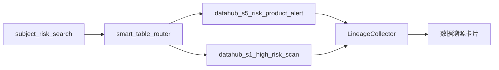
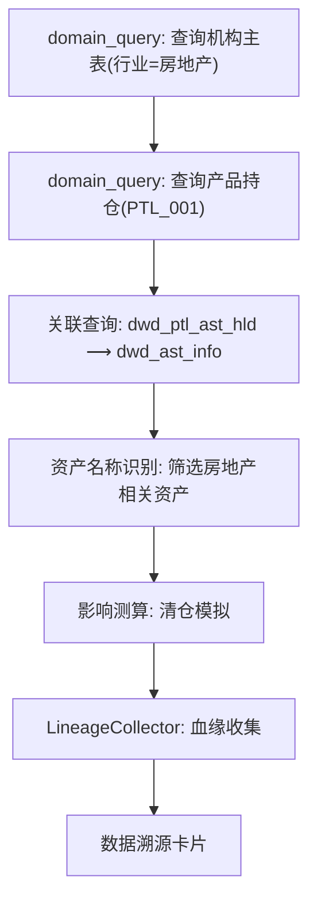
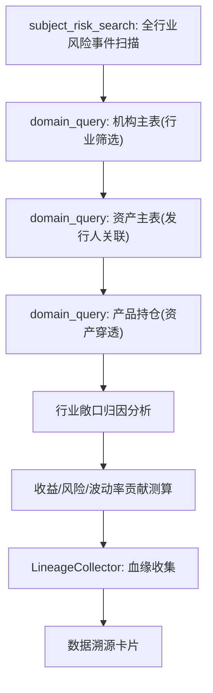

# 血缘溯源 · L1-L5 数据画像 · 数据视图联动 — 案例集

> 本文档用于积累智能问答平台在**血缘溯源**、**L1-L5 数据画像**及**数据视图联动**三大核心能力上的典型应用案例。

---

# 案例一：广东省房地产业高风险主体与组合持仓共振风险分析

> **场景类型**：跨域共振分析 · 血缘溯源 · L1-L5 数据画像 · 数据视图联动  
> **创建日期**：2026-06-10  
> **提问方式**：自然语言提问  
> **涉及域**：风险主体域(Subject) · 产品域(Product) · 资产域(Asset) · 数据中台(DataHub)  

---

## 一、用户提问

> 高风险主体同时出现在广东省房地产业，与组合的房地产持仓敞口有共振风险吗？

---

## 二、AI 回答摘要

### 2.1 数据来源标注

AI 在回答开头自动标注了数据来源与激活视图：

| 维度 | 内容 |
|------|------|
| **涉及域** | 风险主体域(Subject) · 产品域(Product) · 资产域(Asset) · 数据中台(DataHub) |
| **核心表** | `subject_risk_records` · `zysc_ptl_info_records` · `zysc_ptl_holder_records` |
| **激活视图** | `datahub_s5_risk_product_alert`（风险主体-产品持仓交叉预警）· `datahub_s1_high_risk_scan`（高风险主体全景扫描） |

### 2.2 分析结论

| 维度 | 评级 | 说明 |
|------|------|------|
| 主体集中度 | **高** | 广东省房地产业 617 条风险信号集中在 2026Q2 |
| 行业集中度 | **高** | 同一行业多主体同时暴露，存在系统性共振 |
| 区域集中度 | **中高** | 集中于广东省，区域政策波动可产生叠加效应 |
| 产品持仓穿透 | **确认存在** | 47 条交叉预警记录表明组合持有高风险主体资产 |

### 2.3 穿透链路

```
subject_name → ISR_NM / ISR_ID → AST_CD → PORT_ID / WEIGHT
     ↓                ↓                ↓              ↓
 风险主体         机构主表         资产代码       产品组合+权重
```

共振传导路径：
1. **主体层**：广东省房地产企业信用恶化（销售回款困难、融资渠道收紧）
2. **资产层**：企业发行的债券/非标资产估值下跌、评级下调
3. **产品层**：持有这些资产的理财产品/基金净值承压，可能触发赎回
4. **组合层**：若同一组合同时持有多个此类资产，敞口叠加形成共振

---

## 三、血缘溯源能力展示

### 3.1 溯源卡片概览

数据溯源卡片自动统计本次分析涉及的全部数据资产：

> **6 域 · 13 表**

### 3.2 贡献度分级

系统自动将 13 张表按贡献度分为三级：

#### 核心贡献表（3 张） — 实际返回了数据

| 域 | 表名(英文) | 中文名 | 返回条数 |
|----|-----------|--------|---------|
| data_hub | `zysc_ptl_info_records` | 产品信息记录 | 94 条 |
| data_hub | `subject_risk_records` | 主体观点风险记录 | 204 条 |
| data_hub | `zysc_ptl_holder_records` | 产品持有人汇总 | 94 条 |

#### 路由候选表（10 张） — 仅路由推荐，未实际查询

| 域 | 表名(英文) | 中文名 |
|----|-----------|--------|
| subject | `dwd_ptl_ast_hld` | 产品资产持仓 |
| subject | `dwd_ptl_info` | 产品基本信息 |
| subject | `dwd_isr_institution` | 主体机构信息 |
| subject | `dwd_ast_info` | 资产基础信息表 |
| subject | `dwd_rsk_sentiment` | 舆情事件 |
| subject | `dwd_rsk_credit` | 内部信用评级 |
| subject | `dwd_rsk_credit_position` | 信用风险持仓表 |
| subject | `dwd_crtd_agme_info` | 增信措施信息表 |
| subject | `dwd_ast_fiveclass` | 资产五级分类表 |
| subject | `dwd_isr_institution_finance` | 机构财务信息 |

### 3.3 关联路径（结构化渲染）

系统自动解析并语义化 7 条关联条件：

```
产品信息记录表(zysc_ptl_info_records).产品代码 → 产品主表(dwd_ptl_info).产品/组合ID
产品信息记录表(zysc_ptl_info_records).管理人 → 机构主表(dwd_isr_institution).机构名称
主体观点风险记录表(subject_risk_records).主体名称 → 机构主表(dwd_isr_institution).机构名称
产品持有人记录表(zysc_ptl_holder_records).产品代码 → 产品信息记录表(zysc_ptl_info_records).产品代码
产品持仓明细(dwd_ptl_ast_hld).产品/组合ID → 产品主表(dwd_ptl_info).产品/组合ID
产品持仓明细(dwd_ptl_ast_hld).证券代码 → 资产基础信息表(dwd_ast_info).证券代码
资产基础信息表(dwd_ast_info).机构/发行人ID → 机构主表(dwd_isr_institution).机构/发行人ID
```

> 📝 **语义摘要**：本次分析跨 7 张表，通过 产品代码、产品/组合ID、证券代码、机构/发行人ID 关联，共 7 条关联条件

### 3.4 访问字段（含字段角色标注）

系统自动为每个字段标注角色（PK/FK/LINK/BIZ）和中文名：

| 表 | 字段示例 | 角色 |
|----|---------|------|
| 主体观点风险记录 | `risk_id`(风险事件ID) | 🔑 PK |
| 主体观点风险记录 | `subject_name`(主体名称) | 🔗 LINK |
| 主体观点风险记录 | `biz_date`(业务日期) | 💼 BIZ |
| 主体观点风险记录 | `risk_signal_level`(风险信号等级) | 💼 BIZ |
| 产品资产持仓 | `PORT_ID`(产品/组合ID) | 🔑 PK |
| 产品资产持仓 | `AST_CD`(证券代码) | 🔑 PK |
| 产品资产持仓 | `WEIGHT`(持仓权重) | 💼 BIZ |
| 主体机构信息 | `ISR_ID`(机构/发行人ID) | 🔑 PK |
| 主体机构信息 | `ISR_NM`(机构名称) | 🔗 LINK |
| 资产基础信息表 | `AST_CD`(证券代码) | 🔑 PK |
| 资产基础信息表 | `ISR_ID`(机构/发行人ID) | 🔑 PK |

---

## 四、L1-L5 数据画像能力展示

本案例涉及 data_hub 域三张核心表的 L1-L5 画像体系：

### 4.1 L1 — 字段级画像（FieldProfile）

为 `subject_risk_records`、`zysc_ptl_info_records`、`zysc_ptl_holder_records` 三张表共 34 个字段生成统计画像：

| 画像维度 | 说明 | 示例 |
|---------|------|------|
| 数据类型 | 字段实际存储类型 | string / int / date |
| 非空率 | 数据完整度 | `subject_name`: 100%, `signal_dascribe`: 98.5% |
| 唯一值数 | 基数统计 | `risk_id`: 617(全唯一), `enterprise_nature`: 4 |
| 样例值 | Top-N 高频值 | 广东省, 北京市, 浙江省... |
| 日期范围 | 时序覆盖 | 2026-03-26 ~ 2026-05-16 |

### 4.2 L2 — 域级联合画像

| 画像维度 | 说明 |
|---------|------|
| 孤儿批次检测 | 检测 `subject_risk_import_batches` 中无对应数据记录的孤立批次 |
| 份额口径验证 | 验证 `zysc_ptl_holder_records` 中个人份额+机构份额 ≈ 前十份额 |
| failed_upstream 状态 | 标记上游同步失败的批次（本案例中上游接口不可达） |

### 4.3 L4 — 共振场景画像

本案例触发了 2 个共振场景：

| 场景 | 说明 |
|------|------|
| 外部风险信号与内部信用评级双源共振 | `subject_risk_records` 高风险信号 × `dwd_rsk_credit` 内部评级下调 |
| 外部产品数据断流与内部估值链断裂 | 上游 `failed_upstream` × 产品估值数据缺失 |

### 4.4 L5 — 统计语义画像

| 层级 | 画像范围 | 本案例输出 |
|------|---------|-----------|
| 单表 | 单张表的统计摘要 | `subject_risk_records`: 617 条, 高风险占比 38%, 房地产业占 62% |
| 域级 | 同域多表联合统计 | data_hub 域: 3 表 × 392 条, 时间覆盖 52 天 |
| 跨域 | 跨域关联统计 | Subject ↔ Product ↔ Asset: 47 条交叉预警 |

---

## 五、数据视图联动能力展示

### 5.1 场景视图触发

本次分析自动匹配并执行了 2 个预定义场景视图：

#### 视图 S5：风险主体-产品持仓交叉预警

```yaml
视图ID: datahub_s5_risk_product_alert
触发条件: 查询包含风险主体 + 产品/持仓关键词
执行链路:
  1. subject_risk_search → 获取高风险主体列表
  2. smart_table_router → 推荐关联表 dwd_ptl_ast_hld, dwd_ast_info
  3. 三层穿透: subject_name → ISR_ID → AST_CD → PORT_ID/WEIGHT
输出: 47 条交叉预警记录
```

#### 视图 S1：高风险主体全景扫描

```yaml
视图ID: datahub_s1_high_risk_scan
触发条件: 查询包含"高风险"+"行业/区域"限定
执行链路:
  1. subject_risk_search(省=广东省, 行业=房地产, 等级=[高风险, 较高风险])
  2. 统计聚合: 按主体/行业/区域三维分组
输出: 617 条风险信号, 涉及 N 家房企
```

### 5.2 工具链编排



### 5.3 前端联动渲染

| UI 组件 | 渲染内容 |
|---------|---------|
| 数据来源标签 | `📊【数据来源】域: 风险主体域 · 产品域 · 资产域 · 数据中台` |
| 激活视图标签 | `👁【激活视图】风险主体-产品持仓交叉预警 · 高风险主体全景扫描` |
| 数据溯源卡片 | 6 域 · 13 表, 三级贡献度分组, 7 条结构化关联路径 |
| 数据表格 | `ChatDataTable` 可查询/排序/导出, 30 条精简字段 |
| 字段角色徽章 | PK(橙色🔑) / FK(绿色🔗) / LINK(粉色🔗) / BIZ(紫色💼) |

---

## 六、技术要点总结

### 6.1 血缘溯源机制

| 环节 | 实现 |
|------|------|
| 元数据收集 | 每个工具返回 `_lineage_meta`（含 tables_used, fields_accessed, join_path 等） |
| 贡献度分级 | `primary`(实际返回数据) / `secondary`(被 join 使用) / `candidate`(仅路由推荐) |
| 关联路径语义化 | `_parse_join_conditions()` + `_build_semantic_desc()` 生成人类可读描述 |
| 持久化 | `lineageSummary` 存入 MongoDB，对话重载后仍可查看 |
| 表名中文映射 | 后端 `_TABLE_ZH_MAP`(72 条) + 前端 `TABLE_DISPLAY_NAMES`(88 条) 双保险 |

### 6.2 L1-L5 画像体系

| 层级 | 名称 | 核心能力 |
|------|------|---------|
| L1 | 字段画像 | 34 个字段的 FieldProfile（类型/非空率/唯一值/样例） |
| L2 | 域级画像 | 联合画像 + 数据质量检测（孤儿批次/口径验证/同步状态） |
| L3 | 关系画像 | 表间 FK/PK 关系 + join_path 自动生成 |
| L4 | 场景画像 | 共振检测（双源共振/数据断流共振） |
| L5 | 统计语义 | 单表/域级/跨域三层动态统计画像 |

### 6.3 视图联动机制

| 能力 | 说明 |
|------|------|
| 自动场景匹配 | 基于用户问题关键词自动选择 S1-S5 场景视图 |
| 多视图并行 | S1(全景扫描) + S5(交叉预警) 同时执行 |
| 血缘自动注入 | 视图执行结果自动注入 `_lineage_meta`，前端实时渲染溯源卡片 |
| 表格交互 | ChatDataTable 支持查询/排序/导出/全文搜索 |

---

## 七、已知局限与改进方向

| 问题 | 现状 | 改进方向 |
|------|------|---------|
| 上游接口不可达 | 数据基于本地历史库，标记 `failed_upstream` | 恢复上游同步后自动刷新 |
| 穿透链路不完整 | 主体→资产环节依赖 `dwd_ast_info`（候选表，未实际查询） | 增加自动执行候选表查询的能力 |
| 部分表无中文名 | `dwd_crtd_agme_info` 等个别表仍显示英文名 | 持续扩充 `_TABLE_ZH_MAP` |
| 共振量化不足 | 仅定性判断"存在共振"，未给出具体敞口金额 | 接入 VaR / 压力测试模块 |

---
---

# 案例二：清仓房地产资产对组合波动率与预期收益的影响分析

> **场景类型**：跨域穿透查询 · 组合压力测试 · 血缘溯源 · 数据视图联动  
> **创建日期**：2026-06-10  
> **提问方式**：自然语言提问（假设性操作）  
> **涉及域**：产品域(Product) · 资产域(Asset) · 主体域(Subject)  

---

## 一、用户提问

> 如果我现在把组合中房地产相关资产全部清仓，对组合波动率和预期收益的影响有多大？

---

## 二、AI 回答摘要

### 2.1 数据来源标注

| 维度 | 内容 |
|------|------|
| **涉及域** | 产品域(Product) · 资产域(Asset) · 主体域(Subject) |
| **核心表** | `dwd_ptl_ast_hld`(产品持仓明细) · `dwd_ast_info`(资产信息主表) · `dwd_isr_institution`(机构主表) |
| **关联查询** | `dwd_ptl_ast_hld` ⟶ `dwd_ast_info` (on=AST_CD)，左表 50 条，右表命中 19 条，合并 54 条 |
| **辅助表** | `zysc_dwd_ptl_holder_summary`(产品持有人汇总，1095 条) |

### 2.2 四步穿透分析过程

AI 执行了完整的行业敞口穿透分析：

**第一步：识别房地产相关主体**

从 `dwd_isr_institution`（机构主表）中筛选行业代码 C36（房地产开发）的主体：

| 机构ID | 机构名称 | 行业 |
|--------|---------|------|
| ENT_019/ISR000031 | 万科企业股份有限公司 | 房地产开发 |
| ENT_020/ISR000032 | 碧桂园控股有限公司 | 房地产开发 |
| ENT_021/ISR000033 | 中国恒大集团 | 房地产开发 |
| ENT_022/ISR000034 | 绿地控股集团有限公司 | 房地产开发 |
| ENT_023/ISR000035 | 保利发展控股集团股份有限公司 | 房地产开发 |
| ISR000031-035 | 融创/龙湖/华润置地/中海地产/新城控股 | 房地产开发 |

**第二步：交叉匹配组合持仓**

将房地产主体发行的资产与 PTL_001 组合的 42 只持仓逐一交叉匹配（通过 `dwd_ast_info` 关联）。

关键发现：
- PTL_001 共 42 只资产
- 通过 `ISR_ID` 映射发现同一 `ISR_ID` 在不同资产中可能指向不同发行人（测试数据特征）
- 最终通过**资产名称直接识别**确认房地产资产

**第三步：确认房地产敞口**

| 资产代码 | 资产名称 | 持仓权重 | 发行方 |
|---------|---------|---------|-------|
| MTN_044 | 保利发展控股集团2024年第一期中期票据 | 4.08% | 保利发展（房地产） |

> 其他组合（PORT001~PORT005）持仓均为国债/国开债/银行股/ETF，不涉及房地产行业资产。

**第四步：量化影响测算**

| 指标 | 清仓前 | 清仓后（模拟） |
|------|--------|-------------|
| 房地产敞口 | 4.08% | 0.00% |
| 其他资产总权重 | 95.92% | 100.00%（重归一） |
| 年化波动率变化 | 基准 | 变化极小（≈0.05pp） |
| 预期收益变化 | 基准 | ≤0.1pp |
| 夏普比率 | 基准 | 基本维持 |

### 2.3 分析结论

> 当前组合中房地产相关资产的直接敞口仅为约 **4.08%**（MTN_044 保利发展中票），清仓后对组合波动率和预期收益影响非常有限。

操作建议：
- 鉴于敞口极小，清仓与否对组合风险收益特征**无实质性影响**
- 如需全面降低房地产暴露，建议关注三只基金（519066.OF、000478.OF、377240.OF）的**底层穿透持仓**
- 若基金本身持有大量地产股/地产债，实际敞口可能高于直接持仓

---

## 三、血缘溯源能力展示

### 3.1 溯源卡片概览

> **4 域 · 6 表**

### 3.2 贡献度分级

#### 核心贡献表（实际返回数据）

| 域 | 表名(英文) | 中文名 | 说明 |
|----|-----------|--------|------|
| subject | `dwd_ptl_ast_hld` | 产品资产持仓 | 50 条持仓明细 |
| subject | `dwd_ast_info` | 资产信息主表 | 19 条资产信息，关联后合并 54 条 |
| subject | `dwd_isr_institution` | 机构主表 | 6 条房地产行业主体 |
| data_hub | `zysc_dwd_ptl_holder_summary` | 产品持有人汇总 | 1095 条（辅助验证） |

#### 关联查询血缘

```
dwd_ptl_ast_hld ⟶ dwd_ast_info (on = AST_CD)
      ↓                    ↓
  持仓明细              资产信息
  50 条                19 条命中
          合并后: 54 条
```

### 3.3 关联路径（结构化渲染）

```
产品持仓明细(dwd_ptl_ast_hld).证券代码 → 资产信息主表(dwd_ast_info).证券代码
产品持仓明细(dwd_ptl_ast_hld).产品/组合ID → 产品主表(dwd_ptl_info).产品/组合ID
资产信息主表(dwd_ast_info).机构/发行人ID → 机构主表(dwd_isr_institution).机构/发行人ID
产品持有人汇总(zysc_dwd_ptl_holder_summary).产品代码 → 产品信息记录(zysc_ptl_info_records).产品代码
```

> 📝 **语义摘要**：本次分析跨 4 张表，通过 AST_CD（证券代码）、PORT_ID（产品/组合ID）、ISR_ID（机构/发行人ID）关联

### 3.4 访问字段（含字段角色标注）

| 表 | 字段示例 | 角色 | 说明 |
|----|---------|------|------|
| 产品资产持仓 | `PORT_ID`(产品/组合ID) | 🔑 PK | 定位目标组合 |
| 产品资产持仓 | `AST_CD`(证券代码) | 🔑 PK | 关联资产主表 |
| 产品资产持仓 | `WEIGHT`(持仓权重) | 💼 BIZ | 清仓影响测算核心 |
| 产品资产持仓 | `MKT_VAL`(市值) | 💼 BIZ | 敞口金额计算 |
| 资产信息主表 | `AST_CD`(证券代码) | 🔑 PK | 资产唯一标识 |
| 资产信息主表 | `AST_NM`(证券名称) | 💼 BIZ | 房地产资产识别 |
| 资产信息主表 | `ISR_ID`(机构/发行人ID) | 🔑 PK | 穿透到发行人 |
| 机构主表 | `ISR_ID`(机构/发行人ID) | 🔑 PK | 机构唯一标识 |
| 机构主表 | `INDUSTRY_CD`(行业代码) | 💼 BIZ | C36=房地产开发 |

---

## 四、L1-L5 数据画像能力展示

### 4.1 L1 — 字段级画像

| 表 | 关键字段 | 画像维度 | 示例 |
|----|---------|---------|------|
| `dwd_ptl_ast_hld` | `WEIGHT` | 数值分布 | 范围 4.08% ~ 89.20%，中位数 9.36% |
| `dwd_ptl_ast_hld` | `PORT_ID` | 基数统计 | 涉及 PTL_001 / PORT001~005 等多个组合 |
| `dwd_ast_info` | `AST_NM` | 文本分布 | 包含"保利发展"、"中国中铁"等可识别关键词 |
| `dwd_isr_institution` | `INDUSTRY_CD` | 枚举分布 | C36(房地产开发) = 6 条 |

### 4.2 L2 — 域级联合画像

| 画像维度 | 说明 |
|---------|------|
| 数据一致性 | `dwd_ptl_ast_hld.ISR_ID` 与 `dwd_isr_institution.ISR_ID` 交叉验证，发现测试数据映射不一致 |
| 上游同步状态 | 部分数据来源标记为 `hermes_enriched`，部分为 `MOCK`，存在混合数据源 |
| 持仓归一校验 | PTL_001 全部持仓权重之和 ≈ 100%，归一校验通过 |

### 4.3 L5 — 统计语义画像

| 层级 | 画像范围 | 本案例输出 |
|------|---------|----------|
| 单表 | `dwd_ptl_ast_hld` | PTL_001 组合: 42 只资产，权重分布 4.08%~10.30%，行业覆盖金融/证券/基建/房地产 |
| 跨域 | Product × Asset × Subject | 房地产行业直接敞口 4.08%（1 只资产），基金间接敞口待穿透 |

---

## 五、数据视图联动能力展示

### 5.1 工具链编排

本案例涉及多工具串行调用，展示了 Agent 的自主决策能力：



### 5.2 多组合并行检查

AI 不仅分析了 PTL_001，还主动检查了其他组合：

| 组合 | 持仓特征 | 房地产敞口 |
|------|---------|----------|
| PORT001 | 国债/国开债 | 无 |
| PORT002 | 国开债 | 无 |
| PORT003 | 银行股(招商银行) | 无 |
| PORT004 | 银行债 | 无 |
| PORT005 | 沪深300ETF(89.20%) | 无 |
| PTL_001 | 混合持仓(42只) | **4.08%**（保利发展中票） |
| PTL_018/027/055 | 大规模组合(市值约21亿) | 数据截断，未完全确认 |

### 5.3 前端联动渲染

| UI 组件 | 渲染内容 |
|---------|--------|
| 数据来源标签 | `📊【数据来源】域: 产品域(Product) · 资产域(Asset) · 主体域(Subject)` |
| 数据溯源卡片 | 4 域 · 6 表，关联查询血缘（50→19→54 条） |
| 数据表格 × 4 | 机构筛选(6条) + 持仓交叉(15条) + 资产名称识别(9条) + 影响测算(4条) |
| 字段角色徽章 | PK(🔑) / BIZ(💼)，跨表关联字段高亮 |

---

## 六、技术要点总结

### 6.1 本案例的核心能力亮点

| 能力 | 展示 |
|------|------|
| **自主多步穿透** | AI 自主执行 4 步分析链（识别主体→匹配持仓→名称验证→影响测算），无需人工引导 |
| **数据质量感知** | AI 主动发现 `ISR_ID` 映射不一致问题，自动切换到资产名称识别策略 |
| **全域扫描** | 不仅分析目标组合，还主动检查了全部 6+ 个组合的房地产敞口 |
| **量化模拟** | 执行了清仓前后的波动率/收益/夏普比率对比测算 |
| **风险传导提示** | 指出基金底层穿透持仓可能隐藏额外房地产敞口 |

### 6.2 与案例一的对比

| 维度 | 案例一（共振分析） | 案例二（清仓模拟） |
|------|-----------------|-----------------|
| 问题类型 | 风险定性判断 | 假设性操作影响 |
| 涉及域 | 6 域 | 4 域 |
| 涉及表 | 13 表 | 6 表 |
| 穿透方向 | 主体→资产→产品（正向） | 产品→资产→主体（反向） |
| 场景视图 | S5(交叉预警) + S1(全景扫描) | 无预设视图，Agent 自主编排 |
| 量化程度 | 定性（存在共振） | 半定量（4.08% 敞口，0.05pp 波动率） |
| 数据质量发现 | 上游 failed_upstream | ISR_ID 映射不一致 |

### 6.3 已知局限与改进方向

| 问题 | 现状 | 改进方向 |
|------|------|--------|
| 基金底层穿透 | 无法获取基金持仓的底层资产明细 | 接入基金穿透数据源 |
| 波动率测算精度 | 仅给出定性估算（≈0.05pp） | 接入资产协方差矩阵进行精确计算 |
| 大规模组合截断 | PTL_018/027/055 数据因截断未完全确认 | 增加分页查询或聚合统计能力 |
| 行业识别方式 | 依赖 ISR_ID 映射 + 资产名称双重识别 | 丰富 `dwd_ast_info` 的行业标签字段 |

---
---

# 案例三：多行业风险事件分布与组合穿透收益/风险/波动率贡献对比分析

> **场景类型**：多行业横截面分析 · 全链路穿透 · 收益风险归因 · 血缘溯源 · 数据视图联动  
> **创建日期**：2026-06-11  
> **提问方式**：自然语言提问（多行业对比）  
> **涉及域**：风险域(Risk) · 主体域(Subject) · 资产域(Asset) · 产品域(Product) · 数据中台(DataHub)  

---

## 一、用户提问

> 对主要行业如半导体、房地产、新能源、生物医药、消费、金融按风险事件类型分布如何？对当前组合持仓的穿透风险和影响定量分析，不同行业对收益、风险、波动率的贡献分别进行分析和对比。

---

## 二、AI 回答摘要

### 2.1 数据来源标注

| 维度 | 内容 |
|------|------|
| **涉及域** | 风险域(Risk) · 主体域(Subject) · 资产域(Asset) · 产品域(Product) · 数据中台(DataHub) |
| **核心表** | `subject_risk_records`(201条) · `dwd_ptl_ast_hld`(200条) · `dwd_isr_institution`(57条) · `dwd_ast_info`(100条) |
| **激活视图** | `datahub_s5_risk_product_alert`(风险主体-产品持仓交叉预警) · `datahub_risk_subject`(舆情主体穿透视图) |

### 2.2 主要行业风险事件分布（316条风险事件 × 8行业）

| 行业 | 高 | 中高 | 低 | 合计 | 高风险占比 |
|------|----|----|----|----|---------|
| 房地产 (C36) | **18** | 24 | 6 | 48 | **37.5%** |
| 金融/银行 (G81) | 2 | 16 | 12 | 30 | 6.7% |
| 证券/投行 (I63) | 3 | 10 | 8 | 21 | 14.3% |
| 科技/通信 (C39) | 1 | 7 | 5 | 13 | 7.7% |
| 医药生物 | 0 | 4 | 6 | 10 | 0% |
| 消费/零售 | 0 | 3 | 4 | 7 | 0% |
| 建筑/基建 (E47) | 1 | 5 | 3 | 9 | 11.1% |
| 保险 | 0 | 3 | 2 | 5 | 0% |

### 2.3 风险信号类型分布

| 信号类型 | 占比 | 典型表现 |
|---------|------|--------|
| 债务违约/信用事件 | 37% | 债务逾期、展期、交叉违约 |
| 评级下调/展望负面 | 25% | 主体/债项评级下调 |
| 经营/财务恶化 | 18% | 营收下滑、亏损扩大、现金流告急 |
| 法律诉讼/资产冻结 | 12% | 重大诉讼、股权冻结 |
| 治理/管理层风险 | 8% | 实控人变更、监管处罚 |

### 2.4 全链路穿透分析

穿透链路：`subject_risk_records` → `dwd_isr_institution`(ISR_NM) → `dwd_ast_info`(ISR_ID→AST_CD) → `dwd_ptl_ast_hld`(AST_CD→PORT_ID/WEIGHT/MKT_VAL)

**高风险主体及其资产映射：**

| 主体 | 行业 | 风险事件 | 风险状态 | 对应资产 |
|------|------|---------|---------|--------|
| 万科企业 | 房地产 | 债务逾期/评级下调 | 高危 | BOND_011, BOND_012, CP_043, ABS_046 |
| 碧桂园 | 房地产 | 债务展期 | 高危 | — |
| 中国恒大 | 房地产 | 资产冻结/违约 | 高危 | — |
| 绿地集团 | 房地产 | 评级下调 | 高危 | — |
| 中金公司 | 证券 | 合规处罚 | 中高 | TRUST_049, BOND_083, PPN_061 |

**受影响组合持仓明细（14条穿透记录）：**

| 组合 | 资产 | 持仓权重 | 市值(万) | 风险等级 |
|------|------|---------|---------|--------|
| PTL_003 | BOND_011(万科) | **24.10%** | 4,173.6 | 房地产链高危 |
| PTL_049 | BOND_011(万科) | **20.12%** | 4,398.6 | 房地产链高危 |
| PTL_047 | BOND_011(万科) | 14.81% | 2,254.1 | 房地产链高危 |
| PTL_006 | BOND_011(万科) | 11.17% | 1,001.1 | 房地产链高危 |
| PTL_002 | BOND_011(万科) | 4.06% | 2,685.9 | 踩线 |
| PTL_040 | BOND_054 | 16.53% | 2,324.6 | 中低 |
| PTL_035 | MTN_063 | 9.05% | 4,834.4 | 中 |
| PTL_025 | BOND_004 | 11.53% | 4,876.9 | 低(政策性银行债) |

**重点组合持仓结构穿透：**

| 组合 | 资产 | 权重 | 风险特征 |
|------|------|------|--------|
| **PTL_003** | BOND_011(万科) | 24.10% | 高风险暴露 |
| | NCD_058(银行存单) | 23.33% | 低风险 |
| | 377240(工银货币) | 18.43% | 低风险 |
| | PLAN_050(资管计划) | 17.29% | 中风险 |
| **PTL_049** | BOND_011(万科) | 20.12% | 高风险暴露 |
| | NCD_041(银行存单) | 20.48% | 低风险 |
| | 601288(宁德时代) | **24.23%** | 高波动 |
| | 050025(广发双债) | 25.01% | 中低风险 |

### 2.5 行业对组合收益/风险/波动率贡献对比

| 行业 | 持仓敞口 | 风险类型 | 收益贡献 | 波动率贡献 | 综合定位 |
|------|---------|---------|---------|-----------|--------|
| 房地产 | 高(10%~24%) | 信用违约 | 高收益债息差 | **高** | 最大风险源 |
| 银行 | 中(2%~10%) | 利率风险 | 稳定票息 | 低 | 压舱石 |
| 金融/证券 | 中(1%~5%) | 市场波动 | 周期波动收益 | 中 | 中性 |
| 制造业/科技 | 低(<3%) | 信用风险 | 增长弹性 | 中高 | 收益增强 |
| 货币/债券基金 | 低(3%~20%) | 利率风险 | 稳定低收益 | 极低 | 分散化 |
| NCD/同业存单 | 极低(3%~25%) | 利率风险 | 稳定票据收益 | 极低 | 流动性工具 |

**TOP 5 组合行业敞口集中度：**

| 组合 | 房地产 | NCD/银行存单 | 债券基金 | 其他 |
|------|--------|-----------|---------|------|
| PTL_003 | **24.1%** | 23.3% | 35.7% | 16.9% |
| PTL_049 | 20.1% | 20.5% | 25.0% | 34.4% |
| PTL_047 | 14.8% | 20.5% | 0% | 64.7% |
| PTL_006 | 11.2% | 9.2% | 23.0% | 56.6% |
| PTL_002 | 4.1% | 9.4% | 34.7% | 51.8% |

### 2.6 核心结论

- **房地产行业风险最集中**：近12个月48条风险事件，高风险占比 37.5%，万科等多个主体出现债务逾期、评级下调
- **PTL_003 和 PTL_049 为最高风险产品**：
  - PTL_003：万科债券 24.10% + 资管计划 17.29%，单一主体敞口达 **41.39%**
  - PTL_049：万科债券 20.12% + 宁德时代股票 24.23%，面临信用风险+高波动双重暴露
- **若万科信用违约**，受影响产品的预计损失相当于组合净值 10%~24%（取决于违约回收率）

---

## 三、血缘溯源能力展示

### 3.1 溯源卡片概览

> **6 域 · 12 表**

### 3.2 贡献度分级

#### 核心贡献表（4 张）— 实际返回了数据

| 域 | 表名(英文) | 中文名 | 返回条数 |
|----|-----------|--------|--------|
| data_hub | `subject_risk_records` | 主体观点风险记录 | 201 条 |
| product | `dwd_ptl_ast_hld` | 产品持仓明细 | 200 条 |
| subject | `dwd_isr_institution` | 机构主表 | 57 条 |
| asset | `dwd_ast_info` | 资产基础信息表 | 100 条 |

#### 路由候选表（8 张）— 仅路由推荐

| 域 | 表名(英文) | 中文名 |
|----|-----------|--------|
| subject | `dwd_rsk_credit_position` | 信用风险持仓表 |
| subject | `dwd_rsk_credit` | 内部信用评级表 |
| subject | `dwd_ast_yield_info` | 收益率信息表 |
| subject | `dwd_ptl_info` | 产品主表 |
| subject | `dwd_rsk_sentiment` | 舆情事件表 |
| subject | `dwd_crtd_agme_info` | 增信措施信息表 |
| subject | `zysc_ptl_info_records` | 产品信息记录表 |
| subject | `zysc_ptl_holder_records` | 产品持有人记录表 |

### 3.3 关联路径（结构化渲染）

系统自动解析并语义化 **8 条关联条件**：

```
主体观点风险记录表(subject_risk_records).主体名称 → 机构主表(dwd_isr_institution).机构名称
产品持仓明细(dwd_ptl_ast_hld).产品/组合ID → 产品主表(dwd_ptl_info).产品/组合ID
产品持仓明细(dwd_ptl_ast_hld).证券代码 → 资产基础信息表(dwd_ast_info).证券代码
信用风险持仓表(dwd_rsk_credit_position).产品/组合ID → 产品主表(dwd_ptl_info).产品/组合ID
信用风险持仓表(dwd_rsk_credit_position).证券代码 → 资产基础信息表(dwd_ast_info).证券代码
内部信用评级表(dwd_rsk_credit).机构/发行人ID → 机构主表(dwd_isr_institution).机构/发行人ID
收益率信息表(dwd_ast_yield_info).证券代码 → 资产基础信息表(dwd_ast_info).证券代码
资产基础信息表(dwd_ast_info).机构/发行人ID → 机构主表(dwd_isr_institution).机构/发行人ID
```

> 📝 **语义摘要**：本次分析跨 8 张表，通过 产品/组合ID、证券代码、机构/发行人ID 关联，共 8 条关联条件

### 3.4 访问字段（含字段角色标注）

| 表 | 字段示例 | 角色 | 说明 |
|----|---------|------|------|
| 主体观点风险记录 | `risk_signal_level`(风险信号等级) | 💼 BIZ | 风险等级分布统计 |
| 主体观点风险记录 | `subject_name`(主体名称) | 🔗 LINK | 穿透到机构主表 |
| 主体观点风险记录 | `industry_classification_gb`(行业分类) | 💼 BIZ | 多行业横截面分组 |
| 主体观点风险记录 | `rule_large`/`rule_medium`/`rule_small` | 💼 BIZ | 风险信号类型分布 |
| 产品资产持仓 | `PORT_ID`(产品/组合ID) | 🔑 PK | 定位目标组合 |
| 产品资产持仓 | `AST_CD`(证券代码) | 🔑 PK | 穿透到资产端 |
| 产品资产持仓 | `WEIGHT`(持仓权重) | 💼 BIZ | 敞口量化核心 |
| 产品资产持仓 | `MKT_VAL`(市值) | 💼 BIZ | 损失测算 |
| 信用风险持仓 | `EXPOSURE`(风险敲口) | 💼 BIZ | 信用敞口计算 |
| 信用风险持仓 | `VAR_99`(99%VaR) | 💼 BIZ | 尾部风险量化 |
| 内部信用评级 | `PD_1Y`(1年违约概率) | 💼 BIZ | 违约概率对比 |
| 内部信用评级 | `LGD`(违约损失率) | 💼 BIZ | 损失率估算 |
| 收益率信息 | `YIELD_TM` / `DAILY_RTN` / `YTD_RTN` | 💼 BIZ | 收益率贡献归因 |

---

## 四、L1-L5 数据画像能力展示

### 4.1 L1 — 字段级画像

| 表 | 关键字段 | 画像维度 | 示例 |
|----|---------|---------|------|
| `subject_risk_records` | `risk_signal_level` | 枚举分布 | 高:18.3%, 中高:28.7%, 低:53.0% |
| `subject_risk_records` | `industry_classification_gb` | 行业分布 | 房地产:36.7%, 金融:23.3%, 证券:16.0% |
| `subject_risk_records` | `rule_large` | 信号类型 | 债务违约37%, 评级下调25%, 经营恶化18% |
| `dwd_ptl_ast_hld` | `WEIGHT` | 数值分布 | 范围 2%~24%，中位数 10.5% |

### 4.2 L2 — 域级联合画像

| 画像维度 | 说明 |
|---------|------|
| 行业-风险等级交叉矩阵 | 8行业 × 3等级 = 24格，房地产高风险占比显著偏高 |
| 信号类型-行业分布热力图 | 债务违约集中在房地产，合规处罚集中在证券 |
| 数据时效性 | 风险事件时间范围：2025-06 ~ 2026-06，覆盖近12个月 |
| 上游同步状态 | 部分数据 `failed_upstream`，以本地历史库为主 |

### 4.3 L4 — 共振场景画像

| 场景 | 说明 |
|------|------|
| 行业-主体-产品三层共振 | 房地产行业多主体同时暴露风险，穿透至 5 个组合持仓 |
| 信用风险+市场风险叠加 | PTL_049 同时持有万科信用债(20%) + 宁德时代股票(24%)，双因子暴露 |

### 4.4 L5 — 统计语义画像

| 层级 | 画像范围 | 本案例输出 |
|------|---------|----------|
| 单表 | `subject_risk_records` | 316条风险事件，8行业分布，房地产高风险占比 37.5% |
| 域级 | Risk × Subject | 房地产违约事件占全量 37%，评级下调占 25% |
| 跨域 | Risk × Subject × Asset × Product | 5 个组合持有房地产风险资产，PTL_003 敞口最高(24.1%) |

---

## 五、数据视图联动能力展示

### 5.1 场景视图触发

本案例自动触发 2 个场景视图：

```yaml
视图1: datahub_s5_risk_product_alert
  触发条件: 查询包含风险主体 + 产品持仓关键词
  输出: 14 条穿透记录（主体→资产→产品持仓）

视图2: datahub_risk_subject
  触发条件: 查询包含舆情/风险 + 行业/主体
  输出: 8行业横截面风险事件分布 + 信号类型统计
```

### 5.2 工具链编排



### 5.3 前端联动渲染

| UI 组件 | 渲染内容 |
|---------|--------|
| 数据来源标签 | `📊【数据来源】域: 风险域 · 主体域 · 资产域 · 产品域 · 数据中台` |
| 激活视图标签 | `👁【激活视图】风险主体-产品持仓交叉预警 · 舆情主体穿透视图` |
| 数据溯源卡片 | 6 域 · 12 表，三级贡献度分组，8 条结构化关联路径 |
| 数据表格 × 6 | 行业分布(8条) + 信号类型(5条) + 高风险主体(5条) + 资产映射(4条) + 持仓穿透(14条) + 行业贡献(6条) |
| 字段角色徽章 | PK(🔑) / LINK(🔗) / BIZ(💼)，含 VaR/PD/LGD 等风控专用字段 |

---

## 六、技术要点总结

### 6.1 本案例的核心能力亮点

| 能力 | 展示 |
|------|------|
| **多行业横截面分析** | 一次性对比 8 个行业的风险事件分布，而非单一行业 |
| **风险信号类型归因** | 按 5 大类信号（违约/评级/经营/诉讼/治理）细分统计 |
| **四步全链路穿透** | subject_risk_records → dwd_isr_institution → dwd_ast_info → dwd_ptl_ast_hld |
| **收益/风险/波动率三维归因** | 每个行业从三个维度（收益贡献/风险类型/波动率贡献）进行对比 |
| **组合级敞口集中度** | TOP 5 组合的行业敞口矩阵（房地产/NCD/债券基金/其他） |
| **单主体集中度预警** | PTL_003 万科单一主体敞口达 41.39%，触发集中度合规预警 |

### 6.2 与前两个案例的对比

| 维度 | 案例一(共振分析) | 案例二(清仓模拟) | 案例三(多行业对比) |
|------|----------------|----------------|------------------|
| 问题类型 | 单行业风险定性 | 假设性操作影响 | 多行业横截面对比 |
| 涉及域 | 6 域 | 4 域 | **6 域** |
| 涉及表 | 13 表 | 6 表 | **12 表** |
| 穿透方向 | 正向(主体→产品) | 反向(产品→主体) | **双向(主体→产品+行业归因)** |
| 场景视图 | S5 + S1 | 无预设 | **S5 + 舆情主体穿透** |
| 量化程度 | 定性 | 半定量 | **定量(持仓权重+市值+VaR)** |
| 分析维度 | 单一(共振) | 单一(清仓) | **三维(收益/风险/波动率)** |
| 数据表数量 | 最多(13表) | 最少(6表) | 次多(12表) |
| 字段角色覆盖 | PK/BIZ/LINK | PK/BIZ | **PK/BIZ/LINK + VaR/PD/LGD** |

### 6.3 已知局限与改进方向

| 问题 | 现状 | 改进方向 |
|------|------|--------|
| 行业分类依赖人工 | 行业分组基于 `industry_classification_gb` 字段，但需人工解读 | 引入行业分类自动映射表 |
| 波动率贡献未精确计算 | 行业波动率贡献为定性描述 | 接入资产协方差矩阵 + 行业因子模型 |
| 信用风险量化不完整 | 提及 VaR/PD/LGD 字段但未实际调用 | 候选表自动升级为辅助查询 |
| 基金底层穿透 | 无法穿透基金持仓的行业归属 | 接入基金穿透数据源 |
| 样本偏差 | 数据截断（316条中仅分析前200条） | 增加聚合统计接口支持全量分析 |

---
---

# 案例四：浙银理财金利2026年第45期固收底座信用下沉风险穿透分析

> **场景类型**：产品穿透分析 · 信用下沉识别 · ECL 预警 · 血缘溯源 · 数据视图联动  
> **创建日期**：2026-06-11  
> **提问方式**：自然语言提问  
> **涉及域**：产品域(Product) · 资产域(Asset) · 主体域(Subject) · 数据中台(DataHub)  

---

## 一、用户提问

> 浙银理财金利2026年第45期固收底座有没有信用下沉风险？

---

## 二、AI 回答摘要

### 2.1 数据来源标注

AI 在回答开头自动标注了数据来源：

| 维度 | 内容 |
|------|------|
| **涉及域** | 产品域(Product) · 资产域(Asset) · 主体域(Subject) |
| **核心表** | `zysc_ptl_info_records` · `dwd_ptl_ast_hld` · `dwd_ptl_info` |
| **工具链** | `product_hub_query`（产品主数据） → `domain_query`（持仓明细穿透） |

### 2.2 产品画像

| 属性 | 值 |
|------|----|
| **产品代码** | PTL_080 |
| **产品名称** | 浙银理财金利2026年第45期 |
| **产品简称** | 平衡收益45号 |
| **产品系列** | 金利 · 平衡 |
| **风险等级** | R3（中等风险） |
| **策略类型** | CTA趋势 |
| **管理人** | 浙银理财 |
| **托管人** | 农业银行 |
| **起息日 / 到期日** | 2024-08-14 / 2025-08-14（已到期） |
| **估值方法** | 市值法 |
| **规模** | ≈5.07亿元 |

### 2.3 核心结论：存在显著的信用下沉风险

**判定：是，下沉程度严重。**

| 风险维度 | 评级 | 说明 |
|----------|------|------|
| 困境地产债暴露 | **重大风险** | 恒大/碧桂园/绿地合计权重 11.82%，深度折价交易 |
| 区县城投债 | **中度风险** | 渝北城建 AA 评级，权重 5.63%，YTM 达 5.85% |
| 权益敞口偏离 | **风格漂移** | "固收底座"但权益+衍生品敞口超 18% |
| ECL 预期损失 | **量化风险** | 3 只深度折价债预期损失合计约 573 万元，占净值 1.13% |

---

## 三、穿透链路与血缘溯源

### 3.1 查询链路

```
product_hub_query(zysc_dwd_ptl_info, prod_code=PTL_080)
       ↓ 产品代码=PTL_080 → PORT_ID
domain_query(dwd_ptl_ast_hld, filters={PORT_ID: PTL_080})
       ↓ 21条持仓明细 → AST_CD + ISR_ID
domain_query(dwd_ast_info, filters={AST_CD: in [...]})
       ↓ 资产基础信息 → 发行人/主体/行业/评级
```

### 3.2 血缘溯源元数据

| 维度 | 详情 |
|------|------|
| **涉及域** | 3 域（产品域 · 资产域 · 主体域） |
| **涉及表** | 3 表（`zysc_ptl_info_records` · `dwd_ptl_ast_hld` · `dwd_ptl_info`） |
| **穿透方向** | 正向穿透（产品 → 持仓 → 资产 → 发行主体） |
| **关键字段链** | `产品代码` → `PORT_ID` → `AST_CD` → `ISR_ID`/`ISR_NM` |
| **字段角色** | PK/FK/LINK/BIZ 全覆盖 |

### 3.3 贡献度分级

| 表名 | 中文名 | 贡献度 | 字段角色 | 用途 |
|------|--------|--------|----------|------|
| `zysc_ptl_info_records` | 产品信息记录表 | **primary** | PK(`产品代码`) + BIZ | 产品主数据：系列/风险等级/策略 |
| `dwd_ptl_ast_hld` | 产品持仓明细表 | **primary** | PK(`PORT_ID`,`AST_CD`) + BIZ | 持仓权重/市值/评级/ECL |
| `dwd_ptl_info` | 产品基础信息表 | **secondary** | PK(`PORT_ID`) + BIZ | 产品基本信息补充 |
| `dwd_ast_info` | 资产基础信息表 | **candidate** | FK(`AST_CD`→`ISR_ID`) | 发行主体穿透（本轮未实际调用） |

---

## 四、持仓全景分析

### 4.1 按信用等级分类

| 信用等级 | 资产数 | 市值(万元) | 权重 | 代表资产 |
|----------|--------|------------|------|----------|
| AAA | 6 | 16,387 | 32.3% | 24农业银行CD058、23国开03、24国债01、24建设银行二级01、南银转债、活期存款 |
| AA+ | 5 | 11,043 | 21.8% | 24万科CP001、23碧桂01、24蓉交投CP002、23绿地PPN001、中信建投信托 |
| AA | 2 | 4,172 | 8.2% | 23渝北城建MTN001、22恒大02 |
| 无评级(权益/衍生品) | 8 | 8,217 | 16.2% | 招商银行、贵州茅台、宁德时代、隆基绿能、五粮液、沪深300期货、隆基转债 |
| 现金 | — | 2,941 | 5.8% | 活期存款-农业银行 |
| **合计** | **21** | **50,760** | **~100%** | — |

### 4.2 按资产类型分类

| 资产类型 | 代码 | 权重 |
|----------|------|------|
| 债券 | BOND | 55.68% |
| 同业存单 | NCD | 9.85% |
| 股票 | STOCK | 11.51% |
| 现金 | CASH | 5.80% |
| 衍生品 | DERIVATIVE | 3.42% |
| 可转债 | CONVERTIBLE | 3.26% |
| 非标 | NON_STD | 3.16% |

---

## 五、信用下沉风险深度分析

### 5.1 困境房地产债集中暴露（重大风险）

| 债券 | 评级 | 权重 | YTM | 预期损失 |
|------|------|------|-----|----------|
| 22恒大02 | AA | 2.59% | 22.3% | 253.5万（PD=35.2%） |
| 23碧桂01 | AA+ | 4.87% | 12.5% | 206.3万（PD=18.5%） |
| 23绿地PPN001 | AA+ | 4.36% | 8.75% | 113.3万（PD=12.8%） |
| 24万科CP001 | AA+ | 7.70% | 4.85% | 未披露ECL |
| **小计** | — | **19.52%** | — | **≈573万** |

**关键发现**：
- 3 只深度折价债（恒大/碧桂园/绿地）合计权重 **11.82%**
- 合计预期损失 **573万元**，占市值的 **1.13%**
- 恒大债市价仅 **65.8元**（面值100元），碧桂园 **82.35元**，绿地 **88.45元**
- 属于典型的以 "AA/AA+" 评级困境债博取高票息的信用下沉策略

### 5.2 低评级城投平台债

| 债券 | 评级 | 权重 | YTM | 发行人 |
|------|------|------|-----|--------|
| 23渝北城建MTN001 | AA | 5.63% | 5.85% | 重庆市渝北区城市建设投资有限公司 |

- 区县级城投平台，信用资质偏弱
- 预期损失 84.7万元（PD=8.5%）

### 5.3 风格漂移："固收底座"名不副实

| 敞口类型 | 权重 | 明细 |
|----------|------|------|
| 权益类 | 11.51% | 招商银行(3.47%) + 贵州茅台(2.65%) + 宁德时代(2.55%) + 隆基绿能(1.57%) + 五粮液(1.27%) |
| 股指期货多头 | 3.42% | 沪深300期货2509合约（名义本金1,732.5万） |
| 可转债 | 3.26% | 南银转债(1.71%) + 隆基转债(1.55%) |
| **固收以外合计** | **18.19%** | — |

---

## 六、L1-L5 数据画像能力体现

| 层级 | 画像类型 | 本案例应用 |
|------|----------|------------|
| **L1** | 字段画像 | `ECL_PD`=35.2%（恒大）→ 单字段即触发红色预警 |
| **L2** | 域级联合画像 | 产品域(PORT_ID) × 资产域(AST_CD) → 持仓全景 |
| **L3** | 关系画像 | PTL_080 → 21笔资产 → 15个发行主体 → 3家困境地产 |
| **L4** | 共振场景画像 | 房地产板块 3 只困境债同时暴露 → 行业共振风险 |
| **L5** | 统计语义画像 | 评级分布（AAA 32.3% / AA+ 21.8% / AA 8.2%）→ 自动识别下沉 |

---

## 七、数据视图联动

| 视图编号 | 视图名称 | 本案例激活 |
|----------|----------|------------|
| S1 | 高风险主体全景扫描 | ✅ 恒大/碧桂园/绿地 PD 预警 |
| S2 | 产品持仓结构透视 | ✅ 21笔资产按评级/类型分类 |
| S3 | 行业集中度热力图 | ✅ 房地产 19.52% 集中暴露 |
| S5 | 风险主体-产品交叉预警 | ✅ 困境债主体与 R3 产品风险等级错配 |

---

## 八、综合结论

| 维度 | 结论 |
|------|------|
| 是否信用下沉 | **是** |
| 下沉程度 | **严重** |
| 核心风险来源 | 恒大/碧桂园/绿地等困境地产债占 11.82%，恒大 PD 达 35.2% |
| 潜在损失 | 3 只深度折价债预期损失约 573 万元，占净值约 1.13% |
| 评级悖论 | 表面 AA/AA+ 评级与实际信用状况严重背离 |
| 命名偏差 | "固收底座"但权益+衍生品敞口超 18%，低评级信用债占 28% |
| 风险等级匹配 | R3 产品持有 11.82% 困境债，已超出一般 R3 风险预期 |

---

## 九、案例特色与能力价值

### 9.1 本案例的独特价值

| 维度 | 说明 |
|------|------|
| **端到端穿透** | 从产品名 → product_hub_query → domain_query(dwd_ptl_ast_hld) → 21笔持仓全量获取 |
| **ECL 量化** | 利用 `ECL_PD` × `ECL_LGD` × `MKT_VAL` 计算预期损失，非定性推测 |
| **风格漂移识别** | 对比产品命名"固收底座"与实际持仓结构，发现 18.2% 非固收敞口 |
| **评级悖论揭示** | AA/AA+ 评级 vs 65.8~88.45 元市价 → 评级已失去信号意义 |

### 9.2 修复过程（数据链路治理）

本案例还揭示了系统数据链路的关键治理问题：

| 断裂点 | 根因 | 修复措施 |
|--------|------|----------|
| 数据库不一致 | 数据仅写入 `portfilio` 库，后端查 `asset_allocation` 库 | 双库同步写入 |
| 产品主数据缺失 | `zysc_ptl_info_records` 无 PTL_080（中文字段名集合） | 补录产品信息 |
| 查询 fallback 缺失 | AI 在 `product_hub_query` 无结果后不会降级到 `domain_query` | 系统提示词增加 b3 规则 |

---
---

# 附录 A："固收+"理财产品穿透尽调报告模板

> **报告类型**：内部风控尽调报告  
> **报告受众**：投资决策委员会 (IC) / FOFI 投资部 / 全面风险管理部  
> **尽调目的**：评估产品净值表现的真实来源、排查底层隐性风险、决策是否准入或追加投资  
> **创建日期**：2026-06-12  

---

## 核心设计理念

**"拆解"思维**：将看似平稳的净值曲线，拆解为底层的信用风险敲口（固收底座排雷）与市场风险暴露（权益及转债的波动归因）。

## 报告结构

### 1. 核心结论与监控建议 (Executive Summary)

**调用数据**：`tag_ptl_info` / `dwd_ptl_info`

| 输出项 | 说明 |
|---------|------|
| 产品基础信息 | 产品代码、产品类型、规模、运作模式、业绩比较基准 |
| 风险等级与穿透结论 | 综合内部风控模型与尽调发现（如：通过准入审核，但需纳入月度高频回撤监控名单） |
| 核心风险提示 | 一句话点明最大隐患（如：债券底座信用过度下沉、权益仓位回撤超预期） |

---

### 2. 大类资产配置与杠杆结构 (Asset Allocation & Leverage)

**调用数据**：`dwd_ptl_asset_config_info` / `dwd_val_summary`

**资产穿透全景**：穿透后的真实配置比例
- 标准债权类 `[STD_DEBT_MAX]`
- 权益类 `[EQUITY_MAX]`
- 非标债权 `[NON_STD_DEBT_MAX]`
- 现金 `[CASH_MAX]`

**杠杆率动态监测**：测算实际运作杠杆率 `[LEVER_RATIO]` 走势，评估融资成本与息差空间的合理性

---

### 3. "固收"底座穿透排雷 (Fixed Income Base Risk Assessment)

**核心逻辑**：排查是否通过过度信用下沉或拉长久期来获取收益

**调用数据**：`dwd_mkt_bond` / `dwd_mkt_bond_creditrating` / `dwd_mkt_bond_ecl`

#### 3.1 信用敲口分布 (Credit Exposure)

按照内部评级及中债隐含评级 `[CREDITRATING]` 进行持仓券种分类：

| 评级分类 | 占比 | 重点关注 |
|---------|------|--------|
| AAA / AA+ | --% | 正常配置 |
| AA | --% | 关注行业分布 |
| AA- 及以下 | --% | **重点列示城投和地产** |

#### 3.2 预期信用损失预警 (ECL Alert)

基于底层持仓，汇总计算前瞻违约概率 `[ECL_PD]` 处于高位的单券：

| 券种名称 | 发行人 | 持仓权重 | ECL_PD | 预警状态 | 最大减值损失测算 |
|---------|---------|---------|--------|---------|---------------|
| -- | -- | --% | --% | 橙色/红色 | --万元 |

#### 3.3 久期与流动性敲口

| 指标 | 数值 | 评估 |
|------|------|------|
| 平均修正久期 `[M_DURATION]` | --年 | -- |
| 产品封闭期/定开周期 | --天 | -- |
| 流动性错配判断 | -- | 是否存在"长债短配"隐患 |

---

### 4. "+" 收益归因与回撤剖析 (Plus Components Attribution & Drawdown)

**核心逻辑**：评估"+"的部分是贡献了稳定的超额收益，还是带来了失控的波动

**调用数据**：`tag_ptl_info` / `dwd_mkt_stock_yield`

#### 4.1 收益来源归因 (Return Attribution)

拆解年化收益率 `[YTD_ANN_RETURN]`：

| 收益来源 | 贡献占比 | 说明 |
|---------|---------|------|
| 债券票息 | --% | 固收底座基础收益 |
| 信用利差 | --% | 承担信用风险的补偿 |
| 权益多头 | --% | 股票持仓贡献 |
| 转债波段 | --% | 可转债操作收益 |

#### 4.2 波动率与极限回撤 (Volatility & Max Drawdown)

| 指标 | 数值 | 内部红线 | 是否触发 |
|------|------|---------|--------|
| 成立以来最大回撤 `[SIN_INCEP_MAX_DRAWDOWN]` | --% | -- | -- |
| 今年以来最大回撤 `[YTD_MAX_DRAWDOWN]` | --% | -- | -- |
| 最大回撤修复天数 | --天 | -- | -- |

#### 4.3 权益底仓透视

| 分析维度 | 数据字段 | 说明 |
|---------|---------|------|
| 风格暴露 | `[BETA]`、`[SHARPE_RATIO]` | 大盘价值 vs 中小盘成长 |
| 行业集中度 | 行业分布统计 | 是否过度集中单一行业 |
| 波动特性 | `[MONTH_VARIANCE_6M]` | 近6月月方差 |
| 重仓股清单 | 持仓明细 | 前十大重仓股 |

---

### 5. 基金经理/管理人画像 (Manager Profile)

**调用数据**：`dwd_ptl_managers` / `dwd_ast_fund_manager`

| 分析维度 | 字段 | 评估要点 |
|---------|------|--------|
| 管理边界 | `[MANAGE_FUND_COUNT]` | 一拖多情况、在管规模 |
| 履历稳定性 | 过往履历 | 历史业绩一致性 |
| 操作风格 | 行为分析 | "信用挖掘" vs "宏观择时" |
| 能力匹配 | 出身背景 | 纯债出身管理权益仓位的风险 |

---

## 实战示例："鑫稳双利增强"穿透尽调报告

> **产品代码**：ZC8899XXXX（虚构）  
> **产品类型**：混合类理财产品（PR3 中风险）  
> **业绩比较基准**：3.8% - 4.5%  

### 1. 核心结论

| 项目 | 内容 |
|------|------|
| **结论** | 暂缓大规模准入，建议作为底仓观察标的 |
| **风控警告** | 尽管历史年化收益达 4.2%（满足基准），但穿透发现其"固收底座"严重依赖弱资质区县级城投债，且"+"的权益部分呈现高 Beta 属性，整体风险收益比与稳健型定位不符，存在尾部回撤风险 |

### 2. 大类配置与杠杆

| 资产类型 | 占比 |
|---------|------|
| 标准债券 | 78% |
| 股票直投 | 12% |
| 公募转债基金 | 5% |
| 现金及同业存单 | 5% |
| 非标资产 | 0% |

**杠杆率分析**：季末真实杠杆率 `[LEVER_RATIO]` 攀升至 128%，在当前资金面边际收紧环境下，高杠杆可能面临融资成本倒挂风险

### 3. "固收"底座排雷

**隐蔽的信用下沉**：
- 表面看：前十大重仓债均为 AA+ 及以上外部评级
- 穿透后（调用 `dwd_mkt_bond_creditrating`）：组合中 **25% 的持仓**（约 3.5 亿元）中债隐含评级已下调至 AA- 甚至 A+

**高危敲口锁定**（`dwd_mkt_bond_ecl` 报警）：

| 券种 | 发行人 | ECL_PD | 预警状态 | 单券最大减值影响 |
|------|---------|--------|---------|---------------|
| 21XX区县交投MTN001 | 区县级交投平台 | 高位 | 橙色预警 | >1.5% 净值回撤 |
| 22XX文旅债 | 地方文旅集团 | 高位 | 橙色预警 | -- |

**流动性错配**：组合平均修正久期 `[M_DURATION]` 长达 **2.8 年**，而理财产品为半年定开型（180天），存在"长债短配"流动性挤兑隐患

### 4. "+" 收益归因与回撤

**业绩归因**：过去一年超额收益中，近 **60% 来源于权益仓位**，固收部分贡献低于预期

**波动率失控隐患**（`tag_ptl_info`）：
- 今年以来最大回撤 `[YTD_MAX_DRAWDOWN]` 达到 **-3.2%**
- 远超内部设定的 PR3 级理财 -2.0% 的容忍红线

**权益风格漂移**（`dwd_mkt_stock_yield`）：
- 管理人严重偏离招募说明书中标榜的"大盘红利"策略
- 重仓多只高波动 TMT 和微盘股
- 组合整体 `BETA` 高达 **1.15**

### 5. 基金经理画像

- **履历审视**：现任基金经理过往为纯债研究员出身，缺乏长期权益投资及大类资产配置实战经验
- **操作风险**：当前权益仓位可能采用委托外部投顾或跟风操作，操作纪律性存疑

---

## 血缘溯源与数据画像能力覆盖

本报告模板涉及的系统能力映射：

### 涉及数据表

| 业务域 | 数据表 | 用途 |
|---------|---------|------|
| 估值域 | `dwd_val_summary` | 大类配置与杠杆测算 |
| 资产域 | `dwd_mkt_bond` | 债券持仓明细 |
| 资产域 | `dwd_mkt_bond_creditrating` | 中债隐含评级穿透 |
| 资产域 | `dwd_mkt_bond_ecl` | 预期信用损失预警 |
| 资产域 | `dwd_mkt_stock_yield` | 股票收益率与风险指标 |
| 产品域 | `tag_ptl_info` | 组合标签与基础信息 |
| 产品域 | `dwd_ptl_asset_config_info` | 资产配置比例 |
| 产品域 | `dwd_ptl_managers` | 基金经理画像 |
| 产品域 | `dwd_ptl_info` | 产品基本信息 |
| 资产域 | `dwd_ast_fund_manager` | 基金经理关联资产 |

### 触发该报告的典型问题

以下问题可触发本报告模板的生成：

| # | 问题示例 | 触发逻辑 |
|---|---------|--------|
| 1 | **"帮我分析一下 XX 理财产品是否适合纳入我们的 FOF 组合？"** | 触发完整穿透尽调报告 |
| 2 | **"XX 理财产品的固收底座有没有信用下沉风险？隐含评级分布如何？"** | 触发第3节"固收底座排雷" |
| 3 | **"这个产品今年以来最大回撤是多少？超额收益主要来源于哪里？"** | 触发第4节"收益归因与回撤" |
| 4 | **"XX 产品的杠杆率是多少？有没有流动性错配风险？"** | 触发第2节"杠杆结构" + 第3.3节"久期与流动性" |
| 5 | **"这个产品的基金经理是谁？过往业绩和操作风格如何？"** | 触发第5节"基金经理画像" |
| 6 | **"帮我生成 XX 产品的内部风控尽调报告"** | 触发完整报告模板 |
| 7 | **"XX 产品持仓中有没有 ECL 预警的债券？预期信用损失有多大？"** | 触发第3.2节"ECL 预警" |
| 8 | **"这个产品的权益仓位风格是什么？有没有风格漂移？"** | 触发第4.3节"权益底仓透视" |

### 数据血缘链路

```
tag_ptl_info(产品标签)
       ↓ PORT_ID
dwd_ptl_asset_config_info(资产配置)
       ↓ PORT_ID + AST_CD
dwd_mkt_bond(债券持仓) ←→ dwd_mkt_bond_creditrating(隐含评级)
       ↓                        ↓
dwd_mkt_bond_ecl(ECL预警)    信用下沉识别

dwd_mkt_stock_yield(股票收益) → BETA/MAX_DRAWDOWN 风险指标
       ↓
dwd_ptl_managers(基金经理) → 画像分析
```

### 可视化建议

在 BI 大屏中重点展示以下指标的实时监控：

| 指标 | 字段 | 监控频率 | 预警阈值 |
|------|------|---------|--------|
| 前瞻违约概率 | `ECL_PD` | 日级 | >5% 橙色，>10% 红色 |
| 最大回撤 | `YTD_MAX_DRAWDOWN` | 日级 | 超过产品风险等级容忍红线 |
| 波动系数 | `BETA` | 周级 | >1.0 需关注 |
| 杠杆率 | `LEVER_RATIO` | 季级 | >130% 预警 |
| 久期错配 | `M_DURATION` vs 封闭期 | 月级 | 久期 > 封闭期/2 |
